<div align="center">


<p>
Universidad Peruana de Ciencias Aplicadas<br>
Carrera de Ingeniería de Software
</p>

<br>

<p>
<strong>1ASI0729</strong><br>
<strong>Desarrollo de Aplicaciones Open Source</strong>
</p>

<p>
NRC<br>
<strong>7750</strong>
</p>

<h3>Informe del Trabajo Final</h3>

<p>
Docente<br>
<strong>Bautista Ubillús, Efraín Ricardo</strong>
</p>

<br>

<p>
Equipo<br>
<strong>CleanCode</strong>
</p>

<p>
Proyecto<br>
<strong>MaquiGest</strong>
</p>

<br>

<p><strong>Integrantes</strong></p>

<p>
<span style="display:inline-block; width:120px; text-align:left;"><strong>Código</strong></span>
<span style="display:inline-block; width:300px; text-align:left;"><strong>Apellidos y Nombres</strong></span>
<br>

<span style="display:inline-block; width:120px; text-align:left;">U202115277</span>
<span style="display:inline-block; width:300px; text-align:left;">Delgado Perez, James Caleb</span>
<br>

<span style="display:inline-block; width:120px; text-align:left;">U202111529</span>
<span style="display:inline-block; width:300px; text-align:left;">Montalvo Vasquez, Bruno Rodrigo</span>
<br>

<span style="display:inline-block; width:120px; text-align:left;">U202410211</span>
<span style="display:inline-block; width:300px; text-align:left;">Manosalva Tovar, Miroslav</span>
<br>

<span style="display:inline-block; width:120px; text-align:left;">U202321613</span>
<span style="display:inline-block; width:300px; text-align:left;">Paredes Chavez, Carlos Augusto</span>
<br>

<span style="display:inline-block; width:120px; text-align:left;">U202219829</span>
<span style="display:inline-block; width:300px; text-align:left;">Daga Chávez, Joaquin Leonardo</span>

<br>

<p><strong>Período 202620</strong></p>

<br>

<p><strong>Noviembre 2026</strong></p>

</div>

<div style="page-break-after: always;"></div>

## Registro de Versiones del Informe

| Versión |   Fecha    |  Autor   |                                                  Descripción de modificación                                                   |
| :-----: |:----------:|:--------:| :----------------------------------------------------------------------------------------------------------------------------: |
|   AV1   | 19/09/2026 |  Todos   | Se agregó la primera versión del informe, incluyendo carátula, registro de versiones, perfiles del equipo, análisis inicial del problema, artefactos de UX, arquitectura preliminar y evidencias del Sprint 1. |
|   TB1   | 08/10/2026 |  Todos   | Se actualizó el informe con los avances y correcciones del Sprint 2, incluyendo la actualización de User Stories y Product Backlog con Technical Stories para el RESTful API, correcciones de Impact Mapping, Problem Statement, Hypothesis Statements, User Flows, diagramas C4, diagramas de clases y Design-Level EventStorming. Asimismo, se documentó el Sprint Backlog 2 y se incorporaron las evidencias de desarrollo, despliegue, integración de la Landing Page con la Web Application y colaboración del equipo. |

<div style="page-break-after: always;"></div>


## Project Report Collaboration Insights

A continuación, se presenta el repositorio utilizado para la elaboración colaborativa del informe del proyecto MaquiGest.

#### Link del repositorio del Reporte:

- https://github.com/upc-pre-202620-1asi0729-7750-cleancode/maquigest-report

#### Link del repositorio de la Website:

- https://github.com/upc-pre-202620-1asi0729-7750-cleancode/maquigest-website

#### Link del repositorio del WebApp:

- https://github.com/upc-pre-202620-1asi0729-7750-cleancode/maquigest-webapp

### Entrega AV1:

#### Participación por integrante:
<p align="center">
  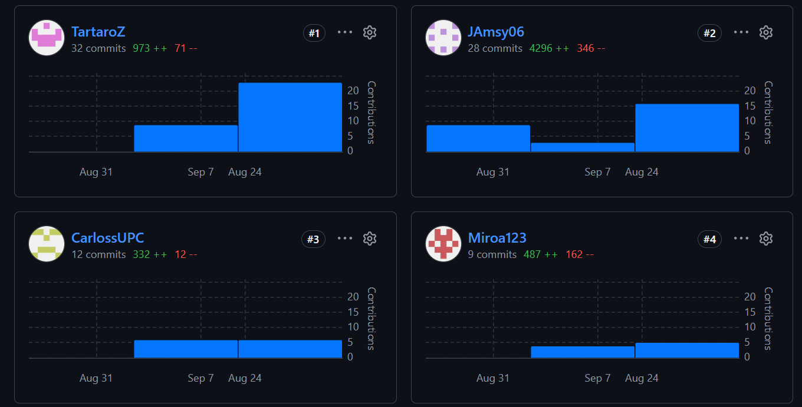
</p>

<p align="center">
  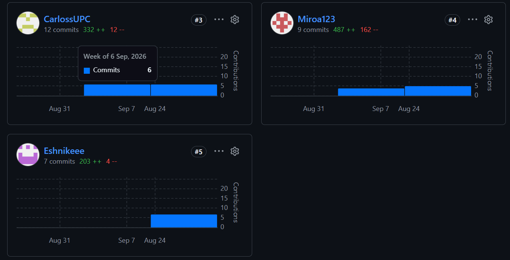
</p>

<p align="center">
  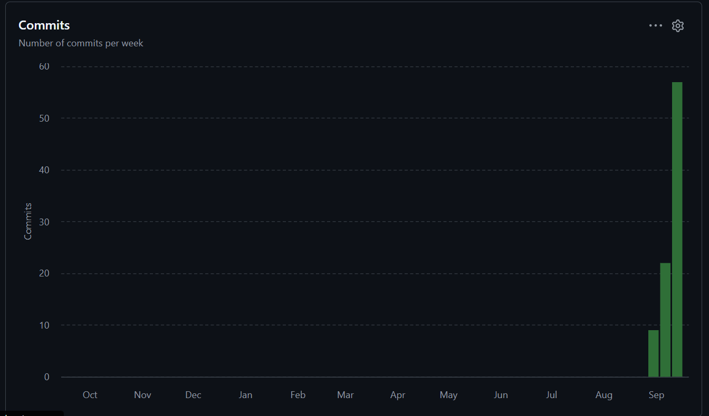
</p>

<div style="page-break-after: always;"></div>

### Entrega TB1:

#### Participación por integrante:

<p align="center">
  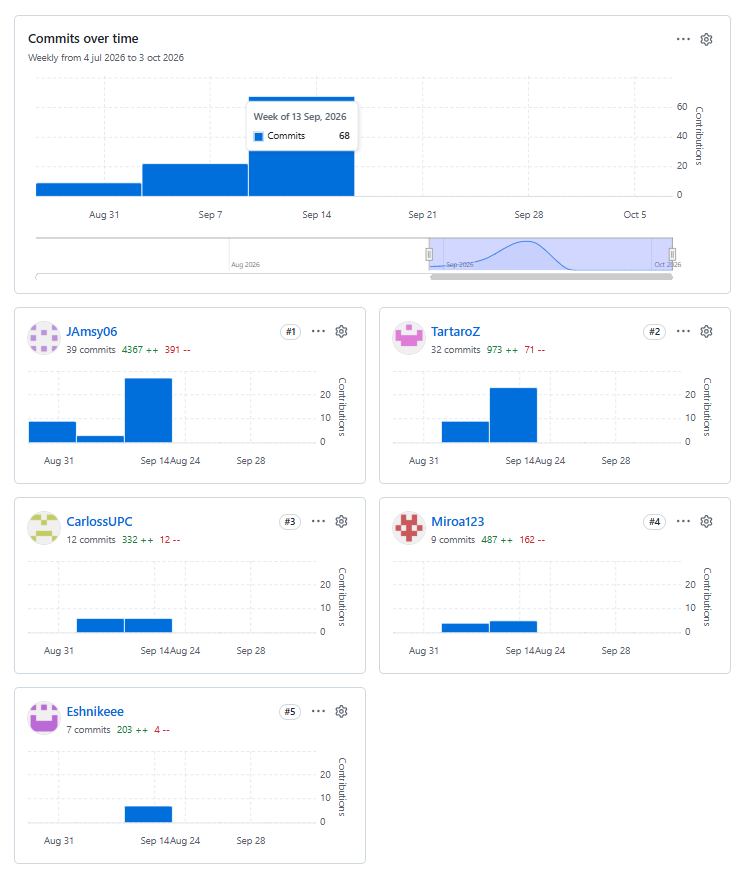
</p>

<p align="center">
  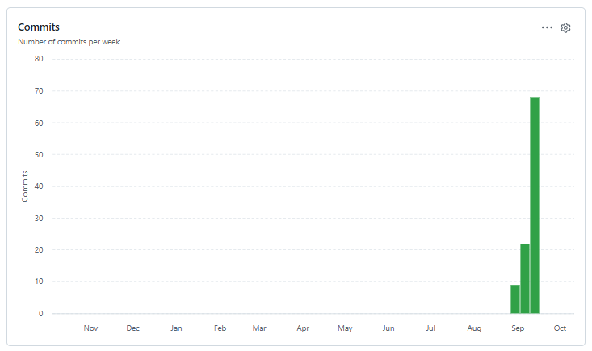
</p>

<div style="page-break-after: always;"></div>

# Contenido

## Índice

- [Registro de Versiones del Informe](#registro-de-versiones-del-informe)
- [Project Report Collaboration Insights](#project-report-collaboration-insights)
- [Contenido](#contenido)
- [Student Outcome](#student-outcome)
- [Capítulo I: Introducción](#capítulo-i-introducción)
    - [1.1. Startup Profile](#11-startup-profile)
        - [1.1.1. Descripción de la Startup](#111-descripción-de-la-startup)
        - [1.1.2. Perfiles de integrantes del equipo](#112-perfiles-de-integrantes-del-equipo)
    - [1.2. Solution Profile](#12-solution-profile)
        - [1.2.1. Antecedentes y problemática](#121-antecedentes-y-problemática)
        - [1.2.2. Lean UX Process](#122-lean-ux-process)
            - [1.2.2.1. Lean UX Problem Statements](#1221-lean-ux-problem-statements)
            - [1.2.2.2. Lean UX Assumptions](#1222-lean-ux-assumptions)
            - [1.2.2.3. Lean UX Hypothesis Statements](#1223-lean-ux-hypothesis-statements)
            - [1.2.2.4. Lean UX Canvas](#1224-lean-ux-canvas)
    - [1.3. Segmentos objetivo](#13-segmentos-objetivo)
- [Capítulo II: Requirements Elicitation & Analysis](#capítulo-ii-requirements-elicitation--analysis)
    - [2.1. Competidores](#21-competidores)
        - [2.1.1. Análisis competitivo](#211-análisis-competitivo)
        - [2.1.2. Estrategias y tácticas frente a competidores](#212-estrategias-y-tácticas-frente-a-competidores)
    - [2.2. Entrevistas](#22-entrevistas)
        - [2.2.1. Diseño de entrevistas](#221-diseño-de-entrevistas)
        - [2.2.2. Registro de entrevistas](#222-registro-de-entrevistas)
        - [2.2.3. Análisis de entrevistas](#223-análisis-de-entrevistas)
    - [2.3. Needfinding](#23-needfinding)
        - [2.3.1. User Personas](#231-user-personas)
        - [2.3.2. User Task Matrix](#232-user-task-matrix)
        - [2.3.3. User Journey Mapping](#233-user-journey-mapping)
        - [2.3.4. Empathy Mapping](#234-empathy-mapping)
    - [2.4. Big Picture Event Storming](#24-big-picture-event-storming)
    - [2.5. Ubiquitous Language](#25-ubiquitous-language)
- [Capítulo III: Requirements Specification](#capítulo-iii-requirements-specification)
    - [3.1. User Stories](#31-user-stories)
    - [3.2. Impact Mapping](#32-impact-mapping)
    - [3.3. Product Backlog](#33-product-backlog)
- [Capítulo IV: Product Design](#capítulo-iv-product-design)
    - [4.1. Style Guidelines](#41-style-guidelines)
        - [4.1.1. General Style Guidelines](#411-general-style-guidelines)
        - [4.1.2. Web Style Guidelines](#412-web-style-guidelines)
    - [4.2. Information Architecture](#42-information-architecture)
        - [4.2.1. Organization Systems](#421-organization-systems)
        - [4.2.2. Labeling Systems](#422-labeling-systems)
        - [4.2.3. SEO Tags and Meta Tags](#423-seo-tags-and-meta-tags)
        - [4.2.4. Searching Systems](#424-searching-systems)
        - [4.2.5. Navigation Systems](#425-navigation-systems)
    - [4.3. Landing Page UI Design](#43-landing-page-ui-design)
        - [4.3.1. Landing Page Wireframe](#431-landing-page-wireframe)
        - [4.3.2. Landing Page Mock-up](#432-landing-page-mock-up)
    - [4.4. Web Applications UX/UI Design](#44-web-applications-uxui-design)
        - [4.4.1. Web Applications Wireframes](#441-web-applications-wireframes)
        - [4.4.2. Web Applications Wireflow Diagrams](#442-web-applications-wireflow-diagrams)
        - [4.4.3. Web Applications Mock-ups](#443-web-applications-mock-ups)
        - [4.4.4. Web Applications User Flow Diagrams](#444-web-applications-user-flow-diagrams)
    - [4.5. Web Applications Prototyping](#45-web-applications-prototyping)
    - [4.6. Domain-Driven Software Architecture](#46-domain-driven-software-architecture)
        - [4.6.1. Design-Level Event Storming](#461-design-level-event-storming)
        - [4.6.2. Software Architecture Context Diagram](#462-software-architecture-context-diagram)
        - [4.6.3. Software Architecture Container Diagram](#463-software-architecture-container-diagram)
        - [4.6.4. Software Architecture Component Diagrams](#464-software-architecture-component-diagrams)
    - [4.7. Software Object-Oriented Design](#47-software-object-oriented-design)
        - [4.7.1. Class Diagrams](#471-class-diagrams)
    - [4.8. Database Design](#48-database-design)
        - [4.8.1. Database Diagrams](#481-database-diagrams)
- [Capítulo V: Product Implementation, Validation & Deployment](#capítulo-v-product-implementation-validation--deployment)
    - [5.1. Software Configuration Management](#51-software-configuration-management)
        - [5.1.1. Software Development Environment Configuration](#511-software-development-environment-configuration)
        - [5.1.2. Source Code Management](#512-source-code-management)
        - [5.1.3. Source Code Style Guide & Conventions](#513-source-code-style-guide--conventions)
        - [5.1.4. Software Deployment Configuration](#514-software-deployment-configuration)
    - [5.2. Landing Page, Services & Applications Implementation](#52-landing-page-services--applications-implementation)
        - [5.2.1. Sprint 1](#521-sprint-1)
            - [5.2.1.1. Sprint Planning 1](#5211-sprint-planning-1)
            - [5.2.1.2. Aspect Leaders and Collaborators](#5212-aspect-leaders-and-collaborators)
            - [5.2.1.3. Sprint Backlog 1](#5213-sprint-backlog-1)
            - [5.2.1.4. Development Evidence for Sprint Review](#5214-development-evidence-for-sprint-review)
            - [5.2.1.5. Execution Evidence for Sprint Review](#5215-execution-evidence-for-sprint-review)
            - [5.2.1.6. Services Documentation Evidence for Sprint Review](#5216-services-documentation-evidence-for-sprint-review)
            - [5.2.1.7. Software Deployment Evidence for Sprint Review](#5217-software-deployment-evidence-for-sprint-review)
            - [5.2.1.8. Team Collaboration Insights during Sprint](#5218-team-collaboration-insights-during-sprint)
        - [5.2.2. Sprint 2](#522-sprint-2)
            - [5.2.2.1. Sprint Planning 2](#5221-sprint-planning-2)
            - [5.2.2.2. Aspect Leaders and Collaborators](#5222-aspect-leaders-and-collaborators)
            - [5.2.2.3. Sprint Backlog 2](#5223-sprint-backlog-2)
            - [5.2.2.4. Development Evidence for Sprint Review](#5224-development-evidence-for-sprint-review)
            - [5.2.2.5. Execution Evidence for Sprint Review](#5225-execution-evidence-for-sprint-review)
            - [5.2.2.6. Services Documentation Evidence for Sprint Review](#5226-services-documentation-evidence-for-sprint-review)
            - [5.2.2.7. Software Deployment Evidence for Sprint Review](#5227-software-deployment-evidence-for-sprint-review)
            - [5.2.2.8. Team Collaboration Insights during Sprint](#5228-team-collaboration-insights-during-sprint)
        - [5.2.3. Sprint 3](#523-sprint-3)
            - [5.2.3.1. Sprint Planning 3](#5231-sprint-planning-3)
            - [5.2.3.2. Aspect Leaders and Collaborators](#5232-aspect-leaders-and-collaborators)
            - [5.2.3.3. Sprint Backlog 3](#5233-sprint-backlog-3)
            - [5.2.3.4. Development Evidence for Sprint Review](#5234-development-evidence-for-sprint-review)
            - [5.2.3.5. Execution Evidence for Sprint Review](#5235-execution-evidence-for-sprint-review)
            - [5.2.3.6. Services Documentation Evidence for Sprint Review](#5236-services-documentation-evidence-for-sprint-review)
            - [5.2.3.7. Software Deployment Evidence for Sprint Review](#5237-software-deployment-evidence-for-sprint-review)
            - [5.2.3.8. Team Collaboration Insights during Sprint](#5238-team-collaboration-insights-during-sprint)
    - [5.3. Validation Interviews]()
            - [5.3.1. Diseño de Entrevistas](#531-diseño-de-entrevistas)
            - [5.3.2. Registro de Entrevistas](#532-registro-de-entrevistas)
            - [5.3.3. Evaluaciones según heuristicas](#533-evaluaciones-segun-heuristicas)
    - [5.4. Video About-the-Product](#54-video-about-the-product)
- [Conclusiones](#conclusiones)
    - [Conclusiones y recomendaciones](#conclusiones-y-recomendaciones)
- [Bibliografía](#bibliografía)
- [Anexos](#anexos)

<div style="page-break-after: always;"></div>

## Student Outcome

El curso contribuye al cumplimiento del Student Outcome ABET:  
**ABET - EAC - Student Outcome 3**

**Criterio:** *Capacidad de comunicarse efectivamente con un rango de audiencias.*

En el siguiente cuadro se describe las acciones realizadas y enunciados de conclusiones por parte del grupo, que permiten sustentar el haber alcanzado el logro del ABET - EAC - Student Outcome 3.


| Criterio específico | Acciones realizadas | Conclusiones |
| :--- | :--- | :--- |
| **Comunica oralmente con efectividad a diferentes rangos de audiencia.** | **Delgado Perez, James Caleb**<br>**AV1:** Participé en la coordinación y comunicación de las decisiones tomadas durante el desarrollo de MaquiGest, explicando al equipo los avances relacionados con la propuesta del producto, el diseño de la Landing Page y la arquitectura de software. Asimismo, comuniqué las decisiones adoptadas para la organización del frontend mediante bounded contexts, las capas de Domain-Driven Design y los diagramas C4 de Context, Container y Components, facilitando que los integrantes comprendieran la estructura y responsabilidades de los diferentes componentes de la solución.<br><br>**TB1:** Durante esta entrega participé en la comunicación y explicación de las decisiones relacionadas con la arquitectura y el desarrollo de MaquiGest. Expliqué al equipo las correcciones realizadas en los diagramas C4, facilitando la comprensión de la estructura y relación entre los componentes de la solución. Asimismo, comuniqué los avances relacionados con la estructura, desarrollo y despliegue de la Landing Page y de la Web Application, explicando las decisiones tomadas durante su implementación. También participé en la revisión de las evidencias de desarrollo y despliegue del Sprint Review, así como en la coordinación de las actividades registradas en Team Collaboration Insights, permitiendo que el equipo mantuviera una comprensión compartida del avance y de las responsabilidades de cada integrante.<br><br>**AV2:** Durante la AV2, coordiné y comuniqué al equipo los avances de implementación e integración del backend de MaquiGest con la Web Application, así como las decisiones relacionadas con la documentación y el despliegue de los servicios. Además, preparé el video About the Product y la presentación About the Team en Canva para explicar el propósito, las funcionalidades y los beneficios de la plataforma a audiencias técnicas y no técnicas. También comuniqué los resultados y evidencias de los apartados Sprint Backlog 3, Development Evidence, Services Documentation Evidence y Software Deployment Evidence del Sprint 3.<br><br>**Montalvo Vasquez, Bruno Rodrigo**<br>**AV1:** Durante el desarrollo de la primera entrega (AV1), lideré y comuniqué las actividades de investigación con usuarios (Needfinding), explicando al equipo la estructuración y el diseño del protocolo de entrevistas aplicadas a los segmentos objetivos. Presenté oralmente los hallazgos cualitativos obtenidos, justificando la definición del Impact Mapping y la derivación de necesidades en User Stories orientadas a generar valor real de negocio. Asimismo, comuniqué y sustenté las decisiones de diseño arquitectónico tomadas para la solución, transmitiendo de forma clara la estructuración de la arquitectura de software a nivel de backend mediante el modelo C4 (Context, Container, Component) y la organización del Product Backlog, asegurando una alineación estratégica del equipo respecto a los límites de dominio y la priorización de requerimientos.<br><br>**TB1:** Durante esta entrega participé en la revisión y coordinación de las correcciones realizadas a los artefactos de análisis y definición del producto. Expliqué al equipo los cambios efectuados en las User Stories y el Product Backlog, especialmente la incorporación de Technical Stories para representar los requerimientos técnicos asociados al RESTful API y las integraciones externas. Asimismo, comuniqué los ajustes realizados al Impact Mapping y la relación entre las necesidades identificadas, las historias de usuario y las funcionalidades planteadas, facilitando que los integrantes comprendieran la justificación de los cambios antes de incorporarlos al informe.<br><br>**AV2:** Durante la AV2, participé en la coordinación de la implementación del backend y comuniqué los criterios de revisión de los artefactos del proyecto. Expliqué los ajustes realizados al Event Storming, las User Stories y el Product Backlog del Sprint 2, así como la organización de las evidencias de ejecución del Sprint 3. Asimismo, compartí con el equipo los hallazgos derivados de las entrevistas de validación y las evaluaciones heurísticas, facilitando la comprensión de las observaciones y de su relación con la propuesta de MaquiGest.<br><br>**Manosalva Tovar, Miroslav Oscar**<br>**AV1:** Durante el desarrollo de la primera entrega de MaquiGest, mi participación se centró en distintos artefactos que posteriormente debían ser explicados y sustentados de manera clara dentro del equipo y durante la presentación del proyecto. En el primer capítulo, estuve a cargo del desarrollo del Lean UX Process, incluyendo la definición del Problem Statement, los diferentes tipos de Assumptions, la formulación de Hypothesis Statements, la elaboración del Lean UX Canvas y la identificación de los segmentos objetivos. Este trabajo me permitió comprender la relación existente entre la problemática identificada, las necesidades de los usuarios, los resultados esperados y las posibles funcionalidades de la solución, facilitando así su explicación de manera estructurada y coherente. Asimismo, en el cuarto capítulo desarrollé los Style Guidelines, considerando los General Style Guidelines y Web Style Guide, además de la Information Architecture, que comprendió Organization Systems, Labeling Systems, SEO Tags and Meta Tags, Searching Systems y Navigation Systems. La elaboración de estos artefactos requirió comprender y comunicar las razones detrás de las decisiones relacionadas con la organización, navegación, presentación y consistencia visual de MaquiGest. Durante el trabajo con el equipo también participé en la revisión de los artefactos y en la explicación de modificaciones realizadas a partir de observaciones e inconsistencias detectadas. El uso del repositorio compartido y del flujo de trabajo basado en ramas permitió mantener organizados los cambios y contar con evidencias concretas para explicar la evolución de las distintas secciones. De esta manera, estas actividades contribuyeron a fortalecer mi capacidad para comunicar oralmente las decisiones tomadas durante el proceso de Lean UX, diseño e Information Architecture, utilizando argumentos sustentados en los artefactos desarrollados y adaptando la explicación según el contexto de trabajo con el equipo y la sustentación académica del proyecto.<br><br>**TB1:** Durante esta entrega participé en la revisión y mejora de distintos artefactos vinculados al proceso de Lean UX y al modelado de la experiencia de usuario de MaquiGest. Entre las principales actividades realizadas se encuentra la corrección del cierre del Problem Statement, incorporando indicadores cuantificables que permiten establecer criterios concretos para evaluar si la propuesta genera valor para los segmentos objetivo. Asimismo, reformulé los Hypothesis Statements para que sigan de manera completa el template de Lean UX, considerando en cada hipótesis el resultado de negocio esperado, los usuarios involucrados, el beneficio que se espera generar para ellos y la funcionalidad propuesta. Este trabajo permitió mejorar la coherencia entre el problema identificado, los assumptions y las hipótesis formuladas. También participé en la reorganización de los User Flows. Debido a que el flujo original resultaba demasiado extenso y complejo de interpretar, se decidió dividirlo en tres diagramas independientes: Authentication and Registration User Flow, Rental Company Core Domain User Flow y Construction Company Core Domain User Flow. Esta división permitió representar de manera más clara los recorridos asociados a cada tipo de usuario y facilitar su explicación durante la revisión del proyecto.<br><br>**AV2:** Durante el Sprint 3, contribuí a la comprensión de la arquitectura y los procesos operativos de la solución mediante la mejora del Design-Level Event Storming, procurando mantener la coherencia entre el diseño estratégico y la implementación táctica del backend. Mi participación en el desarrollo del Bounded Context Equipment me permitió estructurar explicaciones técnicas sobre las reglas de negocio, la gestión de maquinaria, la disponibilidad, los endpoints RESTful y los mecanismos de autorización, relacionando estas implementaciones con las necesidades funcionales del producto. Asimismo, a partir del análisis de las entrevistas de validación realizadas por el equipo, identifiqué aspectos relevantes de la experiencia de los usuarios mediante heurísticas de usabilidad, arquitectura de información e Inclusive Design. Estas actividades me proporcionaron fundamentos técnicos y visuales para comunicar las decisiones de diseño, las funcionalidades desarrolladas y las oportunidades de mejora de manera organizada y comprensible para distintas audiencias. <br><br>**Paredes Chavez, Carlos Augusto**<br>**AV1:** Mi participación se centró en comunicar al equipo los resultados obtenidos durante el análisis de competidores y explicar cómo estos hallazgos podían contribuir a la definición y diferenciación de la propuesta de MaquiGest. Presenté las principales características, fortalezas y limitaciones identificadas en las soluciones analizadas, utilizando un lenguaje claro para facilitar su comprensión y aplicación en el proyecto. Asimismo, coordiné con los integrantes la organización del Sprint Backlog en Trello, explicando la distribución de las historias de usuario, su relación con los Epics y el orden establecido según el valor que aportan al negocio. De esta manera, contribuí a que el equipo mantuviera una comprensión compartida del alcance y de las prioridades del producto.<br><br>**TB1:** Durante esta entrega expliqué al equipo las correcciones realizadas en los diagramas de clases de MaquiGest, especialmente la incorporación de Value Objects, el uso de Money para los atributos monetarios y la revisión de las relaciones entre clases. También expuse la organización del Sprint Backlog 2 y cómo sus historias de usuario se relacionan con el alcance de la entrega. Asimismo, comuniqué las correcciones realizadas en el Product Backlog y la incorporación de Technical Stories, explicando su relación con las funcionalidades de la solución. Procuré presentar estos cambios de forma clara para que los integrantes pudieran revisar y comprender los artefactos antes de integrarlos al informe.<br><br>**AV2:** Durante la AV2, participé en la comunicación de los avances del backend y expliqué al equipo las correcciones realizadas en los diagramas C4, los diagramas de clases, la representación de la arquitectura backend y el diseño de la base de datos. Estas explicaciones ayudaron a relacionar los elementos arquitectónicos con la implementación de los servicios y a mantener criterios comunes para revisar los artefactos técnicos del proyecto. | **AV1:** El AV1 trató de presentar y explicar el avance del proyecto MaquiGest durante el Sprint 1: la problemática y propuesta de valor, los principales artefactos de UX y Product Design, la arquitectura planteada para la solución y, sobre todo, la primera versión funcional y desplegada de la Landing Page. También implicaba explicar cómo se organizó el trabajo del equipo y cómo se aplicaron herramientas y prácticas como GitFlow, GitHub, diseño en Figma y despliegue. El Statement define el AV1 como un Sprint Review de la semana 4, acompañado por el Final Project Keynote y el reporte individual de desempeño.<br><br>**TB1:** Durante la TB1, el equipo fortaleció su capacidad de comunicación oral mediante la revisión y sustentación de las correcciones realizadas a los diferentes artefactos del proyecto. La explicación de los cambios en los diagramas de clases y datos, User Stories, Technical Stories, Product Backlog, Impact Mapping y EventStorming permitió que los integrantes compartieran una comprensión común de las decisiones adoptadas y pudieran justificar los ajustes frente a las observaciones recibidas. Asimismo, la coordinación del Sprint 2 permitió comunicar de manera clara el alcance de las funcionalidades priorizadas y la distribución de responsabilidades entre los integrantes. De esta manera, las actividades realizadas evidencian una mejora en la capacidad del equipo para explicar decisiones de diseño, modelado y planificación utilizando un lenguaje adecuado para sus compañeros y para el contexto de evaluación académica.<br><br>**AV2:** Durante la AV2, la comunicación de los avances de implementación, los cambios arquitectónicos y los hallazgos de validación permitió al equipo CleanCode compartir criterios de trabajo y explicar las decisiones técnicas de MaquiGest. La preparación del video About the Product y de la presentación About the Team contribuyó, además, a presentar el funcionamiento y la propuesta de valor de la solución mediante recursos audiovisuales orientados a distintas audiencias. |
| **Comunica por escrito con efectividad a diferentes rangos de audiencia.** | **Delgado Perez, James Caleb**<br>**AV1:** Contribuí en la elaboración y mejora de la documentación técnica del proyecto MaquiGest. Desarrollé y documenté artefactos correspondientes al diseño de la Landing Page, incluyendo wireframes y mock-ups, y participé en la elaboración de la arquitectura de software mediante diagramas C4 de Context, Container y Components utilizando PlantUML. Asimismo, documenté la arquitectura frontend considerando los bounded contexts IAM, Profiles, Inventory, Rentals, Maintenance y Subscriptions, sus capas Presentation, Application, Domain e Infrastructure, así como los componentes compartidos de Shared Frontend. También participé en la implementación de secciones de la Landing Page, la configuración del despliegue mediante Netlify, el versionamiento con Git y GitHub, y la actualización del informe siguiendo las convenciones y estructura establecidas para el proyecto.<br><br>**TB1:** Durante esta entrega contribuí a la documentación técnica del desarrollo de MaquiGest mediante la actualización y corrección de los diagramas C4 y la documentación de la estructura de la solución. También participé en la documentación de la estructura, desarrollo y despliegue de la Landing Page y de la Web Application. Asimismo, contribuí a organizar y presentar las evidencias correspondientes al desarrollo del Sprint Review y al despliegue del software, además de registrar las actividades de colaboración realizadas durante el Sprint. Estas actividades permitieron mantener una documentación técnica ordenada y trazable sobre la evolución de la solución y facilitaron su revisión por parte del equipo y de los evaluadores.<br><br>**AV2:** Durante la AV2, documenté los apartados del Sprint 3 correspondientes a Sprint Backlog 3, Development Evidence for Sprint Review, Services Documentation Evidence for Sprint Review y Software Deployment Evidence for Sprint Review, incorporando evidencias reales de Swagger UI, Northflank, MySQL Workbench, Vercel y Netlify. Participé en el desarrollo y la integración del backend de MaquiGest y preparé los contenidos del video About the Product y la presentación About the Team en Canva. Estas actividades permitieron organizar los avances técnicos y funcionales del proyecto en formatos comprensibles para el equipo y los evaluadores.<br><br>**Montalvo Vasquez, Bruno Rodrigo**<br>**AV1:** Redacté y documenté rigurosamente los artefactos clave del análisis de usuarios y modelado de dominio en el informe del proyecto. Estructuré la documentación completa del Needfinding, abarcando el diseño de entrevistas, el registro detallado de las entrevistas realizadas y la elaboración del Impact Mapping. Redacté y prioricé las User Stories del Product Backlog aplicando criterios INVEST y el formato estándar del curso. En el ámbito del diseño de software, documenté la arquitectura del backend mediante diagramas C4 (Context, Container y Component) utilizando PlantUML, los diagramas de clases por Bounded Context (IAM, Profiles, Subscriptions, Inventory, Rentals, Maintenance) integrando la descripción narrativa de agregados y value objects, y el diagrama relacional de base de datos (Database Diagram), garantizando la trazabilidad entre las User Stories, el modelo de dominio y la persistencia de datos.<br><br>**TB1:** Durante esta entrega participé en la actualización de la documentación de las User Stories y del Product Backlog, incorporando las correcciones solicitadas y agregando las Technical Stories necesarias para representar los aspectos técnicos del RESTful API y de las integraciones externas. También participé en la corrección del Impact Mapping, mejorando la relación entre los objetivos, actores, necesidades y resultados esperados del producto. Estas modificaciones permitieron mantener una documentación más completa y trazable entre las necesidades del negocio, los requisitos funcionales y los requerimientos técnicos de MaquiGest.<br><br>**AV2:** Durante la AV2, corregí y actualicé los artefactos de Event Storming, las User Stories y el Product Backlog del Sprint 2. También trabajé en la sección Execution Evidence for Sprint Review del Sprint 3, las entrevistas de validación y las evaluaciones heurísticas. Adicionalmente, participé en el desarrollo del backend de MaquiGest. La documentación elaborada permitió presentar de manera estructurada los requisitos, las evidencias de ejecución y los hallazgos de validación del proyecto.<br><br>**Manosalva Tovar, Miroslav Oscar**<br>**AV1:** Mi participación se centró principalmente en la elaboración, revisión y organización de distintos artefactos vinculados con Lean UX, diseño e Information Architecture de MaquiGest. A partir del análisis del problema abordado por el producto, contribuí a documentar los segmentos objetivo y a estructurar el proceso Lean UX mediante la identificación de assumptions, la formulación del Problem Statement y de los Hypothesis Statements, y su posterior síntesis en el Lean UX Canvas. Esta documentación permitió expresar de manera ordenada la relación entre la problemática identificada, las necesidades de los usuarios, los resultados esperados y las funcionalidades propuestas, facilitando que los demás integrantes del equipo pudieran utilizar estos artefactos como base para las siguientes actividades de UX Research y definición de la solución. Asimismo, contribuí a documentar los Style Guidelines y la Information Architecture de la plataforma, estableciendo criterios relacionados con la organización, etiquetado, navegación, búsqueda y presentación del contenido. Estos artefactos fueron redactados procurando mantener coherencia terminológica, claridad en la descripción de los elementos y consistencia con las características definidas para MaquiGest, de modo que pudieran ser comprendidos tanto por los integrantes responsables del diseño como por quienes participarían posteriormente en la implementación.<br><br>**TB1:** Durante esta entrega participé en la mejora y actualización de la documentación de MaquiGest, aplicando las observaciones recibidas durante la primera revisión del proyecto. Una de las principales correcciones realizadas fue la incorporación de métricas cuantificables en el cierre del Problem Statement, con el objetivo de definir criterios verificables para evaluar el valor generado por la solución. También reformulé los Hypothesis Statements para asegurar que cada uno respete completamente el template de Lean UX, identificando de forma explícita el Business Outcome, los usuarios objetivo, el User Outcome o beneficio esperado y la Feature relacionada. De esta manera, se mejoró la trazabilidad entre los problemas identificados, los assumptions y las posibles soluciones planteadas. A partir de la retroalimentación recibida sobre la extensión del User Flow original, participé en su reestructuración y división en tres diagramas: Authentication and Registration User Flow, Rental Company Core Domain User Flow y Construction Company Core Domain User Flow. Esta modificación permitió reducir la complejidad visual del artefacto y mejorar la claridad con la que se comunican los procesos principales de la plataforma.<br><br> <br><br>**AV2:** Durante el Sprint 3, contribuí a la organización y estructuración técnica de la solución mediante el desarrollo del Bounded Context Equipment, aplicando principios de Domain-Driven Design (DDD), CQRS y arquitectura por capas. Implementé contratos de comandos y consultas, interfaces de repositorios independientes de la persistencia, adaptadores JPA y recursos RESTful, siguiendo convenciones que favorecen la legibilidad, mantenibilidad y comprensión del código. Asimismo, participé en la mejora del Design-Level Event Storming, procurando mantener la trazabilidad y consistencia entre los artefactos de diseño estratégico y la implementación del backend. A nivel colaborativo, participé en la creación del repositorio maquigest-platform, organizado bajo el flujo de trabajo GitFlow. Adicionalmente, analicé las entrevistas de validación para realizar una evaluación heurística de la experiencia propuesta, considerando usabilidad, arquitectura de información e Inclusive Design. Estas actividades contribuyeron a mantener una representación técnica coherente de la solución y a fundamentar oportunidades de mejora a partir de evidencias obtenidas de los usuarios. <br><br>**Paredes Chavez, Carlos Augusto**<br>**AV1:** Mi desempeño se enfocó en documentar de manera clara y organizada el análisis de competidores de MaquiGest y en estructurar el Sprint Backlog mediante Trello. En el análisis competitivo, registré información relevante sobre las características, propuestas de valor, fortalezas y debilidades de las alternativas existentes, procurando que los resultados fueran comprensibles y útiles para sustentar las decisiones del equipo. Además, organicé las 35 historias de usuario en el tablero de Trello, incorporando sus descripciones, criterios de aceptación, Epics relacionados y orden de prioridad. Esta información fue presentada con una estructura uniforme y coherente, permitiendo mantener la trazabilidad entre los requisitos definidos en el informe y su representación en la herramienta de gestión del proyecto.<br><br>**TB1:** Contribuí a la actualización del informe mediante las correcciones realizadas al Product Backlog y a los diagramas de clases de Backend, IAM, Profiles, Inventory, Rentals, Maintenance y Subscriptions. Además, documenté la sección Sprint Backlog 2 siguiendo la estructura solicitada en el Project Statement e incorporé la evidencia del tablero de Trello. También participé en la actualización de las historias de usuario y la incorporación de Technical Stories, organizando la información para mantener la relación entre los requisitos, los modelos y la planificación del Sprint. De esta manera, la documentación de esta entrega permitió presentar de forma ordenada la evolución del proyecto y facilitar su revisión por parte del equipo y de los evaluadores.<br><br>**AV2:** Durante la AV2, corregí y actualicé los diagramas C4, los diagramas de clases, la representación de los componentes y la arquitectura del backend, así como el modelo de base de datos de MaquiGest. Además, participé en el desarrollo del backend. Estas correcciones buscaron mantener la coherencia entre los artefactos de diseño, la estructura técnica y la implementación de la solución, facilitando su lectura y revisión. | **AV1:** El AV1 trató de documentar formalmente todo ese avance en el informe del proyecto. Debía incluir carátula, registro de versiones, Collaboration Insights, Student Outcome, los capítulos I, II, III y IV, además del Capítulo V con Software Configuration Management y todo el Sprint 1: planificación, backlog, evidencias de desarrollo, ejecución, despliegue y colaboración. También se pedía tener implementada y desplegada la primera versión de la Landing Page.<br><br>**TB1:** Durante la TB1, la documentación del proyecto se fortaleció mediante la actualización y corrección de los principales artefactos de requisitos, modelado y planificación. La incorporación de Technical Stories, la corrección del Product Backlog y del Impact Mapping, así como la actualización de los diagramas de clases, datos y EventStorming, permitió comunicar por escrito de manera más clara la evolución de MaquiGest y mantener una mejor trazabilidad entre las necesidades del negocio, los requisitos, el diseño y la implementación. Asimismo, la documentación del Sprint 2 y de los anexos permitió organizar la información de la nueva iteración y facilitar su revisión por diferentes integrantes y evaluadores. En conjunto, estas actividades evidencian el fortalecimiento de la capacidad del equipo para producir documentación técnica clara, estructurada y comprensible para diferentes audiencias.<br><br>**AV2:** La documentación elaborada durante la AV2 permitió comunicar de forma organizada los avances del backend, la arquitectura, los requisitos, las evidencias de ejecución, las validaciones y el despliegue de MaquiGest. La actualización de los artefactos del informe y su trazabilidad en los repositorios facilitaron que los integrantes y evaluadores comprendieran la evolución técnica y funcional del proyecto. |


<div style="page-break-after: always;"></div>

# Capítulo I: Introducción

## 1.1. Startup Profile

### 1.1.1. Descripción de la Startup

CleanCode es una startup orientada al desarrollo de soluciones digitales accesibles que permitan organizar y optimizar los procesos de pequeñas y medianas empresas. Su propuesta se enfoca en resolver problemas operativos mediante herramientas especializadas, sencillas de utilizar y adaptadas a las necesidades de sus usuarios.

Como parte de esta iniciativa, CleanCode desarrolla MaquiGest, una plataforma SaaS dirigida principalmente a pequeñas y medianas empresas dedicadas al alquiler de maquinaria y equipos para obras de construcción de pequeña escala. Estas empresas suelen gestionar sus operaciones mediante hojas de cálculo, llamadas, mensajes y sistemas independientes, lo cual dificulta el control de sus equipos y aumenta la posibilidad de cometer errores.

MaquiGest centralizará la gestión del inventario, disponibilidad, reservas, contratos, pagos, entregas, devoluciones, incidencias y mantenimiento de los equipos. De esta manera, permitirá realizar el seguimiento de la maquinaria durante todo su ciclo de alquiler y facilitará la interacción con las personas que necesitan alquilar equipos para sus proyectos personales relacionados con la construcción.

#### Misión

Nuestra misión es facilitar la gestión integral de las pequeñas y medianas empresas dedicadas al alquiler de maquinaria y equipos para construcción mediante una plataforma digital sencilla, accesible y confiable. Buscamos centralizar sus operaciones, reducir errores relacionados con la disponibilidad y las reservas, mejorar el control del estado de los equipos y brindar una mejor experiencia tanto a las empresas como a las personas que alquilan maquinaria.

#### Visión

Nuestra visión es convertirnos en una startup referente en el Perú en soluciones digitales para la gestión del alquiler de maquinaria de construcción, contribuyendo a que las pequeñas y medianas empresas profesionalicen sus operaciones y brinden servicios más eficientes, organizados y confiables.

#### Valores

Nuestros valores principales son los siguientes:

* **Innovación:** Aplicamos tecnología para mejorar y simplificar los procesos tradicionales del alquiler de maquinaria.
* **Simplicidad:** Diseñamos soluciones comprensibles y accesibles para empresas con diferentes niveles de experiencia tecnológica.
* **Responsabilidad:** Promovemos una gestión adecuada de los equipos, la información y las operaciones de alquiler.
* **Colaboración:** Valoramos el trabajo en equipo y la comunicación con las empresas y personas que utilizarán MaquiGest.
* **Calidad:** Buscamos ofrecer una plataforma confiable, organizada y orientada a las necesidades reales de sus usuarios.

### 1.1.2. Perfiles de integrantes del equipo

|   Código   | Nombre completo del integrante  | Descripción de la carrera                                          |                               Fotografía                                | Conocimientos y habilidades                                                                                                                                                                                                                                                                                                                                                                                                                                                                                                                                                                                                                                                                                                                                                                                                                                                                                                                                                                                                             |
| :--------: |:--------------------------------| :----------------------------------------------------------------- |:-----------------------------------------------------------------------:| :-------------------------------------------------------------------------------------------------------------------------------------------------------------------------------------------------------------------------------------------------------------------------------------------------------------------------------------------------------------------------------------------------------------------------------------------------------------------------------------------------------------------------------------------------------------------------------------------------------------------------------------------------------------------------------------------------------------------------------------------------------------------------------------------------------------------------------------------------------------------------------------------------------------------------------------------------------------------------------------------------------------------------------------- |
| U202115277 | Delgado Perez, James Caleb      | Ingeniería de Software - Universidad Peruana de Ciencias Aplicadas |  | Soy estudiante de Ingeniería de Software y me apasiona la creación de productos digitales que simplifiquen procesos y ayuden a las personas a ahorrar tiempo para enfocarse en lo que realmente importa. Me motiva transformar problemas en soluciones prácticas, eficientes y con impacto real. Actualmente estoy fortaleciendo mis conocimientos en C# y tengo experiencia con C++, HTML, CSS, JavaScript y Java, este último desarrollado durante el curso de Diseño y Patrones de Software. Me interesa especialmente el área de frontend, bases de datos y aplicaciones web. Lo que más me motiva de este proyecto es que representa una gran oportunidad para incorporarme al mundo laboral, adquirir nuevos conocimientos y seguir fortaleciendo mi perfil profesional. Además, me considero una persona organizada, que aprende rápido y que trabaja bien en equipo. Fuera del ámbito académico y tecnológico, me gustan los deportes, y también encuentro en la programación y la música una forma de expresión y creatividad. |
| U202111529 | Montalvo Vasquez, Bruno Rodrigo | Ingeniería de Software - Universidad Peruana de Ciencias Aplicadas |  | Soy Bruno Rodrigo Montalvo Vasquez, estudiante de la carrera de Ingeniería de Software. Me encuentro interesado y motivado por aprender nuevos temas relacionados con mi carrera. Asimismo, estoy abierto a trabajar con profesionales de mi área académica para mejorar mis conocimientos, adquirir experiencia y fortalecer mis habilidades de trabajo en equipo.                                                                                                                                                                                                                                                                                                                                                                                                                                                                                                                                                                                                                                                                     |           
| U202410211 | Manosalva Tovar, Miroslav       | Ingeniería de Software - Universidad Peruana de Ciencias Aplicadas |  | Soy Miroslav Manosalva Tovar, estudiante de Ingeniería de Software. Tengo conocimientos en el área de programación y experiencia en la elaboración de interfaces de usuario (UI), que puedo aportar al desarrollo de MaquiGest. Mi experiencia trabajando con interfaces me permite contribuir a la presentación de la información y a la organización visual de las funcionalidades de la plataforma. Me considero una persona responsable y persistente: procuro cumplir con las actividades que asumo y mantener el esfuerzo cuando encuentro dificultades. En este proyecto, busco aplicar mis conocimientos de programación y diseño de interfaces, seguir fortaleciendo mi formación y contribuir al desarrollo de una solución útil para sus usuarios. |
| U202219829 | Daga Chávez, Joaquin Leonardo   | Ingeniería de Software - Universidad Peruana de Ciencias Aplicadas |  | Soy estudiante de Ingeniería de Software con conocimientos en desarrollo de aplicaciones web, programación y bases de datos. Tengo experiencia trabajando con tecnologías como Java, Spring Boot, JavaScript, Angular y Vue, además de herramientas como Git y GitHub. Me considero una persona responsable, organizada y orientada al aprendizaje continuo. En este proyecto busco aplicar mis conocimientos, fortalecer mis habilidades técnicas y contribuir al trabajo colaborativo del equipo. |
| U202321613 | Paredes Chávez, Carlos Augusto   | Ingeniería de Software - Universidad Peruana de Ciencias Aplicadas |  | Soy estudiante de Ingeniería de Software y tengo experiencia en el desarrollo de aplicaciones web, principalmente utilizando HTML, CSS, JavaScript, TypeScript y frameworks modernos. También cuento con conocimientos en bases de datos, control de versiones con Git y GitHub, y desarrollo tanto frontend como backend. Me interesa especialmente crear soluciones digitales funcionales, bien estructuradas y con una buena experiencia de usuario. Me considero una persona constante, responsable y con facilidad para aprender nuevas tecnologías. Busco seguir fortaleciendo mis conocimientos mediante proyectos prácticos que me permitan mejorar mis habilidades técnicas y prepararme para desenvolverme profesionalmente en el área de desarrollo de software. |

## 1.2. Solution Profile

### 1.2.1. Antecedentes y problemática

Actualmente, muchas pequeñas y medianas empresas dedicadas al alquiler de maquinaria y equipos para construcción gestionan sus operaciones mediante herramientas dispersas, como hojas de cálculo, documentos físicos, llamadas telefónicas y aplicaciones de mensajería. Aunque estos medios permiten registrar información básica, no proporcionan una visión integrada y actualizada sobre la disponibilidad, ubicación, condición y mantenimiento de cada equipo.

El alquiler de maquinaria comprende distintas actividades que deben mantenerse coordinadas, entre ellas el registro del inventario, la consulta de disponibilidad, la creación de reservas, la elaboración de contratos, el registro de pagos, la programación de entregas, la recepción de devoluciones y la atención de incidencias. Cuando esta información se encuentra distribuida en diferentes medios, aumenta la posibilidad de generar reservas duplicadas, asignar equipos que no se encuentran disponibles, perder el seguimiento de los contratos o retrasar los mantenimientos correspondientes.

Esta situación también afecta a pequeñas empresas constructoras y contratistas que necesitan alquilar maquinaria para ejecutar proyectos de construcción de pequeña y mediana escala. La comunicación con las empresas proveedoras suele realizarse mediante llamadas telefónicas o aplicaciones de mensajería, lo que puede dificultar la consulta de equipos disponibles, las condiciones de alquiler, los costos y el seguimiento de las reservas o alquileres solicitados. Esta falta de información centralizada puede afectar la planificación de los recursos necesarios para ejecutar sus proyectos.

Existen plataformas orientadas a empresas de alquiler de gran escala; sin embargo, estas pueden resultar complejas o poco accesibles para negocios pequeños y medianos que necesitan organizar sus operaciones sin incorporar sistemas sobredimensionados. Asimismo, las pequeñas empresas constructoras y contratistas requieren mecanismos más claros para consultar y gestionar el alquiler de los equipos necesarios para sus proyectos.

En consecuencia, se identifica la oportunidad de desarrollar una solución especializada que centralice el ciclo de alquiler y facilite la interacción entre las empresas proveedoras de maquinaria y las organizaciones que requieren alquilar estos equipos.

MaquiGest abordará esta problemática mediante una plataforma SaaS que permitirá administrar en un único entorno el inventario, la disponibilidad, las reservas, los contratos, los pagos, las entregas, las devoluciones, las incidencias y el mantenimiento. De esta manera, las pequeñas y medianas empresas de alquiler podrán mantener un mayor control sobre sus equipos y operaciones, mientras que las pequeñas empresas constructoras y contratistas podrán buscar maquinaria, consultar su disponibilidad, realizar solicitudes de alquiler y dar seguimiento a los equipos requeridos para sus proyectos.

#### 5W & 2H

**Who (¿Quiénes?)**

La problemática afecta principalmente a los propietarios, administradores y trabajadores de pequeñas y medianas empresas dedicadas al alquiler de maquinaria y equipos para construcción. También afecta a pequeñas empresas constructoras y contratistas que necesitan alquilar maquinaria para ejecutar proyectos de construcción de pequeña y mediana escala.

**What (¿Qué?)**

El problema principal es la ausencia de una plataforma especializada que permita gestionar de manera integrada el ciclo de alquiler de maquinaria. La información relacionada con inventario, disponibilidad, reservas, contratos, pagos, entregas, devoluciones, incidencias y mantenimiento suele encontrarse distribuida entre diferentes herramientas y medios de comunicación.

Del lado de las empresas constructoras y contratistas, esta fragmentación también dificulta la búsqueda de equipos, la consulta de disponibilidad, el conocimiento de las condiciones de alquiler y el seguimiento de las solicitudes realizadas.

**Where (¿Dónde?)**

La problemática se presenta tanto en las operaciones internas de las pequeñas y medianas empresas de alquiler como en la interacción que mantienen con pequeñas empresas constructoras y contratistas.

Abarca la gestión administrativa y operativa del negocio de alquiler, así como los procesos mediante los cuales las empresas constructoras buscan, reservan, reciben, utilizan y devuelven la maquinaria necesaria para sus proyectos.

**When (¿Cuándo?)**

La problemática puede manifestarse durante cualquier etapa del ciclo de alquiler: cuando una empresa constructora consulta la disponibilidad de un equipo, solicita una reserva, acuerda las condiciones del alquiler, realiza un pago, recibe la maquinaria, comunica una incidencia o efectúa la devolución.

También puede presentarse internamente cuando la empresa de alquiler necesita verificar disponibilidad, preparar una entrega, actualizar el estado de un equipo, registrar una devolución o programar su mantenimiento.

**Why (¿Por qué?)**

La problemática ocurre porque muchas de las herramientas utilizadas actualmente no se encuentran integradas y requieren que la información sea registrada, actualizada o comprobada manualmente.

Además, algunas soluciones existentes están orientadas a empresas con operaciones de mayor escala y pueden resultar excesivamente complejas o poco accesibles para pequeñas y medianas empresas que necesitan gestionar sus procesos de alquiler de forma más sencilla.

Por otro lado, las pequeñas empresas constructoras y contratistas suelen depender de llamadas o aplicaciones de mensajería para conocer la disponibilidad y condiciones de los equipos, lo que dificulta contar con información centralizada durante la planificación de sus proyectos.

**How (¿Cómo?)**

Las empresas de alquiler revisan y actualizan manualmente hojas de cálculo, documentos, llamadas y conversaciones por mensajería para determinar el estado de sus equipos y alquileres.

De forma paralela, las empresas constructoras y contratistas deben comunicarse directamente con los proveedores para consultar qué maquinaria se encuentra disponible, conocer sus condiciones y realizar seguimiento a sus solicitudes.

Esta forma de trabajo puede producir información desactualizada, registros duplicados, conflictos de disponibilidad, dificultades de coordinación y pérdida de trazabilidad durante el proceso de alquiler.

**How Much (¿Cuánto impacta?)**

El impacto se refleja en el tiempo empleado para comprobar y actualizar información, los posibles conflictos de disponibilidad, los retrasos en las entregas y devoluciones, la inmovilización de equipos que requieren mantenimiento y la pérdida de oportunidades de alquiler.

Para las pequeñas empresas constructoras y contratistas, también puede generar retrasos en la obtención de maquinaria, dificultades para planificar recursos y una mayor dependencia de comunicaciones manuales con los proveedores.

Estas situaciones pueden afectar la eficiencia operativa de ambas partes y la calidad de la relación entre proveedor y cliente. La dimensión cuantitativa del impacto será determinada posteriormente mediante entrevistas, validaciones y la investigación realizada con los segmentos objetivo.

#### Objetivos

**Corto plazo**

* Identificar y validar las necesidades principales de las empresas de alquiler y de las personas que solicitan maquinaria.
* Diseñar una experiencia digital comprensible para los dos segmentos objetivo.
* Implementar y desplegar la primera versión del Landing Page de MaquiGest.
* Definir las funcionalidades iniciales relacionadas con inventario, disponibilidad, reservas y alquileres.

**Mediano plazo**

* Implementar progresivamente la gestión de contratos, pagos, entregas, devoluciones, incidencias y mantenimiento.
* Integrar la Web Application con el RESTful API desarrollado por el equipo.
* Incorporar un servicio externo que complemente las funcionalidades de la plataforma.
* Mejorar el producto a partir de las entrevistas y validaciones realizadas con los segmentos objetivo.

**Largo plazo**

* Conseguir una adopción recurrente de MaquiGest por parte de pequeñas y medianas empresas del sector.
* Reducir los errores relacionados con reservas, disponibilidad y seguimiento de equipos.
* Incorporar nuevas herramientas de análisis y seguimiento de las operaciones.
* Posicionar MaquiGest como una solución especializada para la gestión del alquiler de maquinaria de construcción.

#### Restricciones

* MaquiGest debe desarrollarse como una solución web distribuida compuesta por un Landing Page, una Web Application y un RESTful API propio.
* La lógica del lado servidor debe desarrollarse con Java y tecnologías open-source, conforme a los lineamientos del curso.
* La plataforma debe integrar al menos un servicio externo de terceros.
* La interfaz debe adaptarse a las dimensiones de computadoras, tabletas y dispositivos móviles.
* La experiencia visual y funcional debe ser consistente entre el Landing Page y la Web Application.
* Los call-to-action del Landing Page deben dirigir a las vistas correspondientes de la Web Application.
* El funcionamiento de la plataforma dependerá de una conexión a Internet para consultar y actualizar la información.
* El alcance de la primera versión debe priorizar las funcionalidades principales que puedan desarrollarse dentro del ciclo académico.
* El código y la documentación deben gestionarse en repositorios públicos de la organización de GitHub de CleanCode.
* El equipo debe aplicar GitFlow y Conventional Commits durante la evolución del proyecto.

### 1.2.2. Lean UX Process

#### 1.2.2.1. Lean UX Problem Statements

Actualmente, muchas pequeñas y medianas empresas dedicadas al alquiler de maquinaria y equipos para construcción gestionan sus operaciones mediante herramientas dispersas, como hojas de cálculo, documentos, llamadas telefónicas y aplicaciones de mensajería. Esta forma de trabajo dificulta mantener información centralizada y actualizada sobre inventario, disponibilidad, reservas, contratos, pagos, entregas, devoluciones, incidencias y mantenimiento. Como consecuencia, pueden presentarse conflictos de disponibilidad, registros duplicados, retrasos operativos y pérdida de trazabilidad durante el ciclo de alquiler.

Esta problemática también afecta a pequeñas empresas constructoras y contratistas que necesitan alquilar maquinaria para ejecutar proyectos de construcción de pequeña y mediana escala. Estas empresas suelen depender de comunicaciones directas con los proveedores para consultar la disponibilidad de los equipos, conocer las condiciones de alquiler y realizar seguimiento a sus solicitudes, lo que puede dificultar la planificación de los recursos necesarios para sus proyectos.

Aunque existen soluciones digitales orientadas a la gestión del alquiler de maquinaria y equipos, algunas están dirigidas a organizaciones con operaciones de mayor escala y pueden resultar excesivamente complejas o poco accesibles para pequeñas y medianas empresas. Esta situación representa para CleanCode la oportunidad de desarrollar una solución especializada que facilite la gestión del ciclo de alquiler y la interacción entre las empresas proveedoras de maquinaria y las pequeñas empresas constructoras y contratistas que requieren estos equipos.

MaquiGest abordará esta oportunidad mediante una plataforma SaaS que centralizará la gestión del inventario, disponibilidad, reservas, alquileres, contratos, pagos, entregas, devoluciones, incidencias y mantenimiento. La plataforma permitirá a las empresas de alquiler mantener un mayor control sobre sus equipos y operaciones, mientras que las empresas constructoras y contratistas podrán buscar maquinaria, consultar su disponibilidad, realizar solicitudes y dar seguimiento a sus alquileres.

El desarrollo de MaquiGest estará sujeto a las restricciones definidas para el proyecto. La solución deberá implementarse como una aplicación web distribuida compuesta por un Landing Page, una Web Application y un RESTful API propio; la lógica del servidor deberá desarrollarse con Java y tecnologías open-source; deberá integrarse al menos un servicio externo; y la interfaz deberá adaptarse a computadoras, tabletas y dispositivos móviles. Debido al alcance del ciclo académico, la primera versión priorizará las funcionalidades relacionadas con inventario, disponibilidad, reservas y alquileres.

Sabremos que MaquiGest está generando valor cuando, durante una etapa inicial de validación, al menos 10 pequeñas y medianas empresas de alquiler utilicen recurrentemente la plataforma para gestionar sus operaciones, se registren al menos 50 equipos con información actualizada sobre su estado y disponibilidad, se gestionen al menos 30 reservas o alquileres mediante la plataforma y al menos 5 pequeñas empresas constructoras o contratistas realicen solicitudes de alquiler utilizando MaquiGest.

Asimismo, se buscará registrar menos de 5 conflictos de disponibilidad o reservas duplicadas durante el período de evaluación. Estos resultados serán analizados mediante las métricas de uso de la plataforma, los registros de las operaciones realizadas y las validaciones efectuadas con los segmentos objetivo.
#### 1.2.2.2. Lean UX Assumptions

**Business Assumptions:**

- Creemos que las pequeñas y medianas empresas dedicadas al alquiler de maquinaria para construcción presentan dificultades para mantener actualizada y centralizada la información sobre inventario, disponibilidad, reservas, alquileres y mantenimiento cuando utilizan hojas de cálculo, documentos, llamadas y aplicaciones de mensajería.

- Creemos que estas empresas estarían dispuestas a reemplazar parte de sus procesos manuales por una plataforma web si esta les permite centralizar la información y reducir problemas relacionados con disponibilidad, seguimiento y duplicidad de registros.

- Creemos que las empresas de alquiler estarían dispuestas a pagar una suscripción mensual por MaquiGest si perciben que la plataforma reduce el tiempo requerido para gestionar sus operaciones y facilita el control de sus equipos.

- Creemos que un modelo de suscripción con diferentes niveles puede adaptarse a empresas con distintos tamaños de inventario y necesidades operativas, siempre que cada plan ofrezca funcionalidades y capacidades diferenciadas.

- Creemos que existe una oportunidad para una solución especializada en pequeñas y medianas empresas frente a plataformas de alquiler orientadas a organizaciones con operaciones de mayor escala o complejidad.

**Business Outcome Assumptions:**

- Creemos que la adopción de MaquiGest podrá evidenciarse mediante un crecimiento en el número de empresas que registran maquinaria y utilizan recurrentemente las funcionalidades de disponibilidad, reservas y alquileres.

- Creemos que las empresas continuarán utilizando MaquiGest si experimentan una reducción de problemas relacionados con reservas duplicadas, información desactualizada y desconocimiento del estado de sus equipos.

- Creemos que el uso frecuente de las funcionalidades de inventario, reservas, alquileres y mantenimiento será un indicador de que MaquiGest está siendo incorporado dentro de las operaciones habituales de las empresas.

- Creemos que algunas empresas estarán dispuestas a migrar hacia planes de mayor nivel cuando aumenten la cantidad de equipos gestionados o necesiten funcionalidades adicionales.

- Creemos que la participación de pequeñas empresas constructoras y contratistas incrementará la cantidad de solicitudes y operaciones de alquiler gestionadas mediante la plataforma.

**User Assumptions:**

- Creemos que los propietarios y administradores de pequeñas y medianas empresas de alquiler necesitan conocer el estado, ubicación, disponibilidad y condición de sus equipos para organizar sus operaciones.

- Creemos que los trabajadores responsables de gestionar los alquileres necesitan consultar y actualizar reservas, contratos, entregas, devoluciones e incidencias sin depender de información distribuida entre diferentes herramientas.

- Creemos que las pequeñas empresas constructoras y contratistas necesitan encontrar maquinaria disponible en función de los requerimientos y fechas de sus proyectos.

- Creemos que los responsables de gestionar el alquiler de maquinaria dentro de empresas constructoras necesitan conocer con anticipación la disponibilidad, características, costos y condiciones de los equipos antes de realizar una solicitud.

- Creemos que las empresas constructoras y contratistas necesitan realizar seguimiento a sus reservas y alquileres para coordinar adecuadamente la recepción, utilización y devolución de la maquinaria.

**User Outcome and Benefit Assumptions:**

- Creemos que los administradores de empresas de alquiler podrán tomar mejores decisiones operativas si pueden identificar rápidamente qué equipos están disponibles, reservados, alquilados o en mantenimiento.

- Creemos que los trabajadores responsables de las operaciones de alquiler podrán reducir errores y tiempo de coordinación si la información sobre reservas, entregas y devoluciones se mantiene actualizada en un único sistema.

- Creemos que disponer de un historial de incidencias y mantenimiento permitirá a las empresas identificar equipos que necesitan inspección o reparación antes de volver a ofrecerlos en alquiler.

- Creemos que las pequeñas empresas constructoras y contratistas podrán encontrar con mayor rapidez la maquinaria requerida si pueden consultar equipos mediante criterios como categoría, disponibilidad y características.

- Creemos que disponer de información clara sobre costos, condiciones y fechas de alquiler permitirá a las empresas constructoras planificar mejor los recursos y gastos asociados a sus proyectos.

- Creemos que la posibilidad de consultar el estado de una reserva o alquiler reducirá la dependencia de llamadas y mensajes para realizar seguimiento a las solicitudes.

**Feature Assumptions:**

- Creemos que un módulo de inventario que permita registrar características, ubicación, condición y estado de disponibilidad facilitará a las empresas conocer la situación actual de cada equipo.

- Creemos que un sistema de reservas que compruebe la disponibilidad antes de confirmar una solicitud ayudará a evitar la asignación de un mismo equipo a alquileres incompatibles.

- Creemos que un módulo de gestión de alquileres que integre contratos, tarifas, pagos, entregas y devoluciones facilitará el seguimiento del proceso desde la reserva hasta la devolución del equipo.

- Creemos que un módulo de mantenimiento con historial de inspecciones, incidencias, reparaciones y mantenimientos programados permitirá identificar equipos que temporalmente no deberían encontrarse disponibles para alquiler.

- Creemos que una interfaz de búsqueda permitirá a las empresas constructoras y contratistas localizar maquinaria adecuada según las necesidades de sus proyectos.

- Creemos que una funcionalidad para consultar disponibilidad permitirá a las empresas constructoras evaluar si un equipo puede ser utilizado durante las fechas requeridas antes de realizar una solicitud.

- Creemos que una sección de seguimiento de reservas y alquileres permitirá a las empresas constructoras consultar el estado de sus solicitudes, períodos de alquiler, costos y fechas previstas de devolución.

#### 1.2.2.3. Lean UX Hypothesis Statements

* Creemos que lograremos incrementar el uso recurrente de MaquiGest si los administradores de pequeñas y medianas empresas de alquiler pueden conocer rápidamente el estado, ubicación, condición y disponibilidad de sus equipos mediante un módulo centralizado de gestión de inventario.

* Creemos que lograremos disminuir los conflictos de disponibilidad y reservas duplicadas si los trabajadores responsables de las operaciones de alquiler pueden confirmar una reserva con mayor seguridad al conocer previamente la disponibilidad del equipo mediante un sistema de gestión de reservas con validación de disponibilidad.

* Creemos que lograremos incrementar la cantidad de operaciones de alquiler gestionadas mediante MaquiGest si los trabajadores de las empresas de alquiler pueden realizar el seguimiento del proceso de alquiler desde su formalización hasta la devolución del equipo mediante un módulo integrado de gestión de alquileres que centralice contratos, tarifas, pagos, entregas y devoluciones.

* Creemos que lograremos incrementar la trazabilidad de los equipos durante los alquileres si los trabajadores de las empresas de alquiler pueden registrar y consultar los problemas ocurridos durante su utilización mediante una funcionalidad de gestión de incidencias.

* Creemos que lograremos disminuir la cantidad de equipos que permanecen fuera de operación debido a mantenimientos no atendidos si los administradores de las empresas de alquiler pueden identificar oportunamente los equipos que requieren inspección o reparación mediante un módulo de mantenimiento con historial y programación de intervenciones.

* Creemos que lograremos incrementar la cantidad de solicitudes de alquiler realizadas mediante MaquiGest si los responsables de pequeñas empresas constructoras y contratistas pueden encontrar con mayor rapidez maquinaria adecuada para sus proyectos mediante una interfaz de búsqueda con filtros por categoría y características.

* Creemos que lograremos disminuir las solicitudes realizadas sobre equipos no disponibles si los responsables de pequeñas empresas constructoras y contratistas pueden verificar si la maquinaria estará disponible durante las fechas requeridas mediante una funcionalidad de consulta de disponibilidad.

* Creemos que lograremos incrementar la cantidad de solicitudes de alquiler iniciadas mediante la plataforma si los responsables de pequeñas empresas constructoras y contratistas pueden evaluar con mayor facilidad si un equipo responde a las necesidades y presupuesto de su proyecto mediante una vista que muestre características, costos y condiciones de alquiler.

* Creemos que lograremos incrementar el uso recurrente de MaquiGest por parte de pequeñas empresas constructoras y contratistas si sus responsables pueden conocer fácilmente el estado y las fechas relevantes de sus reservas y alquileres mediante una interfaz de seguimiento de alquileres.

#### 1.2.2.4. Lean UX Canvas


## 1.3. Segmentos objetivo

**Segmento #1: Pequeñas y medianas empresas de alquiler de maquinaria**

Empresas dedicadas al alquiler de maquinaria y equipos utilizados principalmente en construcción, remodelación, movimiento de tierras y obras civiles. 

* Aspectos demográficos:
  - Edades: aproximadamente 30–55 años. 
  - Ubicación: principalmente zonas urbanas donde existe concentración de actividad empresarial y construcción.
* Aspectos psicográficos:
  - Comportamiento tecnológico: utiliza computadora y smartphone para gestionar el negocio; suele utilizar WhatsApp, Excel, correo electrónico y sistemas administrativos básicos.
  - Motivación: reducir pérdidas, mantener los equipos disponibles y tener mayor control sobre el negocio.

**Segmento #2: Pequeñas empresas constructoras**

Pequeñas empresas constructoras y contratistas que necesitan alquilar maquinaria para ejecutar proyectos de construcción de pequeña y mediana escala. 

* Aspectos demográficos:
  - Edades: aproximadamente 28–50 años. 
  - Ubicación: zonas urbanas y áreas con actividad constructiva. 
* Aspectos psicográficos:
  - Comportamiento: Prefieren procesos de solicitud simples y rápidos.
  - Motivación: reducir costos y evitar retrasos en sus proyectos.

<div style="page-break-before: always;"></div>

# Capítulo II: Requirements Elicitation & Analysis

## 2.1. Competidores

En esta sección se analizan soluciones digitales que actualmente brindan soporte a empresas dedicadas al alquiler de equipos y otros activos, con el objetivo de conocer las alternativas existentes e identificar oportunidades de diferenciación para MaquiGest.

Para el análisis se han seleccionado **Booqable, EZRentOut y Point of Rental**, debido a que cuentan con modelos de negocio basados en productos digitales relacionados directamente con la gestión de alquileres. Booqable ofrece una plataforma SaaS para la administración de inventario, pedidos y reservas; EZRentOut se especializa en la gestión de alquiler de equipos e incorpora funcionalidades de mantenimiento y seguimiento de activos; mientras que Point of Rental ofrece soluciones de gestión para empresas de alquiler de distintos tamaños, incluyendo aquellas vinculadas al alquiler de herramientas y maquinaria.

### 2.1.1. Análisis competitivo

A través del presente análisis se busca conocer la posición de MaquiGest frente a soluciones digitales consolidadas dentro del mercado de gestión de alquileres. La comparación permite identificar las principales fortalezas, debilidades, oportunidades y amenazas relacionadas con cada alternativa y determinar posibles características diferenciales para la propuesta de CleanCode.


<table>
  <thead>
    <tr>
      <th colspan="6">Competitive Analysis Landscape</th>
    </tr>
    <tr>
      <td colspan="2"><strong>¿Por qué llevar a cabo este análisis?</strong></td>
      <td colspan="4">¿Cómo puede MaquiGest posicionarse como una alternativa especializada para pequeñas y medianas empresas dedicadas al alquiler de maquinaria y equipos para construcción frente a soluciones digitales de gestión de alquiler ya existentes?</td>
    </tr>
    <tr>
      <td colspan="2"><strong>(En la cabecera colocar por cada competidor nombre y logo)</strong></td>
      <th>
        MaquiGest<br>
        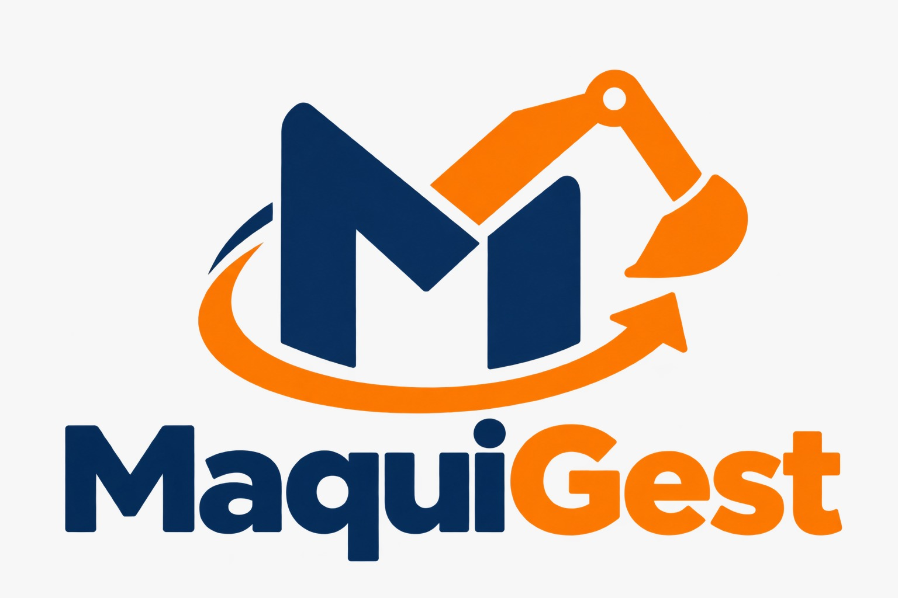
      </th>
      <th>
        Booqable<br>
        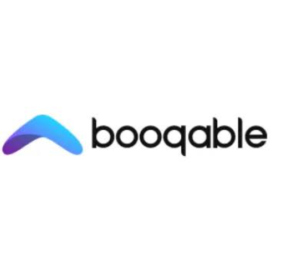
      </th>
      <th>
        EZRentOut<br>
        
      </th>
      <th>
        Point of Rental<br>
        
      </th>
    </tr>
  </thead>
  <tbody>
    <tr>
      <th rowspan="2">Perfil</th>
      <td><strong>Overview</strong></td>
      <td>Plataforma SaaS desarrollada por CleanCode para centralizar el ciclo de alquiler de maquinaria y equipos para construcción. Contempla la gestión de inventario, disponibilidad, reservas, contratos, pagos, entregas, devoluciones, incidencias y mantenimiento.</td>
      <td>Plataforma SaaS orientada a empresas de alquiler. Integra gestión de inventario, pedidos, disponibilidad, reservas, presupuestos, contratos, facturas, pagos y reservas online.</td>
      <td>Plataforma especializada en empresas de alquiler de equipos. Integra inventario, disponibilidad, reservas, devoluciones, mantenimiento, facturación y seguimiento de los equipos dentro de una misma solución.</td>
      <td>Plataforma cloud para empresas de alquiler de diferentes industrias. Permite gestionar inventario, contratos, facturación, disponibilidad, mantenimiento, comercio electrónico, clientes y reportes.</td>
    </tr>
    <tr>
      <td><strong>Ventaja competitiva</strong><br>¿Qué valor ofrece a los clientes?</td>
      <td>Busca diferenciarse mediante una experiencia especializada para pequeñas y medianas empresas dedicadas al alquiler de maquinaria para construcción, priorizando simplicidad, centralización y trazabilidad durante todo el ciclo de alquiler.</td>
      <td>Ofrece una puesta en marcha sencilla, disponibilidad en tiempo real y un conjunto amplio de herramientas para gestionar alquileres y recibir reservas online desde una misma plataforma.</td>
      <td>Ofrece una cobertura amplia del ciclo de los equipos, integrando alquiler, mantenimiento, órdenes de trabajo, facturación y herramientas avanzadas de seguimiento de activos.</td>
      <td>Cuenta con una trayectoria consolidada en software de alquiler y ofrece un ecosistema escalable que permite crecer desde operaciones pequeñas hasta empresas con múltiples ubicaciones y mayores necesidades operativas.</td>
    </tr>
    <tr>
      <th rowspan="2">Perfil de Marketing</th>
      <td><strong>Mercado objetivo</strong></td>
      <td>Pequeñas y medianas empresas dedicadas al alquiler de maquinaria y equipos utilizados principalmente en obras de construcción de pequeña escala, además de personas interesadas en alquilar dichos equipos.</td>
      <td>Operadores independientes, pequeñas empresas, negocios de alquiler en crecimiento y empresas con múltiples ubicaciones pertenecientes a distintas industrias.</td>
      <td>Empresas dedicadas al alquiler de equipos y, mediante sus planes de mayor nivel, compañías con múltiples ubicaciones y operaciones relacionadas con maquinaria pesada.</td>
      <td>Empresas de alquiler de herramientas, equipos, eventos, maquinaria y otros activos, desde negocios en crecimiento hasta organizaciones con operaciones de mayor escala.</td>
    </tr>
    <tr>
      <td><strong>Estrategias de marketing</strong></td>
      <td>Se plantea utilizar presencia digital, contenido relacionado con la gestión de maquinaria, demostraciones del producto y contacto directo con empresas del sector para facilitar el conocimiento y adopción de la plataforma.</td>
      <td>Utiliza prueba gratuita, demostraciones, contenido digital y planes diferenciados según el tamaño y crecimiento de la empresa.</td>
      <td>Emplea pruebas gratuitas, demostraciones comerciales, contenido especializado y planes diferenciados según la complejidad de la operación.</td>
      <td>Utiliza demostraciones personalizadas, casos de éxito, contenido especializado y soluciones diferenciadas según la industria y el tamaño de las operaciones.</td>
    </tr>
    <tr>
      <th rowspan="3">Perfil de Producto</th>
      <td><strong>Productos &amp; Servicios</strong></td>
      <td>Gestión de inventario, disponibilidad, reservas, alquileres, contratos, pagos, entregas, devoluciones, incidencias y mantenimiento. También contempla una experiencia digital para que los clientes consulten equipos y realicen procesos relacionados con sus alquileres.</td>
      <td>Gestión de inventario y pedidos, disponibilidad en tiempo real, reservas online, presupuestos, contratos, facturas, pagos, reportes, integraciones, página de reservas y acceso a API en determinados planes.</td>
      <td>Gestión de inventario, reservas, calendario de disponibilidad, pagos, tienda de alquiler, mantenimiento, órdenes de trabajo, aplicaciones móviles, alquileres de largo plazo y, en planes superiores, GPS y telemática.</td>
      <td>Gestión de inventario, contratos, facturación, mantenimiento, órdenes de trabajo, reservas, portal para clientes, comercio electrónico, disponibilidad en múltiples ubicaciones, pagos, reportes y analítica.</td>
    </tr>
    <tr>
      <td><strong>Precios &amp; Costos</strong></td>
      <td>El esquema definitivo de precios deberá validarse durante el desarrollo del modelo de negocio. Se plantea un modelo SaaS basado en suscripciones adaptadas a las necesidades y capacidad operativa de las empresas objetivo.</td>
      <td>Cuenta con los planes Start, Grow y Scale. Con facturación anual, sus precios publicados parten aproximadamente de USD 29, USD 69 y USD 149 mensuales respectivamente, además de complementos opcionales.</td>
      <td>El plan Growth parte de USD 399 mensuales con facturación anual, Premium de USD 499 mensuales y Enterprise utiliza un esquema de precio personalizado.</td>
      <td>No publica una tarifa única. El costo se determina mediante una cotización basada en factores como tamaño de la flota, número de ubicaciones y funcionalidades requeridas.</td>
    </tr>
    <tr>
      <td><strong>Canales de distribución</strong><br>(Web y/o Móvil)</td>
      <td>Landing Page y Web Application responsive accesibles mediante Internet.</td>
      <td>Plataforma web, página de reservas, integración con sitios web y herramientas móviles complementarias para la gestión de alquileres.</td>
      <td>Aplicación web, aplicaciones móviles para Android y iOS y Rental Webstore orientada a los clientes.</td>
      <td>Plataforma web cloud, portal para clientes, comercio electrónico y herramientas móviles para las operaciones de alquiler.</td>
    </tr>
    <tr>
      <th colspan="2">Análisis SWOT</th>
      <td colspan="4">Se realiza el análisis para MaquiGest y sus competidores. Las fortalezas de MaquiGest deben apoyar sus oportunidades y contribuir a la posible ventaja competitiva de la propuesta.</td>
    </tr>
    <tr>
      <th rowspan="4">Análisis SWOT</th>
      <td><strong>Fortalezas</strong></td>
      <td>
        <ul>
          <li>Especialización propuesta en pequeñas y medianas empresas vinculadas al alquiler de maquinaria para construcción.</li>
          <li>Centralización del ciclo de alquiler.</li>
          <li>Orientación tanto a las empresas como a sus clientes.</li>
          <li>Propuesta enfocada en simplicidad y trazabilidad.</li>
        </ul>
      </td>
      <td>
        <ul>
          <li>Plataforma madura y fácil de adoptar.</li>
          <li>Disponibilidad en tiempo real.</li>
          <li>Reservas online.</li>
          <li>Amplio conjunto de funcionalidades e integraciones.</li>
          <li>Plan inicial de menor costo frente a otras soluciones analizadas.</li>
        </ul>
      </td>
      <td>
        <ul>
          <li>Amplia cobertura del ciclo de alquiler.</li>
          <li>Gestión avanzada de mantenimiento.</li>
          <li>Aplicaciones móviles.</li>
          <li>Soporte para operaciones con maquinaria pesada.</li>
          <li>Integraciones de GPS y telemática en el plan Enterprise.</li>
        </ul>
      </td>
      <td>
        <ul>
          <li>Amplia experiencia en el mercado de alquiler.</li>
          <li>Ecosistema escalable.</li>
          <li>Gestión de mantenimiento y órdenes de trabajo.</li>
          <li>Gran cantidad de reportes.</li>
          <li>Soporte para múltiples industrias y ubicaciones.</li>
        </ul>
      </td>
    </tr>
    <tr>
      <td><strong>Debilidades</strong></td>
      <td>
        <ul>
          <li>Producto nuevo y todavía en desarrollo.</li>
          <li>Ausencia inicial de reconocimiento de marca.</li>
          <li>Menor cantidad de funcionalidades durante el MVP.</li>
          <li>Base inicial limitada de usuarios e integraciones.</li>
          <li>Necesidad de validar la disposición de pago del segmento objetivo.</li>
        </ul>
      </td>
      <td>
        <ul>
          <li>Está orientado a diferentes industrias de alquiler y no específicamente al alquiler de maquinaria para construcción.</li>
          <li>Algunas funcionalidades avanzadas dependen de planes superiores o complementos adicionales.</li>
        </ul>
      </td>
      <td>
        <ul>
          <li>El precio inicial puede representar una barrera para pequeñas empresas con presupuestos reducidos.</li>
          <li>Algunas capacidades avanzadas se encuentran únicamente en planes superiores.</li>
        </ul>
      </td>
      <td>
        <ul>
          <li>El precio no se encuentra publicado directamente y requiere contacto comercial.</li>
          <li>Su amplia cobertura puede superar las necesidades iniciales de pequeños negocios que buscan digitalizar solamente sus procesos esenciales.</li>
        </ul>
      </td>
    </tr>
    <tr>
      <td><strong>Oportunidades</strong></td>
      <td>
        <ul>
          <li>Digitalización de empresas que todavía utilizan hojas de cálculo, documentos y mensajería.</li>
          <li>Especialización en un nicho concreto del alquiler de maquinaria.</li>
          <li>Adaptación a las necesidades de empresas locales.</li>
          <li>Incorporación progresiva de nuevas funcionalidades y servicios.</li>
          <li>Desarrollo de planes SaaS adecuados al crecimiento de las empresas.</li>
        </ul>
      </td>
      <td>
        <ul>
          <li>Crecimiento de las reservas digitales.</li>
          <li>Expansión hacia nuevas industrias y empresas con múltiples ubicaciones.</li>
          <li>Ampliación de integraciones y automatización de procesos.</li>
        </ul>
      </td>
      <td>
        <ul>
          <li>Crecimiento de la digitalización de flotas.</li>
          <li>Mayor adopción de mantenimiento preventivo y telemática.</li>
          <li>Expansión hacia empresas de maquinaria pesada y operaciones multi-sede.</li>
        </ul>
      </td>
      <td>
        <ul>
          <li>Crecimiento de empresas de alquiler que buscan migrar a soluciones cloud.</li>
          <li>Incorporación de analítica e inteligencia artificial.</li>
          <li>Expansión de servicios para operaciones multi-sede.</li>
        </ul>
      </td>
    </tr>
    <tr>
      <td><strong>Amenazas</strong></td>
      <td>
        <ul>
          <li>Presencia de competidores internacionales consolidados.</li>
          <li>Resistencia al cambio de empresas acostumbradas a procesos manuales.</li>
          <li>Sensibilidad al precio en pequeñas empresas.</li>
          <li>Posibilidad de que plataformas existentes profundicen su oferta para el mismo segmento.</li>
          <li>Dificultad inicial para generar confianza.</li>
        </ul>
      </td>
      <td>
        <ul>
          <li>Aparición de soluciones especializadas en nichos específicos.</li>
          <li>Competencia basada en precios.</li>
          <li>Plataformas regionales que ofrezcan mayor adaptación al mercado local.</li>
        </ul>
      </td>
      <td>
        <ul>
          <li>Competencia de soluciones SaaS de menor costo.</li>
          <li>Preferencia de pequeñas empresas por herramientas más simples.</li>
          <li>Aparición de plataformas especializadas en sectores concretos.</li>
        </ul>
      </td>
      <td>
        <ul>
          <li>Competencia de soluciones SaaS más económicas y de menor alcance.</li>
          <li>Aparición de plataformas especializadas por industria.</li>
          <li>Empresas pequeñas que prefieran soluciones con precios publicados y adopción inmediata.</li>
        </ul>
      </td>
    </tr>
  </tbody>
</table>


El análisis permite observar que **Booqable, EZRentOut y Point of Rental cuentan con soluciones consolidadas y una cobertura funcional considerable**. Booqable destaca por su facilidad de adopción y su capacidad para habilitar reservas digitales; EZRentOut presenta una fuerte orientación a la gestión integral de equipos y mantenimiento; mientras que Point of Rental dispone de un ecosistema de mayor amplitud y escalabilidad para distintos tipos de operaciones.

Frente a estas alternativas, MaquiGest no plantea competir inicialmente mediante una mayor cantidad de funcionalidades. Su oportunidad preliminar consiste en **especializar la experiencia en pequeñas y medianas empresas dedicadas al alquiler de maquinaria y equipos para construcción**, priorizando los procesos de mayor valor para este segmento, una experiencia sencilla y la centralización del ciclo de alquiler. Estas características deberán contrastarse posteriormente con los resultados obtenidos en las entrevistas con los segmentos objetivo.

### 2.1.2. Estrategias y tácticas frente a competidores

A partir del análisis competitivo realizado, CleanCode plantea las siguientes estrategias y tácticas preliminares para posicionar a MaquiGest frente a las soluciones identificadas. Estas propuestas buscan aprovechar las oportunidades del mercado, utilizar las fortalezas de MaquiGest, responder a las fortalezas de los competidores y aprovechar las limitaciones identificadas en sus propuestas.

#### 1. Aprovechar la fortaleza: especialización en el alquiler de maquinaria para construcción

**Estrategia**

Posicionar MaquiGest como una plataforma especializada en los procesos de pequeñas y medianas empresas dedicadas al alquiler de maquinaria y equipos para construcción, evitando competir únicamente mediante la cantidad de funcionalidades disponibles.

**Tácticas**

- **Terminología especializada:** utilizar conceptos propios del dominio del alquiler de maquinaria de manera consistente dentro de la plataforma.
- **Priorización de procesos principales:** centrar el MVP en inventario, disponibilidad, reservas, alquileres, entregas, devoluciones y mantenimiento.
- **Validación con empresas del sector:** utilizar las entrevistas para identificar cuáles de estos procesos representan mayor valor para los usuarios.
- **Experiencia orientada al ciclo de alquiler:** diseñar los flujos de acuerdo con las etapas que atraviesa un equipo desde su disponibilidad hasta su devolución y posterior mantenimiento.

**Valor Añadido**

- Mayor adaptación de la plataforma al contexto específico de las empresas objetivo.
- Reducción de funcionalidades innecesarias durante las primeras etapas de adopción.
- Experiencia de uso alineada con las tareas que realizan las empresas de alquiler de maquinaria.

#### 2. Aprovechar las debilidades de competidores: costos y amplitud funcional

**Estrategia**

Reducir la barrera de entrada para pequeñas y medianas empresas que no necesitan inicialmente el alcance funcional de plataformas más amplias o cuyos costos pueden superar su capacidad de inversión.

**Tácticas**

- **Adopción progresiva:** permitir que las empresas comiencen utilizando las funcionalidades esenciales de gestión de alquiler.
- **Modelo SaaS escalonado:** evaluar planes de suscripción que permitan aumentar las capacidades disponibles conforme crezca la operación de la empresa.
- **MVP orientado al valor:** evitar incorporar funcionalidades avanzadas que todavía no hayan sido validadas con los segmentos objetivo.
- **Configuración simplificada:** reducir la cantidad de pasos necesarios para registrar inicialmente los equipos y comenzar a administrar alquileres.

**Valor Añadido**

- Menor barrera para la adopción de una plataforma digital por parte de pequeñas empresas.
- Posibilidad de incorporar nuevas capacidades conforme aumenten las necesidades del negocio.
- Mayor relación entre las funcionalidades contratadas y las necesidades reales de la empresa.

#### 3. Afrontar las fortalezas de competidores consolidados

**Estrategia**

Frente a la experiencia, amplitud funcional y reconocimiento de Booqable, EZRentOut y Point of Rental, MaquiGest buscará construir confianza mediante una experiencia sencilla, trazable y adaptada al segmento objetivo.

**Tácticas**

- **Seguimiento del estado de las operaciones:** mostrar claramente el estado de reservas, alquileres, entregas, devoluciones e incidencias.
- **Historial de equipos:** mantener registros relevantes sobre alquileres, incidencias y mantenimiento de cada equipo.
- **Experiencia consistente:** mantener una navegación y comunicación coherentes entre el Landing Page y la Web Application.
- **Retroalimentación de usuarios:** actualizar progresivamente el producto según los hallazgos obtenidos mediante Needfinding y Validation Interviews.

**Valor Añadido**

- Mayor visibilidad sobre el estado de los equipos y alquileres.
- Reducción de la incertidumbre generada por información distribuida en diferentes herramientas.
- Construcción progresiva de confianza mediante procesos claros y trazables.

#### 4. Aprovechar la oportunidad: digitalización de empresas con procesos dispersos

**Estrategia**

Orientar la propuesta de MaquiGest hacia empresas que actualmente dependen de hojas de cálculo, documentos físicos, llamadas y aplicaciones de mensajería para coordinar sus operaciones de alquiler.

**Tácticas**

- **Centralización de información:** concentrar inventario, disponibilidad, reservas y alquileres en un mismo entorno.
- **Consulta de disponibilidad:** facilitar que los responsables del negocio puedan conocer el estado de los equipos antes de confirmar un alquiler.
- **Digitalización progresiva de documentos:** incorporar de manera gradual contratos, pagos y otros registros asociados al ciclo de alquiler.
- **Contenido demostrativo:** utilizar el Landing Page y material audiovisual para mostrar de forma sencilla los beneficios de reemplazar procesos dispersos por una plataforma centralizada.

**Valor Añadido**

- Menor dependencia de registros distribuidos entre diferentes herramientas.
- Mayor facilidad para consultar información actualizada durante las operaciones.
- Mejor trazabilidad del ciclo de alquiler desde la reserva hasta la devolución del equipo.

## 2.2. Entrevistas

### 2.2.1. Diseño de entrevistas

**Segmento 1: Pequeñas y medianas empresas de alquiler de maquinaria**

**Objetivo:** Conocer cómo gestionan actualmente sus máquinas y alquileres, qué problemas enfrentan y qué tan útil podría resultarles una solución como MaquiGest.

**Contexto**

1. ¿A qué se dedica actualmente su empresa y qué tipo de maquinaria suelen alquilar?

2. ¿Quién se encarga normalmente de gestionar los alquileres y las máquinas?

**Situación actual**

3. Cuando un cliente quiere alquilar una máquina, ¿cómo realizan normalmente todo el proceso?

4. ¿Cómo saben qué máquinas están disponibles, alquiladas o fuera de servicio?

5. ¿Qué herramientas utilizan actualmente para llevar el control de sus máquinas y alquileres?

**Problemas**

6. ¿Cuál es la principal dificultad que tienen al gestionar sus alquileres?

7. ¿Alguna vez han tenido problemas porque una máquina fue reservada para más de un cliente o no estaba disponible cuando debía estarlo?

8. ¿Qué ocurre cuando una máquina es devuelta con algún daño o presenta una falla?

9. ¿Cómo controlan actualmente los mantenimientos y cuándo una máquina puede volver a alquilarse?

10. ¿Qué parte del proceso de alquiler les toma más tiempo o les genera más problemas?

**Opinión sobre MaquiGest**

> *"Estamos desarrollando MaquiGest, una plataforma pensada para pequeñas y medianas empresas de alquiler de maquinaria. La idea es permitir gestionar las máquinas y alquileres desde un solo lugar, desde la reserva hasta la devolución y mantenimiento, de una manera sencilla."*

11. ¿Qué le parece esta idea? ¿Cree que podría ser útil para su empresa? ¿Por qué?

12. Si pudiera mejorar una sola parte de la gestión de sus alquileres, ¿cuál sería?


**Segmento 2: Pequeñas empresas constructoras**

**Objetivo:** Conocer cómo buscan y alquilan maquinaria actualmente, qué dificultades encuentran y qué tan útil podría resultarles MaquiGest.

**Contexto**

1. ¿A qué tipo de proyectos de construcción o remodelación se dedica su empresa?

2. ¿Con qué frecuencia necesitan alquilar maquinaria o equipos?

**Situación actual**

3. Cuando necesitan una máquina para un proyecto, ¿cómo buscan actualmente dónde alquilarla?

4. ¿Cómo averiguan si una máquina está disponible para las fechas que necesitan?

5. ¿Qué información necesitan conocer antes de decidir alquilar una máquina?

**Problemas**

6. ¿Cuál es la principal dificultad que encuentran cuando necesitan conseguir maquinaria?

7. ¿Alguna vez han necesitado una máquina y no pudieron conseguirla cuando la necesitaban? ¿Qué ocurrió?

8. ¿Han tenido problemas con la entrega, el uso o la devolución de una máquina alquilada?

9. ¿Qué parte del proceso de conseguir y alquilar maquinaria les toma más tiempo?

10. ¿Qué cambiarían de la forma en que actualmente buscan o alquilan maquinaria?

**Opinión sobre MaquiGest**

> *"Estamos desarrollando MaquiGest, una plataforma pensada para facilitar el alquiler de maquinaria. La idea es que las empresas puedan buscar equipos, consultar información y disponibilidad y gestionar sus alquileres desde un solo lugar, de una manera sencilla."*

11. ¿Qué le parece esta idea? ¿Cree que podría ser útil para su empresa? ¿Por qué?

12. Si pudiera encontrar toda la información de una máquina en un solo lugar, ¿qué información sería indispensable para usted?

### 2.2.2. Registro de entrevistas

### Entrevista 1 — Pedro González

| Campo | Detalle |
|-------|---------|
| Nombres y apellidos | Pedro González |
| Edad | 27 años |
| Distrito | Villa El Salvador |
| Segmento objetivo | Primer segmento objetivo: Pequeñas y medianas empresas de alquiler de maquinaria |
| Fecha de entrevista | 18 setiembre 2026 |
| Duración | 02:48 |
| Timing en el video | 00:00 - 02:48 |
| URL del video | [Ver video](https://upcedupe-my.sharepoint.com/:v:/g/personal/u202111529_upc_edu_pe/IQA5a8CNSsMpS4FCXtf1oudtAc2qhMOlDfRb31DJTwyH6q4?nav=eyJyZWZlcnJhbEluZm8iOnsicmVmZXJyYWxBcHAiOiJTdHJlYW1XZWJBcHAiLCJyZWZlcnJhbFZpZXciOiJTaGFyZURpYWxvZy1MaW5rIiwicmVmZXJyYWxBcHBQbGF0Zm9ybSI6IldlYiIsInJlZmVycmFsTW9kZSI6InZpZXcifX0%3D&e=8aWP0C)|

<p align="center">
  
</p>

**Resumen:**  
Pedro González se desempeña como contratista en el rubro de alquiler de maquinaria pesada (tractores, camiones y mezcladoras). Su gestión la realiza de forma manual y mediante correos electrónicos. Mantiene el control de la disponibilidad y el estado de sus equipos a través de documentación física y papeles, lo que dificulta el seguimiento constante y puede ocasionar el traspapeleo de registros importantes. Confirmó haber tenido inconvenientes debido a la falta de trazabilidad en las reservas. Cuando una maquinaria es devuelta con fallas o daños, aplican penalidades previamente pactadas. Para el control de salidas y mantenimientos, realizan una inspección previa con fotografías y escaneo preventivo antes de liberar la máquina. Identifica que la etapa más crítica y propensa a problemas es el registro de retorno de los equipos por mal uso o daños no reportados. Mostró gran interés en la propuesta de MaquiGest, destacando que una solución web centralizada agilizaría considerablemente sus procesos y reduciría la dependencia de documentos físicos, siendo el módulo de registro de entrada y salida de equipos la función que más valoraría.

### Entrevista 2 — Carlos Rodríguez

| Campo | Detalle |
|-------|---------|
| Nombres y apellidos | Carlos Rodríguez |
| Edad | 51 años |
| Distrito | San Juan de Miraflores |
| Segmento objetivo | Primer segmento objetivo: Pequeñas y medianas empresas de alquiler de maquinaria |
| Fecha de entrevista | 18 setiembre 2026 |
| Duración | 04:34 |
| Timing en el video | 02:49 - 07:23 |
| URL del video | [Ver video](https://upcedupe-my.sharepoint.com/:v:/g/personal/u202111529_upc_edu_pe/IQA5a8CNSsMpS4FCXtf1oudtAc2qhMOlDfRb31DJTwyH6q4?nav=eyJyZWZlcnJhbEluZm8iOnsicmVmZXJyYWxBcHAiOiJTdHJlYW1XZWJBcHAiLCJyZWZlcnJhbFZpZXciOiJTaGFyZURpYWxvZy1MaW5rIiwicmVmZXJyYWxBcHBQbGF0Zm9ybSI6IldlYiIsInJlZmVycmFsTW9kZSI6InZpZXcifX0%3D&e=8aWP0C)|

<p align="center">
  
</p>

**Resumen:**  
Carlos Rodríguez es técnico mecánico y también se dedica al alquiler de camiones de carga. Gestiona los alquileres y el control de las unidades de manera directa e informal junto a su esposa, utilizando únicamente un cuaderno de apuntes para registrar las fechas de retorno, mantenimiento y disponibilidad. Esta falta de un sistema centralizado les ha ocasionado problemas frecuentes como duplicidad de reservas, vehículos parados por falta de fluidez en la demanda y complicaciones cuando una unidad presenta fallas técnicas en ruta. Respecto a la propuesta del aplicativo, mostró una valoración positiva destacando que permitiría automatizar el proceso, evitar errores en los apuntes manuales y optimizar significativamente los tiempos de gestión de su negocio.

### Entrevista 3 — Carmen Losada Paredes

| Campo | Detalle |
|-------|---------|
| Nombres y apellidos | Carmen Losada Paredes |
| Edad | 51 años |
| Distrito | San Juan de Lurigancho |
| Segmento objetivo | Primer segmento objetivo: Pequeñas y medianas empresas de alquiler de maquinaria |
| Fecha de entrevista | 18 setiembre 2026 |
| Duración | 03:13 |
| Timing en el video | 07:24 - 10:38 |
| URL del video | [Ver video](https://upcedupe-my.sharepoint.com/:v:/g/personal/u202111529_upc_edu_pe/IQA5a8CNSsMpS4FCXtf1oudtAc2qhMOlDfRb31DJTwyH6q4?nav=eyJyZWZlcnJhbEluZm8iOnsicmVmZXJyYWxBcHAiOiJTdHJlYW1XZWJBcHAiLCJyZWZlcnJhbFZpZXciOiJTaGFyZURpYWxvZy1MaW5rIiwicmVmZXJyYWxBcHBQbGF0Zm9ybSI6IldlYiIsInJlZmVycmFsTW9kZSI6InZpZXcifX0%3D&e=8aWP0C)|

<p align="center">
  
</p>

**Resumen:**  
Carmen Losada Paredes administra una pequeña empresa dedicada al alquiler de camiones concreteros (mixers). Gestiona el negocio de manera directa a través de redes sociales para la captación de clientes y utiliza una base de datos en Excel como única herramienta para controlar la disponibilidad de las unidades y los mantenimientos. La falta de una herramienta centralizada y automatizada le ha generado problemas de duplicidad de reservas, alquilando la misma máquina a dos clientes distintos en una misma fecha. Además, considera que el trámite administrativo actual es bastante pesado y tedioso. Respecto a la propuesta del aplicativo, mostró una recepción positiva, destacando que le permitiría agilizar los procesos de tramitación, evitar errores en las reservas y lograr una mayor rotación en el alquiler de sus equipos.

### Entrevista 4 — Yovani Meléndez Zuleta

| Campo | Detalle |
|-------|---------|
| Nombres y apellidos | Yovani Meléndez Zuleta |
| Edad | 49 años |
| Distrito | San Juan de Lurigancho |
| Segmento objetivo | Segundo segmento objetivo: Pequeñas empresas constructoras |
| Fecha de entrevista | 18 setiembre 2026 |
| Duración | 04:22 |
| Timing en el video | 10:39 - 14:59 |
| URL del video | [Ver video](https://upcedupe-my.sharepoint.com/:v:/g/personal/u202111529_upc_edu_pe/IQA5a8CNSsMpS4FCXtf1oudtAc2qhMOlDfRb31DJTwyH6q4?nav=eyJyZWZlcnJhbEluZm8iOnsicmVmZXJyYWxBcHAiOiJTdHJlYW1XZWJBcHAiLCJyZWZlcnJhbFZpZXciOiJTaGFyZURpYWxvZy1MaW5rIiwicmVmZXJyYWxBcHBQbGF0Zm9ybSI6IldlYiIsInJlZmVycmFsTW9kZSI6InZpZXcifX0%3D&e=8aWP0C)|

<p align="center">
  
</p>

**Resumen:**  
Yovani Meléndez Zuleta es administrador de maquinaria en una empresa dedicada a la ejecución de obras públicas y privadas, principalmente enfocado en áreas verdes, parques y pistas. Requiere alquilar maquinaria con alta frecuencia y actualmente recurre a anuncios en internet, avisos publicitarios y coordinación directa telefónica para ubicar proveedores. Su principal problema radica en la pérdida de tiempo durante la búsqueda y la falta de disponibilidad oportuna de equipos en buen estado técnico. Destaca la recepción positiva hacia la propuesta de la plataforma, manifestando que centralizar la disponibilidad e información en un solo lugar les permitirá optimizar tiempos de gestión y agilizar la contratación de las máquinas para sus obras.

### Entrevista 5 — Sonia Gutiérrez

| Campo | Detalle |
|-------|---------|
| Nombres y apellidos | Sonia Gutiérrez |
| Edad | 41 años |
| Distrito | San Juan de Miraflores |
| Segmento objetivo | Segundo segmento objetivo: Pequeñas empresas constructoras |
| Fecha de entrevista | 18 setiembre 2026 |
| Duración | 03:33 |
| Timing en el video | 14:59 - 18:32 |
| URL del video | [Ver video](https://upcedupe-my.sharepoint.com/:v:/g/personal/u202111529_upc_edu_pe/IQA5a8CNSsMpS4FCXtf1oudtAc2qhMOlDfRb31DJTwyH6q4?nav=eyJyZWZlcnJhbEluZm8iOnsicmVmZXJyYWxBcHAiOiJTdHJlYW1XZWJBcHAiLCJyZWZlcnJhbFZpZXciOiJTaGFyZURpYWxvZy1MaW5rIiwicmVmZXJyYWxBcHBQbGF0Zm9ybSI6IldlYiIsInJlZmVycmFsTW9kZSI6InZpZXcifX0%3D&e=8aWP0C)|

<p align="center">
  
</p>

**Resumen:**  
Sonia Gutiérrez trabaja en una empresa inmobiliaria ubicada en San Juan de Miraflores y requieren alquilar maquinaria o equipos de construcción aproximadamente cada 15 días. Actualmente, cuando necesitan equipos para sus proyectos u obras inmobiliarias, buscan proveedores navegando por internet y se comunican directamente con ellos para consultar precios y disponibilidad. Mencionó que han enfrentado problemas como la cancelación o falta de disponibilidad a última hora por parte de proveedores que ya habían confirmado el alquiler. Además, señala que el proceso actual de buscar y comparar proveedores uno por uno les consume bastante tiempo. Mostró una recepción muy positiva hacia la propuesta de la plataforma centralizada, destacando que les facilitaría encontrar en un solo lugar la oferta disponible, la capacidad/carga técnica de las máquinas y los precios, agilizando considerablemente su gestión.

### Entrevista 6 — Ana Rivera Quispe

| Campo | Detalle |
|-------|---------|
| Nombres y apellidos | Ana Rivera Quispe |
| Edad | 36 años |
| Distrito | Los Olivos |
| Segmento objetivo | Segundo segmento objetivo: Pequeñas empresas constructoras |
| Fecha de entrevista | 18 setiembre 2026 |
| Duración | 02:50 |
| Timing en el video | 18:33 - 21:22 |
| URL del video | [Ver video](https://upcedupe-my.sharepoint.com/:v:/g/personal/u202111529_upc_edu_pe/IQA5a8CNSsMpS4FCXtf1oudtAc2qhMOlDfRb31DJTwyH6q4?nav=eyJyZWZlcnJhbEluZm8iOnsicmVmZXJyYWxBcHAiOiJTdHJlYW1XZWJBcHAiLCJyZWZlcnJhbFZpZXciOiJTaGFyZURpYWxvZy1MaW5rIiwicmVmZXJyYWxBcHBQbGF0Zm9ybSI6IldlYiIsInJlZmVycmFsTW9kZSI6InZpZXcifX0%3D&e=8aWP0C)|

<p align="center">
  
</p>

**Resumen:**  
Ana Rivera Quispe se dedica a la administración de pequeñas empresas dedicadas a la construcción de pequeños edificios, departamentos y casas. Requieren alquilar maquinaria con mucha frecuencia debido a la demanda de sus obras. Actualmente, buscan proveedores principalmente mediante redes sociales por ser un canal más rápido y confirman la disponibilidad conversando directamente con la persona encargada. La principal condición que evalúan antes de alquilar es que las máquinas se encuentren en buenas condiciones de operatividad. Señala que el mayor obstáculo y la parte que les toma más tiempo en todo el proceso es lograr comunicarse y conversar directamente con la persona indicada o el propietario de la máquina. Valora de forma positiva la propuesta del aplicativo centralizado, destacando que les permitiría encontrar los equipos adecuados de manera mucho más rápida.

#### 2.2.3. Análisis de entrevistas

### Primera entrevista - Pedro González (Segmento 1)

La entrevista con Pedro González, contratista de una empresa de El Salvador dedicada al alquiler de maquinaria pesada, permitió conocer que actualmente gestionan sus alquileres principalmente mediante documentación y correos electrónicos. La empresa trabaja con maquinaria como tractores, camiones y mezcladoras.

Para controlar el estado de las máquinas antes de entregarlas, realizan una revisión mediante fotografías y escaneo. La entrevista permitió identificar la necesidad de contar con una plataforma centralizada que facilite la gestión de máquinas, reservas, devoluciones y mantenimiento.

#### Hallazgos importantes

* El proceso actual de gestión se basa principalmente en documentación y correos electrónicos, lo que puede dificultar tener una visión centralizada del estado y disponibilidad de las máquinas.
* La empresa necesita controlar qué maquinaria está disponible, alquilada o fuera de servicio para evitar problemas durante las reservas.
* Antes de entregar una máquina, realizan una revisión mediante fotografías y escaneo para comprobar que salga en buenas condiciones.
* Existe una necesidad de registrar y conservar evidencias del estado de cada equipo.
* También resulta importante controlar posibles daños o fallas durante la devolución y relacionarlos con el historial de cada máquina.
* La propuesta de una plataforma que centralice las reservas, disponibilidad, devolución y mantenimiento resulta pertinente para este tipo de empresas, especialmente para pequeñas y medianas empresas de alquiler de maquinaria.
* La entrevista quedó incompleta, ya que el entrevistado no llegó a responder las preguntas sobre cuál es la principal dificultad del proceso, qué parte genera más problemas, su valoración concreta de la plataforma y qué aspecto mejoraría prioritariamente.

### Segunda entrevista - Carlos Rodríguez (Segmento 1)

La entrevista con Carlos Rodríguez, de 51 años, técnico mecánico y dedicado al alquiler de camiones en San Juan de Miraflores, permitió conocer que actualmente administra junto con su esposa una flota de cinco camiones utilizando principalmente un cuaderno de apuntes. Los alquileres se coordinan mediante llamadas telefónicas y registran manualmente dónde se encuentra cada vehículo, quién lo tiene alquilado y cuándo debe regresar al taller.

Esta forma de gestión ha generado problemas de control, como reservas duplicadas cuando ambos coordinan con clientes diferentes. También presentan dificultades cuando los camiones sufren fallas durante los viajes, ya que deben realizar auxilios, reparaciones y mantenimientos antes de volver a alquilarlos.

El entrevistado consideró que el aplicativo propuesto sería muy útil porque permitiría centralizar y automatizar el control, reducir tiempos y mejorar la precisión de la información.

#### Hallazgos importantes

* **Gestión actual:** utilizan un cuaderno para registrar camiones, clientes, ubicaciones, alquileres y retornos.
* **Proceso de alquiler:** los clientes se comunican principalmente por teléfono con Carlos o su esposa.
* **Problema de disponibilidad:** han tenido reservas duplicadas porque ambos pueden comprometer el mismo camión con clientes diferentes.
* **Baja fluidez:** algunos camiones permanecen varios días sin alquilarse porque esperan llamadas de clientes.
* **Fallos y devoluciones:** cuando un camión presenta problemas, debe regresar al taller para revisión y reparación antes de volver a estar disponible.
* **Mantenimiento:** se realiza según los viajes y se registra manualmente en el cuaderno.
* **Mayor dificultad:** las fallas durante la ruta generan problemas y requieren realizar auxilios, lo que consume bastante tiempo.
* **Aceptación de la solución:** considera que el aplicativo permitiría tener un mejor control de todo el proceso, reemplazando los apuntes manuales por una gestión más práctica y automática.
* **Necesidad principal identificada:** centralizar la disponibilidad, reservas, mantenimiento, ubicación y estado de los camiones para evitar errores y ahorrar tiempo.

---

### Tercera entrevista - Sonia Gutiérrez (Segmento 2)

La entrevista muestra que una empresa inmobiliaria ubicada en San Juan de Miraflores necesita alquilar maquinaria aproximadamente cada 15 días para sus proyectos. Actualmente buscan proveedores por internet y deben comunicarse individualmente con cada uno para verificar la disponibilidad, el precio y las características de las máquinas.

Una de las principales dificultades es encontrar equipos adecuados según el tamaño, peso y capacidad de carga que requieren, además de asegurarse de que estén completamente operativos. También señalaron que el proceso de búsqueda consume tiempo porque deben revisar diferentes páginas y proveedores por separado.

La persona entrevistada consideró muy útil la plataforma propuesta, ya que permitiría encontrar en un solo lugar las máquinas disponibles, evitando buscar proveedor por proveedor.

#### Hallazgos importantes

* **Frecuencia de alquiler:** aproximadamente cada 15 días.
* **Búsqueda actual:** utilizan internet para encontrar proveedores y luego contactan directamente con ellos.
* **Información indispensable:** principalmente precio, capacidad de carga, peso que soporta y características de la maquinaria.
* **Principal dificultad:** encontrar una máquina con el tamaño y capacidad adecuados para proyectos inmobiliarios y que esté 100 % operativa.
* **Problema de disponibilidad:** han tenido ocasiones en las que necesitaban maquinaria, pero el proveedor ya tenía el equipo ocupado.
* **Mayor pérdida de tiempo:** revisar diferentes páginas y consultar a los proveedores uno por uno.
* **Necesidad identificada:** contar con una plataforma que reúna todas las maquinarias disponibles y sus proveedores en un solo lugar.
* **Validación de la idea:** la propuesta fue considerada muy buena y útil, principalmente porque reduciría el tiempo de búsqueda y facilitaría la comparación de opciones.
* **Funcionalidad clave:** mostrar claramente la disponibilidad y las especificaciones técnicas de cada máquina, especialmente su capacidad de carga.

---

### Cuarta entrevista - Giovanni Mena Zuleta (Segmento 2)

La entrevista con Giovanni Mena Zuleta, de 49 años, administrador de maquinaria y de subconstrucción en San Juan de Lurigancho, permitió identificar que su empresa trabaja principalmente en obras de áreas verdes, parques y pistas, por lo que necesita alquilar maquinaria con mucha frecuencia.

Actualmente buscan equipos mediante anuncios de internet y publicidad, y verifican la disponibilidad coordinando directamente con el encargado del alquiler. Una de sus principales dificultades es encontrar rápidamente proveedores y máquinas en buenas condiciones, ya que algunos equipos están en mal estado o ya fueron alquilados.

El proceso de búsqueda mediante publicidad les genera pérdida de tiempo. El entrevistado consideró útil la plataforma propuesta porque facilitaría encontrar maquinaria, ahorrar tiempo y mejorar la coordinación entre la empresa y los proveedores.

#### Hallazgos importantes

* **Frecuencia de alquiler:** necesitan maquinaria muy frecuentemente debido a sus actividades.
* **Tipo de proyectos:** áreas verdes, parques y pistas.
* **Búsqueda actual:** anuncios en internet y otros medios publicitarios.
* **Verificación de disponibilidad:** coordinan directamente con el encargado del alquiler.
* **Información importante:** que la maquinaria esté en buenas condiciones y operativa para el trabajo.
* **Principal dificultad:** localizar rápidamente al responsable del alquiler y encontrar equipos disponibles.
* **Problemas de disponibilidad:** algunas máquinas ya estaban alquiladas y otras no se encontraban en buenas condiciones.
* **Mayor pérdida de tiempo:** buscar mediante anuncios y publicidad en internet.
* **Necesidad identificada:** facilitar la búsqueda y el contacto con proveedores desde un solo lugar.
* **Validación de la plataforma:** considera que sería factible y útil, principalmente porque permitiría ahorrar tiempo durante el proceso de alquiler.
* **Funcionalidad clave:** facilitar la comunicación y coordinación entre el cliente y el proveedor.

---

### Quinta entrevista - Carmen Glosada (Segmento 1)

La entrevista con Carmen Glosada Paredes, de 51 años, administradora de una pequeña empresa de alquiler de camiones en San Juan de Lurigancho, permitió identificar que actualmente gestiona los alquileres mediante redes sociales y utiliza una base de datos en Excel para controlar la disponibilidad de sus unidades.

A pesar de contar con este registro, han tenido problemas de control, incluyendo casos en los que una misma maquinaria fue alquilada a dos clientes. Cuando una unidad es entregada, elaboran un documento que registra que se encuentra en buenas condiciones y establece una penalidad en caso de daños durante la devolución.

El mantenimiento y la disponibilidad también se controlan mediante Excel. La entrevistada señaló que el trámite del alquiler es una de las partes más tediosas del proceso y consideró que una plataforma centralizada sería útil porque podría facilitar la gestión y generar más oportunidades de alquiler.

#### Hallazgos importantes

* **Gestión actual:** la propietaria administra personalmente los alquileres.
* **Contacto con clientes:** los clientes llegan principalmente mediante redes sociales.
* **Control de disponibilidad:** utilizan una base de datos en Excel.
* **Problema crítico:** han ocurrido reservas duplicadas de una misma maquinaria para dos clientes.
* **Control de daños:** antes de entregar la maquinaria elaboran un documento que registra su buen estado y establece una penalidad por daños al devolverla.
* **Mantenimiento:** actualmente también se controla mediante la base de datos.
* **Principal dificultad:** el trámite y proceso del alquiler resulta tedioso.
* **Necesidad identificada:** centralizar y simplificar el proceso completo, desde la reserva hasta la devolución y mantenimiento.
* **Validación de la plataforma:** considera que sería útil porque podría facilitar la gestión y permitir más salidas de alquileres.

---

### Sexta entrevista - Ana Rivera (Segmento 1)

La entrevista con Ana Rivera Quispe, de 36 años, administradora de pequeñas empresas en Los Olivos, permitió identificar que su empresa se dedica a la construcción de pequeños edificios, departamentos y casas, por lo que requiere maquinaria con frecuencia.

Actualmente buscan equipos principalmente mediante redes sociales y verifican su disponibilidad comunicándose directamente con la persona encargada. La principal dificultad identificada es encontrar y contactar rápidamente a la persona indicada para gestionar el alquiler.

Hasta el momento no han tenido problemas con la disponibilidad, entrega, uso o devolución de las máquinas. La entrevistada considera que una plataforma centralizada sería útil porque permitiría encontrar más rápidamente la maquinaria adecuada y facilitar el contacto con el propietario.

#### Hallazgos importantes

* **Tipo de proyectos:** construcción de pequeños edificios, departamentos y casas.
* **Frecuencia de alquiler:** requieren maquinaria con bastante frecuencia.
* **Búsqueda actual:** utilizan principalmente redes sociales porque consideran que es más rápido.
* **Verificación de disponibilidad:** deben comunicarse directamente con la persona encargada.
* **Información importante:** que la maquinaria se encuentre en buenas condiciones.
* **Principal dificultad:** localizar y comunicarse con la persona indicada o propietaria de la máquina.
* **Problemas de disponibilidad:** hasta el momento no han tenido casos en los que no consiguieran una máquina cuando la necesitaban.
* **Entrega, uso y devolución:** tampoco han experimentado problemas hasta ahora.
* **Mayor pérdida de tiempo:** establecer comunicación con el propietario o responsable de la maquinaria.
* **Necesidad identificada:** facilitar la búsqueda y el contacto directo con los proveedores.
* **Validación de la plataforma:** considera que sería útil para encontrar más rápidamente las máquinas indicadas y centralizar la información.

#### Análisis general de entrevistas

Se entrevistaron **6 personas/empresas vinculadas al alquiler o uso de maquinaria**. Los principales hallazgos identificados fueron los siguientes:

### Gestión y búsqueda de maquinaria

El principal problema identificado corresponde a la **gestión y búsqueda de maquinaria**, ya que **5 de 6 entrevistados (83%)** mencionaron dificultades relacionadas con encontrar proveedores, contactar a la persona encargada, verificar disponibilidad o gestionar el alquiler.

Además, **4 de 6 entrevistados (67%)** utilizan herramientas manuales o poco centralizadas, como **cuadernos, Excel, documentación y llamadas**, mientras que **2 de 6 (33%)** dependen principalmente de **internet y redes sociales** para encontrar maquinaria.

### Disponibilidad y reservas

Un problema relevante para MaquiGest es el **control de disponibilidad y reservas**. **2 de 6 entrevistados (33%)** reportaron directamente problemas relacionados con **reservas duplicadas o falta de disponibilidad**, incluyendo casos en los que una misma máquina fue comprometida con dos clientes.

Por otro lado, **4 de 6 entrevistados (67%)** señalaron como una necesidad importante poder conocer o verificar que la maquinaria se encuentre **disponible y en buenas condiciones** antes de realizar el alquiler.

### Mantenimiento y condición de la maquinaria

En relación con el mantenimiento y estado de las máquinas, **3 de 6 entrevistados (50%)** mencionaron explícitamente problemas o procesos relacionados con **fallas, reparaciones, mantenimiento o condiciones de la maquinaria**.

Entre los casos mencionados se encuentran devoluciones con fallas, mantenimientos periódicos y la necesidad de comprobar que el equipo se encuentre operativo antes de realizar un alquiler.

### Tiempo de búsqueda y coordinación

Respecto al proceso de búsqueda, **4 de 6 entrevistados (67%)** identificaron la **búsqueda, comunicación o coordinación con proveedores** como una actividad que consume tiempo.

Los entrevistados señalaron que deben buscar proveedor por proveedor, revisar anuncios, realizar llamadas o comunicarse directamente con los responsables para confirmar la disponibilidad de la maquinaria.

### Aceptación de una plataforma como MaquiGest

Finalmente, **6 de 6 entrevistados (100%)** mostraron una **respuesta favorable hacia una plataforma como MaquiGest**. Entre los principales beneficios mencionados se encuentran la posibilidad de **centralizar información, conocer la disponibilidad, reducir tiempos, mejorar el control y simplificar el proceso de alquiler**.

En conjunto, los resultados evidencian oportunidades de mejora principalmente en la **búsqueda y gestión de maquinaria, control de disponibilidad, coordinación con proveedores y seguimiento del estado de los equipos**.

## 2.3. Needfinding

### 2.3.1. User Personas

El user persona se construyó a partir de patrones encontrados en las entrevistas

**Segmento objetivo 1: Pequeñas y medianas empresas de alquiler de maquinaria**
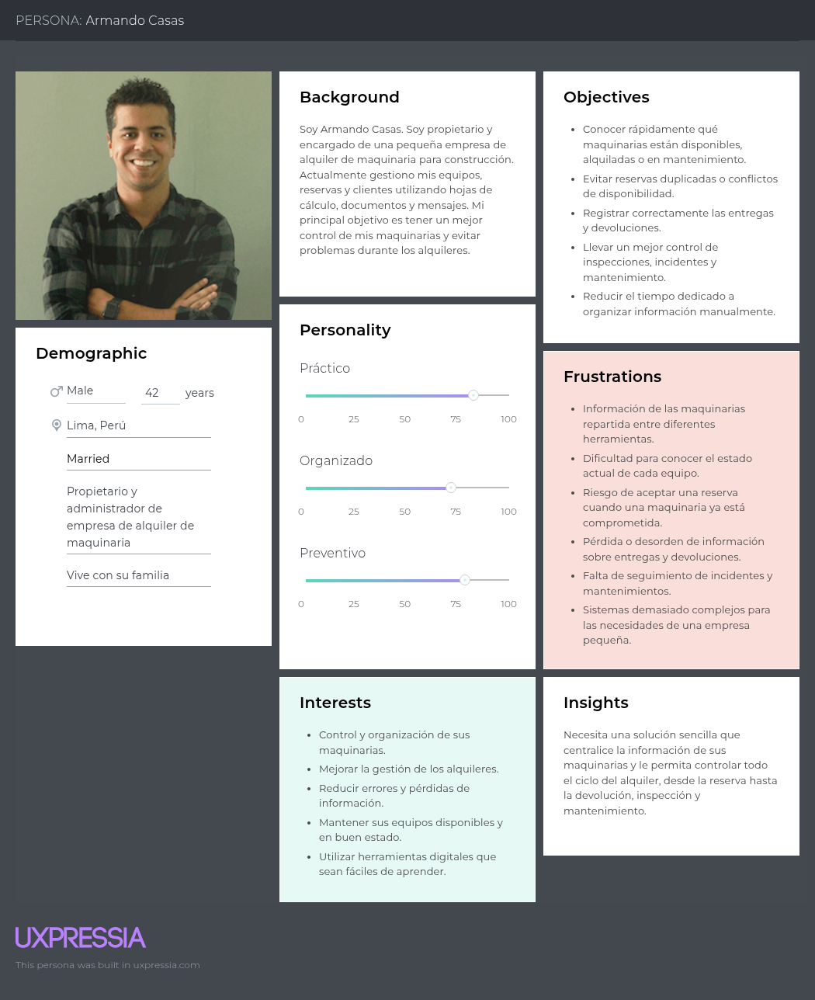

**Segmento Objetivo 2: Pequeñas empresas constructoras**
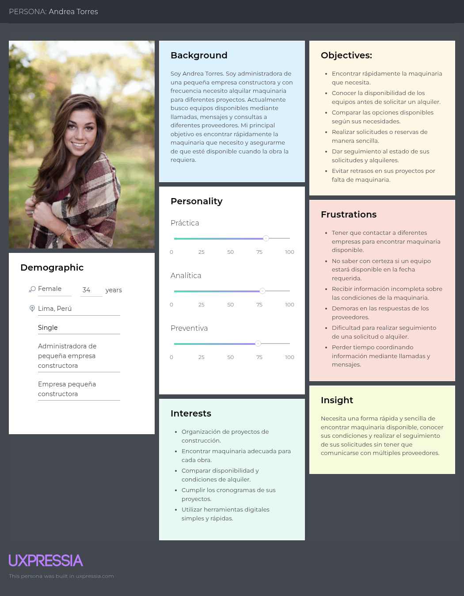

### 2.3.2. User Task Matrix

| TASK | Armando Casas (Empresa de alquiler) Frecuencia | Armando Casas (Empresa de alquiler) Importancia | Andrea Torres (Empresa constructora) Frecuencia | Andrea Torres (Empresa constructora) Importancia |
| :---- | :---: | :---: | :---: | :---: |
| **Consultar el inventario de maquinaria** | **Often** | **High** | **Sometimes** | **Medium** |
| **Consultar la disponibilidad de una maquinaria** | **Often** | **High** | **Often** | **High** |
| **Registrar o actualizar información de maquinaria** | **Often** | **High** | **Rarely** | **Low** |
| **Gestionar reservas y solicitudes de alquiler** | **Often** | **High** | **Often** | **High** |
| **Coordinar la entrega de maquinaria** | **Often** | **High** | **Often** | **High** |
| **Registrar la devolución de maquinaria** | **Often** | **High** | **Sometimes** | **Medium** |
| **Verificar el estado de la maquinaria después de un alquiler** | **Often** | **High** | **Sometimes** | **Medium** |
| **Registrar incidentes o daños en una maquinaria** | **Sometimes** | **High** | **Sometimes** | **High** |
| **Consultar el historial de mantenimiento de una maquinaria** | **Often** | **High** | **Rarely** | **Medium** |
| **Programar o registrar mantenimientos** | **Sometimes** | **High** | **Rarely** | **Low** |
| **Buscar maquinaria según las necesidades de un proyecto** | **Rarely** | **Low** | **Often** | **High** |
| **Consultar características y condiciones de una maquinaria** | **Sometimes** | **Medium** | **Often** | **High** |
| **Realizar seguimiento del estado de una solicitud o alquiler** | **Often** | **High** | **Often** | **High** |

### 2.3.3. User Journey Mapping

**1. User Journey Map para el primer segmento**

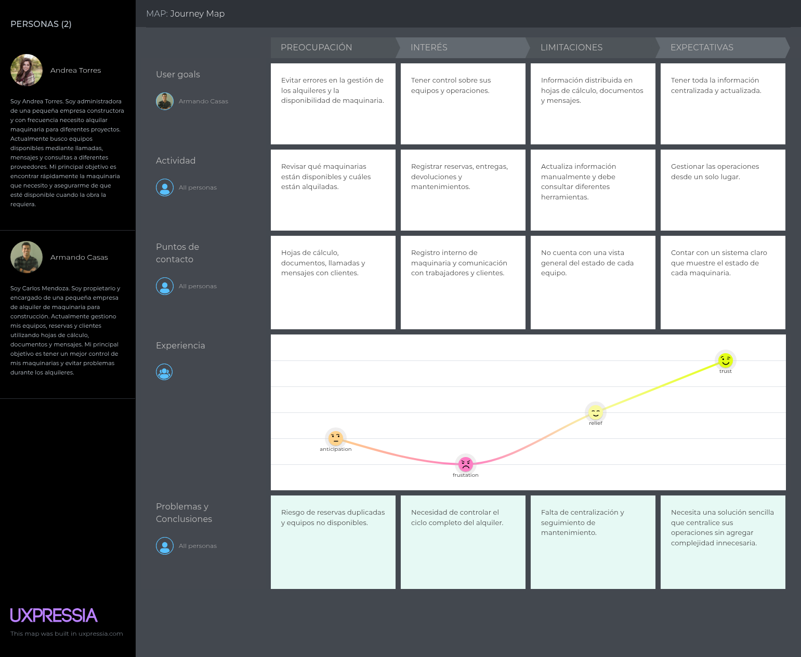

**2. User Journey Map para el segundo segmento**

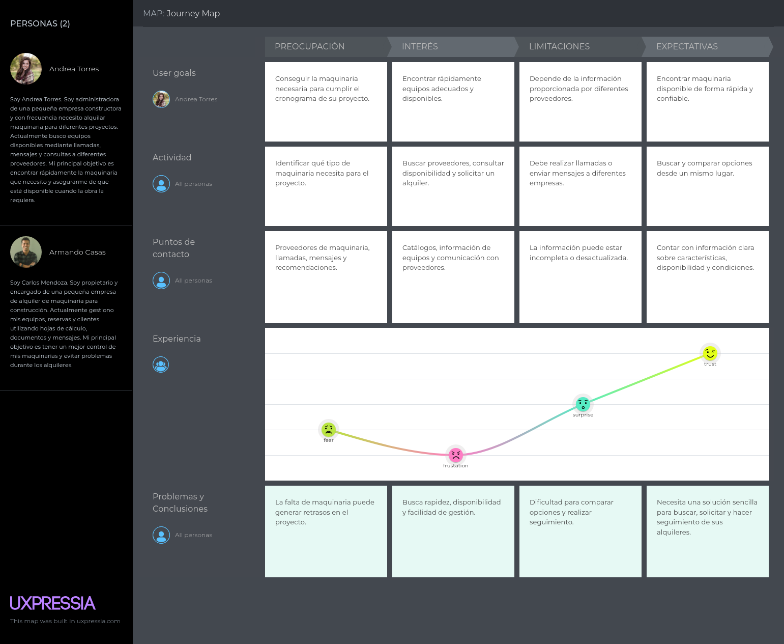

### 2.3.4. Empathy Mapping

**1. Empathy Map para el primer segmento**

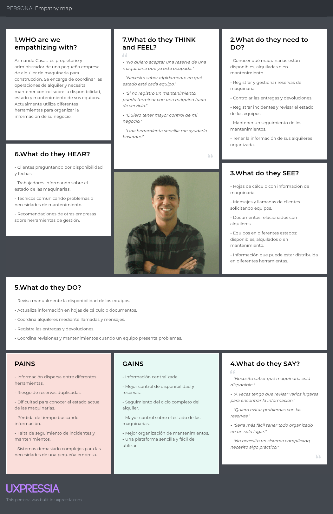

**2. Empathy Map para el segundo segmento**

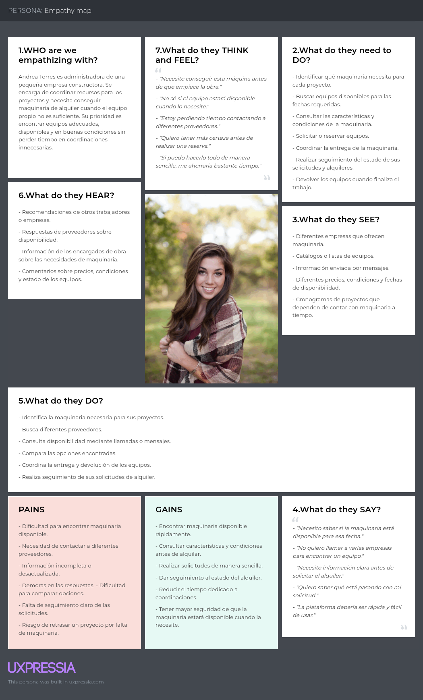

### 2.4. Big Picture Event Storming

El Big Picture Event Storming permitió identificar y representar los principales eventos del dominio de MaquiGest, mostrando de manera general el flujo del negocio desde el registro de la maquinaria hasta su devolución, inspección y mantenimiento.

La siguiente imagen presenta el resultado del Big Picture Event Storming realizado para el proyecto:

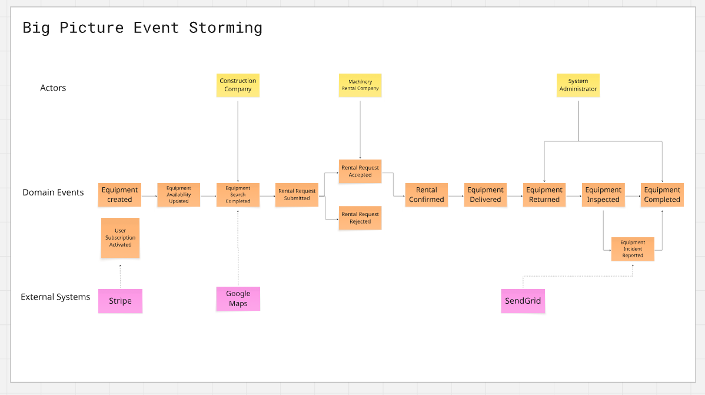


## 2.5. Ubiquitous Language

A continuación, se presenta un glosario de términos y conceptos propios del dominio de MaquiGest, relacionados con la gestión del alquiler de maquinaria para empresas constructoras y empresas de alquiler. Los términos permiten establecer un lenguaje común entre los miembros del equipo y los stakeholders del negocio.

* **Machinery (Maquinaria):** Equipo utilizado para realizar actividades de construcción que puede ser ofrecido en alquiler.
* **Machinery Rental Company (Empresa de alquiler de maquinaria):** Empresa que administra maquinaria y la ofrece en alquiler a empresas que requieren estos equipos.
* **Construction Company (Empresa constructora):** Empresa que requiere maquinaria para ejecutar actividades relacionadas con proyectos de construcción.
* **Machinery Availability (Disponibilidad de maquinaria):** Condición que determina si una maquinaria se encuentra disponible para ser alquilada durante un periodo determinado.
* **Machinery Condition (Condición de la maquinaria):** Estado físico y operativo de una maquinaria en un momento determinado.
* **Rental Request (Solicitud de alquiler):** Solicitud realizada por una empresa constructora para alquilar una maquinaria durante un periodo determinado.
* **Rental (Alquiler):** Acuerdo mediante el cual una empresa constructora utiliza una maquinaria proporcionada por una empresa de alquiler durante un periodo establecido.
* **Rental Period (Periodo de alquiler):** Periodo establecido durante el cual una maquinaria permanece bajo responsabilidad de la empresa que la alquila.
* **Delivery (Entrega):** Traslado y entrega de la maquinaria al cliente para iniciar el periodo de alquiler.
* **Return (Devolución):** Entrega de la maquinaria por parte del cliente a la empresa de alquiler al finalizar el periodo de alquiler.
* **Inspection (Inspección):** Evaluación de la maquinaria devuelta para verificar su condición física y operativa.
* **Incident (Incidente):** Situación inesperada, como una falla o daño, que afecta la condición o funcionamiento de una maquinaria.
* **Maintenance (Mantenimiento):** Actividades realizadas para conservar o recuperar la condición física y operativa de una maquinaria.
* **Machinery History (Historial de maquinaria):** Historial de las actividades relevantes asociadas a una maquinaria, incluyendo alquileres, devoluciones, inspecciones, incidentes y mantenimientos.

<div style="page-break-before: always;"></div>

# Capítulo III: Requirements Specification

## 3.1. User Stories

Las User Stories y Technical Stories representan los requisitos funcionales y técnicos identificados para el desarrollo progresivo de la solución. Las historias se organizan mediante Epics de acuerdo con las principales capacidades del producto, mientras que las Technical Stories permiten definir el soporte técnico necesario para implementar y evolucionar las funcionalidades de la solución.

| Epic / Story ID | Título | Descripción | Criterios de Aceptación | Relacionado con |
| --------------- | ------ | ----------- | ----------------------- | --------------- |
| EP02 | Gestión de maquinaria | Permite administrar el inventario, información, disponibilidad y estado de la maquinaria de las empresas de alquiler. | N/A | — |
| US06 | Registrar maquinaria | Como empresa de alquiler, quiero registrar maquinaria para mantener mi inventario disponible en MaquiGest. | **Scenario 1: Registro exitoso**<br><br>**Given** la empresa de alquiler proporciona toda la información obligatoria y válida de una maquinaria,<br>**When** solicita registrarla,<br>**Then** el sistema registra la maquinaria en el inventario.<br><br>**Scenario 2: Datos incompletos**<br><br>**Given** faltan datos obligatorios de la maquinaria,<br>**When** la empresa intenta registrarla,<br>**Then** el sistema rechaza el registro e informa los campos pendientes. | EP02 |
| US07 | Consultar maquinaria | Como empresa de alquiler, quiero consultar mi maquinaria para conocer los equipos registrados. | **Scenario 1: Consulta exitosa**<br><br>**Given** existen maquinarias registradas en el inventario,<br>**When** la empresa de alquiler solicita consultarlas,<br>**Then** el sistema muestra las maquinarias correspondientes.<br><br>**Scenario 2: Inventario vacío**<br><br>**Given** no existen maquinarias registradas,<br>**When** la empresa consulta su inventario,<br>**Then** el sistema informa que no existen registros disponibles. | EP02 |
| US08 | Actualizar información de maquinaria | Como empresa de alquiler, quiero actualizar la información de mi maquinaria para mantener sus datos actualizados. | **Scenario 1: Actualización exitosa**<br><br>**Given** existe una maquinaria registrada,<br>**When** la empresa proporciona información válida y solicita actualizarla,<br>**Then** el sistema actualiza los datos de la maquinaria.<br><br>**Scenario 2: Maquinaria inexistente**<br><br>**Given** la maquinaria que se desea actualizar no existe,<br>**When** la empresa solicita modificar su información,<br>**Then** el sistema rechaza la operación e informa que no se encontró el recurso.<br><br>**Scenario 3: Información inválida**<br><br>**Given** la empresa proporciona datos que no cumplen las validaciones establecidas,<br>**When** solicita actualizar la maquinaria,<br>**Then** el sistema rechaza los cambios e informa los errores encontrados. | EP02 |
| US09 | Consultar disponibilidad de maquinaria | Como empresa de alquiler, quiero consultar la disponibilidad de mi maquinaria para conocer qué equipos están disponibles. | **Scenario 1: Consulta exitosa**<br><br>**Given** existen maquinarias registradas en el inventario,<br>**When** la empresa consulta su disponibilidad,<br>**Then** el sistema muestra el estado de disponibilidad correspondiente de cada maquinaria.<br><br>**Scenario 2: Maquinaria comprometida**<br><br>**Given** una maquinaria se encuentra comprometida durante un periodo,<br>**When** la empresa consulta su disponibilidad para dicho periodo,<br>**Then** el sistema la identifica como no disponible. | EP02 |
| US10 | Consultar estado de maquinaria | Como empresa de alquiler, quiero consultar el estado de mi maquinaria para conocer su condición actual. | **Scenario 1: Consulta exitosa**<br><br>**Given** existe una maquinaria registrada,<br>**When** la empresa consulta su estado,<br>**Then** el sistema devuelve la condición actual de la maquinaria.<br><br>**Scenario 2: Maquinaria inexistente**<br><br>**Given** la maquinaria solicitada no existe,<br>**When** la empresa intenta consultar su estado,<br>**Then** el sistema informa que no se encontró la maquinaria. | EP02 |
| TS03 | Gestionar maquinaria mediante API REST | Como desarrollador, quiero disponer de recursos REST para registrar, consultar y actualizar maquinaria para permitir la gestión del inventario desde la Web Application. | **Scenario 1: Operación exitosa**<br><br>**Given** el usuario tiene permisos para gestionar maquinaria y envía una solicitud válida,<br>**When** realiza una operación de registro, consulta o actualización mediante la API REST,<br>**Then** la API procesa la operación y devuelve la información correspondiente.<br><br>**Scenario 2: Datos inválidos**<br><br>**Given** la solicitud contiene información incompleta o inválida,<br>**When** la API procesa la petición,<br>**Then** rechaza la operación e informa los errores de validación.<br><br>**Scenario 3: Acceso no autorizado**<br><br>**Given** el cliente no tiene autorización para gestionar maquinaria,<br>**When** intenta acceder al recurso protegido,<br>**Then** la API rechaza la solicitud. | US06, US07, US08 |
| TS04 | Consultar disponibilidad mediante API REST | Como desarrollador, quiero disponer de un recurso REST para consultar la disponibilidad de maquinaria durante un periodo para que la Web Application pueda mostrar los equipos disponibles. | **Scenario 1: Consulta exitosa**<br><br>**Given** existe una maquinaria registrada y el periodo solicitado es válido,<br>**When** el cliente consulta su disponibilidad mediante la API REST,<br>**Then** la API devuelve la información correspondiente al periodo solicitado.<br><br>**Scenario 2: Periodo inválido**<br><br>**Given** el periodo solicitado contiene fechas inválidas o incompatibles,<br>**When** el cliente realiza la consulta,<br>**Then** la API rechaza la solicitud e informa el error correspondiente.<br><br>**Scenario 3: Maquinaria inexistente**<br><br>**Given** la maquinaria solicitada no existe,<br>**When** el cliente consulta su disponibilidad,<br>**Then** la API informa que no se encontró el recurso. | US09, US13 |
| EP03 | Búsqueda y solicitud de alquiler | Permite a las empresas constructoras buscar maquinaria, consultar sus características y disponibilidad y solicitar alquileres. | N/A | — |
| US11 | Buscar maquinaria | Como empresa constructora, quiero buscar maquinaria para encontrar equipos que se ajusten a mis necesidades. | **Scenario 1: Búsqueda exitosa**<br><br>**Given** existen maquinarias registradas en la plataforma,<br>**When** la empresa constructora realiza una búsqueda con criterios válidos,<br>**Then** el sistema muestra las maquinarias que coinciden con los criterios indicados.<br><br>**Scenario 2: Sin resultados**<br><br>**Given** no existen maquinarias que coincidan con los criterios de búsqueda,<br>**When** la empresa realiza la búsqueda,<br>**Then** el sistema informa que no se encontraron resultados.<br><br>**Scenario 3: Criterios inválidos**<br><br>**Given** los criterios de búsqueda contienen información inválida,<br>**When** la empresa intenta realizar la búsqueda,<br>**Then** el sistema informa que debe corregir los datos ingresados. | EP03 |
| US12 | Consultar información de maquinaria | Como empresa constructora, quiero consultar la información de una maquinaria para conocer sus características antes de solicitar un alquiler. | **Scenario 1: Consulta exitosa**<br><br>**Given** existe una maquinaria registrada,<br>**When** la empresa constructora consulta su información,<br>**Then** el sistema muestra las características y los datos correspondientes de la maquinaria.<br><br>**Scenario 2: Maquinaria inexistente**<br><br>**Given** la maquinaria solicitada no existe,<br>**When** la empresa intenta consultar su información,<br>**Then** el sistema informa que no se encontró la maquinaria. | EP03 |
| US13 | Consultar disponibilidad para un periodo | Como empresa constructora, quiero consultar la disponibilidad de una maquinaria para un periodo determinado para saber si puedo alquilarla. | **Scenario 1: Consulta de disponibilidad exitosa**<br><br>**Given** existe una maquinaria registrada y un periodo válido,<br>**When** la empresa constructora consulta su disponibilidad,<br>**Then** el sistema indica si la maquinaria se encuentra disponible durante ese periodo.<br><br>**Scenario 2: Maquinaria no disponible**<br><br>**Given** la maquinaria se encuentra comprometida durante parte del periodo solicitado,<br>**When** la empresa consulta su disponibilidad,<br>**Then** el sistema indica que no está disponible para dicho periodo.<br><br>**Scenario 3: Periodo inválido**<br><br>**Given** el periodo solicitado contiene fechas inválidas o incompatibles,<br>**When** la empresa consulta la disponibilidad,<br>**Then** el sistema rechaza la consulta e informa el problema. | EP03 |
| US14 | Solicitar alquiler de maquinaria | Como empresa constructora, quiero solicitar el alquiler de una maquinaria para utilizarla en mi proyecto. | **Scenario 1: Solicitud exitosa**<br><br>**Given** la maquinaria está disponible para el periodo solicitado y la empresa proporciona información válida,<br>**When** registra una solicitud de alquiler,<br>**Then** el sistema crea la solicitud con estado inicial PENDING.<br><br>**Scenario 2: Maquinaria no disponible**<br><br>**Given** la maquinaria no está disponible para el periodo solicitado,<br>**When** la empresa intenta solicitar el alquiler,<br>**Then** el sistema rechaza la solicitud e informa que la maquinaria no está disponible.<br><br>**Scenario 3: Datos incompletos o inválidos**<br><br>**Given** la solicitud contiene datos obligatorios incompletos o inválidos,<br>**When** la empresa intenta registrarla,<br>**Then** el sistema rechaza la operación e informa los datos que deben corregirse. | EP03 |
| TS05 | Gestionar solicitudes de alquiler mediante API REST | Como desarrollador, quiero disponer de recursos REST para crear y consultar solicitudes de alquiler para permitir que las empresas constructoras soliciten maquinaria y consulten sus solicitudes. | **Scenario 1: Creación exitosa de solicitud**<br><br>**Given** existe una maquinaria disponible y el cliente envía información válida,<br>**When** realiza una solicitud para crear un alquiler mediante la API REST,<br>**Then** la API registra la solicitud y devuelve su identificador y estado inicial.<br><br>**Scenario 2: Consulta exitosa de solicitud**<br><br>**Given** existe una solicitud de alquiler registrada,<br>**When** un cliente autorizado consulta el recurso correspondiente,<br>**Then** la API devuelve la información de la solicitud.<br><br>**Scenario 3: Maquinaria no disponible**<br><br>**Given** la maquinaria no está disponible para el periodo solicitado,<br>**When** el cliente intenta crear una solicitud de alquiler,<br>**Then** la API rechaza la operación e informa que no se puede realizar el alquiler. | US14, US21 |
| EP05 | Gestión de reservas y alquileres | Permite administrar solicitudes, decisiones de alquiler, alquileres activos, entregas y devoluciones. | N/A | — |
| US18 | Gestionar solicitudes de alquiler | Como empresa de alquiler, quiero gestionar las solicitudes de alquiler para administrar las solicitudes recibidas. | **Scenario 1: Consulta de solicitudes**<br><br>**Given** existen solicitudes de alquiler registradas,<br>**When** la empresa de alquiler consulta sus solicitudes,<br>**Then** el sistema muestra las solicitudes recibidas y su información relevante.<br><br>**Scenario 2: Identificación de solicitudes pendientes**<br><br>**Given** existen solicitudes con estado PENDING,<br>**When** la empresa consulta las solicitudes recibidas,<br>**Then** el sistema permite identificar aquellas que se encuentran pendientes.<br><br>**Scenario 3: Sin solicitudes registradas**<br><br>**Given** no existen solicitudes de alquiler registradas,<br>**When** la empresa consulta sus solicitudes,<br>**Then** el sistema informa que no existen solicitudes disponibles. | EP05 |
| US19 | Confirmar o rechazar una solicitud | Como empresa de alquiler, quiero confirmar o rechazar una solicitud para determinar si el alquiler puede realizarse. | **Scenario 1: Confirmación exitosa**<br><br>**Given** existe una solicitud de alquiler con estado PENDING,<br>**When** la empresa de alquiler confirma la solicitud,<br>**Then** el sistema actualiza su estado a CONFIRMED.<br><br>**Scenario 2: Rechazo exitoso**<br><br>**Given** existe una solicitud de alquiler con estado PENDING,<br>**When** la empresa de alquiler rechaza la solicitud,<br>**Then** el sistema actualiza su estado a REJECTED.<br><br>**Scenario 3: Solicitud con estado no válido**<br><br>**Given** la solicitud no se encuentra en estado PENDING,<br>**When** la empresa intenta confirmarla o rechazarla,<br>**Then** el sistema rechaza la operación e informa que la solicitud no puede modificarse. | EP05 |
| US20 | Consultar alquileres activos | Como empresa de alquiler, quiero consultar los alquileres activos para conocer las operaciones que se encuentran en curso. | **Scenario 1: Consulta exitosa**<br><br>**Given** existen alquileres activos registrados,<br>**When** la empresa de alquiler solicita consultarlos,<br>**Then** el sistema muestra los alquileres que se encuentran en curso.<br><br>**Scenario 2: Sin alquileres activos**<br><br>**Given** no existen alquileres activos,<br>**When** la empresa realiza la consulta,<br>**Then** el sistema informa que no existen alquileres en curso. | EP05 |
| US21 | Consultar estado de una solicitud de alquiler | Como empresa constructora, quiero consultar el estado de una solicitud de alquiler para conocer su situación actual. | **Scenario 1: Consulta exitosa**<br><br>**Given** existe una solicitud de alquiler asociada a la empresa constructora,<br>**When** la empresa consulta su estado,<br>**Then** el sistema devuelve el estado actual de la solicitud.<br><br>**Scenario 2: Solicitud inexistente o no autorizada**<br><br>**Given** la solicitud no existe o no pertenece a la empresa constructora que realiza la consulta,<br>**When** intenta consultar su estado,<br>**Then** el sistema rechaza la consulta e informa que no se encontró la solicitud o que no tiene acceso a ella. | EP05 |
| US22 | Gestionar entregas y devoluciones | Como empresa de alquiler, quiero gestionar las entregas y devoluciones para controlar el movimiento de la maquinaria. | **Scenario 1: Registro de entrega**<br><br>**Given** existe un alquiler confirmado,<br>**When** la empresa de alquiler registra una entrega válida de maquinaria,<br>**Then** el sistema registra la entrega y actualiza el estado correspondiente del alquiler.<br><br>**Scenario 2: Registro de devolución**<br><br>**Given** existe un alquiler en curso,<br>**When** la empresa de alquiler registra una devolución válida,<br>**Then** el sistema registra la devolución y actualiza el estado de la maquinaria.<br><br>**Scenario 3: Alquiler no válido**<br><br>**Given** no existe un alquiler válido asociado a la operación o su estado no permite realizarla,<br>**When** la empresa intenta registrar una entrega o devolución,<br>**Then** el sistema rechaza la operación. | EP05 |
| TS06 | Gestionar reservas y estados de alquiler mediante API REST | Como desarrollador, quiero disponer de recursos REST para gestionar solicitudes, confirmaciones, rechazos y alquileres activos para soportar el ciclo de alquiler de MaquiGest. | **Scenario 1: Actualización de estado exitosa**<br><br>**Given** existe una solicitud de alquiler y el usuario está autorizado,<br>**When** confirma o rechaza la solicitud mediante la API REST,<br>**Then** la API actualiza el estado correspondiente.<br><br>**Scenario 2: Consulta de alquileres activos**<br><br>**Given** existen alquileres activos registrados,<br>**When** un cliente autorizado consulta los alquileres mediante la API REST,<br>**Then** la API devuelve la información correspondiente.<br><br>**Scenario 3: Operación no permitida**<br><br>**Given** la solicitud se encuentra en un estado que no permite la operación solicitada,<br>**When** el cliente intenta modificarla,<br>**Then** la API rechaza la operación e informa que no está permitida para el estado actual. | US18, US19, US20 |
| TS07 | Gestionar entregas y devoluciones mediante API REST | Como desarrollador, quiero disponer de recursos REST para registrar entregas y devoluciones de maquinaria para mantener la trazabilidad del ciclo de alquiler. | **Scenario 1: Registro de entrega exitoso**<br><br>**Given** existe un alquiler confirmado,<br>**When** el cliente envía una solicitud válida para registrar la entrega,<br>**Then** la API registra la entrega y actualiza el estado correspondiente.<br><br>**Scenario 2: Registro de devolución exitoso**<br><br>**Given** existe un alquiler en curso,<br>**When** el cliente envía una solicitud válida para registrar la devolución,<br>**Then** la API registra la devolución y actualiza el estado correspondiente.<br><br>**Scenario 3: Estado de alquiler incompatible**<br><br>**Given** el alquiler no se encuentra en un estado que permita registrar la operación,<br>**When** el cliente intenta registrar una entrega o devolución,<br>**Then** la API rechaza la solicitud. | US22 |
| EP06 | Gestión de mantenimiento e incidencias | Permite registrar, programar y consultar mantenimientos e incidencias relacionadas con la maquinaria. | N/A | — |
| US23 | Registrar mantenimiento | Como empresa de alquiler, quiero registrar mantenimientos para mantener un historial de las intervenciones realizadas a cada maquinaria. | **Scenario 1: Registro exitoso**<br><br>**Given** existe una maquinaria registrada y la empresa proporciona información válida del mantenimiento,<br>**When** solicita registrar la intervención,<br>**Then** el sistema almacena el mantenimiento en el historial de la maquinaria.<br><br>**Scenario 2: Maquinaria inexistente**<br><br>**Given** la maquinaria no existe,<br>**When** la empresa intenta registrar un mantenimiento,<br>**Then** el sistema rechaza la operación e informa que no se encontró la maquinaria. | EP06 |
| US24 | Programar mantenimiento | Como empresa de alquiler, quiero programar mantenimientos para organizar las próximas intervenciones de la maquinaria. | **Scenario 1: Programación exitosa**<br><br>**Given** existe una maquinaria registrada y la empresa proporciona una fecha válida,<br>**When** solicita programar un mantenimiento,<br>**Then** el sistema registra la programación correspondiente.<br><br>**Scenario 2: Fecha inválida**<br><br>**Given** la fecha proporcionada no cumple las condiciones establecidas,<br>**When** la empresa intenta programar el mantenimiento,<br>**Then** el sistema rechaza la operación e informa que la fecha no es válida. | EP06 |
| US25 | Registrar incidencia de maquinaria | Como empresa de alquiler, quiero registrar incidencias para mantener un registro de los problemas ocurridos con la maquinaria. | **Scenario 1: Registro exitoso**<br><br>**Given** existe una maquinaria registrada y la empresa proporciona información válida de una incidencia,<br>**When** solicita registrarla,<br>**Then** el sistema almacena la incidencia en el registro de la maquinaria.<br><br>**Scenario 2: Maquinaria inexistente**<br><br>**Given** la maquinaria no existe,<br>**When** la empresa intenta registrar una incidencia,<br>**Then** el sistema rechaza la operación e informa que no se encontró la maquinaria. | EP06 |
| US26 | Consultar historial de maquinaria | Como empresa de alquiler, quiero consultar el historial de una maquinaria para conocer sus mantenimientos e incidencias anteriores. | **Scenario 1: Consulta exitosa**<br><br>**Given** existe una maquinaria registrada con mantenimientos o incidencias anteriores,<br>**When** la empresa consulta su historial,<br>**Then** el sistema muestra los registros históricos correspondientes.<br><br>**Scenario 2: Historial sin registros**<br><br>**Given** la maquinaria no tiene mantenimientos ni incidencias registrados,<br>**When** la empresa consulta su historial,<br>**Then** el sistema informa que no existen registros históricos disponibles. | EP06 |
| TS08 | Gestionar mantenimiento e incidencias mediante API REST | Como desarrollador, quiero disponer de recursos REST para registrar y consultar mantenimientos e incidencias de maquinaria para conservar su historial operativo. | **Scenario 1: Registro exitoso**<br><br>**Given** existe una maquinaria registrada y el cliente envía información válida de mantenimiento o incidencia,<br>**When** realiza la solicitud mediante la API REST,<br>**Then** la API almacena la información correspondiente.<br><br>**Scenario 2: Consulta de historial**<br><br>**Given** existen registros históricos de una maquinaria,<br>**When** el cliente consulta el historial mediante la API REST,<br>**Then** la API devuelve los mantenimientos e incidencias registrados.<br><br>**Scenario 3: Maquinaria inexistente**<br><br>**Given** la maquinaria indicada no existe,<br>**When** el cliente intenta registrar un mantenimiento o incidencia,<br>**Then** la API rechaza la operación e informa que no se encontró el recurso. | US23, US24, US25, US26 |
| EP04 | Planes y suscripciones | Permite consultar y gestionar las opciones de suscripción disponibles para los usuarios de MaquiGest. | N/A | — |
| US15 | Consultar planes | Como usuario, quiero consultar los planes disponibles para conocer las opciones que ofrece MaquiGest. | **Scenario 1: Consulta exitosa**<br><br>**Given** existen planes configurados en MaquiGest,<br>**When** el usuario consulta los planes disponibles,<br>**Then** el sistema muestra la información correspondiente a cada plan.<br><br>**Scenario 2: Sin planes disponibles**<br><br>**Given** no existen planes configurados o disponibles,<br>**When** el usuario realiza la consulta,<br>**Then** el sistema informa que no existen planes disponibles. | EP04 |
| US16 | Seleccionar plan | Como usuario, quiero seleccionar un plan para elegir la opción que se adapte a mis necesidades. | **Scenario 1: Selección exitosa**<br><br>**Given** existen planes disponibles,<br>**When** el usuario selecciona un plan válido,<br>**Then** el sistema registra la selección correspondiente.<br><br>**Scenario 2: Plan no disponible**<br><br>**Given** el plan seleccionado no se encuentra disponible,<br>**When** el usuario intenta seleccionarlo,<br>**Then** el sistema rechaza la operación e informa que el plan no está disponible. | EP04 |
| US17 | Gestionar suscripción | Como usuario, quiero gestionar mi suscripción para administrar el plan seleccionado. | **Scenario 1: Gestión exitosa**<br><br>**Given** existe una suscripción asociada al usuario,<br>**When** solicita consultar o modificar la información permitida de su suscripción,<br>**Then** el sistema procesa la operación correctamente.<br><br>**Scenario 2: Suscripción inexistente**<br><br>**Given** el usuario no tiene una suscripción válida,<br>**When** intenta gestionarla,<br>**Then** el sistema rechaza la operación e informa que no existe una suscripción asociada. | EP04 |
| TS09 | Consultar planes y suscripciones mediante API REST | Como desarrollador, quiero disponer de recursos REST para consultar los planes disponibles y gestionar la información básica de la suscripción para que la Web Application pueda mostrar y administrar estas opciones. | **Scenario 1: Consulta de planes**<br><br>**Given** existen planes configurados,<br>**When** el cliente solicita los planes disponibles mediante la API REST,<br>**Then** la API devuelve la información correspondiente.<br><br>**Scenario 2: Selección de plan**<br><br>**Given** el cliente proporciona información válida para seleccionar un plan disponible,<br>**When** registra la selección mediante la API REST,<br>**Then** la API procesa la operación y devuelve el estado correspondiente.<br><br>**Scenario 3: Información inválida**<br><br>**Given** la solicitud contiene información incompleta o inválida,<br>**When** la API procesa la petición,<br>**Then** rechaza la operación e informa los errores de validación. | US15, US16, US17 |
| EP07 | Información y contratación del servicio | Permite a los visitantes conocer MaquiGest, solicitar una demostración y contactar con el equipo. | N/A | — |
| US27 | Consultar información de MaquiGest | Como visitante, quiero consultar información de MaquiGest para conocer la solución y su propuesta de valor. | **Scenario 1: Consulta exitosa**<br><br>**Given** el visitante accede a la información de MaquiGest,<br>**When** consulta el contenido disponible,<br>**Then** el sistema presenta información sobre la solución y su propuesta de valor.<br><br>**Scenario 2: Información no disponible**<br><br>**Given** la información solicitada no está disponible,<br>**When** el visitante intenta consultarla,<br>**Then** el sistema informa que el contenido no se encuentra disponible. | EP07 |
| US28 | Solicitar demostración | Como visitante, quiero solicitar una demostración para conocer cómo funciona MaquiGest. | **Scenario 1: Solicitud exitosa**<br><br>**Given** el visitante completa los datos obligatorios con información válida,<br>**When** solicita una demostración,<br>**Then** el sistema registra la solicitud correctamente.<br><br>**Scenario 2: Datos incompletos**<br><br>**Given** faltan datos obligatorios en el formulario,<br>**When** el visitante intenta solicitar la demostración,<br>**Then** el sistema informa los campos que debe completar. | EP07 |
| US29 | Contactar con MaquiGest | Como visitante, quiero contactar con MaquiGest para realizar consultas sobre la solución. | **Scenario 1: Envío exitoso**<br><br>**Given** el visitante completa los datos requeridos y redacta su consulta,<br>**When** envía el formulario de contacto,<br>**Then** el sistema registra la consulta correctamente.<br><br>**Scenario 2: Datos incompletos**<br><br>**Given** faltan datos obligatorios en el formulario,<br>**When** el visitante intenta enviar su consulta,<br>**Then** el sistema informa los campos pendientes y no registra el contacto. | EP07 |
| EP08 | Landing Page de MaquiGest | Presenta la propuesta de valor, funcionalidades y soluciones de MaquiGest mediante una experiencia web accesible y adaptable. | N/A | — |
| US30 | Visualizar propuesta de valor | Como visitante, quiero visualizar la propuesta de valor de MaquiGest para comprender cómo puede ayudar a mi empresa. | **Scenario 1: Visualización exitosa**<br><br>**Given** el visitante accede al Landing Page,<br>**When** consulta la propuesta de valor,<br>**Then** el sistema presenta la información correspondiente y permite identificar el beneficio principal de MaquiGest.<br><br>**Scenario 2: Contenido no disponible**<br><br>**Given** el contenido de la propuesta de valor no está disponible,<br>**When** el visitante intenta consultarlo,<br>**Then** el sistema informa que la información no se encuentra disponible. | EP08 |
| US31 | Explorar funcionalidades principales | Como visitante, quiero explorar las funcionalidades principales para conocer qué puedo realizar con MaquiGest. | **Scenario 1: Visualización de funcionalidades**<br><br>**Given** el visitante accede a la sección de funcionalidades,<br>**When** consulta la información disponible,<br>**Then** el sistema muestra las funcionalidades principales de MaquiGest y permite comprender su propósito.<br><br>**Scenario 2: Información no disponible**<br><br>**Given** la información de las funcionalidades no está disponible,<br>**When** el visitante intenta consultarla,<br>**Then** el sistema informa que no se puede mostrar el contenido. | EP08 |
| US32 | Identificar la solución para mi empresa | Como visitante, quiero identificar si MaquiGest se adapta a mi tipo de empresa para determinar si la solución responde a mis necesidades. | **Scenario 1: Identificación de solución**<br><br>**Given** el visitante pertenece a uno de los segmentos objetivo,<br>**When** consulta las soluciones disponibles,<br>**Then** el sistema presenta la información correspondiente a su tipo de empresa.<br><br>**Scenario 2: Segmento sin información específica**<br><br>**Given** no existe información específica para el tipo de empresa del visitante,<br>**When** consulta las soluciones disponibles,<br>**Then** el sistema presenta información general sobre MaquiGest. | EP08 |
| US33 | Acceder a la Web Application | Como visitante, quiero acceder a la Web Application desde la Landing Page para utilizar las funcionalidades de MaquiGest. | **Scenario 1: Acceso exitoso**<br><br>**Given** el visitante se encuentra en el Landing Page,<br>**When** selecciona la opción para acceder a la Web Application,<br>**Then** el sistema lo dirige a la plataforma.<br><br>**Scenario 2: Aplicación no disponible**<br><br>**Given** la Web Application no se encuentra disponible,<br>**When** el visitante intenta acceder,<br>**Then** el sistema informa que el recurso no está disponible. | EP08 |
| US34 | Utilizar la plataforma desde dispositivos de diferentes tamaños | Como usuario, quiero utilizar MaquiGest desde diferentes tamaños de pantalla para acceder a la plataforma de manera adecuada. | **Scenario 1: Visualización adaptable**<br><br>**Given** el usuario accede a MaquiGest desde un dispositivo con una resolución determinada,<br>**When** utiliza la plataforma,<br>**Then** el contenido y los componentes se adaptan al tamaño de pantalla.<br><br>**Scenario 2: Cambio de resolución**<br><br>**Given** el usuario cambia el tamaño de la pantalla,<br>**When** continúa utilizando la plataforma,<br>**Then** el sistema reorganiza la presentación para mantener accesibles las funciones y la información. | EP08 |
| US35 | Utilizar la plataforma en diferentes idiomas | Como usuario, quiero utilizar MaquiGest en diferentes idiomas para comprender y utilizar la plataforma. | **Scenario 1: Cambio de idioma exitoso**<br><br>**Given** existen diferentes idiomas disponibles,<br>**When** el usuario selecciona uno de ellos,<br>**Then** el sistema presenta el contenido de la plataforma en el idioma seleccionado.<br><br>**Scenario 2: Idioma no disponible**<br><br>**Given** el usuario intenta seleccionar un idioma que no está disponible,<br>**When** confirma su selección,<br>**Then** el sistema mantiene el idioma actual e informa que la opción no está disponible. | EP08 |
| TS01 | Exponer API REST de MaquiGest | Como desarrollador, quiero disponer de una API REST organizada para exponer los servicios de MaquiGest y permitir que la Web Application consuma las funcionalidades del dominio. | **Scenario 1: Solicitud exitosa**<br><br>**Given** la API REST se encuentra disponible y existe un recurso válido,<br>**When** un cliente realiza una solicitud a dicho recurso,<br>**Then** la API procesa la solicitud y devuelve la respuesta HTTP correspondiente.<br><br>**Scenario 2: Recurso inexistente**<br><br>**Given** el cliente solicita un recurso que no está definido en la API,<br>**When** realiza la petición,<br>**Then** la API devuelve una respuesta de recurso no encontrado.<br><br>**Scenario 3: Método no permitido**<br><br>**Given** el cliente utiliza un método HTTP no permitido para el recurso solicitado,<br>**When** realiza la petición,<br>**Then** la API rechaza la operación e informa que el método no está permitido. | Transversal |
| TS10 | Gestionar autenticación y autorización mediante API REST | Como desarrollador, quiero disponer de mecanismos REST de autenticación y autorización para proteger los recursos de MaquiGest y controlar el acceso según el tipo de usuario. | **Scenario 1: Autenticación exitosa**<br><br>**Given** existe una cuenta registrada y el cliente proporciona credenciales válidas,<br>**When** solicita autenticarse mediante el recurso correspondiente,<br>**Then** la API permite establecer una sesión autorizada.<br><br>**Scenario 2: Acceso sin autenticación**<br><br>**Given** un cliente no dispone de una autorización válida,<br>**When** intenta acceder a un recurso protegido,<br>**Then** la API rechaza el acceso.<br><br>**Scenario 3: Permisos insuficientes**<br><br>**Given** el usuario está autenticado, pero no posee los permisos necesarios para acceder a un recurso,<br>**When** intenta realizar la operación,<br>**Then** la API rechaza la solicitud por falta de autorización. | US01, US02, US04, US05 |
| TS11 | Enviar notificaciones transaccionales mediante SendGrid | Como desarrollador, quiero integrar un servicio de correo transaccional para notificar eventos relevantes del ciclo de alquiler. | **Scenario 1: Notificación de nueva solicitud**<br><br>**Given** se registra correctamente una solicitud de alquiler,<br>**When** el sistema procesa su creación,<br>**Then** se envía una notificación por correo electrónico a la empresa de alquiler.<br><br>**Scenario 2: Notificación de confirmación o rechazo**<br><br>**Given** existe una solicitud de alquiler pendiente,<br>**When** la empresa de alquiler confirma o rechaza la solicitud,<br>**Then** se envía un correo electrónico a la empresa constructora informando la decisión.<br><br>**Scenario 3: Error en el envío**<br><br>**Given** el servicio SendGrid no se encuentra disponible o presenta un error,<br>**When** el sistema intenta enviar una notificación,<br>**Then** registra el error sin revertir una solicitud que ya fue creada o actualizada correctamente. | US14, US19 |
| TS12 | Persistir información del dominio mediante JPA y MySQL | Como desarrollador, quiero persistir las entidades del dominio mediante Spring Data JPA y MySQL para conservar la información operativa de MaquiGest. | **Scenario 1: Persistencia exitosa**<br><br>**Given** se recibe una operación válida de registro,<br>**When** la operación finaliza correctamente,<br>**Then** la información queda almacenada en la base de datos mediante JPA y MySQL.<br><br>**Scenario 2: Consulta de información persistida**<br><br>**Given** existe un registro almacenado en la base de datos,<br>**When** se consulta mediante el recurso correspondiente,<br>**Then** la API devuelve la información persistida.<br><br>**Scenario 3: Error de persistencia**<br><br>**Given** ocurre un error durante una operación de persistencia,<br>**When** el sistema intenta almacenar la información,<br>**Then** informa el fallo y evita comunicar que el registro se realizó correctamente. | TS02, TS03, TS05, TS08, TS09 |
| TS13 | Validar solicitudes de la API REST | Como desarrollador, quiero validar los datos recibidos por la API REST para evitar que información incompleta o inválida ingrese al dominio de MaquiGest. | **Scenario 1: Validación exitosa**<br><br>**Given** una solicitud contiene todos los datos obligatorios con valores válidos,<br>**When** la API procesa la petición,<br>**Then** permite continuar con la operación solicitada.<br><br>**Scenario 2: Datos incompletos o inválidos**<br><br>**Given** una solicitud contiene campos obligatorios ausentes o valores inválidos,<br>**When** la API procesa la petición,<br>**Then** rechaza la solicitud e identifica los errores de validación.<br><br>**Scenario 3: Fechas incompatibles**<br><br>**Given** un periodo de alquiler contiene fechas incompatibles o inválidas,<br>**When** el cliente solicita la operación,<br>**Then** la API rechaza el periodo e informa el error correspondiente. | TS02, TS03, TS04, TS05, TS07, TS09 |
| TS14 | Gestionar errores y respuestas HTTP de la API REST | Como desarrollador, quiero centralizar el tratamiento de errores de la API REST para devolver respuestas consistentes ante operaciones exitosas o fallidas. | **Scenario 1: Respuesta exitosa**<br><br>**Given** una operación se completa correctamente,<br>**When** la API genera la respuesta,<br>**Then** devuelve el código HTTP correspondiente y la información esperada.<br><br>**Scenario 2: Recurso inexistente**<br><br>**Given** el cliente solicita un recurso que no existe,<br>**When** la API procesa la petición,<br>**Then** devuelve una respuesta HTTP que representa el recurso no encontrado.<br><br>**Scenario 3: Datos inválidos**<br><br>**Given** una solicitud contiene datos que no cumplen las validaciones,<br>**When** la API procesa la petición,<br>**Then** devuelve una respuesta de error de validación consistente.<br><br>**Scenario 4: Error inesperado**<br><br>**Given** ocurre un error inesperado durante una operación,<br>**When** la API procesa la solicitud,<br>**Then** devuelve una respuesta controlada sin exponer detalles internos sensibles. | TS01, TS02, TS03, TS04, TS05, TS06, TS07, TS08, TS09, TS10 |
| TS15 | Documentar los recursos de la API REST mediante OpenAPI | Como desarrollador, quiero documentar los recursos, parámetros, respuestas y errores de la API REST mediante OpenAPI para facilitar su comprensión y consumo desde la Web Application. | **Scenario 1: Consulta de documentación**<br><br>**Given** la API REST expone recursos disponibles,<br>**When** un desarrollador consulta la documentación OpenAPI,<br>**Then** puede visualizar los endpoints y métodos disponibles.<br><br>**Scenario 2: Documentación de parámetros**<br><br>**Given** un recurso REST recibe parámetros o un cuerpo de solicitud,<br>**When** el desarrollador consulta su documentación,<br>**Then** puede identificar los datos requeridos y sus restricciones principales.<br><br>**Scenario 3: Documentación de respuestas**<br><br>**Given** un recurso REST puede devolver respuestas exitosas o errores previstos,<br>**When** el desarrollador consulta su documentación,<br>**Then** puede visualizar los códigos HTTP y las respuestas correspondientes. | TS01, TS02, TS03, TS04, TS05, TS06, TS07, TS08, TS09, TS10 |
| TS16 | Integrar servicios de mapas para entregas y devoluciones | Como desarrollador, quiero integrar un servicio externo de mapas y geolocalización para apoyar la planificación de entregas y devoluciones de maquinaria. | **Scenario 1: Consulta geográfica exitosa**<br><br>**Given** se dispone de una ubicación válida,<br>**When** la aplicación solicita información geográfica al servicio externo de mapas,<br>**Then** el sistema procesa la respuesta recibida.<br><br>**Scenario 2: Procesamiento de información geográfica**<br><br>**Given** el servicio externo devuelve información geográfica válida,<br>**When** la API procesa la respuesta,<br>**Then** proporciona los datos necesarios para apoyar la planificación de la entrega o devolución.<br><br>**Scenario 3: Servicio externo no disponible**<br><br>**Given** el servicio externo de mapas no se encuentra disponible,<br>**When** la aplicación solicita información geográfica,<br>**Then** el sistema gestiona el error sin exponer credenciales ni interrumpir operaciones ajenas a esa consulta. | US22, TS07 |
| EP01 | Gestión de usuarios y acceso | Gestiona el registro, acceso, perfil y recuperación de acceso de los usuarios de MaquiGest. | N/A | — |
| US01 | Registro de usuario | Como usuario, quiero registrarme en MaquiGest para poder acceder a las funcionalidades de la plataforma. | **Scenario 1: Registro exitoso**<br><br>**Given** el usuario completa los datos obligatorios con información válida,<br>**When** solicita registrarse en MaquiGest,<br>**Then** el sistema crea su cuenta correctamente.<br><br>**Scenario 2: Datos incompletos o inválidos**<br><br>**Given** faltan campos obligatorios o los datos proporcionados no cumplen las validaciones,<br>**When** el usuario intenta registrarse,<br>**Then** el sistema rechaza el registro e informa los campos que debe corregir.<br><br>**Scenario 3: Información ya registrada**<br><br>**Given** los datos proporcionados ya se encuentran asociados a una cuenta existente,<br>**When** el usuario intenta registrarse nuevamente,<br>**Then** el sistema rechaza el registro e informa que la información ya está registrada. | EP01 |
| US02 | Inicio de sesión | Como usuario, quiero iniciar sesión para acceder de forma segura a mi cuenta. | **Scenario 1: Inicio de sesión exitoso**<br><br>**Given** existe una cuenta registrada y el usuario proporciona credenciales válidas,<br>**When** solicita iniciar sesión,<br>**Then** el sistema permite el acceso a su cuenta.<br><br>**Scenario 2: Credenciales incorrectas**<br><br>**Given** el usuario proporciona un correo electrónico o contraseña incorrectos,<br>**When** intenta iniciar sesión,<br>**Then** el sistema rechaza el acceso e informa que las credenciales no son válidas. | EP01 |
| US03 | Gestionar perfil | Como usuario, quiero gestionar mi perfil para mantener actualizada mi información. | **Scenario 1: Actualización exitosa**<br><br>**Given** existe un perfil de usuario y se proporciona información válida,<br>**When** el usuario solicita actualizar su perfil,<br>**Then** el sistema actualiza la información correctamente.<br><br>**Scenario 2: Información inválida**<br><br>**Given** el usuario proporciona datos que no cumplen las validaciones establecidas,<br>**When** intenta actualizar su perfil,<br>**Then** el sistema rechaza la operación e informa los datos que deben corregirse. | EP01 |
| US04 | Recuperar contraseña | Como usuario, quiero recuperar mi contraseña para volver a acceder a mi cuenta en caso de olvidarla. | **Scenario 1: Solicitud de recuperación exitosa**<br><br>**Given** existe una cuenta asociada a la información proporcionada,<br>**When** el usuario solicita recuperar su contraseña,<br>**Then** el sistema permite iniciar el proceso de recuperación.<br><br>**Scenario 2: Cuenta no encontrada**<br><br>**Given** no existe una cuenta asociada a la información proporcionada,<br>**When** el usuario solicita recuperar su contraseña,<br>**Then** el sistema informa que no se encontró una cuenta asociada.<br><br>**Scenario 3: Información inválida**<br><br>**Given** el usuario proporciona información incompleta o con un formato inválido,<br>**When** solicita recuperar su contraseña,<br>**Then** el sistema rechaza la solicitud e informa los datos que debe corregir. | EP01 |
| US05 | Cerrar sesión | Como usuario, quiero cerrar sesión para proteger el acceso a mi cuenta. | **Scenario 1: Cierre de sesión exitoso**<br><br>**Given** el usuario tiene una sesión activa,<br>**When** solicita cerrar sesión,<br>**Then** el sistema finaliza la sesión y evita que continúe accediendo como usuario autenticado.<br><br>**Scenario 2: Sesión inexistente**<br><br>**Given** el usuario no tiene una sesión activa,<br>**When** intenta cerrar sesión,<br>**Then** el sistema informa que no existe una sesión activa. | EP01 |
| TS02 | Gestionar perfiles mediante API REST | Como desarrollador, quiero disponer de recursos REST para consultar y actualizar los perfiles de los usuarios para permitir que la Web Application gestione su información. | **Scenario 1: Consulta exitosa**<br><br>**Given** existe un perfil de usuario,<br>**When** un cliente autorizado consulta el recurso correspondiente,<br>**Then** la API devuelve la información del perfil.<br><br>**Scenario 2: Actualización exitosa**<br><br>**Given** existe un perfil y se proporciona información válida,<br>**When** un cliente autorizado solicita actualizarlo,<br>**Then** la API actualiza el perfil y devuelve la información correspondiente.<br><br>**Scenario 3: Información inválida**<br><br>**Given** la información proporcionada para actualizar el perfil no cumple las validaciones,<br>**When** el cliente envía la solicitud,<br>**Then** la API rechaza la operación e informa los errores encontrados. | US03 |

## 3.2. Impact Mapping

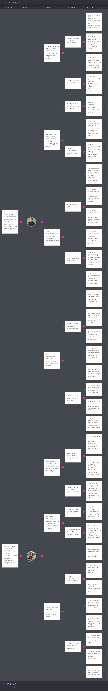

## 3.3. Product Backlog

El Product Backlog contiene las User Stories y Technical Stories identificadas para el desarrollo progresivo de la solución. El orden de los elementos responde principalmente al valor para el negocio y al alcance de las primeras iteraciones del proyecto.

| # | Story ID | Tipo | Título | Descripción | Story Points |
| :---: | :---: | :--- | :--- | :--- | :---: |
| 1 | US30 | User Story | Visualizar propuesta de valor | Como visitante, quiero visualizar la propuesta de valor de MaquiGest para comprender cómo puede ayudar a mi empresa. | 2 |
| 2 | US31 | User Story | Explorar funcionalidades principales | Como visitante, quiero explorar las funcionalidades principales para conocer qué puedo realizar con MaquiGest. | 3 |
| 3 | US32 | User Story | Identificar la solución para mi empresa | Como visitante, quiero identificar si MaquiGest se adapta a mi tipo de empresa para determinar si la solución responde a mis necesidades. | 3 |
| 4 | US27 | User Story | Consultar información de MaquiGest | Como visitante, quiero consultar información de MaquiGest para conocer la solución y su propuesta de valor. | 2 |
| 5 | US33 | User Story | Acceder a la Web Application | Como visitante, quiero acceder a la Web Application desde la Landing Page para utilizar las funcionalidades de MaquiGest. | 2 |
| 6 | US28 | User Story | Solicitar demostración | Como visitante, quiero solicitar una demostración para conocer cómo funciona MaquiGest. | 2 |
| 7 | US29 | User Story | Contactar con MaquiGest | Como visitante, quiero contactar con MaquiGest para realizar consultas sobre la solución. | 2 |
| 8 | US34 | User Story | Utilizar la plataforma desde dispositivos de diferentes tamaños | Como usuario, quiero utilizar MaquiGest desde diferentes tamaños de pantalla para acceder a la plataforma de manera adecuada. | 5 |
| 9 | US35 | User Story | Utilizar la plataforma en diferentes idiomas | Como usuario, quiero utilizar MaquiGest en diferentes idiomas para comprender y utilizar la plataforma. | 5 |
| 10 | US11 | User Story | Buscar maquinaria | Como empresa constructora, quiero buscar maquinaria para encontrar equipos que se ajusten a mis necesidades. | 5 |
| 11 | US12 | User Story | Consultar información de maquinaria | Como empresa constructora, quiero consultar la información de una maquinaria para conocer sus características antes de solicitar un alquiler. | 3 |
| 12 | US13 | User Story | Consultar disponibilidad para un periodo | Como empresa constructora, quiero consultar la disponibilidad de una maquinaria para un periodo determinado para saber si puedo alquilarla. | 5 |
| 13 | US14 | User Story | Solicitar alquiler de maquinaria | Como empresa constructora, quiero solicitar el alquiler de una maquinaria para utilizarla en mi proyecto. | 5 |
| 14 | TS05 | Technical Story | Gestionar solicitudes de alquiler mediante API REST | Como desarrollador, quiero disponer de recursos REST para crear y consultar solicitudes de alquiler para permitir que las empresas constructoras soliciten maquinaria y consulten sus solicitudes. | 5 |
| 15 | TS11 | Technical Story | Enviar notificaciones transaccionales mediante SendGrid | Como desarrollador, quiero integrar un servicio de correo transaccional para notificar eventos relevantes del ciclo de alquiler. | 5 |
| 16 | US06 | User Story | Registrar maquinaria | Como empresa de alquiler, quiero registrar maquinaria para mantener mi inventario disponible en MaquiGest. | 5 |
| 17 | US07 | User Story | Consultar maquinaria | Como empresa de alquiler, quiero consultar mi maquinaria para conocer los equipos registrados. | 3 |
| 18 | US08 | User Story | Actualizar información de maquinaria | Como empresa de alquiler, quiero actualizar la información de mi maquinaria para mantener sus datos actualizados. | 3 |
| 19 | US09 | User Story | Consultar disponibilidad de maquinaria | Como empresa de alquiler, quiero consultar la disponibilidad de mi maquinaria para conocer qué equipos están disponibles. | 5 |
| 20 | US10 | User Story | Consultar estado de maquinaria | Como empresa de alquiler, quiero consultar el estado de mi maquinaria para conocer su condición actual. | 3 |
| 21 | TS03 | Technical Story | Gestionar maquinaria mediante API REST | Como desarrollador, quiero disponer de recursos REST para registrar, consultar y actualizar maquinaria para permitir la gestión del inventario desde la Web Application. | 5 |
| 22 | TS04 | Technical Story | Consultar disponibilidad mediante API REST | Como desarrollador, quiero disponer de un recurso REST para consultar la disponibilidad de maquinaria durante un periodo para que la Web Application pueda mostrar los equipos disponibles. | 5 |
| 23 | US18 | User Story | Gestionar solicitudes de alquiler | Como empresa de alquiler, quiero gestionar las solicitudes de alquiler para administrar las solicitudes recibidas. | 5 |
| 24 | US19 | User Story | Confirmar o rechazar una solicitud | Como empresa de alquiler, quiero confirmar o rechazar una solicitud para determinar si el alquiler puede realizarse. | 3 |
| 25 | US20 | User Story | Consultar alquileres activos | Como empresa de alquiler, quiero consultar los alquileres activos para conocer las operaciones que se encuentran en curso. | 3 |
| 26 | US21 | User Story | Consultar estado de una solicitud de alquiler | Como empresa constructora, quiero consultar el estado de una solicitud de alquiler para conocer su situación actual. | 3 |
| 27 | US22 | User Story | Gestionar entregas y devoluciones | Como empresa de alquiler, quiero gestionar las entregas y devoluciones para controlar el movimiento de la maquinaria. | 5 |
| 28 | TS06 | Technical Story | Gestionar reservas y estados de alquiler mediante API REST | Como desarrollador, quiero disponer de recursos REST para gestionar solicitudes, confirmaciones, rechazos y alquileres activos para soportar el ciclo de alquiler de MaquiGest. | 5 |
| 29 | TS07 | Technical Story | Gestionar entregas y devoluciones mediante API REST | Como desarrollador, quiero disponer de recursos REST para registrar entregas y devoluciones de maquinaria para mantener la trazabilidad del ciclo de alquiler. | 5 |
| 30 | TS16 | Technical Story | Integrar servicios de mapas para entregas y devoluciones | Como desarrollador, quiero integrar un servicio externo de mapas y geolocalización para apoyar la planificación de entregas y devoluciones de maquinaria. | 5 |
| 31 | US23 | User Story | Registrar mantenimiento | Como empresa de alquiler, quiero registrar mantenimientos para mantener un historial de las intervenciones realizadas a cada maquinaria. | 5 |
| 32 | US24 | User Story | Programar mantenimiento | Como empresa de alquiler, quiero programar mantenimientos para organizar las próximas intervenciones de la maquinaria. | 3 |
| 33 | US25 | User Story | Registrar incidencia de maquinaria | Como empresa de alquiler, quiero registrar incidencias para mantener un registro de los problemas ocurridos con la maquinaria. | 3 |
| 34 | US26 | User Story | Consultar historial de maquinaria | Como empresa de alquiler, quiero consultar el historial de una maquinaria para conocer sus mantenimientos e incidencias anteriores. | 5 |
| 35 | TS08 | Technical Story | Gestionar mantenimiento e incidencias mediante API REST | Como desarrollador, quiero disponer de recursos REST para registrar y consultar mantenimientos e incidencias de maquinaria para conservar su historial operativo. | 5 |
| 36 | TS12 | Technical Story | Persistir información del dominio mediante JPA y MySQL | Como desarrollador, quiero persistir las entidades del dominio mediante Spring Data JPA y MySQL para conservar la información operativa de MaquiGest. | 5 |
| 37 | TS13 | Technical Story | Validar solicitudes de la API REST | Como desarrollador, quiero validar los datos recibidos por la API REST para evitar que información incompleta o inválida ingrese al dominio de MaquiGest. | 3 |
| 38 | TS14 | Technical Story | Gestionar errores y respuestas HTTP de la API REST | Como desarrollador, quiero centralizar el tratamiento de errores de la API REST para devolver respuestas consistentes ante operaciones exitosas o fallidas. | 3 |
| 39 | US15 | User Story | Consultar planes | Como usuario, quiero consultar los planes disponibles para conocer las opciones que ofrece MaquiGest. | 3 |
| 40 | US16 | User Story | Seleccionar plan | Como usuario, quiero seleccionar un plan para elegir la opción que se adapte a mis necesidades. | 3 |
| 41 | US17 | User Story | Gestionar suscripción | Como usuario, quiero gestionar mi suscripción para administrar el plan seleccionado. | 5 |
| 42 | TS09 | Technical Story | Consultar planes y suscripciones mediante API REST | Como desarrollador, quiero disponer de recursos REST para consultar los planes disponibles y gestionar la información básica de la suscripción para que la Web Application pueda mostrar y administrar estas opciones. | 5 |
| 43 | US03 | User Story | Gestionar perfil | Como usuario, quiero gestionar mi perfil para mantener actualizada mi información. | 3 |
| 44 | TS02 | Technical Story | Gestionar perfiles mediante API REST | Como desarrollador, quiero disponer de recursos REST para consultar y actualizar los perfiles de los usuarios para permitir que la Web Application gestione su información. | 3 |
| 45 | TS01 | Technical Story | Exponer API REST de MaquiGest | Como desarrollador, quiero disponer de una API REST organizada para exponer los servicios de MaquiGest y permitir que la Web Application consuma las funcionalidades del dominio. | 5 |
| 46 | TS15 | Technical Story | Documentar los recursos de la API REST mediante OpenAPI | Como desarrollador, quiero documentar los recursos, parámetros, respuestas y errores de la API REST mediante OpenAPI para facilitar su comprensión y consumo desde la Web Application. | 3 |
| 47 | US01 | User Story | Registro de usuario | Como usuario, quiero registrarme en MaquiGest para poder acceder a las funcionalidades de la plataforma. | 5 |
| 48 | US02 | User Story | Inicio de sesión | Como usuario, quiero iniciar sesión para acceder de forma segura a mi cuenta. | 3 |
| 49 | US04 | User Story | Cerrar sesión | Como usuario, quiero cerrar sesión para proteger el acceso a mi cuenta. | 1 |
| 50 | US05 | User Story | Recuperar contraseña | Como usuario, quiero recuperar mi contraseña para volver a acceder a mi cuenta en caso de olvidarla. | 3 |
| 51 | TS10 | Technical Story | Gestionar autenticación y autorización mediante API REST | Como desarrollador, quiero disponer de mecanismos REST de autenticación y autorización para proteger los recursos de MaquiGest y controlar el acceso según el tipo de usuario. | 5 |

# Capítulo IV: Product Design

## 4.1. Style Guidelines

Las **Style Guidelines** de MaquiGest establecen las decisiones visuales y de interacción que deben mantenerse de forma consistente en la Landing Page y en la Web Application. Estas pautas funcionan como referencia común para el equipo al momento de diseñar e implementar interfaces, assets y componentes, evitando variaciones innecesarias entre productos y dispositivos.

La propuesta toma como base la identidad ya implementada en la Landing Page de MaquiGest y la extiende a la Web Application. Además, se adoptan principios de **Material Design** para la jerarquía, los estados, el feedback visual y la consistencia de los componentes. En la futura implementación de la Web Application, estos criterios se alinean con el uso de **Angular Material**.

### 4.1.1. General Style Guidelines

#### Tone of Voice

El tono de comunicación de MaquiGest se define como **serio, formal, respetuoso y sereno**. La plataforma se dirige principalmente a empresas que necesitan controlar operaciones de alquiler y a pequeñas empresas constructoras que requieren maquinaria para sus proyectos, por lo que la comunicación debe transmitir control, claridad y confianza.

- **Serio:** se priorizan mensajes útiles y orientados a la operación del negocio.
- **Formal:** se emplean expresiones claras y profesionales, evitando lenguaje ambiguo o excesivamente coloquial.
- **Respetuoso:** los mensajes de ayuda, error y validación orientan al usuario sin atribuirle culpa.
- **Sereno:** incluso en estados de mantenimiento, retraso o incidencia, la interfaz informa la situación y la acción disponible sin recurrir a mensajes alarmistas.

#### Branding

MaquiGest utiliza una identidad visual asociada a la gestión de maquinaria y a la digitalización de operaciones. El logotipo combina una **M** con elementos gráficos vinculados a maquinaria pesada, mientras que el naranja funciona como acento de energía y acción. El azul oscuro refuerza los atributos de confianza, control y estabilidad.

El logotipo completo se utiliza en cabeceras, hero sections y piezas promocionales. El isotipo se reserva para espacios compactos como favicon, navegación móvil o identificadores de aplicación. Debe mantenerse la proporción original del recurso y evitar cambios arbitrarios de color, rotación, deformación o fondos que reduzcan el contraste.

#### Typography

La familia tipográfica principal es **Inter**, importada en la implementación actual de la Landing Page con pesos `400`, `500`, `600`, `700`, `800` y `900`. Se seleccionó por su alta legibilidad en pantallas y por su comportamiento consistente en interfaces con cards, formularios, dashboards y tablas.

Se establece la siguiente jerarquía como referencia:

| Nivel | Referencia de uso | Peso sugerido |
|---|---|---:|
| H1 / Hero | Mensaje principal de Landing Page y títulos de alto impacto | 700–800 |
| H2 / Section title | Títulos de Benefits, Features, Solutions, Plans, etc. | 700 |
| H3 / Card title | Títulos de cards, planes y módulos de aplicación | 600–700 |
| Body | Descripciones, formularios, tablas y contenido general | 400 |
| Caption / Helper | Badges, metadatos, ayudas y estados | 400–500 |
| Button label | CTA y acciones operativas | 600 |

#### Colors

La paleta se toma de los tokens presentes en `css/global.css` de la Landing Page actual.

| Token | Hex | Aplicación |
|---|---|---|
| Primary | `#1E3A5F` | Branding, títulos, navegación y elementos principales |
| Primary Dark | `#1E293B` | Texto de alto contraste y superficies oscuras |
| Primary Light | `#E2E8F0` | Fondos suaves, selección y superficies secundarias |
| Secondary | `#2563EB` | Enlaces, focus y acciones secundarias |
| Accent | `#F59E0B` | CTA principal y acciones destacadas |
| Background | `#F8FAFC` | Fondo general de la experiencia |
| Surface | `#FFFFFF` | Cards, formularios y paneles |
| Text Muted | `#64748B` | Descripciones, metadatos y texto auxiliar |
| Border | `#E2E8F0` | Bordes, divisores y contornos |

En la Web Application se utilizan además colores semánticos para estados de operación: verde para disponibilidad o éxito, azul para estados confirmados, naranja para mantenimiento o atención requerida y rojo para error o acciones críticas.

#### Spacing

El sistema de espaciado se organiza a partir de una base de **8 px**, utilizando principalmente `8`, `16`, `24`, `32` y `48 px` para márgenes, paddings y separación entre bloques. La implementación actual también define radios de `10 px`, `16 px`, `24 px`, `30 px` y `999 px` para pills.

El ancho compartido de contenido de la Landing Page es de **1080 px** (`--page-max-width`), con adaptación progresiva a pantallas de menor tamaño. Las cards y paneles utilizan sombras suaves para generar jerarquía sin sobrecargar la interfaz.

<p align="center">
  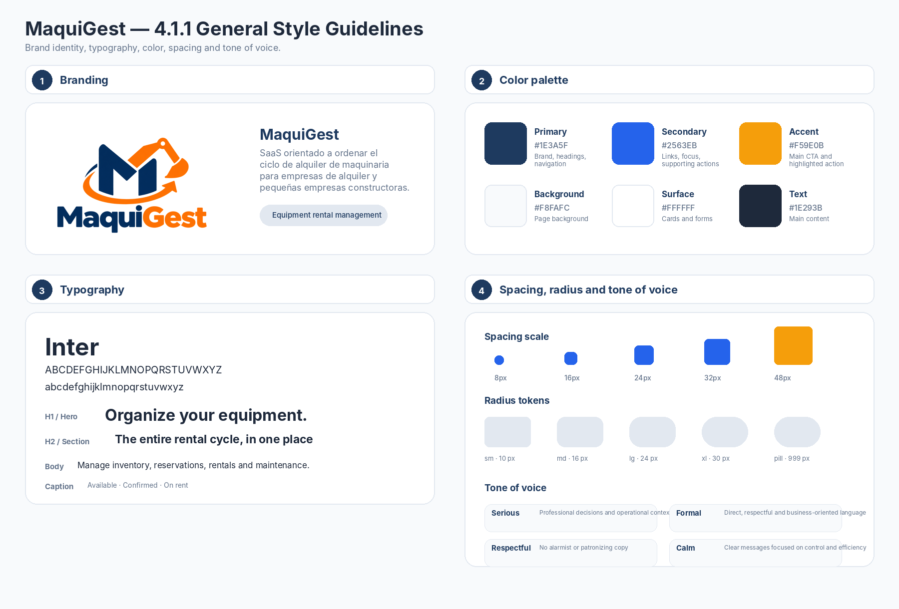
</p>

### 4.1.2. Web Style Guidelines

Las Web Style Guidelines trasladan la identidad general de MaquiGest a interfaces web responsive. La Landing Page utiliza una navegación horizontal y una organización secuencial de contenido, mientras que la Web Application utiliza navegación por módulos, cards, formularios, filtros y tablas o listas operativas.

#### Material Design and Components

El lenguaje visual de MaquiGest toma **Material Design** como referencia para la jerarquía, la separación de superficies, la consistencia de acciones, el feedback y los estados de interacción. Para la Web Application, la implementación se plantea con componentes compatibles con **Angular Material**, manteniendo la identidad propia de MaquiGest mediante sus tokens de color, tipografía y espaciado.

Los componentes principales son:

| Componente | Criterio de diseño |
|---|---|
| Primary CTA | Acción principal visible; utiliza `Accent` o `Primary` según el contexto |
| Secondary Button | Acción complementaria en variante outline o superficie blanca |
| Input / Select / Textarea | Label visible, borde consistente y estados de focus, error y disabled |
| Search Bar | Búsqueda directa por nombre o código, complementada con filtros |
| Status Badge | Etiqueta breve que comunica disponibilidad o estado operativo |
| Metric Card | Resumen de indicadores principales en dashboards |
| Data Table / List | Tabla en desktop; reorganización en cards o listas cuando el ancho sea reducido |
| Sidebar / Header | Navegación principal de Web Application / Landing Page |

#### Responsive Web Design

- **Desktop Web Browser:** estructura de hasta 12 columnas; Landing Page con header horizontal y Web Application con sidebar persistente.
- **Tablet / Small Laptop:** reducción de columnas, mayor compactación de cards y reorganización progresiva de tablas.
- **Mobile Web Browser:** distribución de una columna, menú desplegable, controles de ancho disponible y transformación de tablas extensas en listas o cards.

#### Interaction States

Los elementos interactivos deben contemplar los estados **default, hover, focus, disabled, success y error**. El focus de teclado debe ser claramente visible. La Landing Page actual implementa `:focus-visible` mediante un outline azul de `3 px`, con offset de `4 px`.

#### Internationalization and Accessibility

MaquiGest considera **English (`en_US`)** como idioma predeterminado y **Latin American Spanish (`es_419`)** como idioma alternativo. La Landing Page actual ya utiliza contenido en inglés, atributos `data-es` para su variante en español y un selector `EN / ES`.

Para accesibilidad, se consideran atributos ARIA en controles y secciones, estructura semántica, textos alternativos, foco visible y respeto por la preferencia `prefers-reduced-motion`. Estas decisiones deben mantenerse en la Web Application.

<p align="center">
  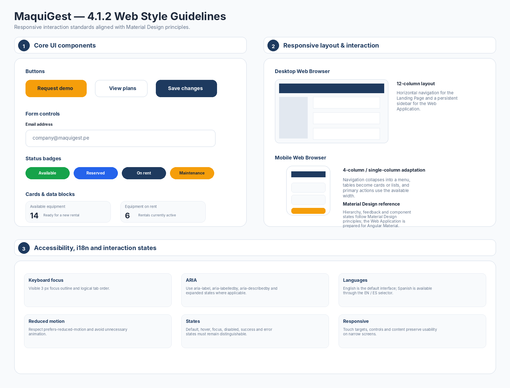
</p>

## 4.2. Information Architecture

Para el desarrollo del proyecto, la Arquitectura de la Información se plantea considerando las necesidades de los usuarios y la estructura del contenido de la plataforma. Esto permite establecer una organización coherente de las funcionalidades y reducir la complejidad durante la navegación e interacción con el sistema. 

### 4.2.1. Organization Systems

En la **Landing Page**, la información se organiza principalmente de manera **jerárquica y secuencial**. El visitante comienza con la propuesta de valor en Home y continúa hacia Benefits, Features, About, Solutions, Plans, Demo y Contact. Esta secuencia acompaña el proceso de conocimiento, evaluación y conversión del visitante.

En la **Web Application**, la organización es principalmente **por tópicos y por audiencia**. Después de la autenticación, la navegación se adapta al tipo de organización:

- La **empresa de alquiler de maquinaria** accede a Dashboard, Equipment, Rental Requests, Reservations, Rentals, Maintenance, Plan & Subscription y Profile.
- La **empresa constructora** accede a Dashboard, Search Equipment, Equipment Detail, My Requests, My Reservations, My Rentals y Profile.

También existe organización **secuencial** dentro del ciclo operativo: consulta o registro de maquinaria → solicitud → reserva → alquiler → entrega/devolución → inspección o mantenimiento → disponibilidad.

<p align="center">
  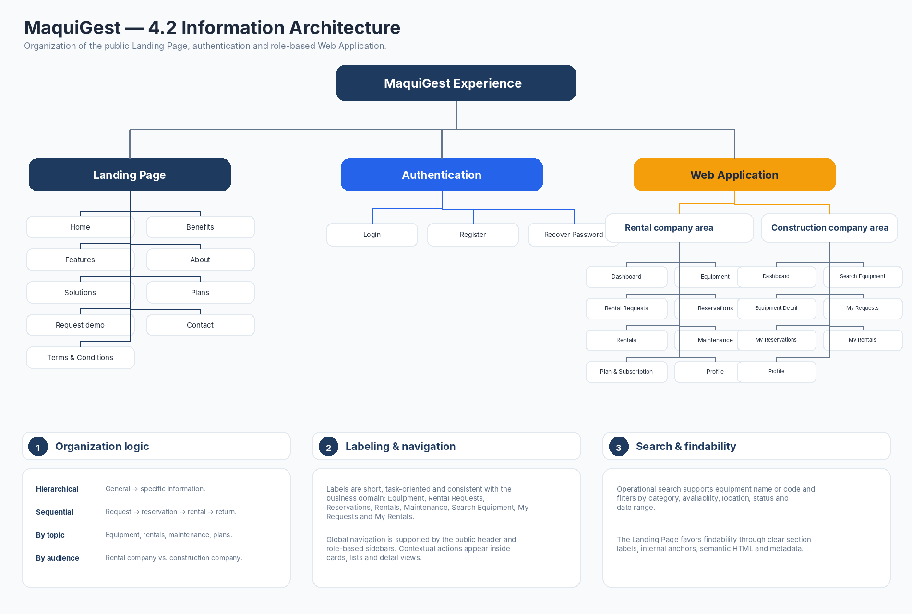
</p>

### 4.2.2. Labeling Systems

El sistema de etiquetado utiliza términos cortos, reconocibles y consistentes con las tareas del dominio. El idioma de interfaz predeterminado es inglés, manteniendo equivalentes en español mediante i18n.

| Contexto | Etiqueta principal | Asociación esperada |
|---|---|---|
| Landing Page | `Home` | Propuesta de valor y accesos principales |
| Landing Page | `Benefits` | Beneficios del uso de MaquiGest |
| Landing Page | `Features` | Capacidades principales del producto |
| Landing Page | `Solutions` | Soluciones para los segmentos objetivo |
| Landing Page | `Plans` | Planes Essential, Professional y Growth |
| Landing Page | `Request demo` | Solicitud de demostración |
| Web Application – Rental company | `Equipment` | Inventario y estado de maquinaria |
| Web Application – Rental company | `Rental Requests` | Solicitudes recibidas |
| Web Application – Rental company | `Reservations` | Reservas confirmadas |
| Web Application – Rental company | `Rentals` | Alquileres activos y seguimiento |
| Web Application – Rental company | `Maintenance` | Inspecciones, incidencias y mantenimiento |
| Web Application – Construction company | `Search Equipment` | Búsqueda de maquinaria disponible |
| Web Application – Construction company | `My Requests` | Solicitudes enviadas |
| Web Application – Construction company | `My Reservations` | Reservas confirmadas del usuario |
| Web Application – Construction company | `My Rentals` | Alquileres vigentes e historial operativo |

Los estados se comunican con etiquetas breves como `Available`, `Reserved`, `On rent`, `Maintenance`, `Confirmed`, `Pending` e `Inspection pending`, acompañadas por color pero sin depender exclusivamente de él.

### 4.2.3. SEO Tags and Meta Tags

Los SEO Tags y Meta Tags permiten describir correctamente las principales páginas de la experiencia. En la Landing Page se conservan los valores actualmente implementados. Para la Web Application se establecen valores coherentes con su propósito operativo.

| Producto | Tag | Valor                                                                                                                                                                        |
|---|---|------------------------------------------------------------------------------------------------------------------------------------------------------------------------------|
| Landing Page | `title` | `MaquiGest` \| Equipment rental management`                                                                                                                                  |
| Landing Page | `description` | `Manage construction equipment rentals in one place. Organize inventory, availability, reservations, rentals and maintenance with MaquiGest.`                                |
| Landing Page | `keywords` | `equipment rental, construction equipment, rental management software, MaquiGest`                                                                                            |
| Landing Page | `author` | `CleanCode`                                                                                                                                                                  |
| Web Application | `title` | `MaquiGest`                                                                                                                                   \| Equipment rental workspace` |
| Web Application | `description` | `Manage equipment, rental requests, reservations, rentals and maintenance in the MaquiGest workspace.`                                                                       |
| Web Application | `keywords` | `equipment management, rental requests, reservations, rentals, maintenance, MaquiGest`                                                                                       |
| Web Application | `author` | `CleanCode`                                                                                                                                                                  |

Como metadatos transversales se utiliza `charset=UTF-8` y un `viewport` adaptable a dispositivos. El documento HTML actual declara `lang="en-US"`; la variante en español se gestiona mediante i18n.

### 4.2.4. Searching Systems

El sistema de búsqueda se concentra en las zonas donde el volumen de registros puede dificultar el acceso directo a la información. En la Landing Page, la necesidad de búsqueda se resuelve principalmente mediante navegación por secciones y CTA, mientras que en la Web Application se incorpora búsqueda operativa y filtros.

| Área | Búsqueda / filtros | Presentación de resultados |
|---|---|---|
| Equipment – empresa de alquiler | Nombre, código, categoría, estado, ubicación y disponibilidad | Tabla en desktop; cards/lista en mobile |
| Rental Requests | Estado, cliente y período | Listado priorizado por estado y fecha |
| Reservations | Estado y rango de fechas | Tabla o cards con equipo, cliente y período |
| Rentals | Estado, cliente, equipo y fecha de devolución | Tabla con badges de estado y alertas temporales |
| Maintenance | Equipo, estado, tipo de mantenimiento y fecha | Listado de tareas e incidencias |
| Equipment Search – constructora | Nombre/categoría, ubicación, disponibilidad y rango de fechas | Catálogo de cards con datos esenciales del equipo |

El criterio principal es combinar **búsqueda directa** —cuando el usuario conoce el nombre o código— con **búsqueda exploratoria por filtros** cuando necesita comparar alternativas.

### 4.2.5. Navigation Systems

MaquiGest utiliza distintos niveles de navegación para ayudar al usuario a completar sus objetivos sin perder contexto.

| Tipo de navegación | Aplicación en MaquiGest |
|---|---|
| Global | Header de Landing Page y sidebar principal de la Web Application |
| Local | Módulos específicos como Equipment, Rentals, Maintenance o My Requests |
| Contextual | `View details`, editar, aprobar, rechazar, registrar entrega o devolución |
| Utility | Selector `EN / ES`, Profile, Plan & Subscription y Sign out |
| Quick actions | `Register equipment`, `Review requests`, `Register rental`, `Request demo` |
| Responsive | Menú toggle/drawer en mobile y reorganización vertical de contenido |

En la Landing Page, la navegación global conduce a `Home`, `Benefits`, `Features`, `About`, `Plans`, `Contact` y `Request demo`, mientras que `Solutions` forma parte de la secuencia de contenido. En la Web Application, la navegación se adapta al rol para evitar mostrar módulos irrelevantes.

La navegación contextual permite avanzar entre las vistas que conforman el ciclo de alquiler, mientras que las quick actions reducen la cantidad de pasos para las tareas más frecuentes. En dispositivos móviles, la navegación principal se compacta en un menú desplegable y el contenido se presenta verticalmente para preservar legibilidad y facilidad de interacción.

## 4.3. Landing Page UI Design
### 4.3.1. Landing Page Wireframe

En esta sección se presentan los wireframes de la Landing Page de MaquiGest. Estos artefactos permiten definir la estructura inicial de la interfaz, la distribución de los contenidos y la jerarquía visual de los principales elementos antes de aplicar los estilos finales del producto. Asimismo, permiten evidenciar la traducción de las decisiones tomadas previamente en las secciones de Style Guidelines e Information Architecture hacia una propuesta concreta de interfaz para la Landing Page.

La propuesta de wireframes organiza la experiencia de navegación de forma jerárquica y secuencial, guiando al visitante desde la comprensión inicial de la propuesta de valor de MaquiGest hasta las acciones de conversión, como la solicitud de una demostración o el envío de una consulta. La estructura general está compuesta por las secciones Home, Benefits, Features, About Us, Solutions, Plans, Request Demo y Contact, las cuales responden a las necesidades de los segmentos objetivo previamente identificados: pequeñas y medianas empresas de alquiler de maquinaria y pequeñas empresas constructoras.

#### Desktop Web Browser

La versión para Desktop Web Browser aprovecha el espacio horizontal para distribuir la información mediante bloques claramente diferenciados, facilitando la lectura, la comparación de contenido y la identificación de los principales llamados a la acción. La propuesta mantiene consistencia estructural entre secciones y aplica principios de jerarquía visual, alineación, proximidad y contraste, permitiendo que los visitantes comprendan de manera progresiva la solución ofrecida por MaquiGest.

##### Home

El wireframe de la sección Home presenta el primer contacto entre el visitante y la propuesta de valor de MaquiGest. En esta sección se ubican el encabezado de navegación, el mensaje principal del producto, una breve descripción y los principales Call To Action: “Solicitar Demo” y “Ver planes”. La composición está orientada a comunicar rápidamente el propósito de la plataforma y motivar al visitante a continuar explorando el sitio.

<p align="center">
  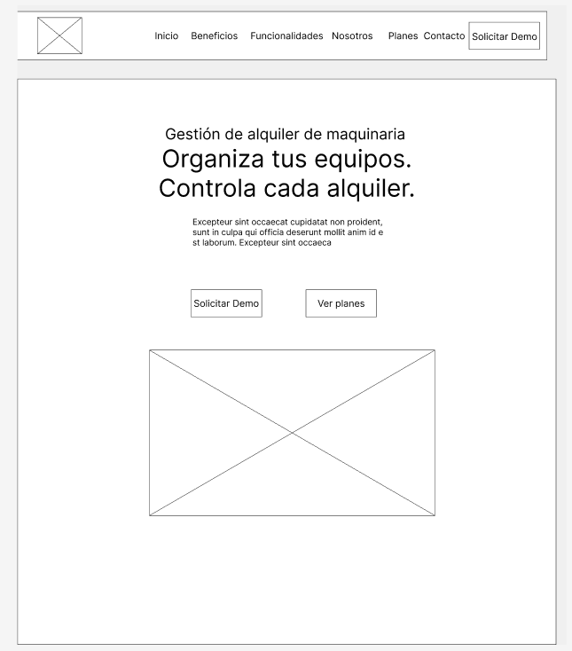
</p>

##### Benefits

La sección Benefits organiza en tres bloques los principales beneficios de la solución. Esta disposición permite que el visitante identifique rápidamente el valor que ofrece MaquiGest, destacando aspectos como el control de disponibilidad, la centralización de operaciones y el seguimiento del estado de la maquinaria. La estructura mediante cards facilita la exploración y comparación de la información.

<p align="center">
  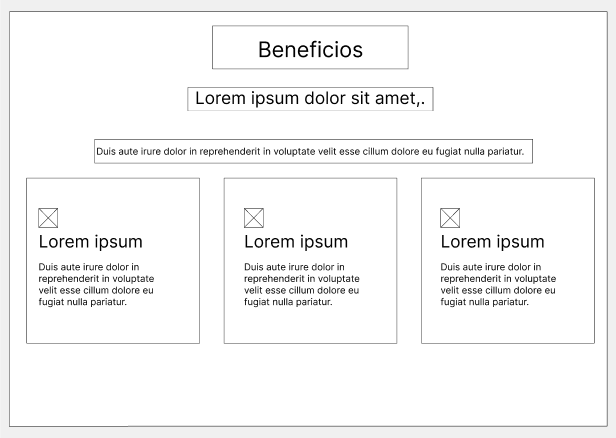
</p>

##### Features

La sección Features presenta las funcionalidades principales de la plataforma mediante seis cards distribuidas en una retícula. Esta organización permite representar de forma clara y ordenada las herramientas más importantes de MaquiGest, como la gestión del inventario de maquinaria, disponibilidad, alquileres, entregas y devoluciones, mantenimiento e incidencias, y búsqueda o solicitud de equipos. La distribución busca favorecer la legibilidad y el reconocimiento visual de cada funcionalidad.

<p align="center">
  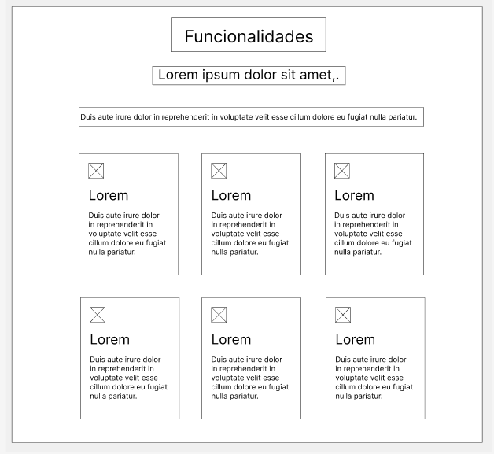
</p>

##### About Us

La sección About Us comunica la identidad de la startup y la intención del producto. El wireframe emplea una composición de bloques que permite presentar información institucional de forma resumida, como la misión, la visión y los valores de CleanCode y MaquiGest. Esta organización contribuye a fortalecer la credibilidad de la propuesta y a comunicar el enfoque del equipo desarrollador.

<p align="center">
  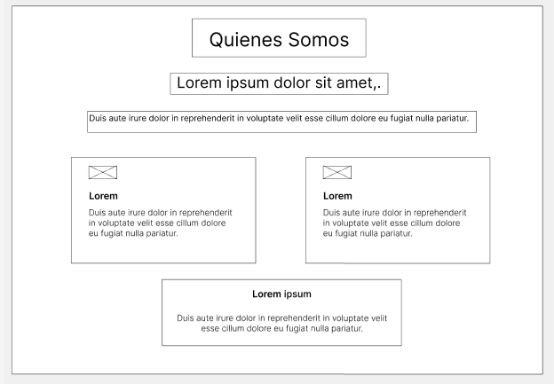
</p>

##### Solutions

La sección Solutions traduce de forma directa los resultados del análisis de segmentos objetivo. Su estructura permite diferenciar visualmente las soluciones orientadas a pequeñas y medianas empresas de alquiler de maquinaria y a pequeñas empresas constructoras. De esta manera, cada visitante puede identificar rápidamente la propuesta de valor más cercana a sus necesidades y relacionarla con su contexto de uso.

<p align="center">
  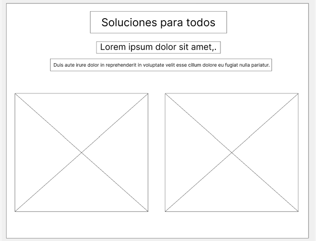
</p>

##### Plans

La sección Plans organiza la información comercial de la plataforma en tres tarjetas comparables. El objetivo de esta disposición es permitir que el visitante reconozca de manera sencilla las alternativas disponibles y evalúe la opción más adecuada para su negocio. El uso de cards refuerza la claridad, la comparación entre opciones y la orientación a la conversión.

<p align="center">
  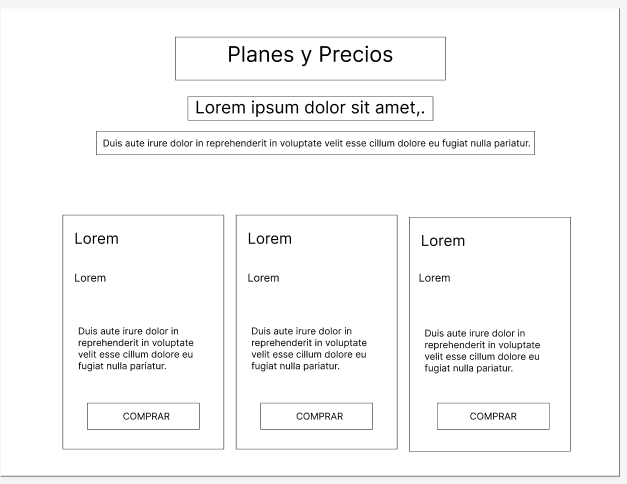
</p>

##### Request Demo

La sección Request Demo está orientada a la conversión del visitante. El wireframe organiza el contenido en dos áreas: una zona de explicación breve sobre la demostración y un formulario para registrar los datos del interesado. Esta distribución facilita la comprensión del propósito de la sección y reduce la fricción durante el proceso de contacto inicial con la startup.

<p align="center">
  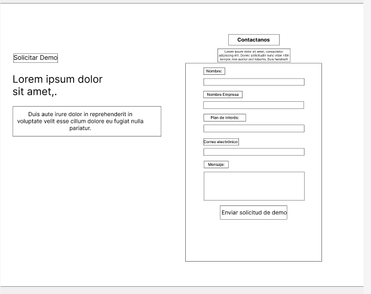
</p>

##### Contact

La sección Contact presenta un formulario orientado a consultas generales y se complementa con un footer informativo. Su estructura prioriza la claridad en la interacción, permitiendo que el visitante identifique fácilmente los campos necesarios para enviar un mensaje. Además, el footer funciona como cierre de la experiencia, reforzando la navegación, la identidad del producto y la información complementaria del sitio.

<p align="center">
  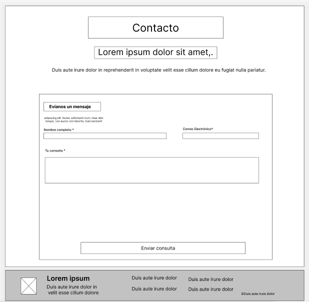
</p>

En conjunto, los wireframes de la Landing Page de MaquiGest evidencian una propuesta estructurada, coherente con la arquitectura de información y orientada a una experiencia de navegación clara, comprensible e inclusiva. La distribución de secciones, el uso de jerarquías visuales y la ubicación de los llamados a la acción buscan facilitar tanto la comprensión de la propuesta de valor como la interacción de los visitantes con el producto.

#### Mobile Web Browser

La versión para Mobile Web Browser adapta la estructura de la Landing Page de MaquiGest a una pantalla de menor ancho, priorizando la legibilidad, la navegación vertical y el acceso rápido a los principales llamados a la acción. Para ello, los contenidos se reorganizan en una sola columna, manteniendo la misma secuencia informativa definida en la versión desktop y preservando la coherencia con la arquitectura de información establecida previamente.

En esta propuesta, el encabezado se simplifica mediante un menú hamburguesa, lo cual permite optimizar el espacio disponible sin perder acceso a las secciones principales del sitio. Asimismo, el Hero prioriza el mensaje principal del producto y los Call To Action “Solicitar Demo” y “Ver planes”, con una disposición centrada que facilita la lectura y la interacción desde dispositivos móviles.

##### Home

La sección Home en mobile presenta la propuesta de valor de MaquiGest de forma resumida, destacando el nombre del producto, una breve descripción y los principales Call To Action. La disposición vertical permite centrar la atención del visitante en el propósito de la Landing Page desde el inicio de la experiencia.

<p align="center">
  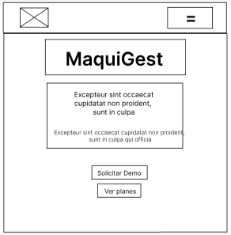
</p>

##### Benefits

La sección Benefits reorganiza la propuesta de beneficios en una sola card visible por bloque, priorizando la lectura secuencial y reduciendo la sobrecarga visual en pantallas pequeñas. Esta adaptación mantiene claridad en la presentación del valor de la plataforma.

<p align="center">
  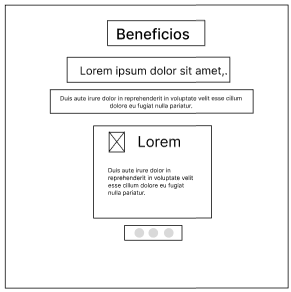
</p>

##### Features

La sección Features adapta las funcionalidades principales a una experiencia vertical y progresiva. Cada funcionalidad se presenta en tarjetas individuales, permitiendo al usuario concentrarse en un elemento a la vez y comprender con facilidad las capacidades principales de MaquiGest.

<p align="center">
  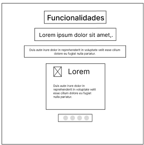
</p>

##### About Us

La sección About Us en mobile conserva la información institucional de forma resumida y jerarquizada. Los bloques de contenido se disponen verticalmente para facilitar la lectura y mantener una presentación limpia y comprensible sobre la identidad de CleanCode y MaquiGest.

<p align="center">
  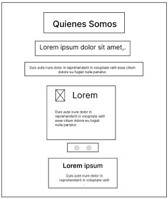
</p>

##### Solutions

La sección Solutions mantiene la diferenciación de la propuesta de valor para los segmentos objetivo, reorganizando el contenido en formato vertical. Esta decisión favorece la identificación progresiva de cada solución y mejora la experiencia de lectura en dispositivos móviles.

<p align="center">
  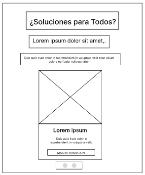
</p>

##### Plans

La sección Plans reorganiza las alternativas disponibles en un formato vertical, permitiendo que cada plan sea visualizado individualmente. Esta adaptación mejora la comparación y facilita que el visitante identifique la opción más adecuada sin afectar la claridad del contenido.

<p align="center">
  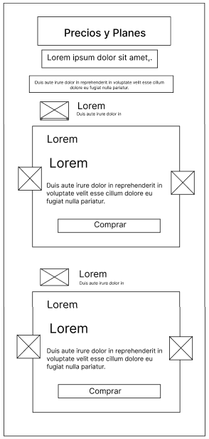
</p>

##### Request Demo

La sección Request Demo en mobile prioriza la simplicidad de interacción, presentando el contenido explicativo y el formulario en una estructura vertical. Esta organización reduce la fricción y facilita el registro de datos desde una pantalla táctil.

<p align="center">
  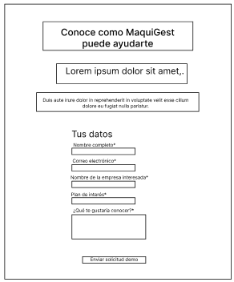
</p>

##### Contact

La sección Contact adapta el formulario y el footer al entorno móvil, manteniendo una disposición clara de campos y botones para favorecer la interacción del visitante. De esta forma, se asegura una experiencia consistente y accesible al cierre del recorrido de la Landing Page.

<p align="center">
  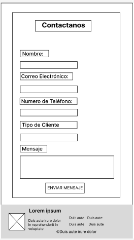
</p>

En conjunto, la propuesta mobile mantiene la estructura, jerarquía y objetivos de conversión de la Landing Page de MaquiGest, adaptándolos a las características de navegación propias de dispositivos móviles. La organización en una sola columna, el uso de un menú simplificado y la disposición vertical de las cards y formularios contribuyen a una experiencia clara, comprensible e inclusiva.

### 4.3.2. Landing Page Mock-up

En esta sección se presentan los mock-ups de la Landing Page de MaquiGest para las versiones Desktop Web Browser y Mobile Web Browser. A diferencia de los wireframes, los mock-ups incorporan los elementos visuales definidos para el producto, como colores, tipografía, iconografía, estilos de botones, cards, formularios y demás componentes de interfaz, permitiendo representar una versión más cercana al resultado final de la Landing Page.

La propuesta mantiene la estructura y jerarquía establecidas previamente en los wireframes y aplica de manera consistente el Design System de MaquiGest. La identidad visual utiliza principalmente tonos azul oscuro, azul y naranja, acompañados de fondos claros que favorecen la legibilidad y permiten destacar los principales Call To Action.

Asimismo, los mock-ups evidencian la aplicación de principios de jerarquía visual, alineación, proximidad, consistencia y contraste. La organización del contenido facilita que los visitantes comprendan progresivamente la propuesta de valor, conozcan los beneficios y funcionalidades del producto, identifiquen la solución correspondiente a su segmento, comparen los planes disponibles y puedan solicitar una demostración o ponerse en contacto con CleanCode.

#### Landing Page Mock-up para Desktop Web Browser

La versión Desktop Web Browser aprovecha el espacio horizontal para organizar los contenidos mediante una estructura clara y consistente. El Header mantiene visibles las principales opciones de navegación y los Call To Action, mientras que las diferentes secciones utilizan cards, bloques de contenido y formularios para facilitar la exploración de la información.

La sección Home presenta la identidad de MaquiGest y comunica directamente su propuesta de valor mediante el mensaje principal “Organize your equipment. Stay on top of every rental.”. Los botones “Request demo” y “View plans” destacan las principales acciones disponibles para el visitante.

<p align="center">
  
</p>

La sección Benefits presenta tres beneficios principales mediante cards diferenciadas visualmente: claridad sobre la disponibilidad de equipos, conexión de las operaciones de alquiler y cuidado de la maquinaria. Esta organización permite comunicar de forma rápida los principales resultados que MaquiGest busca ofrecer a sus usuarios.

<p align="center">
  
</p>

La sección Features organiza las principales funcionalidades de MaquiGest mediante una retícula de seis cards. Entre ellas se encuentran la gestión del inventario de maquinaria, disponibilidad y reservas, seguimiento de alquileres, entregas y devoluciones, mantenimiento e incidencias, y búsqueda y solicitud de equipos. Esta disposición facilita la identificación y comprensión de las capacidades principales de la plataforma.

<p align="center">
  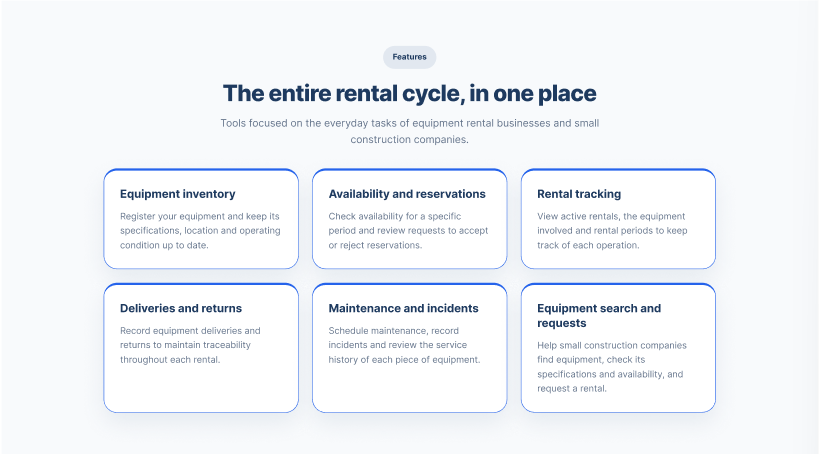
</p>

La sección About Us presenta a CleanCode como la startup responsable de MaquiGest. La información se organiza mediante bloques diferenciados para misión, visión y valores, reforzando la identidad del equipo y comunicando los principios que orientan el desarrollo del producto.

<p align="center">
  
</p>

La sección Solutions diferencia visualmente las propuestas dirigidas a los dos segmentos objetivo de MaquiGest. El primer bloque está orientado a empresas de alquiler de maquinaria que requieren centralizar información y operaciones durante todo el ciclo de alquiler. El segundo está dirigido a pequeñas empresas constructoras que necesitan buscar equipos, consultar disponibilidad y gestionar sus solicitudes de alquiler.

<p align="center">
  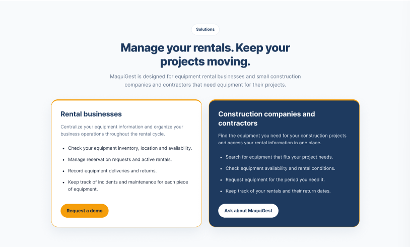
</p>

La sección Plans presenta los planes Essential, Professional y Growth mediante cards comparables. Cada alternativa muestra su precio referencial, propósito, principales funcionalidades y un Call To Action para solicitar una demostración. El plan Professional recibe un tratamiento visual destacado mediante la etiqueta “Recommended”, estableciendo una jerarquía entre las alternativas sin impedir su comparación.

<p align="center">
  
</p>

La sección Request Demo utiliza una composición de dos columnas. En el lado izquierdo se explica brevemente el propósito de la demostración, mientras que en el lado derecho se presenta un formulario con los datos necesarios para registrar el interés del visitante. El botón “Send demo request” funciona como Call To Action principal de la sección y utiliza el color de acento para reforzar su visibilidad.

<p align="center">
  
</p>

Finalmente, la sección Contact permite realizar consultas generales mediante un formulario simplificado compuesto por nombre, correo electrónico y mensaje. El Footer complementa el cierre de la experiencia mediante la identidad visual de MaquiGest, accesos de navegación, información de copyright y el enlace a los términos y condiciones.

<p align="center">
  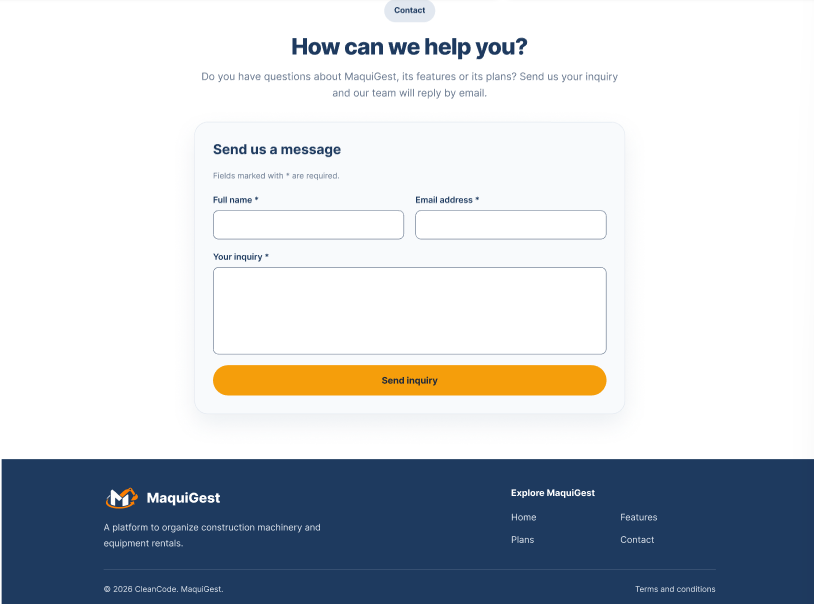
</p>

En conjunto, los mock-ups para Desktop Web Browser muestran la evolución visual de los wireframes y evidencian la aplicación coherente de la identidad visual y del Design System de MaquiGest. La combinación de jerarquía visual, contraste, agrupación de contenido, componentes reutilizables y Call To Action claramente identificables busca proporcionar una experiencia clara, consistente y orientada a las necesidades de los segmentos objetivo.

#### Landing Page Mock-up para Mobile Web Browser

La versión Mobile Web Browser adapta la propuesta visual de la Landing Page de MaquiGest a pantallas de menor tamaño, manteniendo la misma estructura, identidad visual y objetivos de conversión definidos para la versión desktop. En esta adaptación, los contenidos se reorganizan en una sola columna, priorizando la lectura vertical, la claridad de los elementos interactivos y la facilidad de navegación desde dispositivos móviles.

La propuesta conserva los lineamientos del Design System de MaquiGest mediante el uso consistente de colores, tipografía, botones, cards y formularios. Asimismo, se aplican principios de jerarquía visual, contraste, proximidad y consistencia para asegurar que la experiencia en dispositivos móviles continúe siendo clara, comprensible y alineada con las necesidades de los segmentos objetivo.

La sección Home concentra la propuesta de valor principal de MaquiGest en una composición vertical. El mensaje central, los botones “Request demo” y “View plans”, y la presencia destacada del logotipo permiten que el visitante identifique rápidamente el propósito de la plataforma desde el inicio de la navegación.

<p align="center">
  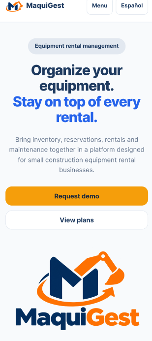
</p>

La sección Benefits reorganiza los beneficios principales en tarjetas apiladas verticalmente, favoreciendo la lectura secuencial y la comprensión rápida del valor de la solución. Esta disposición permite destacar con claridad la disponibilidad, la conexión de operaciones y el cuidado de la maquinaria.

<p align="center">
  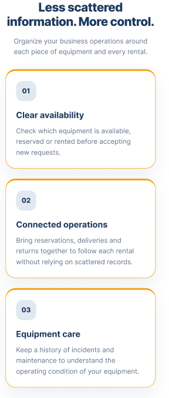
</p>

La sección Features presenta las funcionalidades principales de la plataforma mediante cards verticales, facilitando la lectura de cada capacidad del sistema en una pantalla reducida. Esta distribución permite al visitante reconocer progresivamente funciones como el inventario de maquinaria, disponibilidad y reservas, seguimiento de alquileres, entregas y devoluciones, mantenimiento e incidencias, y búsqueda o solicitud de equipos.

<p align="center">
  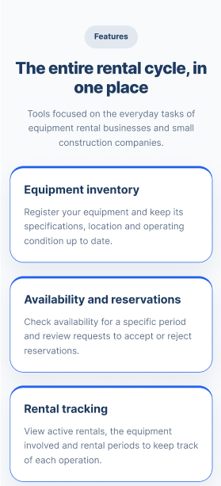
</p>

La sección About Us adapta la información institucional de CleanCode y MaquiGest a una estructura vertical, presentando de forma clara la misión, visión y valores del equipo. El uso de bloques diferenciados favorece la legibilidad y evita la saturación de contenido en la interfaz móvil.

<p align="center">
  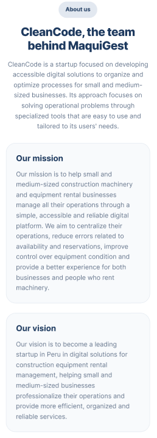
</p>

La sección Solutions mantiene la diferenciación de la propuesta de valor para los segmentos objetivo de MaquiGest. En la versión mobile, los bloques se presentan uno debajo del otro, permitiendo que el visitante identifique con claridad la solución orientada a empresas de alquiler de maquinaria y la propuesta dirigida a pequeñas empresas constructoras.

<p align="center">
  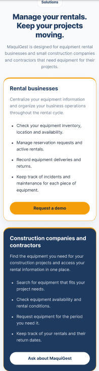
</p>

La sección Plans reorganiza las alternativas disponibles en un formato vertical, permitiendo visualizar cada plan de manera individual. Esta adaptación mejora la comparación y mantiene una lectura clara de los planes Essential, Professional y Growth, así como de sus respectivas características y llamados a la acción.

<p align="center">
  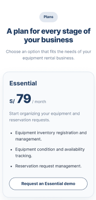
</p>
<p align="center">
  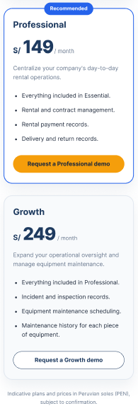
</p>

La sección Request Demo combina una breve explicación de la demostración con un formulario adaptado a interacción táctil. La disposición en una sola columna facilita el ingreso de datos desde un dispositivo móvil y mantiene visible el Call To Action principal para enviar la solicitud.

<p align="center">
  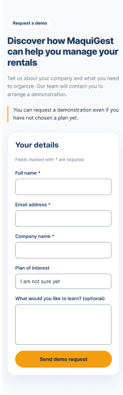
</p>

Finalmente, la sección Contact presenta un formulario simplificado para consultas generales y un footer adaptado al entorno móvil. La disposición vertical de los enlaces, el contenido institucional y la información complementaria permite cerrar la experiencia de navegación de manera ordenada y consistente con la identidad visual del producto.

<p align="center">
  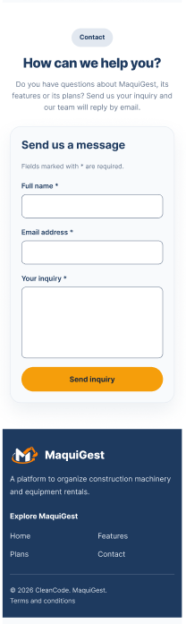
</p>

En conjunto, los mock-ups para Mobile Web Browser evidencian la adaptación del diseño visual de MaquiGest a dispositivos móviles, manteniendo coherencia con la versión desktop y aplicando de forma consistente el Design System del producto. La organización vertical, la claridad de los componentes y la visibilidad de los llamados a la acción contribuyen a una experiencia intuitiva, accesible y orientada a la conversión.


## 4.4. Web Applications UX/UI Design

### 4.4.1. Web Applications Wireframes

Los wireframes de la Web Application de MaquiGest representan la estructura funcional y la organización de las principales interfaces antes de incorporar los elementos visuales definitivos del Design System. Estos artefactos permiten definir la jerarquía de información, los componentes de interacción y los recorridos principales que realizarán los usuarios dentro de la aplicación.

Las interfaces consideran experiencias diferenciadas para los dos segmentos objetivo. Las empresas de alquiler de maquinaria disponen de funcionalidades orientadas a la gestión del inventario, solicitudes, reservas, alquileres y mantenimiento; mientras que las pequeñas empresas constructoras acceden a funcionalidades relacionadas con la búsqueda de maquinaria, consulta de disponibilidad, solicitud de alquiler y seguimiento de sus operaciones.

Cada pantalla contempla una variante para Desktop Web Browser y otra para Mobile Web Browser. En escritorio se prioriza el uso de navegación lateral, tablas, cards y paneles; mientras que en mobile los contenidos se reorganizan verticalmente y las tablas se transforman en cards para conservar la legibilidad y facilidad de interacción.
#### 1. Login

**Propósito:** Permitir que los usuarios registrados accedan de forma segura a MaquiGest mediante sus credenciales.

**Elementos clave:**
- Logotipo de MaquiGest y selector de idioma.
- Campo de correo electrónico y campo de contraseña.
- Acción principal para iniciar sesión.
- Enlace para recuperar la contraseña.
- Enlace para crear una nueva cuenta.

**Desktop Web Browser**

<p align="center">
  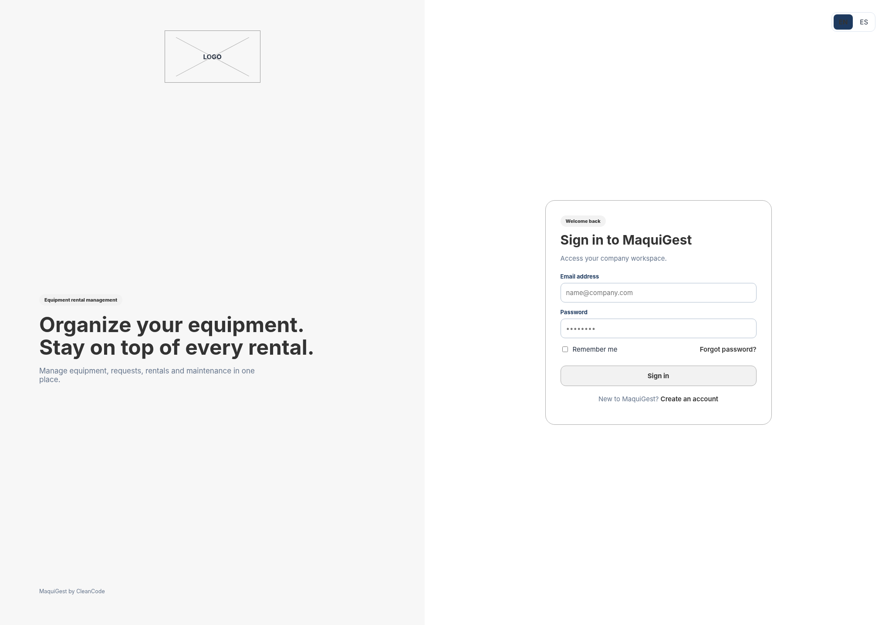
</p>

**Mobile Web Browser**

<p align="center">
  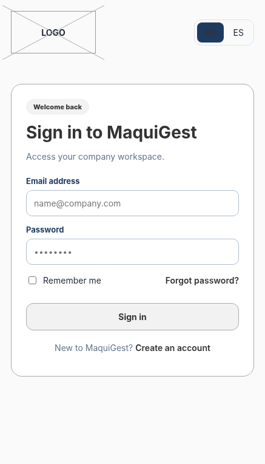
</p>

#### 2. Registro de usuario

**Propósito:** Permitir la creación de una cuenta y recopilar la información necesaria para identificar al usuario y su organización dentro de MaquiGest.

**Elementos clave:**
- Datos personales del usuario.
- Correo electrónico y contraseña.
- Información básica de la empresa.
- Selección del tipo de organización.
- Acción para crear la cuenta.
- Enlace para volver al inicio de sesión.

**Desktop Web Browser**

<p align="center">
  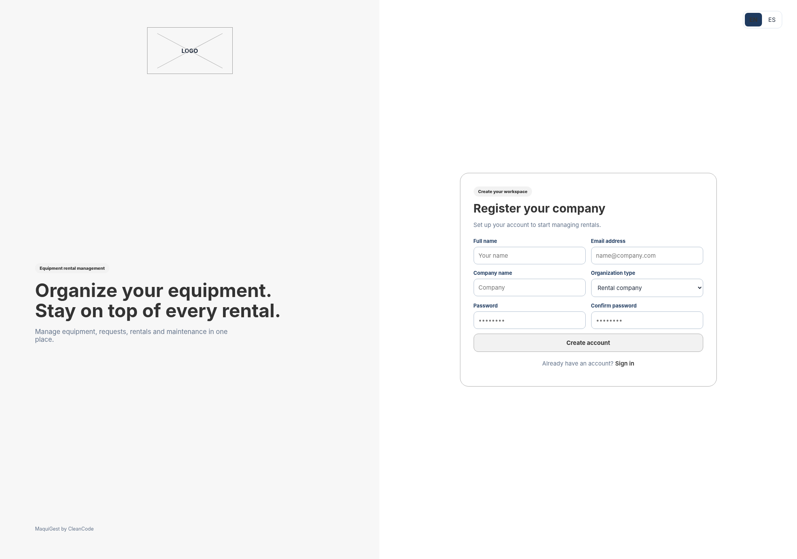
</p>

**Mobile Web Browser**

<p align="center">
  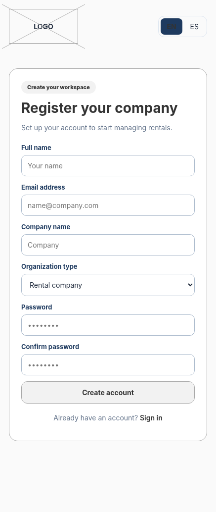
</p>

#### 3. Recuperación de contraseña

**Propósito:** Permitir que un usuario que no recuerda su contraseña solicite instrucciones para recuperar el acceso a su cuenta.

**Elementos clave:**
- Campo de correo electrónico.
- Acción para enviar la solicitud de recuperación.
- Mensaje informativo sobre el proceso.
- Enlace para volver al inicio de sesión.

**Desktop Web Browser**

<p align="center">
  
</p>

**Mobile Web Browser**

<p align="center">
  
</p>

#### 4. Dashboard — Empresa de alquiler de maquinaria

**Propósito:** Proporcionar al administrador una vista general de la disponibilidad de su maquinaria y de las operaciones de alquiler, facilitando la identificación de próximas entregas, devoluciones y necesidades de mantenimiento.

**Elementos clave:**
- Navegación lateral hacia Dashboard, Equipment, Rental requests, Reservations, Rentals, Maintenance, Clients y Reports.
- Accesos rápidos para registrar maquinaria, revisar solicitudes y registrar un alquiler.
- Indicadores de maquinaria disponible, maquinaria alquilada, maquinaria en mantenimiento y próximas reservas.
- Listado de reservas confirmadas y resumen de alquileres activos con sus fechas de devolución.
- Seguimiento de inspecciones, mantenimiento y actividad reciente.
- Selector de idioma y acceso a la cuenta del administrador.

**Desktop Web Browser**

<p align="center">
  
</p>

**Mobile Web Browser**

<p align="center">
  
</p>

Los registros, cantidades y fechas se presentan como datos ilustrativos para representar la organización de la información.

#### 5. Equipment — Gestión de maquinaria

**Propósito:** Permitir que la empresa de alquiler consulte y administre la maquinaria registrada, identificando rápidamente su disponibilidad, estado y ubicación.

**Elementos clave:**
- Acción principal para registrar maquinaria.
- Barra de búsqueda por nombre o código.
- Filtros por categoría, estado, ubicación y disponibilidad.
- Indicadores de equipos disponibles, alquilados y en mantenimiento.
- Listado de maquinaria con código, categoría, ubicación y estado.
- Acciones para consultar detalles y editar información.

**Desktop Web Browser**

<p align="center">
  
</p>

**Mobile Web Browser**

<p align="center">
  
</p>

#### 6. Rental Requests — Solicitudes de alquiler

**Propósito:** Permitir que la empresa de alquiler revise las solicitudes recibidas y determine cuáles pueden ser atendidas de acuerdo con la disponibilidad de la maquinaria.

**Elementos clave:**
- Resumen de solicitudes pendientes, aprobadas y rechazadas.
- Filtros por estado y fecha.
- Información del solicitante, equipo solicitado y período.
- Acciones para revisar, aprobar o rechazar solicitudes.
- Etiquetas de estado claramente diferenciadas.

**Desktop Web Browser**

<p align="center">
  
</p>

**Mobile Web Browser**

<p align="center">
  
</p>

#### 7. Reservations — Reservas

**Propósito:** Permitir que la empresa de alquiler consulte y administre las reservas confirmadas de maquinaria para determinados períodos.

**Elementos clave:**
- Listado de reservas confirmadas.
- Equipo, cliente y período de reserva.
- Próximas fechas de entrega.
- Filtros por período y estado.
- Acceso al detalle de la reserva.
- Acción para continuar con el registro del alquiler.

**Desktop Web Browser**

<p align="center">
  
</p>

**Mobile Web Browser**

<p align="center">
  
</p>

#### 8. Rentals — Alquileres

**Propósito:** Permitir que la empresa de alquiler consulte los alquileres activos y gestione las etapas de entrega y devolución de la maquinaria.

**Elementos clave:**
- Resumen de alquileres activos y próximos a vencer.
- Información de equipo, cliente, fecha de inicio y devolución.
- Estados del alquiler.
- Acciones para registrar entrega y devolución.
- Indicadores para devoluciones próximas o vencidas.

**Desktop Web Browser**

<p align="center">
  
</p>

**Mobile Web Browser**

<p align="center">
  
</p>

#### 9. Maintenance — Mantenimiento e incidencias

**Propósito:** Permitir que la empresa de alquiler gestione inspecciones, incidencias, mantenimientos programados y el historial operativo de la maquinaria.

**Elementos clave:**
- Resumen de equipos en mantenimiento e inspecciones pendientes.
- Listado de mantenimientos programados y en curso.
- Registro de incidencias asociadas a maquinaria.
- Fecha, tipo y estado de cada mantenimiento.
- Acciones para registrar, programar o consultar mantenimiento.

**Desktop Web Browser**

<p align="center">
  
</p>

**Mobile Web Browser**

<p align="center">
  
</p>

#### 10. Dashboard — Empresa constructora

**Propósito:** Proporcionar a la empresa constructora una vista general de sus solicitudes, reservas y alquileres, permitiéndole conocer rápidamente el estado de la maquinaria requerida para sus proyectos.

**Elementos clave:**
- Navegación hacia Dashboard, Search equipment, My requests, My reservations, My rentals y Profile.
- Acción principal para buscar maquinaria.
- Resumen de solicitudes pendientes y reservas próximas.
- Alquileres activos y fechas de devolución.
- Actividad reciente relacionada con solicitudes y alquileres.

**Desktop Web Browser**

<p align="center">
  
</p>

**Mobile Web Browser**

<p align="center">
  
</p>

#### 11. Equipment Search — Búsqueda de maquinaria

**Propósito:** Permitir que la empresa constructora encuentre maquinaria de acuerdo con las necesidades de su proyecto.

**Elementos clave:**
- Barra de búsqueda.
- Filtros por categoría, disponibilidad, ubicación y características.
- Cards de maquinaria con nombre, código, categoría y estado.
- Información resumida de disponibilidad.
- Acción para consultar el detalle de un equipo.

**Desktop Web Browser**

<p align="center">
  
</p>

**Mobile Web Browser**

<p align="center">
  
</p>

#### 12. Equipment Detail — Detalle de maquinaria

**Propósito:** Permitir que la empresa constructora consulte las características, condiciones y disponibilidad de una maquinaria antes de solicitar su alquiler.

**Elementos clave:**
- Nombre, código, categoría e información descriptiva del equipo.
- Características y condiciones de alquiler.
- Estado y disponibilidad.
- Selección del período requerido.
- Acción para consultar disponibilidad.
- Acción principal para solicitar alquiler.

**Desktop Web Browser**

<p align="center">
  
</p>

**Mobile Web Browser**

<p align="center">
  
</p>

#### 13. My Requests — Mis solicitudes

**Propósito:** Permitir que la empresa constructora consulte el estado de las solicitudes de alquiler realizadas.

**Elementos clave:**
- Listado de solicitudes realizadas.
- Equipo solicitado y período requerido.
- Fecha de creación.
- Estados Pending, Approved y Rejected.
- Acceso al detalle de cada solicitud.

**Desktop Web Browser**

<p align="center">
  
</p>

**Mobile Web Browser**

<p align="center">
  
</p>

#### 14. My Reservations — Mis reservas

**Propósito:** Permitir que la empresa constructora consulte las reservas confirmadas y conozca las próximas fechas asociadas a la entrega de la maquinaria.

**Elementos clave:**
- Listado de reservas confirmadas.
- Equipo y empresa de alquiler.
- Período reservado.
- Fecha o información de próxima entrega.
- Acceso al detalle de la reserva.

**Desktop Web Browser**

<p align="center">
  
</p>

**Mobile Web Browser**

<p align="center">
  
</p>

#### 15. My Rentals — Mis alquileres

**Propósito:** Permitir que la empresa constructora realice seguimiento de sus alquileres activos y conozca las fechas de devolución.

**Elementos clave:**
- Listado de alquileres activos.
- Equipo alquilado y empresa proveedora.
- Período del alquiler.
- Fecha de devolución.
- Indicadores para devoluciones próximas.
- Acceso al detalle del alquiler.

**Desktop Web Browser**

<p align="center">
  
</p>

**Mobile Web Browser**

<p align="center">
  
</p>

#### 16. Profile — Perfil

**Propósito:** Permitir que el usuario consulte y actualice su información personal, de contacto y de organización.

**Elementos clave:**
- Información personal.
- Información de contacto.
- Datos básicos de la organización.
- Acción para editar y guardar cambios.
- Acción para cerrar sesión.

**Desktop Web Browser**

<p align="center">
  
</p>

**Mobile Web Browser**

<p align="center">
  
</p>

#### 17. Plan & Subscription — Plan y suscripción

**Propósito:** Permitir que la empresa consulte el plan actual y compare las alternativas disponibles para cambiar su suscripción.

**Elementos clave:**
- Plan actual y estado de la suscripción.
- Comparación de planes disponibles.
- Precio y funcionalidades principales.
- Acción para seleccionar o cambiar de plan.
- Información complementaria sobre la suscripción.

**Desktop Web Browser**

<p align="center">
  
</p>

**Mobile Web Browser**

<p align="center">
  
</p>

### 4.4.2. Web Applications Wireflow Diagrams

Los wireflow diagrams de la Web Application de **MaquiGest** representan la relación entre las principales pantallas del sistema y permiten visualizar el recorrido general de navegación que realizan los usuarios dentro de la plataforma. A diferencia de los wireframes, que muestran la estructura individual de cada interfaz, el wireflow permite comprender cómo se conectan las pantallas entre sí y cómo fluye la experiencia de uso de acuerdo con las acciones y decisiones del usuario.

En el caso de MaquiGest, se ha definido un wireflow general que integra los principales recorridos de la aplicación web, desde las pantallas de autenticación hasta las interfaces específicas para los dos segmentos principales de usuarios: las **empresas de alquiler de maquinaria** y las **empresas constructoras**. De esta forma, se representa de manera global la navegación principal del sistema, así como las pantallas clave que intervienen en el proceso de gestión y solicitud de maquinaria.

El recorrido inicia en la pantalla de **Login**, desde la cual el usuario puede registrarse en caso de no contar con una cuenta o recuperar su contraseña si no recuerda sus credenciales. Una vez completado el proceso de autenticación o registro, el flujo contempla una decisión relacionada con el tipo de empresa usuaria. Esta decisión divide la navegación en dos ramas principales.

Por un lado, la rama correspondiente a la **empresa de alquiler de maquinaria** conduce al dashboard principal de administración. Desde esta vista se accede a pantallas orientadas a la gestión interna de la operación, tales como **Equipment**, **Rental Requests**, **Reservations**, **Rentals**, **Maintenance**, **Plan & Subscription** y **Profile**. Estas interfaces permiten registrar y administrar maquinaria, revisar solicitudes de alquiler, gestionar reservas confirmadas, controlar alquileres activos, programar mantenimientos y administrar la suscripción del servicio.

Por otro lado, la rama correspondiente a la **empresa constructora** conduce a su propio dashboard, desde el cual el usuario puede navegar hacia **Equipment Search**, **Equipment Detail**, **My Requests**, **My Reservations**, **My Rentals** y **Profile**. Este recorrido permite buscar maquinaria disponible, consultar sus características, enviar solicitudes de alquiler y dar seguimiento a las reservas y alquileres realizados.

Asimismo, el wireflow incorpora una salida general mediante la acción de **sign out**, representando el cierre de sesión como parte del ciclo de navegación de la aplicación. En conjunto, este diagrama permite validar que las pantallas diseñadas en la sección 4.4.1 se encuentran conectadas de manera coherente y alineadas con los objetivos funcionales definidos para cada segmento de usuario.

<p align="center">
  
</p>

### 4.4.3. Web Applications Mock-ups

Los mock-ups de la Web Application de MaquiGest representan la propuesta visual de alta fidelidad de las interfaces definidas mediante los wireframes. Estas vistas incorporan los elementos establecidos en el Design System de MaquiGest, como la tipografía Inter, los colores corporativos, la iconografía, los botones, cards, formularios, etiquetas de estado y componentes de navegación.

La propuesta utiliza azul oscuro para la identidad y navegación principal, naranja para destacar las acciones prioritarias, azul para enlaces y acciones secundarias, y fondos claros para mantener una interfaz ordenada y legible. Los componentes mantienen una jerarquía visual consistente y comunican los estados mediante etiquetas textuales, evitando depender únicamente del color.

Las variantes Desktop Web Browser y Mobile Web Browser conservan la misma arquitectura de información y los mismos objetivos de tarea, adaptando únicamente la distribución y densidad de los componentes al espacio disponible.
#### 1. Login

**Propósito:** Presentar una interfaz que permita que los usuarios registrados accedan de forma segura a MaquiGest mediante sus credenciales.

**Elementos clave:**
- Logotipo de MaquiGest y selector de idioma.
- Campo de correo electrónico y campo de contraseña.
- Acción principal para iniciar sesión.
- Enlace para recuperar la contraseña.
- Enlace para crear una nueva cuenta.

**Desktop Web Browser**

<p align="center">
  
</p>

**Mobile Web Browser**

<p align="center">
  
</p>

#### 2. Registro de usuario

**Propósito:** Permitir la creación de una cuenta y recopilar la información necesaria para identificar al usuario y su organización dentro de MaquiGest.

**Elementos clave:**
- Datos personales del usuario.
- Correo electrónico y contraseña.
- Información básica de la empresa.
- Selección del tipo de organización.
- Acción para crear la cuenta.
- Enlace para volver al inicio de sesión.

**Desktop Web Browser**

<p align="center">
  
</p>

**Mobile Web Browser**

<p align="center">
  
</p>

#### 3. Recuperación de contraseña

**Propósito:** Presentar una interfaz que permita que un usuario que no recuerda su contraseña solicite instrucciones para recuperar el acceso a su cuenta.

**Elementos clave:**
- Campo de correo electrónico.
- Acción para enviar la solicitud de recuperación.
- Mensaje informativo sobre el proceso.
- Enlace para volver al inicio de sesión.

**Desktop Web Browser**

<p align="center">
  
</p>

**Mobile Web Browser**

<p align="center">
  
</p>

#### 4. Dashboard — Empresa de alquiler de maquinaria

**Propósito:** Presentar visualmente al administrador una vista general de la disponibilidad de su maquinaria y de las operaciones de alquiler, facilitando la identificación de próximas entregas, devoluciones y necesidades de mantenimiento.

**Elementos clave:**
- Navegación lateral hacia Dashboard, Equipment, Rental requests, Reservations, Rentals, Maintenance, Clients y Reports.
- Accesos rápidos para registrar maquinaria, revisar solicitudes y registrar un alquiler.
- Indicadores de maquinaria disponible, maquinaria alquilada, maquinaria en mantenimiento y próximas reservas.
- Listado de reservas confirmadas y resumen de alquileres activos con sus fechas de devolución.
- Seguimiento de inspecciones, mantenimiento y actividad reciente.
- Selector de idioma y acceso a la cuenta del administrador.

**Desktop Web Browser**

<p align="center">
  
</p>

**Mobile Web Browser**

<p align="center">
  
</p>

Esta propuesta utiliza datos ilustrativos y representa el diseño visual de la pantalla. Las interacciones se desarrollarán posteriormente al conectar las vistas en el prototipo.

#### 5. Equipment — Gestión de maquinaria

**Propósito:** Presentar una interfaz que permita que la empresa de alquiler consulte y administre la maquinaria registrada, identificando rápidamente su disponibilidad, estado y ubicación.

**Elementos clave:**
- Acción principal para registrar maquinaria.
- Barra de búsqueda por nombre o código.
- Filtros por categoría, estado, ubicación y disponibilidad.
- Indicadores de equipos disponibles, alquilados y en mantenimiento.
- Listado de maquinaria con código, categoría, ubicación y estado.
- Acciones para consultar detalles y editar información.

**Desktop Web Browser**

<p align="center">
  
</p>

**Mobile Web Browser**

<p align="center">
  
</p>

#### 6. Rental Requests — Solicitudes de alquiler

**Propósito:** Presentar una interfaz que permita que la empresa de alquiler revise las solicitudes recibidas y determine cuáles pueden ser atendidas de acuerdo con la disponibilidad de la maquinaria.

**Elementos clave:**
- Resumen de solicitudes pendientes, aprobadas y rechazadas.
- Filtros por estado y fecha.
- Información del solicitante, equipo solicitado y período.
- Acciones para revisar, aprobar o rechazar solicitudes.
- Etiquetas de estado claramente diferenciadas.

**Desktop Web Browser**

<p align="center">
  
</p>

**Mobile Web Browser**

<p align="center">
  
</p>

#### 7. Reservations — Reservas

**Propósito:** Presentar una interfaz que permita que la empresa de alquiler consulte y administre las reservas confirmadas de maquinaria para determinados períodos.

**Elementos clave:**
- Listado de reservas confirmadas.
- Equipo, cliente y período de reserva.
- Próximas fechas de entrega.
- Filtros por período y estado.
- Acceso al detalle de la reserva.
- Acción para continuar con el registro del alquiler.

**Desktop Web Browser**

<p align="center">
  
</p>

**Mobile Web Browser**

<p align="center">
  
</p>

#### 8. Rentals — Alquileres

**Propósito:** Presentar una interfaz que permita que la empresa de alquiler consulte los alquileres activos y gestione las etapas de entrega y devolución de la maquinaria.

**Elementos clave:**
- Resumen de alquileres activos y próximos a vencer.
- Información de equipo, cliente, fecha de inicio y devolución.
- Estados del alquiler.
- Acciones para registrar entrega y devolución.
- Indicadores para devoluciones próximas o vencidas.

**Desktop Web Browser**

<p align="center">
  
</p>

**Mobile Web Browser**

<p align="center">
  
</p>

#### 9. Maintenance — Mantenimiento e incidencias

**Propósito:** Presentar una interfaz que permita que la empresa de alquiler gestione inspecciones, incidencias, mantenimientos programados y el historial operativo de la maquinaria.

**Elementos clave:**
- Resumen de equipos en mantenimiento e inspecciones pendientes.
- Listado de mantenimientos programados y en curso.
- Registro de incidencias asociadas a maquinaria.
- Fecha, tipo y estado de cada mantenimiento.
- Acciones para registrar, programar o consultar mantenimiento.

**Desktop Web Browser**

<p align="center">
  
</p>

**Mobile Web Browser**

<p align="center">
  
</p>

#### 10. Dashboard — Empresa constructora

**Propósito:** Presentar visualmente a la empresa constructora una vista general de sus solicitudes, reservas y alquileres, permitiéndole conocer rápidamente el estado de la maquinaria requerida para sus proyectos.

**Elementos clave:**
- Navegación hacia Dashboard, Search equipment, My requests, My reservations, My rentals y Profile.
- Acción principal para buscar maquinaria.
- Resumen de solicitudes pendientes y reservas próximas.
- Alquileres activos y fechas de devolución.
- Actividad reciente relacionada con solicitudes y alquileres.

**Desktop Web Browser**

<p align="center">
  
</p>

**Mobile Web Browser**

<p align="center">
  
</p>

#### 11. Equipment Search — Búsqueda de maquinaria

**Propósito:** Presentar una interfaz que permita que la empresa constructora encuentre maquinaria de acuerdo con las necesidades de su proyecto.

**Elementos clave:**
- Barra de búsqueda.
- Filtros por categoría, disponibilidad, ubicación y características.
- Cards de maquinaria con nombre, código, categoría y estado.
- Información resumida de disponibilidad.
- Acción para consultar el detalle de un equipo.

**Desktop Web Browser**

<p align="center">
  
</p>

**Mobile Web Browser**

<p align="center">
  
</p>

#### 12. Equipment Detail — Detalle de maquinaria

**Propósito:** Presentar una interfaz que permita que la empresa constructora consulte las características, condiciones y disponibilidad de una maquinaria antes de solicitar su alquiler.

**Elementos clave:**
- Nombre, código, categoría e información descriptiva del equipo.
- Características y condiciones de alquiler.
- Estado y disponibilidad.
- Selección del período requerido.
- Acción para consultar disponibilidad.
- Acción principal para solicitar alquiler.

**Desktop Web Browser**

<p align="center">
  
</p>

**Mobile Web Browser**

<p align="center">
  
</p>

#### 13. My Requests — Mis solicitudes

**Propósito:** Presentar una interfaz que permita que la empresa constructora consulte el estado de las solicitudes de alquiler realizadas.

**Elementos clave:**
- Listado de solicitudes realizadas.
- Equipo solicitado y período requerido.
- Fecha de creación.
- Estados Pending, Approved y Rejected.
- Acceso al detalle de cada solicitud.

**Desktop Web Browser**

<p align="center">
  
</p>

**Mobile Web Browser**

<p align="center">
  
</p>

#### 14. My Reservations — Mis reservas

**Propósito:** Presentar una interfaz que permita que la empresa constructora consulte las reservas confirmadas y conozca las próximas fechas asociadas a la entrega de la maquinaria.

**Elementos clave:**
- Listado de reservas confirmadas.
- Equipo y empresa de alquiler.
- Período reservado.
- Fecha o información de próxima entrega.
- Acceso al detalle de la reserva.

**Desktop Web Browser**

<p align="center">
  
</p>

**Mobile Web Browser**

<p align="center">
  
</p>

#### 15. My Rentals — Mis alquileres

**Propósito:** Presentar una interfaz que permita que la empresa constructora realice seguimiento de sus alquileres activos y conozca las fechas de devolución.

**Elementos clave:**
- Listado de alquileres activos.
- Equipo alquilado y empresa proveedora.
- Período del alquiler.
- Fecha de devolución.
- Indicadores para devoluciones próximas.
- Acceso al detalle del alquiler.

**Desktop Web Browser**

<p align="center">
  
</p>

**Mobile Web Browser**

<p align="center">
  
</p>

#### 16. Profile — Perfil

**Propósito:** Presentar una interfaz que permita que el usuario consulte y actualice su información personal, de contacto y de organización.

**Elementos clave:**
- Información personal.
- Información de contacto.
- Datos básicos de la organización.
- Acción para editar y guardar cambios.
- Acción para cerrar sesión.

**Desktop Web Browser**

<p align="center">
  
</p>

**Mobile Web Browser**

<p align="center">
  
</p>

#### 17. Plan & Subscription — Plan y suscripción

**Propósito:** Presentar una interfaz que permita que la empresa consulte el plan actual y compare las alternativas disponibles para cambiar su suscripción.

**Elementos clave:**
- Plan actual y estado de la suscripción.
- Comparación de planes disponibles.
- Precio y funcionalidades principales.
- Acción para seleccionar o cambiar de plan.
- Información complementaria sobre la suscripción.

**Desktop Web Browser**

<p align="center">
  
</p>

**Mobile Web Browser**

<p align="center">
  
</p>


### 4.4.4. Web Applications User Flow Diagrams

El User Flow Diagram de la Web Application de **MaquiGest** representa las acciones, decisiones y resultados que atraviesan los usuarios durante los principales procesos de la plataforma. A diferencia del wireflow, que se enfoca en la relación y navegación entre pantallas, el user flow incorpora puntos de decisión y validaciones que permiten comprender cómo progresa cada tarea hasta alcanzar un resultado determinado.


#### Authentication and Registration User Flow

El Authentication and Registration User Flow representa el proceso transversal mediante el cual una persona obtiene acceso a MaquiGest, independientemente del tipo de empresa a la que pertenece. El flujo contempla tanto el ingreso de usuarios existentes como la creación de nuevas cuentas, la recuperación de credenciales y la validación de las condiciones necesarias para acceder al workspace correspondiente.

El recorrido comienza cuando el usuario abre la plataforma y el sistema comprueba si existe una sesión activa. En caso contrario, se presenta la pantalla de inicio de sesión, desde la cual el usuario puede autenticarse, registrarse o iniciar el proceso de recuperación de contraseña. Cuando las credenciales son válidas, el sistema identifica el tipo de compañía y redirige al usuario hacia el entorno que le corresponde.

Durante el registro se distingue entre los dos segmentos atendidos por MaquiGest: empresas de alquiler de maquinaria y empresas constructoras o contratistas. Las empresas constructoras pueden activar su cuenta directamente, mientras que las empresas de alquiler deben seleccionar un plan de suscripción y completar el proceso de pago antes de habilitar el acceso a las funcionalidades de la plataforma.

Asimismo, el flujo contempla escenarios alternativos como credenciales incorrectas, pagos no completados, suscripciones inactivas y recuperación de contraseña mediante correo electrónico. De esta manera, el diagrama no representa únicamente el camino exitoso, sino también las principales situaciones que pueden presentarse durante el acceso.

En conjunto, este User Flow permite visualizar cómo MaquiGest controla la autenticación, creación de cuentas, diferenciación de segmentos, activación de suscripciones y acceso al workspace adecuado, constituyendo el punto de entrada común para los demás flujos funcionales del sistema.


#### Rental Company Core Domain User Flow

El Rental Company Core Domain User Flow representa las principales operaciones que realiza una empresa de alquiler de maquinaria dentro de MaquiGest una vez que ha obtenido acceso a su workspace. El flujo se concentra en las actividades directamente relacionadas con la administración de maquinaria y con el ciclo completo de atención de un alquiler.

El recorrido parte desde el Rental Company Dashboard, desde donde el usuario puede acceder a los módulos de Equipment, Rental Requests, Reservations, Rentals y Maintenance. Estos módulos representan las capacidades principales que permiten controlar la disponibilidad y utilización de la maquinaria.

En Equipment, la empresa administra su inventario mediante el registro de nuevos equipos, la actualización de información y la consulta de detalles. Esta información constituye la base para que la maquinaria pueda ser posteriormente encontrada y solicitada por empresas constructoras.

En Rental Requests, la empresa revisa las solicitudes recibidas. Cada solicitud puede ser aprobada o rechazada. Cuando se aprueba, la empresa constructora es notificada y se genera una reserva asociada al equipo y al período solicitado. Si se rechaza, se registra el motivo correspondiente y se comunica la decisión al solicitante.

El módulo Reservations permite administrar las asignaciones ya confirmadas. Una reserva puede consultarse, cancelarse o continuar hacia el registro de un alquiler. Esto establece una separación entre la intención inicialmente aprobada y la operación de alquiler que posteriormente será ejecutada.

En Rentals, la empresa administra las etapas operativas del servicio. El proveedor registra la entrega del equipo y posteriormente espera la confirmación de recepción por parte de la empresa constructora antes de considerar que la maquinaria se encuentra efectivamente en alquiler. Al finalizar el período, la constructora inicia la devolución y la empresa de alquiler revisa el retorno, inspecciona el equipo y confirma su recepción antes de completar el alquiler.

Finalmente, el módulo Maintenance permite programar mantenimientos, actualizar su estado y devolver un equipo a disponibilidad cuando nuevamente se encuentre en condiciones de ser alquilado.

Por ello, este User Flow representa el núcleo operativo de MaquiGest para las empresas proveedoras, ya que integra la administración del inventario con la recepción de solicitudes, confirmación de reservas, ejecución de alquileres, entregas, devoluciones y mantenimiento de los equipos.


#### Construction Company Core Domain User Flow

El Construction Company Core Domain User Flow representa el recorrido principal de una pequeña empresa constructora o contratista que utiliza MaquiGest para encontrar maquinaria, solicitar su alquiler y realizar seguimiento a las operaciones asociadas.

El flujo comienza desde el Construction Company Dashboard, desde donde el usuario puede acceder principalmente a Search Equipment, My Requests, My Reservations y My Rentals. A diferencia de la empresa de alquiler, este segmento no administra inventario propio dentro del sistema, sino que utiliza MaquiGest como medio para encontrar y contratar maquinaria ofrecida por proveedores.

En Search Equipment, la empresa constructora explora el catálogo de maquinaria disponible, puede aplicar filtros según categoría, ubicación, disponibilidad u otras características, y acceder al detalle de un equipo. Desde esta vista puede seleccionar el período requerido y comprobar si la maquinaria se encuentra disponible para dichas fechas. Cuando la disponibilidad es favorable, puede generar una solicitud de alquiler.

Las solicitudes realizadas pasan a My Requests, donde la constructora puede consultar su estado. Una solicitud puede encontrarse pendiente mientras espera la respuesta del proveedor, ser aprobada para continuar con el proceso o ser rechazada. Mientras corresponda, el usuario también puede cancelar solicitudes que todavía no hayan avanzado a etapas posteriores.

Una vez confirmada la asignación del equipo, la operación pasa a My Reservations. Desde este módulo la empresa consulta las reservas vigentes, los equipos involucrados, los proveedores y los períodos confirmados. También puede cancelar una reserva cuando ya no requiera la maquinaria, notificando al proveedor y liberando el período previamente reservado.

Posteriormente, cuando la reserva se convierte en alquiler, la operación aparece en My Rentals. Desde allí la constructora puede consultar la maquinaria que se encuentra en uso, revisar las fechas de devolución y realizar las acciones que le corresponden dentro de la operación. Cuando el proveedor registra una entrega, la constructora confirma que recibió el equipo. Al finalizar el uso de la maquinaria, la constructora inicia el proceso de devolución, quedando la confirmación final y la inspección en manos de la empresa de alquiler.

En conjunto, este User Flow representa el journey principal de la empresa constructora dentro de MaquiGest, desde la búsqueda de una necesidad de maquinaria hasta la solicitud, reserva, recepción, uso y devolución del equipo. De esta manera, complementa el flujo de la empresa de alquiler y muestra cómo ambos segmentos interactúan dentro del mismo ciclo de negocio.


## 4.5. Web Applications Prototyping

En esta sección se presenta el prototipo interactivo de la aplicación web MaquiGest, desarrollado en Figma a partir de los mockups definidos previamente. El prototipo permite simular la navegación y las principales interacciones que realizarán los usuarios dentro de la plataforma, con el objetivo de validar la organización de las funcionalidades, la secuencia de navegación y los flujos planteados durante el diseño de la experiencia de usuario.

Las decisiones de interacción mantienen relación con la Arquitectura de Información definida para MaquiGest, especialmente con el sistema de navegación global. Para ello, se utiliza una barra lateral o *sidebar* como principal mecanismo de acceso a las diferentes secciones de la aplicación. Esta estructura permite mantener una navegación consistente y predecible entre las distintas vistas del sistema.

El prototipo contempla dos experiencias principales de navegación, correspondientes a los segmentos de **empresas de alquiler de maquinaria** y **empresas constructoras**. Aunque ambas mantienen una estructura visual similar y emplean el mismo patrón de navegación mediante una barra lateral, las opciones disponibles varían de acuerdo con las necesidades, responsabilidades y tareas de cada segmento.

Para el segmento de **empresas de alquiler de maquinaria**, la interfaz identifica al usuario mediante la etiqueta **Rental Company** y proporciona acceso a las secciones **Dashboard, Equipment, Reservations, Rentals, Rental requests y Maintenance**. Esta organización permite centralizar las funcionalidades relacionadas con la gestión de los equipos, las reservas, los alquileres, las solicitudes recibidas y las actividades de mantenimiento.

Las interacciones implementadas en este segmento permiten simular el desplazamiento entre las diferentes secciones y ejecutar acciones representativas de la administración de maquinaria y del proceso de alquiler. De esta manera, el prototipo refleja los principales recorridos establecidos previamente en los User Flow Diagrams y mantiene correspondencia con la estructura de navegación definida en la Arquitectura de Información.

Por otro lado, para el segmento de **empresas constructoras**, la interfaz identifica al usuario mediante la etiqueta **Construction Company** y presenta las secciones **Dashboard, Search equipment, My reservations, My rentals y My requests**. En este caso, la estructura de navegación está orientada principalmente a facilitar la búsqueda de maquinaria disponible y la gestión de las reservas, alquileres y solicitudes realizadas por la empresa constructora.

Las interacciones de este segmento permiten simular el proceso de exploración y búsqueda de equipos, así como el acceso a la información asociada con las operaciones realizadas por el usuario. De esta forma, se mantiene una estructura de navegación coherente con la utilizada por las empresas de alquiler, pero adaptada a las funciones específicas que corresponden a las empresas constructoras.

En ambos segmentos se utilizan elementos de interacción como botones, opciones de navegación, formularios, campos de búsqueda, filtros, tablas y vistas de detalle, según las necesidades de cada flujo. Estas interacciones permiten representar de manera más realista el comportamiento esperado de la aplicación y facilitan la validación de los principales recorridos del usuario.

Asimismo, el prototipo considera su adaptación para navegadores web en computadoras de escritorio y dispositivos móviles. En la versión Desktop se aprovecha el mayor espacio disponible para mostrar de manera simultánea los elementos de navegación y el contenido principal. En la versión Mobile, los componentes son reorganizados para adaptarse a las dimensiones reducidas de pantalla, procurando mantener la jerarquía de la información, la facilidad de navegación y el acceso a las principales funcionalidades.

Como evidencia del funcionamiento del prototipo, se realizaron videos demostrativos en los que se presenta la navegación por las principales secciones de la aplicación y se explican los flujos de interacción implementados. Estos videos permiten evidenciar la relación entre los User Flow Diagrams, la Arquitectura de Información y las decisiones de interacción desarrolladas en el prototipo de MaquiGest.

#### Rental Company Prototype

El prototipo correspondiente al segmento de empresas de alquiler permite navegar por las secciones Dashboard, Equipment, Reservations, Rentals, Rental requests y Maintenance, simulando los principales procesos de gestión de maquinaria y alquiler.

#### Construction Company Prototype

El prototipo correspondiente al segmento de empresas constructoras permite navegar por las secciones Dashboard, Search equipment, My reservations, My rentals y My requests, simulando los principales procesos de búsqueda, reserva y alquiler de maquinaria.


**Video de demostración:**  
Link: [Prototype](https://upcedupe-my.sharepoint.com/:v:/g/personal/u202111529_upc_edu_pe/IQAAnsDBhRKVQpR1PWOgAkTtAU7P-QO86FqFMmuM5NzuKJU?nav=eyJyZWZlcnJhbEluZm8iOnsicmVmZXJyYWxBcHAiOiJTdHJlYW1XZWJBcHAiLCJyZWZlcnJhbFZpZXciOiJTaGFyZURpYWxvZy1MaW5rIiwicmVmZXJyYWxBcHBQbGF0Zm9ybSI6IldlYiIsInJlZmVycmFsTW9kZSI6InZpZXcifX0%3D&e=zB4J8W)

## 4.6. Domain-Driven Software Architecture

### 4.6.1. Design-Level Event Storming

El Design-Level Event Storming permitió profundizar en los procesos identificados durante el Big Picture Event Storming, detallando los actores, comandos, agregados, eventos de dominio, modelos de lectura, políticas y reglas de negocio involucrados en MaquiGest.

Para facilitar su comprensión, el modelado se presenta mediante diagramas individuales por Bounded Context, permitiendo identificar sus responsabilidades y las interacciones entre los componentes del sistema.

**Inventory Bounded Context**


**Rentals Bounded Context**


**Maintenance Bounded Context**


**Subscription Plans Bounded Context**


**IAM Bounded Context**


**Profiles Bounded Context**


### 4.6.2. Software Architecture Context Diagram

El Software Architecture Context Diagram presenta a **MaquiGest** como un único sistema de software y muestra su interacción con los principales usuarios y servicios externos. En este nivel del C4 Model no se representan todavía los componentes internos, containers, bounded contexts ni tecnologías de implementación, ya que el objetivo es delimitar el alcance funcional de la solución y reconocer las dependencias externas con las que se comunica.

Los principales actores que interactúan con MaquiGest son:

- **Rental Operator:** representa al usuario perteneciente a una empresa de alquiler de maquinaria. Utiliza MaquiGest para administrar equipos, solicitudes de alquiler, reservas, entregas, devoluciones, incidencias y actividades de mantenimiento.
- **Construction Manager:** representa al usuario perteneciente a una empresa constructora. Utiliza la plataforma para buscar maquinaria, revisar disponibilidad, realizar solicitudes de alquiler y efectuar el seguimiento de sus reservas y alquileres activos.
- **System Administrator:** representa al responsable de administrar el acceso a la plataforma, supervisar su operación y atender casos excepcionales que requieran intervención administrativa.

MaquiGest también mantiene comunicación con servicios externos necesarios para determinadas capacidades del producto:

- **Google Maps Platform:** proporciona servicios de geolocalización y mapas utilizados para apoyar la localización de maquinaria y la coordinación de entregas y devoluciones.
- **Stripe:** procesa los pagos asociados a los planes de suscripción de MaquiGest.
- **SendGrid:** proporciona servicios de correo transaccional para comunicaciones relacionadas con cuentas, reservas, alquileres, suscripciones y otras notificaciones del sistema.

<p align="center">
  
</p>

### 4.6.3. Software Architecture Container Diagram

The Software Architecture Container Diagram presents the main containers that compose the MaquiGest platform and the technologies used to implement them.

MaquiGest is composed of a public **Landing Page**, a **Single Page Application**, a **RESTful API**, and a **MySQL Database**. The Landing Page provides public information about the platform, while the Single Page Application allows authenticated users to interact with the main business capabilities. The RESTful API exposes the application services and manages access to persistent data.

Additionally, the RESTful API communicates with external services such as **Google Maps Platform** for geolocation capabilities, **Stripe** for subscription payment processing, and **SendGrid** for transactional email delivery.

<p align="center">
  
</p>

### 4.6.4. Software Architecture Component Diagrams

Los diagramas de componentes de arquitectura de software presentan una vista detallada de la organización interna de los principales contenedores frontend y backend que conforman MaquiGest.

A nivel de frontend, la Single Page Application desarrollada con Angular se organiza alrededor de los bounded contexts definidos para la solución: IAM, Profiles, Inventory, Rentals, Maintenance y Subscriptions. Adicionalmente, Shared Frontend concentra componentes, modelos y capacidades técnicas transversales reutilizables por los diferentes contextos de la aplicación. Una vista general de componentes muestra cómo estos elementos se integran dentro de la aplicación frontend, mientras que los diagramas individuales permiten observar su organización interna mediante las capas Presentation, Application, Domain e Infrastructure, según corresponda.

Además, para cada bounded context del frontend se presenta una vista detallada basada en las capas DDD Presentation, Application, Domain e Infrastructure. Estas vistas permiten identificar los componentes internos, sus responsabilidades, tecnologías y relaciones. Complementariamente, se mantiene una vista específica de la Presentation Layer, donde se muestran con mayor detalle los componentes Angular responsables de las páginas, formularios, vistas y elementos de interfaz correspondientes.

A nivel de backend, la RESTful API desarrollada con Java y Spring Boot mantiene la misma organización basada en bounded contexts. Una vista general presenta los contextos contenidos dentro de la aplicación backend, mientras que los diagramas individuales descomponen cada bounded context en las capas Interfaces, Application, Domain e Infrastructure siguiendo principios de Domain-Driven Design.

A continuación, se presentan las diferentes vistas de componentes que conforman la arquitectura de MaquiGest.

#### Frontend General Components Diagram

El Frontend General Components Diagram presenta la organización general de la Single Page Application de MaquiGest. El frontend está implementado con Angular y se estructura alrededor de los bounded contexts definidos para el dominio del negocio.

Los mecanismos de layout y routing de la aplicación permiten coordinar la navegación hacia IAM, Profiles, Inventory, Rentals, Maintenance y Subscriptions. Asimismo, Shared Frontend proporciona capacidades reutilizables de interfaz y servicios transversales, mientras que la infraestructura del frontend permite la comunicación con la MaquiGest Backend API.

<p align="center">
  
</p>

#### IAM Frontend Components Diagram

El bounded context IAM del frontend es responsable de las funcionalidades relacionadas con autenticación, registro, recuperación de contraseña, gestión de sesión y acceso a la cuenta.

La Presentation Layer administra las vistas y las interacciones relacionadas con la autenticación. La Application Layer coordina los flujos de autenticación y el estado de sesión. La Domain Layer contiene los modelos y reglas del frontend asociados con autenticación, mientras que la Infrastructure Layer proporciona la comunicación con los servicios de autenticación del backend y mecanismos técnicos como la persistencia de sesión.

IAM también proporciona información de la cuenta autenticada a otros contextos del frontend y utiliza las capacidades compartidas proporcionadas por Shared Frontend.

<p align="center">
  
</p>


#### IAM Frontend Detailed Component Diagram

El IAM Frontend Detailed Component Diagram presenta una vista más completa de la organización interna del bounded context IAM, integrando las capas Presentation, Application, Domain e Infrastructure y mostrando las relaciones existentes entre sus componentes.

La Presentation Layer está conformada por `LoginComponent`, `RegisterComponent` y `RecoverPasswordComponent`, responsables de las principales interacciones relacionadas con autenticación, registro y recuperación de contraseña.

La Application Layer coordina los casos de uso y el estado asociado con los procesos de autenticación y gestión de sesión. La Domain Layer concentra los modelos y reglas vinculados con credenciales, sesión y conceptos propios del contexto IAM. Por su parte, la Infrastructure Layer permite consumir los servicios REST expuestos por la MaquiGest Backend API y transformar los recursos recibidos en modelos utilizados por el frontend.

Este nivel de detalle permite observar cómo los componentes de presentación delegan las operaciones a la capa de aplicación, cómo esta coordina el acceso a infraestructura y dominio, y cómo la infraestructura establece la comunicación con los servicios backend.

<p align="center">
  
</p>

#### Profiles Frontend Components Diagram

El bounded context Profiles del frontend administra la información relacionada con los perfiles de usuarios, empresas y proveedores.

La Presentation Layer contiene las vistas y formularios asociados con los perfiles. La Application Layer coordina las consultas y operaciones de actualización, mientras que la Domain Layer contiene los modelos y reglas correspondientes. La Infrastructure Layer se encarga de la comunicación con los endpoints de Profiles disponibles en el backend.

Este bounded context también utiliza la información de la cuenta autenticada proporcionada por IAM y las capacidades comunes proporcionadas por Shared Frontend.

<p align="center">
  
</p>

#### Profiles Frontend Detailed Component Diagram

El Profiles Frontend Detailed Component Diagram presenta una vista más completa de la organización interna del bounded context Profiles, integrando las capas Presentation, Application, Domain e Infrastructure y mostrando las relaciones entre sus componentes.

La Presentation Layer está conformada por `ProfileComponent`, `EditProfileComponent` y `CompanyProfileComponent`, responsables de visualizar y actualizar la información correspondiente a los perfiles de usuarios y empresas.

La Application Layer coordina las consultas, actualizaciones y el estado relacionado con la gestión de perfiles. La Domain Layer concentra los modelos y reglas asociados con usuarios, empresas y perfiles. Por su parte, la Infrastructure Layer permite consumir los servicios REST expuestos por la MaquiGest Backend API y transformar los recursos recibidos en modelos utilizados por el frontend.

Este nivel de detalle permite observar cómo los componentes de presentación delegan las operaciones a la capa de aplicación, cómo esta coordina el acceso al dominio y a la infraestructura, y cómo la infraestructura establece la comunicación con los servicios backend relacionados con Profiles.

<p align="center">
  
</p>

#### Inventory Frontend Components Diagram

El bounded context Inventory del frontend administra el catálogo de maquinaria, los detalles de los equipos, sus categorías, tarifas, estado operativo y disponibilidad.

Su Application Layer coordina los flujos relacionados con la gestión y consulta del inventario, comunicándose con las capas Domain e Infrastructure. Inventory también proporciona información sobre maquinaria y disponibilidad requerida por Rentals y coordina con Maintenance los cambios relacionados con el estado de los equipos.

<p align="center">
  
</p>

#### Inventory Frontend Detailed Component Diagram

El Inventory Frontend Detailed Component Diagram presenta una vista más completa de la organización interna del bounded context Inventory, integrando las capas Presentation, Application, Domain e Infrastructure y mostrando las relaciones entre sus componentes.

La Presentation Layer está conformada por `EquipmentListComponent`, `EquipmentDetailComponent`, `EquipmentFormComponent`, `EquipmentSearchComponent`, `EquipmentFilterComponent` y `AvailabilityBadgeComponent`. Estos componentes soportan las principales interacciones relacionadas con consulta, detalle, registro, edición, búsqueda, filtrado y visualización de disponibilidad de maquinaria.

La Application Layer coordina los casos de uso y el estado asociado con la gestión del inventario. La Domain Layer concentra los modelos y reglas relacionados con equipos, categorías, tarifas, disponibilidad y estado operativo. Por su parte, la Infrastructure Layer permite consumir los servicios REST expuestos por la MaquiGest Backend API y transformar los recursos recibidos en modelos utilizados por el frontend.

Este nivel de detalle permite observar cómo los componentes de presentación delegan las operaciones a la capa de aplicación, cómo esta coordina el acceso al dominio y a la infraestructura, y cómo la infraestructura establece la comunicación con los servicios backend correspondientes al contexto Inventory.

<p align="center">
  
</p>

#### Rentals Frontend Components Diagram

El bounded context Rentals del frontend soporta la interacción correspondiente al ciclo de alquiler, incluyendo solicitudes de alquiler, reservas, entregas, alquileres activos y devoluciones.

Este contexto utiliza la información de los equipos y su disponibilidad proporcionada por Inventory, así como la información de empresas y participantes administrada por Profiles. Su Infrastructure Layer se encarga de la comunicación con los endpoints de Rentals expuestos por el backend.

<p align="center">
  
</p>

#### Rentals Frontend Detailed Component Diagram

El Rentals Frontend Detailed Component Diagram presenta una vista más completa de la organización interna del bounded context Rentals, integrando las capas Presentation, Application, Domain e Infrastructure y mostrando las relaciones entre sus componentes.

La Presentation Layer está conformada por `RentalRequestsComponent`, `RentalRequestDetailComponent`, `ReservationsComponent`, `ActiveRentalsComponent`, `DeliveryFormComponent` y `ReturnFormComponent`. Estos componentes soportan las principales interacciones relacionadas con solicitudes de alquiler, consulta de detalles, reservas, alquileres activos, entregas y devoluciones de maquinaria.

La Application Layer coordina los casos de uso y el estado asociados con el ciclo de alquiler. La Domain Layer concentra los modelos y reglas relacionados con solicitudes de alquiler, reservas, contratos de alquiler, entregas y devoluciones. Por su parte, la Infrastructure Layer permite consumir los servicios REST expuestos por la MaquiGest Backend API y transformar los recursos recibidos en modelos utilizados por el frontend.

Este nivel de detalle permite observar cómo los componentes de presentación delegan las operaciones a la capa de aplicación, cómo esta coordina el acceso al dominio y a la infraestructura, y cómo la infraestructura establece la comunicación con los servicios backend correspondientes al contexto Rentals.

<p align="center">
  
</p>

#### Maintenance Frontend Components Diagram

El bounded context Maintenance del frontend administra las programaciones de mantenimiento, inspecciones, incidencias, registros de mantenimiento e historial de mantenimiento de la maquinaria.

Este contexto colabora con Inventory para reflejar cambios en el estado y disponibilidad de los equipos, y con Rentals cuando una incidencia o actividad de mantenimiento afecta a una maquinaria asociada con un alquiler activo.

<p align="center">
  
</p>

#### Maintenance Frontend Detailed Component Diagram

El Maintenance Frontend Detailed Component Diagram presenta una vista más completa de la organización interna del bounded context Maintenance, integrando las capas Presentation, Application, Domain e Infrastructure y mostrando las relaciones entre sus componentes.

La Presentation Layer está conformada por `MaintenanceListComponent`, `MaintenanceDetailComponent`, `IncidentFormComponent` e `InspectionComponent`. Estos componentes soportan las principales interacciones relacionadas con la consulta de mantenimientos, visualización de detalles, registro de incidencias y gestión de inspecciones de maquinaria.

La Application Layer coordina los casos de uso y el estado asociados con las operaciones de mantenimiento. La Domain Layer concentra los modelos y reglas relacionados con mantenimientos, inspecciones, incidencias, estados de mantenimiento e historial de los equipos. Por su parte, la Infrastructure Layer permite consumir los servicios REST expuestos por la MaquiGest Backend API y transformar los recursos recibidos en modelos utilizados por el frontend.

Este nivel de detalle permite observar cómo los componentes de presentación delegan las operaciones a la capa de aplicación, cómo esta coordina el acceso al dominio y a la infraestructura, y cómo la infraestructura establece la comunicación con los servicios backend correspondientes al contexto Maintenance.

<p align="center">
  
</p>

#### Subscriptions Frontend Components Diagram

El bounded context Subscriptions del frontend administra los planes disponibles, la suscripción actual, el estado de la suscripción y los flujos relacionados con la gestión o cambio de plan.

Este contexto utiliza IAM para identificar la cuenta autenticada y Profiles para obtener la información de la empresa asociada con la suscripción. Su Infrastructure Layer se comunica con los servicios correspondientes de Subscriptions disponibles en el backend.

<p align="center">
  
</p>

#### Subscriptions Frontend Detailed Component Diagram

El Subscriptions Frontend Detailed Component Diagram presenta una vista más completa de la organización interna del bounded context Subscriptions, integrando las capas Presentation, Application, Domain e Infrastructure y mostrando las relaciones entre sus componentes.

La Presentation Layer está conformada por `PlansComponent`, `CurrentSubscriptionComponent` y `ChangePlanComponent`. Estos componentes soportan las principales interacciones relacionadas con la consulta de planes disponibles, visualización de la suscripción actual y modificación del plan contratado.

La Application Layer coordina los casos de uso y el estado asociados con la gestión de suscripciones. La Domain Layer concentra los modelos y reglas relacionados con suscripciones, planes, períodos de facturación y estados de suscripción. Por su parte, la Infrastructure Layer permite consumir los servicios REST expuestos por la MaquiGest Backend API y transformar los recursos recibidos en modelos utilizados por el frontend.

Este nivel de detalle permite observar cómo los componentes de presentación delegan las operaciones a la capa de aplicación, cómo esta coordina el acceso al dominio y a la infraestructura, y cómo la infraestructura establece la comunicación con los servicios backend correspondientes al contexto Subscriptions.

<p align="center">
  
</p>

#### Shared Frontend Components Diagram

El Shared Frontend concentra capacidades transversales y reutilizables utilizadas por los diferentes bounded contexts de la Single Page Application de MaquiGest.

La Presentation Layer contiene componentes comunes de interfaz como `LayoutComponent`, `NavigationComponent`, `LanguageSwitcherComponent` y `FooterComponent`. Estos elementos proporcionan la estructura visual compartida, la navegación principal, el cambio de idioma y contenido reutilizable entre las diferentes vistas de la aplicación.

La Domain Layer contiene value objects reutilizables que no pertenecen exclusivamente a un bounded context, como `Money` y `DateRange`, permitiendo representar valores comunes mediante objetos autovalidados.

Por su parte, la Infrastructure Layer proporciona mecanismos técnicos compartidos. `ApiClient` centraliza capacidades comunes para la comunicación HTTP con la MaquiGest REST API, `AuthInterceptor` incorpora la información de autenticación requerida en las solicitudes salientes y `LocalStorageService` proporciona acceso reutilizable al almacenamiento local del navegador.

De esta manera, Shared Frontend evita duplicar capacidades técnicas y visuales comunes dentro de los bounded contexts y mantiene dichas responsabilidades separadas de los conceptos específicos del dominio.

<p align="center">
  
</p>


#### Backend General Components Diagram

El Backend General Components Diagram presenta la organización general de la MaquiGest API Application implementada con Java y Spring Boot.

El contenedor backend está organizado alrededor de seis bounded contexts de negocio: IAM, Profiles, Inventory, Rentals, Maintenance y Subscriptions. Adicionalmente, un componente Shared proporciona capacidades técnicas y transversales reutilizables por los diferentes contextos del backend.

La Single Page Application desarrollada con Angular aparece fuera del límite del backend debido a que actúa como cliente de los servicios REST expuestos por la aplicación. De igual manera, la base de datos MySQL se representa fuera del límite de componentes del backend como el contenedor encargado de la persistencia de la información.

<p align="center">
  
</p>

#### Inventory Backend Component Diagram

El bounded context Inventory del backend administra la maquinaria, categorías, tarifas, estado operativo y disponibilidad.

La Interfaces Layer expone los endpoints REST correspondientes a la gestión del inventario. La Application Layer coordina el registro y actualización de maquinaria, consultas de disponibilidad, gestión de tarifas y demás operaciones relacionadas con el inventario.

La Domain Layer contiene los conceptos y reglas de negocio asociados con los equipos, mientras que la Infrastructure Layer proporciona las implementaciones de persistencia mediante Spring Data JPA.

Rentals utiliza Inventory para validar la disponibilidad de la maquinaria, mientras que Maintenance interactúa con este contexto cuando las actividades de mantenimiento modifican el estado operativo o la disponibilidad de los equipos.

<p align="center">
  
</p>

#### Rentals Backend Component Diagram

El bounded context Rentals del backend administra el ciclo completo de alquiler, incluyendo solicitudes, reservas, contratos, entregas, alquileres activos y devoluciones.

La Interfaces Layer expone las operaciones REST requeridas por el frontend. La Application Layer coordina los diferentes flujos del alquiler, mientras que la Domain Layer contiene los agregados, entidades, value objects y reglas de negocio correspondientes.

La Infrastructure Layer proporciona las implementaciones necesarias para la persistencia. Rentals colabora con Inventory para verificar la disponibilidad de la maquinaria y con Profiles para obtener la información de las empresas y participantes involucrados en las operaciones de alquiler.

<p align="center">
  
</p>

#### Maintenance Backend Component Diagram

El bounded context Maintenance del backend administra las programaciones de mantenimiento, inspecciones, incidencias, registros de mantenimiento e historial de mantenimiento de la maquinaria.

La Interfaces Layer expone los endpoints REST relacionados con estas operaciones. La Application Layer coordina los casos de uso asociados con programación de mantenimiento, inspecciones, registro de incidencias y actualización de mantenimientos.

La Domain Layer contiene los conceptos y reglas de negocio relacionados con el mantenimiento, mientras que la Infrastructure Layer proporciona las implementaciones de repositorios y mecanismos de persistencia.

Maintenance colabora con Inventory para actualizar el estado y disponibilidad de la maquinaria y con Rentals cuando una actividad de mantenimiento o incidencia afecta a un equipo asociado con un alquiler activo.

<p align="center">
  
</p>

#### Subscriptions Backend Component Diagram

El bounded context Subscriptions del backend administra los planes de suscripción, suscripciones activas, cambios de plan, estado de facturación y operaciones relacionadas con pagos.

La Interfaces Layer expone los endpoints REST necesarios para la gestión de suscripciones. La Application Layer coordina la selección de planes, activación de suscripciones, cambios de plan, estado de facturación y operaciones relacionadas con pagos.

La Domain Layer contiene los conceptos y reglas de negocio correspondientes a las suscripciones, mientras que la Infrastructure Layer proporciona los mecanismos de persistencia necesarios.

Este bounded context utiliza IAM para identificar la cuenta autenticada y Profiles para asociar la suscripción con la información de la empresa. Asimismo, un Payment Connector integra el contexto con Stripe para realizar el procesamiento de los pagos correspondientes a las suscripciones.

<p align="center">
  
</p>

#### IAM Backend Component Diagram

El bounded context IAM del backend administra la autenticación, autorización, credenciales, usuarios, roles y control de acceso.

La Interfaces Layer expone los endpoints REST relacionados con autenticación, registro y administración de cuentas. La Application Layer coordina los casos de uso correspondientes y delega las decisiones de negocio a la Domain Layer. Por su parte, la Infrastructure Layer proporciona los mecanismos de persistencia y adaptadores técnicos necesarios.

Las capacidades relacionadas con seguridad son proporcionadas mediante mecanismos como Spring Security, codificación de contraseñas y autenticación basada en tokens. Además, este contexto puede comunicarse con el servicio externo de correo transaccional para soportar operaciones como recuperación de contraseña y notificaciones relacionadas con la cuenta.

<p align="center">
  
</p>

#### Profiles Backend Component Diagram

El bounded context Profiles del backend administra la información correspondiente a usuarios, empresas, proveedores y clientes.

La Interfaces Layer expone los endpoints REST relacionados con perfiles. La Application Layer coordina operaciones de registro, actualización de perfiles, gestión de información empresarial y consultas.

La Domain Layer contiene los conceptos y reglas de negocio relacionados con los perfiles, mientras que la Infrastructure Layer proporciona las implementaciones de repositorios y mecanismos de persistencia. Profiles también colabora con IAM para identificar la cuenta autenticada asociada con cada perfil.

<p align="center">
  
</p>

## 4.7. Software Object-Oriented Design


### 4.7.1. Class Diagrams

Los diagramas de clases de MaquiGest presentan la estructura interna de los Bounded Contexts de la plataforma, siguiendo los principios de Domain-Driven Design (DDD), Clean Architecture y separación de responsabilidades.

Para facilitar su comprensión, los diagramas se organizan en cuatro capas: Domain, Application, Infrastructure e Interfaces. Cada capa cuenta con una vista general y, cuando corresponde, diagramas complementarios que detallan agregados, dependencias entre paquetes y componentes específicos de implementación.

## Inventory

### A. Domain Layer


**Explicación del Proceso:** Representa el dominio de Inventory mediante el agregado `Equipment`, sus entidades, Value Objects, eventos y contratos de repositorio.

**Conexión de la Capa:** Domain concentra las reglas de negocio relacionadas con los equipos y su disponibilidad, manteniéndose independiente de las tecnologías de persistencia.

#### A.1. Equipment Aggregate


**Descripción:** Detalla `Equipment` como Aggregate Root, sus atributos, operaciones, Value Objects, estados y reglas de disponibilidad.

### B. Application Layer


**Explicación del Proceso:** Presenta los servicios de comandos y consultas que coordinan la gestión de equipos, categorías y disponibilidad.

**Conexión de la Capa:** Application implementa los casos de uso mediante los contratos de Domain, separando las operaciones de lectura y escritura.

### C. Infrastructure Layer


**Explicación del Proceso:** Presenta los principales componentes de persistencia, adaptadores e integración utilizados por Inventory.

**Conexión de la Capa:** Infrastructure implementa los contratos definidos por las capas internas y proporciona acceso a la base de datos.

#### C.1. Infrastructure Packages


**Descripción:** Muestra la organización de los paquetes de infraestructura y las dependencias entre sus componentes.

#### C.2. Infrastructure Persistence


**Descripción:** Detalla las entidades JPA, repositorios, assemblers y adaptadores responsables de la persistencia de equipos y disponibilidad.

### D. Interfaces Layer


**Explicación del Proceso:** Presenta los controladores REST, recursos, transformadores y contratos de integración del contexto.

**Conexión de la Capa:** Interfaces procesa solicitudes externas y delega las operaciones correspondientes a los servicios de Application.

#### D.1. Interfaces Packages


**Descripción:** Representa la estructura de paquetes de Interfaces y las dependencias entre REST, recursos, transformadores e integración.

#### D.2. Interfaces REST


**Descripción:** Detalla los controladores REST, los modelos de entrada y salida y los transformadores utilizados en las operaciones HTTP.

#### D.3. Interfaces ACL


**Descripción:** Presenta los contratos de integración publicados por Inventory para facilitar la comunicación con otros Bounded Contexts.

## Rentals

### A. Domain Layer


**Explicación del Proceso:** Representa los agregados `RentalRequest` y `Rental`, las entidades `Delivery` y `EquipmentReturn`, sus Value Objects, eventos y repositorios.

**Conexión de la Capa:** Domain establece las reglas de negocio del ciclo de alquiler, desde la solicitud hasta su finalización.

#### A.1. Rental Aggregate


**Descripción:** Detalla el agregado `Rental`, su periodo, participantes, estados y referencias a los registros de entrega y devolución.

### B. Application Layer


**Explicación del Proceso:** Representa los servicios y ejecutores transaccionales que coordinan solicitudes, alquileres, entregas y devoluciones.

**Conexión de la Capa:** Application ejecuta los casos de uso mediante los contratos de Domain y los puertos de integración con otros contextos.

### C. Infrastructure Layer


**Explicación del Proceso:** Presenta los componentes de persistencia JPA, adaptadores ACL y mecanismos de publicación de eventos.

**Conexión de la Capa:** Infrastructure implementa los repositorios y puertos requeridos por Application, manteniendo desacoplado el dominio.

#### C.1. Infrastructure Packages


**Descripción:** Representa la organización de los paquetes de persistencia, integración y eventos, junto con sus dependencias principales.

#### C.2. Infrastructure Persistence


**Descripción:** Detalla las entidades JPA, repositorios, assemblers y adaptadores utilizados para almacenar solicitudes, alquileres, entregas y devoluciones.

### D. Interfaces Layer


**Explicación del Proceso:** Presenta los controladores REST, recursos, transformadores, contratos de integración y componentes de autorización del contexto.

**Conexión de la Capa:** Interfaces transforma las solicitudes HTTP en operaciones de Application y expone las funcionalidades de alquiler.

#### D.1. Interfaces Packages


**Descripción:** Muestra la distribución de los paquetes de Interfaces y sus dependencias relacionadas con REST, recursos, integración y autorización.

#### D.2. Interfaces REST


**Descripción:** Detalla los controladores REST, recursos y transformadores utilizados en la gestión HTTP de solicitudes, alquileres, entregas y devoluciones.

#### D.3. Interfaces Security


**Descripción:** Representa la política `RentalActorPolicy` y sus dependencias para identificar y validar los actores que participan en las operaciones de alquiler.

## Maintenance

### A. Domain Layer


**Explicación del Proceso:** Representa los agregados `Incident` y `Maintenance`, la entidad `MaintenanceActivity`, sus Value Objects, eventos y repositorios.

**Conexión de la Capa:** Domain establece las reglas para registrar incidentes, gestionar mantenimientos y realizar el seguimiento de las actividades.

#### A.1. Incident Aggregate


**Descripción:** Detalla el agregado `Incident`, sus atributos, estados, restricciones de alquiler, Value Objects e invariantes.

#### A.2. Maintenance Aggregate


**Descripción:** Presenta el agregado `Maintenance`, sus estados, información del técnico, fechas y relación con las actividades de mantenimiento.

### B. Application Layer


**Explicación del Proceso:** Presenta los servicios, ejecutores transaccionales y puertos que coordinan las operaciones de incidentes y mantenimientos.

**Conexión de la Capa:** Application organiza los casos de uso mediante Domain y los contratos de integración con Inventory, Rentals y Subscriptions.

#### B.1. Application Commands


**Descripción:** Detalla los comandos y servicios responsables de ejecutar operaciones que modifican el estado de incidentes y mantenimientos.

#### B.2. Application Queries


**Descripción:** Presenta las consultas, servicios de lectura y modelos de respuesta utilizados para recuperar información de mantenimiento.

### C. Infrastructure Layer


**Explicación del Proceso:** Representa los componentes de persistencia, integración y publicación de eventos del contexto.

**Conexión de la Capa:** Infrastructure implementa los contratos técnicos necesarios para almacenar información y comunicarse con otros Bounded Contexts.

#### C.1. Infrastructure Packages


**Descripción:** Muestra los paquetes de infraestructura y sus dependencias, incluyendo persistencia, integración y eventos.

#### C.2. Infrastructure Persistence


**Descripción:** Detalla las entidades JPA, repositorios, assemblers y adaptadores utilizados para persistir incidentes, mantenimientos y actividades.

#### C.3. Infrastructure ACL


**Descripción:** Presenta los adaptadores ACL responsables de integrar Maintenance con los servicios de otros Bounded Contexts.

#### C.4. Infrastructure Events


**Descripción:** Representa los componentes encargados de gestionar la publicación y propagación de eventos relacionados con el mantenimiento.

### D. Interfaces Layer


**Explicación del Proceso:** Presenta los controladores REST, recursos, transformadores, manejo de errores y eventos del contexto.

**Conexión de la Capa:** Interfaces expone las funcionalidades de Maintenance y delega la ejecución de los casos de uso a Application.

#### D.1. Interfaces Packages


**Descripción:** Muestra la organización de los paquetes de Interfaces y las dependencias entre los componentes REST y de integración.

#### D.2. Interfaces REST


**Descripción:** Detalla los controladores, recursos y transformadores que permiten registrar, consultar y actualizar incidentes y mantenimientos.

#### D.3. Interfaces Events


**Descripción:** Presenta los eventos expuestos por el contexto para comunicar cambios relevantes a otros componentes de la plataforma.

## Subscription

### A. Domain Layer


**Explicación del Proceso:** Representa los agregados SubscriptionPlan y UserSubscription, junto con sus Value Objects, eventos y contratos de repositorio.

**Conexión de la Capa:** Domain define las reglas del catálogo de planes y del ciclo de vida de las suscripciones.

#### A.1. SubscriptionPlan Aggregate


**Descripción:** Detalla el agregado `SubscriptionPlan`, su precio, ciclo de facturación, estado, beneficios y Value Objects asociados.

#### A.2. UserSubscription Aggregate


**Descripción:** Presenta el agregado `UserSubscription`, su periodo, plan seleccionado, estado y operaciones de modificación o cancelación.

### B. Application Layer


**Explicación del Proceso:** Presenta los servicios de comandos y consultas, puertos de integración y modelos de lectura utilizados para gestionar suscripciones.

**Conexión de la Capa:** Application coordina los casos de uso mediante Domain y utiliza los puertos necesarios para integrarse con IAM.

#### B.1. Application Packages


**Descripción:** Representa la distribución de los paquetes de comandos, consultas, servicios, puertos y modelos de lectura, junto con sus dependencias.

### C. Infrastructure Layer


**Explicación del Proceso:** Presenta la persistencia JPA, inicialización de planes y adaptadores de integración con IAM.

**Conexión de la Capa:** Infrastructure implementa los contratos de persistencia y los puertos requeridos por las capas internas.

#### C.1. Infrastructure Packages


**Descripción:** Muestra la organización de los paquetes de infraestructura y las dependencias entre persistencia, inicialización e integración.

#### C.2. Infrastructure Persistence


**Descripción:** Detalla las entidades JPA, repositorios, assemblers y adaptadores utilizados para persistir planes y suscripciones.

### D. Interfaces Layer


**Explicación del Proceso:** Presenta los controladores REST, recursos, transformadores y contratos publicados por Subscriptions.

**Conexión de la Capa:** Interfaces comunica las solicitudes externas con Application y permite exponer información de suscripciones a otros contextos.

#### D.1. Interfaces Packages


**Descripción:** Representa la estructura de los paquetes de Interfaces y sus dependencias con los servicios de Application.

#### D.2. Interfaces REST


**Descripción:** Detalla los controladores REST, modelos de entrada y salida y transformadores utilizados en las operaciones de planes y suscripciones.

## IAM

### A. Domain Layer


**Explicación del Proceso:** Representa `User` como Aggregate Root, `Role` como entidad de catálogo y los Value Objects asociados a identidad, credenciales y estados.

**Conexión de la Capa:** Domain define las reglas de identidad, usuarios y roles mediante un modelo independiente de las tecnologías de autenticación.

#### A.1. User Aggregate


**Descripción:** Detalla el agregado `User`, sus credenciales, roles, estados, operaciones y Value Objects asociados.

### B. Application Layer


**Explicación del Proceso:** Presenta los servicios de registro, autenticación, gestión de usuarios y roles, junto con los puertos de aplicación.

**Conexión de la Capa:** Application coordina las reglas de Domain y utiliza contratos para acceder a los mecanismos de autenticación e identidad.

### C. Infrastructure Layer


**Explicación del Proceso:** Presenta los componentes técnicos de autenticación, persistencia JPA y adaptación de repositorios.

**Conexión de la Capa:** Infrastructure implementa los mecanismos necesarios para autenticar usuarios y persistir información de identidad.

#### C.1. Infrastructure Packages


**Descripción:** Representa la organización de los paquetes de infraestructura y sus dependencias relacionadas con autenticación y persistencia.

#### C.2. Infrastructure Persistence


**Descripción:** Detalla las entidades JPA, repositorios, assemblers y adaptadores utilizados para persistir usuarios y roles.

#### C.3. Infrastructure Authentication


**Descripción:** Presenta los componentes de Spring Security, JWT y BCrypt utilizados para la autenticación y gestión segura de credenciales.

### D. Interfaces Layer


**Explicación del Proceso:** Presenta los controladores REST, recursos, transformadores y contratos de integración publicados por IAM.

**Conexión de la Capa:** Interfaces expone las funcionalidades de identidad y autenticación, manteniendo encapsulado el modelo interno del contexto.

#### D.1. Interfaces Packages


**Descripción:** Muestra la organización de los paquetes de Interfaces y sus dependencias relacionadas con REST e integración entre contextos.

#### D.2. Interfaces REST


**Descripción:** Detalla los controladores REST, recursos y transformadores utilizados en los procesos de registro, autenticación y consulta de usuarios.

#### D.3. Interfaces ACL


**Descripción:** Presenta los contratos publicados por IAM para proporcionar información de identidad a otros Bounded Contexts.

## Profiles

### A. Domain Layer


**Explicación del Proceso:** Representa `CompanyProfile` como Aggregate Root, junto con sus Value Objects, eventos y contrato de repositorio.

**Conexión de la Capa:** Domain concentra las reglas relacionadas con la información empresarial y mantiene el modelo desacoplado de la persistencia.

#### A.1. CompanyProfile Aggregate


**Descripción:** Detalla el agregado `CompanyProfile`, sus atributos de identidad empresarial, contacto, dirección y Value Objects asociados.

### B. Application Layer


**Explicación del Proceso:** Presenta los servicios de comandos y consultas que coordinan la creación, actualización y recuperación de perfiles empresariales.

**Conexión de la Capa:** Application gestiona los casos de uso de Profiles y utiliza contratos de integración con IAM.

### C. Infrastructure Layer


**Explicación del Proceso:** Presenta los componentes de persistencia JPA, integración con IAM, reconciliación de perfiles y publicación de eventos.

**Conexión de la Capa:** Infrastructure implementa los contratos técnicos que permiten almacenar perfiles y comunicarse con otros contextos.

#### C.1. Infrastructure Packages


**Descripción:** Muestra la organización de los paquetes de persistencia e integración y sus dependencias principales.

#### C.2. Infrastructure Persistence


**Descripción:** Detalla las entidades JPA, repositorios, assemblers y adaptadores utilizados para almacenar información de perfiles empresariales.

#### C.3. Infrastructure Integration


**Descripción:** Presenta los adaptadores y componentes responsables de sincronizar información de identidad y perfiles mediante integración con IAM.

### D. Interfaces Layer


**Explicación del Proceso:** Presenta los controladores REST, recursos, transformadores y componentes de integración del contexto.

**Conexión de la Capa:** Interfaces recibe solicitudes relacionadas con perfiles empresariales y delega su procesamiento a Application.

#### D.1. Interfaces Packages


**Descripción:** Representa la estructura de los paquetes de Interfaces y las relaciones entre componentes REST y eventos.

#### D.2. Interfaces REST


**Descripción:** Detalla los controladores, recursos y transformadores utilizados para crear, consultar y actualizar perfiles empresariales.

#### D.3. Interfaces Events


**Descripción:** Presenta los eventos expuestos por Profiles para comunicar cambios relevantes en la información empresarial.

## 4.8. Database Design

### 4.8.1. Database Diagrams

#### General Database Diagram


Presenta la estructura general de la base de datos de MaquiGest, destacando las tablas y las relaciones entre sus contextos delimitados.

#### Inventory Database Diagram


Describe la persistencia de equipos, categorías y bloques de disponibilidad, incluidas sus relaciones.

#### Rentals Database Diagram 


Solicitudes de alquiler de modelos, alquileres, entregas, devoluciones y mecanismos de control de concurrencia empleados a lo largo del ciclo de vida del alquiler.

#### Maintenance Database Diagram


Representa incidentes de mantenimiento, registros de mantenimiento y actividades utilizadas para realizar el seguimiento del mantenimiento de los equipos.

#### Subscription Database Diagram 


Solicitudes de alquiler de modelos, alquileres, entregas, devoluciones y mecanismos de control de concurrencia empleados a lo largo del ciclo de vida del alquiler.

#### IAM Database Diagram


Ilustra la persistencia de usuarios, roles y sus asociaciones para la gestión de identidades y accesos.

#### Profiles Database Diagram 


Representa la información del perfil de la empresa, incluidos los datos de contacto y los atributos de dirección integrados.


# Capítulo V: Product Implementation, Validation & Deployment

## 5.1. Software Configuration Management

La gestión de la configuración de software en MaquiGest tiene como propósito mantener el control sobre los artefactos producidos durante el desarrollo del proyecto, garantizar la trazabilidad de los cambios realizados por los integrantes del equipo y asegurar que las diferentes versiones del producto puedan ser identificadas, integradas y desplegadas de manera organizada.

Para ello, CleanCode utiliza herramientas de control de versiones, diseño, documentación y despliegue que permiten coordinar el trabajo colaborativo tanto en el Project Report como en el Landing Page y, posteriormente, en los demás productos de software que conformarán MaquiGest.

La estrategia de trabajo se encuentra basada en Git y GitHub para el versionamiento y colaboración, GitFlow para la organización de ramas, Conventional Commits para mantener mensajes de cambios consistentes y Semantic Versioning para identificar las versiones liberadas del producto.

Asimismo, se utilizan herramientas especializadas para las diferentes actividades del ciclo de desarrollo, incluyendo Figma para el diseño UX/UI, PlantUML para la elaboración de diagramas de arquitectura de software y Netlify para el despliegue público del Landing Page.

### 5.1.1. Software Development Environment Configuration

El entorno de desarrollo de MaquiGest se ha configurado utilizando diferentes herramientas de acuerdo con las actividades de gestión, diseño, implementación, documentación y despliegue requeridas durante el desarrollo del producto.

Esta configuración permite mantener una separación clara entre los artefactos de documentación, diseño e implementación, facilitando el trabajo colaborativo del equipo y la evolución progresiva de la solución.

#### Project Management

Para la administración técnica y colaboración del proyecto se utiliza GitHub como plataforma principal.

CleanCode dispone de una organización en GitHub que centraliza los repositorios correspondientes a los diferentes productos de MaquiGest. A través de esta plataforma, los integrantes del equipo pueden trabajar de manera distribuida, crear ramas independientes para sus tareas, registrar commits, integrar cambios y mantener un historial completo de la evolución del proyecto.

Durante el desarrollo se utiliza GitFlow como estrategia de ramificación. Las nuevas funcionalidades y modificaciones se desarrollan principalmente mediante ramas `feature/*`, las cuales se integran posteriormente en la rama `develop`. Cuando el conjunto de funcionalidades alcanza un estado adecuado para una entrega, se utiliza una rama `release/*`, mientras que `main` representa las versiones estables del producto.

Los principales repositorios utilizados actualmente son:

| Producto | Repositorio |
| --- | --- |
| Project Report | `maquigest-report` |
| Landing Page | `maquigest-website` |

**GitHub Organization:**  
`upc-pre-202620-1asi0729-7750-cleancode`

#### Requirements Management

Los requisitos funcionales y las necesidades identificadas para MaquiGest se documentan dentro del Project Report.

La definición de requisitos parte de los resultados obtenidos mediante el proceso de Requirements Elicitation & Analysis, incluyendo entrevistas, Needfinding, User Personas, User Task Matrix, User Journey Mapping, Empathy Mapping, Big Picture Event Storming y Ubiquitous Language.

Posteriormente, los requisitos son formalizados mediante Epics y User Stories, incluyendo criterios de aceptación utilizando la estructura Given-When-Then. Estos artefactos constituyen la base para organizar las funcionalidades que posteriormente son incorporadas al Product Backlog y desarrolladas durante los Sprints.

GitHub también permite relacionar los cambios realizados en los repositorios con las funcionalidades correspondientes mediante ramas y commits descriptivos, proporcionando trazabilidad entre los requisitos documentados y su posterior implementación.

#### Product UX/UI Design

Para el diseño de la experiencia de usuario y de las interfaces de MaquiGest se utiliza Figma.

Esta herramienta permitió desarrollar los Wireframes y Mock-ups correspondientes tanto al Landing Page como a la Web Application. Las propuestas fueron elaboradas considerando los Style Guidelines, la Information Architecture y los segmentos objetivo definidos previamente.

Los diseños incluyen versiones para Desktop Web Browser y Mobile Web Browser, permitiendo representar el comportamiento responsive esperado antes de comenzar la implementación.

Asimismo, Figma sirve como referencia visual durante el desarrollo, facilitando que los integrantes encargados de implementar las interfaces mantengan consistencia con la identidad visual, estructura y componentes definidos durante la etapa de diseño.

**Herramienta:** Figma

#### Software Development

Para el desarrollo inicial del Landing Page de MaquiGest se utilizan tecnologías web estándar:

- HTML5 para la estructura semántica del contenido.
- CSS3 para los estilos, diseño responsive y presentación visual.
- JavaScript para las interacciones y comportamiento dinámico del sitio.

El código fuente del Landing Page se administra en el repositorio `maquigest-website`.

Para el desarrollo de la Web Application se ha definido Angular con TypeScript y Angular Material como tecnologías principales del frontend.

Para el backend se ha establecido una RESTful API desarrollada con Java y Spring Boot, utilizando Spring Data JPA para la persistencia y MySQL como sistema gestor de base de datos.

La arquitectura del software está organizada siguiendo principios de Domain-Driven Design, separando la solución en los siguientes bounded contexts:

`IAM`, `Profiles`, `Inventory`, `Rentals`, `Maintenance` y `Subscriptions`.

La organización por bounded contexts permite mantener separadas las responsabilidades asociadas con autenticación, perfiles, inventario, alquileres, mantenimiento y suscripciones.

#### Software Architecture and Modeling

Para la elaboración de los diagramas de arquitectura de MaquiGest se utiliza PlantUML junto con la librería C4-PlantUML.

Esta configuración permite generar diagramas correspondientes a los diferentes niveles del C4 Model, incluyendo:

- Software Architecture Context Diagram.
- Software Architecture Container Diagram.
- Software Architecture Component Diagrams.

Los archivos PlantUML se utilizan como fuente para generar imágenes PNG que posteriormente son incorporadas al Project Report.

Los diagramas permiten representar progresivamente la arquitectura de MaquiGest, comenzando por las relaciones generales del sistema, continuando con sus containers y finalizando con la descomposición interna de los principales componentes frontend y backend.

#### Software Documentation

La documentación del proyecto se administra principalmente mediante archivos Markdown almacenados en el repositorio `maquigest-report`.

El archivo `README.md` concentra el Project Report y permite mantener versionado el contenido correspondiente a análisis de requisitos, diseño UX/UI, arquitectura de software, implementación y evidencias del proyecto.

GitHub facilita el trabajo colaborativo sobre este documento mediante ramas independientes, commits y merges, permitiendo identificar las contribuciones realizadas por los diferentes integrantes del equipo.

Los recursos visuales utilizados en el informe, como Wireframes, Mock-ups, diagramas C4 y demás evidencias, se almacenan dentro de la estructura de `assets` del repositorio para conservar una organización uniforme.

#### Software Deployment

Para el despliegue del Landing Page de MaquiGest se utiliza Netlify.

El repositorio `maquigest-website` se encuentra vinculado con el proyecto de despliegue `maquigest-cleancode`, permitiendo publicar una versión accesible del Landing Page a través de Internet.

La configuración del despliegue se administra mediante el archivo `netlify.toml`, donde se establecen las instrucciones necesarias para que Netlify procese correctamente el proyecto.

El flujo general de publicación utilizado por el equipo es:

`feature/* → develop → release/* → main → versión estable → Netlify`

De esta manera, las funcionalidades son desarrolladas inicialmente de forma independiente, integradas y verificadas en `develop`, preparadas mediante una rama de release y finalmente incorporadas a `main`, desde donde se mantiene la versión estable del producto.

Para la primera versión del Landing Page se generó la release `1.0.0`, acompañada por los tags correspondientes utilizados para identificar dicha versión dentro del repositorio.

**Deployment Platform:** Netlify  
**Netlify Project:** `maquigest-cleancode`

### 5.1.2. Source Code Management

Para la gestión del código fuente y de los artefactos de documentación de MaquiGest, el equipo CleanCode utiliza **Git** como sistema de control de versiones distribuido y **GitHub** como plataforma remota para el almacenamiento, colaboración y seguimiento de los repositorios del proyecto.

El uso de estas herramientas permite mantener un historial trazable de los cambios realizados, distribuir el trabajo entre los integrantes mediante ramas independientes y controlar la integración progresiva de las funcionalidades desarrolladas.

La organización de GitHub de CleanCode centraliza actualmente los siguientes repositorios principales:

| Producto | Repositorio | Propósito |
| --- | --- | --- |
| Project Report | `maquigest-report` | Contiene el informe del proyecto, diagramas, evidencias y documentación técnica. |
| Landing Page | `maquigest-website` | Contiene la implementación del Landing Page de MaquiGest desarrollado con HTML, CSS y JavaScript. |

A medida que avance el desarrollo del producto, se incorporarán los repositorios correspondientes a la Frontend Web Application y al RESTful API.

#### GitFlow Workflow

El equipo utiliza **GitFlow** como estrategia principal de ramificación para organizar el desarrollo de MaquiGest.

La estrategia se basa en las ramas `main` y `develop`, complementadas por ramas temporales utilizadas para desarrollar funcionalidades, preparar versiones y realizar correcciones.

Las principales ramas son:

- `main`: contiene las versiones estables y publicables del producto.
- `develop`: funciona como rama principal de integración durante el desarrollo.
- `feature/*`: se utiliza para desarrollar nuevas funcionalidades o realizar modificaciones específicas.
- `release/*`: se utiliza para preparar una nueva versión estable antes de integrarla en `main`.
- `hotfix/*`: se reserva para correcciones urgentes que deban aplicarse sobre una versión estable.

El flujo general utilizado por CleanCode es el siguiente:

`feature/* → develop → release/* → main`

Cada nueva tarea comienza normalmente desde `develop`, creando una rama `feature/*` independiente. Una vez completado y verificado el trabajo, la rama se integra nuevamente en `develop`.

Cuando el conjunto de funcionalidades planificadas para una entrega se encuentra listo, se crea una rama `release/*`, donde se realizan las últimas verificaciones antes de integrar la versión en `main`.

Ejemplos de ramas utilizadas durante el desarrollo del proyecto incluyen:

- `feature/landing-header`
- `feature/landing-home`
- `feature/landing-about`
- `feature/landing-features`
- `feature/landing-solutions`
- `feature/landing-benefits`
- `feature/landing-plans`
- `feature/landing-demo`
- `feature/landing-contact`
- `feature/landing-footer`
- `feature/chapter-4-landing-page-ui-design`
- `release/1.0.0`

Este enfoque permite que cada integrante trabaje de manera independiente sin afectar directamente las versiones estables del proyecto.

#### Semantic Versioning

Las versiones estables de MaquiGest siguen los principios de **Semantic Versioning**, utilizando el formato:

`MAJOR.MINOR.PATCH`

donde:

- **MAJOR** representa cambios importantes que pueden introducir incompatibilidades con versiones anteriores.
- **MINOR** representa nuevas funcionalidades compatibles con la versión anterior.
- **PATCH** representa correcciones o ajustes menores que no modifican las funcionalidades principales del producto.

Para la primera versión estable del Landing Page se definió la versión:

`1.0.0`

Asimismo, se utilizaron tags en Git para identificar formalmente esta versión dentro del repositorio.

Los tags asociados a esta primera entrega son:

- `1.0.0`
- `v1.0.0`

El uso de tags permite identificar de forma precisa el estado del código correspondiente a una determinada versión y facilita su recuperación o despliegue cuando sea necesario.

#### Conventional Commits

Los mensajes de commit siguen la convención **Conventional Commits**, permitiendo identificar rápidamente el propósito de cada cambio realizado dentro de los repositorios.

El formato general utilizado es:

`type: short description`

Entre los tipos de commit empleados se encuentran:

| Tipo | Uso |
| --- | --- |
| `feat` | Incorporación de una nueva funcionalidad. |
| `fix` | Corrección de errores. |
| `docs` | Cambios relacionados con documentación. |
| `style` | Cambios de formato o estilo que no alteran la lógica. |
| `refactor` | Reestructuración del código sin modificar su comportamiento funcional. |
| `chore` | Tareas de configuración, mantenimiento o soporte del proyecto. |

Ejemplos de mensajes utilizados durante el desarrollo son:

```
feat: add landing page home section
docs: add landing page UI design wireframes and mockups
docs: center landing page design images
fix: correct Netlify deployment configuration
 ```
### 5.1.3. Source Code Style Guide & Conventions

Con el propósito de mantener consistencia, legibilidad y mantenibilidad en el código fuente de MaquiGest, el equipo CleanCode establece convenciones comunes para el desarrollo del Landing Page.

Todo el código fuente utiliza nomenclatura en inglés para variables, funciones, clases, identificadores y archivos, empleando nombres descriptivos relacionados con la responsabilidad de cada elemento.

#### General Conventions

Las principales convenciones adoptadas por el equipo son:

- El código fuente debe escribirse en inglés.
- Los nombres deben ser descriptivos y representar claramente su propósito.
- Se debe evitar el uso de abreviaciones ambiguas.
- Los archivos deben mantener una estructura organizada de acuerdo con su responsabilidad.
- Se debe evitar código duplicado o que no sea utilizado.
- Los cambios realizados en el repositorio deben seguir la convención Conventional Commits.

#### HTML

Para la estructura del Landing Page se utiliza HTML5, priorizando etiquetas semánticas y buenas prácticas de accesibilidad.

Entre las principales etiquetas utilizadas se encuentran:

- `header`: contiene el encabezado principal y la navegación inicial.
- `nav`: agrupa los enlaces de navegación.
- `main`: contiene el contenido principal del Landing Page.
- `section`: delimita cada sección temática del sitio.
- `div`: permite agrupar elementos visuales y estructurales.
- `img`: incorpora recursos gráficos e incluye atributos `alt`.
- `ul` / `li`: permite representar listas de elementos.
- `a`: representa enlaces y Call-to-Action.
- `p`: representa contenido textual.
- `button`: representa acciones interactivas.
- `form`: agrupa controles para el ingreso de información.
- `footer`: contiene la información final del sitio.
- `h1` - `h6`: establecen la jerarquía de títulos y subtítulos.

Se utilizan identificadores y atributos descriptivos, así como atributos de accesibilidad cuando corresponde.

#### CSS

Para los estilos del Landing Page se utiliza CSS3.

Los nombres de las clases utilizan la convención **kebab-case**.

Ejemplos:

```css
.feature-card
.subscription-plan
.contact-form
.navigation-menu
```

### 5.1.4. Software Deployment Configuration

La configuración de despliegue de MaquiGest permite publicar versiones estables de los productos desarrollados a partir de los repositorios administrados mediante GitHub, manteniendo trazabilidad entre el código fuente, las versiones liberadas y el producto disponible para los usuarios.

Para la primera entrega del proyecto, el producto desplegado corresponde al **Landing Page de MaquiGest**, desarrollado con HTML5, CSS3 y JavaScript y almacenado en el repositorio `maquigest-website`.

#### Landing Page Deployment

El Landing Page de MaquiGest se encuentra desplegado mediante **Netlify**, plataforma utilizada para publicar el sitio web y mantener disponible una versión accesible a través de Internet.

El proyecto configurado en Netlify corresponde a:

`maquigest-cleancode`

La configuración necesaria para el despliegue se encuentra definida mediante el archivo:

`netlify.toml`

Este archivo permite establecer las instrucciones utilizadas por Netlify para procesar y publicar correctamente el contenido del repositorio.

El flujo de desarrollo y publicación utilizado por CleanCode sigue la estrategia GitFlow adoptada para el proyecto:

```text
feature/*
    ↓
develop
    ↓
release/*
    ↓
main
    ↓
version tag
    ↓
Netlify
    ↓
Production
```
**Repository:**  
https://github.com/upc-pre-202620-1asi0729-7750-cleancode/maquigest-website

**Deployment URL:**  
https://maquigest-cleancode.netlify.app/

## 5.2. Landing Page, Services & Applications Implementation

En esta sección se explica y evidencia el proceso de implementación, pruebas, documentación y despliegue de los productos de software que conforman la solución MaquiGest.

El avance del producto se organiza mediante Sprints. Para cada Sprint se documentan las actividades de planificación, la distribución de responsabilidades mediante una Leadership-and-Collaboration Matrix, el Sprint Backlog, las evidencias de desarrollo obtenidas del sistema de control de versiones, las evidencias de ejecución, la documentación de servicios cuando corresponda, las actividades de despliegue y las evidencias de colaboración del equipo.

Durante el Sprint 1, el alcance de implementación se concentró en desarrollar y desplegar la primera versión funcional del Landing Page de MaquiGest, utilizando HTML5, CSS3 y JavaScript.

### 5.2.1. Sprint 1

Durante el Sprint 1, el equipo CleanCode desarrolló la primera versión funcional y responsive del Landing Page de MaquiGest.

La implementación se realizó tomando como referencia los Wireframes, Mock-ups, Style Guidelines e Information Architecture definidos previamente para el producto. Como resultado, el Landing Page permite comunicar la propuesta de valor de MaquiGest, presentar sus beneficios y funcionalidades principales, proporcionar información institucional sobre CleanCode y MaquiGest, diferenciar las soluciones dirigidas a los segmentos objetivo, presentar los planes disponibles y proporcionar mecanismos de interacción mediante los formularios de solicitud de demostración y contacto.

El alcance funcional del Sprint se encuentra relacionado principalmente con el Epic `EP07 - Información y contratación del servicio` y las siguientes User Stories:

- `US27 - Consultar información de MaquiGest`.
- `US28 - Solicitar demostración`.
- `US29 - Contactar con MaquiGest`.

Para el control de versiones se utilizaron Git y GitHub aplicando GitFlow y Conventional Commits. Al finalizar el Sprint se generó la primera versión estable del Landing Page, identificada mediante el tag `v1.0.0` y publicada mediante Netlify.


#### 5.2.1.1. Sprint Planning 1

El Sprint Planning 1 permitió definir el alcance de la primera iteración del proyecto MaquiGest, orientada a implementar y desplegar la primera versión funcional del Landing Page. Durante este Sprint, el equipo priorizó la comunicación de la propuesta de valor del producto, la presentación de sus principales funcionalidades, beneficios, soluciones y planes, así como la implementación de mecanismos de contacto, solicitud de demostración, navegación responsive e internacionalización.

A continuación, se presenta la tabla resumen del Sprint Planning 1:

| Campo                   | Descripción                                                                                                                                                                                                                                                                                                                                                                                                                                                                                                                                                                                                                                                                                                                                                                                                          |
|:------------------------|:---------------------------------------------------------------------------------------------------------------------------------------------------------------------------------------------------------------------------------------------------------------------------------------------------------------------------------------------------------------------------------------------------------------------------------------------------------------------------------------------------------------------------------------------------------------------------------------------------------------------------------------------------------------------------------------------------------------------------------------------------------------------------------------------------------------------|
| **Sprint #**            | Sprint 1                                                                                                                                                                                                                                                                                                                                                                                                                                                                                                                                                                                                                                                                                                                                                                                                             |
|                         | **Sprint Planning Background**                                                                                                                                                                                                                                                                                                                                                                                                                                                                                                                                                                                                                                                                                                                                                                                       |
| **Date**                | 2026-09-5                                                                                                                                                                                                                                                                                                                                                                                                                                                                                                                                                                                                                                                                                                                                                                                                            |
| **Time**                | 17:00                                                                                                                                                                                                                                                                                                                                                                                                                                                                                                                                                                                                                                                                                                                                                                                                                |
| **Location**            | Reunión virtual(Discord)                                                                                                                                                                                                                                                                                                                                                                                                                                                                                                                                                                                                                                                                                                                                                                                             |
| **Prepared By**         | Delgado Perez, James Caleb                                                                                                                                                                                                                                                                                                                                                                                                                                                                                                                                                                                                                                                                                                                                                                                           |
| **Attendees**           | Daga Chávez, Joaquín Leonardo / Delgado Perez, James Caleb / Manosalva Tovar, Miroslav Oscar / Montalvo Vasquez, Bruno Rodrigo / Paredes Chávez, Carlos Augusto                                                                                                                                                                                                                                                                                                                                                                                                                                                                                                                                                                                                                                                      |
|                         | **Sprint Goal & User Stories**.                                                                                                                                                                                                                                                                                                                                                                                                                                                                                                                                                                                                                                                                                                                                                                                      |
| **Sprint 1 Goal**       | Nuestro enfoque se centra en presentar la propuesta de valor de MaquiGest mediante una primera versión funcional y desplegada del Landing Page, permitiendo que los visitantes conozcan las principales funcionalidades, beneficios, soluciones y planes ofrecidos por la plataforma, puedan solicitar una demostración o contactar al equipo, y naveguen correctamente desde diferentes dispositivos y en los idiomas disponibles. Creemos que esto permitirá comunicar de manera clara el valor de MaquiGest a las empresas objetivo. Esto se confirmará cuando los visitantes puedan identificar la propuesta de valor, explorar las principales secciones, consultar los planes, utilizar los formularios disponibles, cambiar el idioma y navegar por el Landing Page sin pérdida de información.               |
| **Sprint 1 Velocity**   | 10 Story Points                                                                                                                                                                                                                                                                                                                                                                                                                                                                                                                                                                                                                                                                                                                                                                                                      |
| **Sum of Story Points** | 10 Story Points                                                                                                                                                                                                                                                                                                                                                                                                                                                                                                                                                                                                                                                                                                                                                                                           |

#### 5.2.1.2. Aspect Leaders and Collaborators

Durante el Sprint 1, el equipo organizó el trabajo mediante una distribución de líderes y colaboradores de acuerdo con los principales aspectos necesarios para implementar y entregar la primera versión del Landing Page de MaquiGest.

Los aspectos considerados fueron el desarrollo del Landing Page, que comprendió la implementación de las secciones y funcionalidades asociadas con la propuesta de valor, beneficios, funcionalidades, soluciones, planes, formularios, responsive design e internacionalización; la documentación del proyecto y de las evidencias del Sprint; y el despliegue y publicación de la primera versión estable del producto.

La letra **L** identifica al integrante responsable principal de cada aspecto, mientras que la letra **C** identifica a los miembros que participaron como colaboradores en su implementación, revisión o documentación.

| Team Member (Last Name, First Name) | GitHub Username | Landing Page Development | Report & Sprint Documentation | Deployment & Release |
| :--- | :--- | :---: | :---: | :---: |
| Delgado Perez, James Caleb | JAmsy06 | **L** | **L** | **L** |
| Montalvo Vasquez, Bruno Rodrigo | TartaroZ | C | C | C |
| Manosalva Tovar, Miroslav Oscar | Miroa123 | C | C | C |
| Daga Chávez, Joaquín Leonardo | Eshnikeee | C | C | C |
| Paredes Chávez, Carlos Augusto | CarlossUPC | C | C | C |

#### 5.2.1.3. Sprint Backlog 1

El Sprint Backlog 1 reúne los Work-items definidos para implementar la primera versión funcional del Landing Page de MaquiGest. Las tareas se derivan de las User Stories seleccionadas para el Sprint 1 y abarcan la presentación de la propuesta de valor, funcionalidades, soluciones, planes, solicitud de demostración, contacto, responsive design e internacionalización.

A continuación, se presenta el Sprint Backlog correspondiente al Sprint 1:

<p align="center">
  
</p>

| Sprint # | Sprint 1 |
| :--- | :--- |

| Story Id | Story Title | Task Id | Task Title | Task Description | Estimation (Hours) | Assigned To | Status |
| :---: | :--- | :---: | :--- | :--- | :---: | :--- | :---: |
| US30 | Visualizar propuesta de valor | TS01 | Implement Home section | Implementar la sección principal del Landing Page con la propuesta de valor, descripción general de MaquiGest y sus principales Call-to-Action. | 4 hrs | Delgado Perez, James Caleb | Done |
| US31 | Explorar funcionalidades principales | TS02 | Implement Benefits section | Implementar la sección de beneficios para comunicar el valor que MaquiGest ofrece a sus segmentos objetivo. | 4 hrs | Montalvo Vasquez, Bruno Rodrigo | Done |
| US31 | Explorar funcionalidades principales | TS03 | Implement Features section | Implementar la sección que presenta las principales funcionalidades ofrecidas por MaquiGest. | 4 hrs | Delgado Perez, James Caleb | Done |
| US27 | Consultar información de MaquiGest | TS04 | Implement About Us section | Implementar la sección informativa sobre CleanCode y MaquiGest, incluyendo misión, visión y valores. | 4 hrs | Montalvo Vasquez, Bruno Rodrigo | Done |
| US32 | Identificar la solución para mi empresa | TS05 | Implement Solutions section | Implementar las soluciones diferenciadas para empresas de alquiler de maquinaria y empresas constructoras. | 4 hrs | Montalvo Vasquez, Bruno Rodrigo | Done |
| US15 | Visualizar planes disponibles | TS06 | Implement Plans section | Implementar la sección de planes mostrando las alternativas disponibles, sus características y precios. | 4 hrs | Delgado Perez, James Caleb | Done |
| US28 | Solicitar demostración | TS07 | Implement Request Demo section | Implementar el formulario mediante el cual un potencial cliente puede solicitar una demostración de MaquiGest. | 4 hrs | Montalvo Vasquez, Bruno Rodrigo | Done |
| US29 | Contactar con MaquiGest | TS08 | Implement Contact section | Implementar el formulario de contacto para permitir que los visitantes realicen consultas al equipo de MaquiGest. | 4 hrs | Manosalva Tovar, Miroslav Oscar | Done |
| US27 | Consultar información de MaquiGest | TS09 | Implement Footer | Implementar el footer con información complementaria, navegación y enlaces correspondientes al Landing Page. | 4 hrs | Manosalva Tovar, Miroslav Oscar | Done |
| US34 | Consultar el Landing Page en diferentes dispositivos | TS10 | Implement responsive layout | Adaptar la estructura, navegación, cards, formularios y contenido del Landing Page para diferentes resoluciones de pantalla. | 4 hrs | Daga Chávez, Joaquín Leonardo | Done |
| US35 | Cambiar el idioma del Landing Page | TS11 | Implement language switching | Implementar el cambio de idioma del Landing Page manteniendo la estructura, navegación y funcionalidades disponibles. | 4 hrs | Delgado Perez, James Caleb | Done |

**Sprint Backlog URL:** https://trello.com/invite/b/6aae122df20cec3612b47569/ATTI06c8d708807538ede9c79fd09c1cf6974064CD0D/sprint-backlog-1-maquigest


#### 5.2.1.4. Development Evidence for Sprint Review

Durante el Sprint 1 se desarrolló la primera versión estable del Landing Page de MaquiGest. Los avances realizados incluyen la preparación de la estructura inicial del proyecto, navegación, internacionalización básica, implementación de las diferentes secciones informativas, formularios de conversión, integración de recursos visuales y configuración del despliegue.

El desarrollo fue gestionado mediante el repositorio `maquigest-website`, utilizando ramas `feature/*` para las diferentes funcionalidades, `develop` como rama de integración y `main` como rama correspondiente a la versión estable.

Los commits fueron redactados aplicando Conventional Commits. Además del Commit Message principal, cada commit cuenta con un Commit Message Body que proporciona información adicional sobre el cambio registrado.

A continuación, se presentan los commits no asociados con operaciones de merge que evidencian los principales avances realizados durante el Sprint.

| Repository | Branch | Commit Id | Commit Message | Commit Message Body | Commited on (Date) |
| --- | --- | --- | --- | --- | --- |
| `upc-pre-202620-1asi0729-7750-cleancode/maquigest-website` | `main` | `304f2d4` | `Initial commit` | Initializes the repository for the MaquiGest Landing Page project. | 2026-09-07 |
| `upc-pre-202620-1asi0729-7750-cleancode/maquigest-website` | `feature/setup-landing-base` | `cb1de32` | `chore(website): prepare readme and gitignore` | Prepares the project README and Git ignore rules for the Landing Page repository. | 2026-09-06 |
| `upc-pre-202620-1asi0729-7750-cleancode/maquigest-website` | `feature/setup-landing-base` | `98e3a96` | `chore(website): add html css and javascript base` | Adds the initial HTML5, CSS3 and JavaScript structure used as the base of the Landing Page. | 2026-09-06 |
| `upc-pre-202620-1asi0729-7750-cleancode/maquigest-website` | `feature/landing-header` | `421a0e4` | `feat(website): implement header and language switching` | Implements and refines the Landing Page header, navigation and language switching behavior. | 2026-09-08 |
| `upc-pre-202620-1asi0729-7750-cleancode/maquigest-website` | `feature/landing-header` | `d798471` | `feat(website): implement header and language switching` | Implements and refines the Landing Page header, navigation and language switching behavior. | 2026-09-08 |
| `upc-pre-202620-1asi0729-7750-cleancode/maquigest-website` | `feature/landing-header` | `cd3980b` | `feat(website): implement header and language switching` | Implements and refines the Landing Page header, navigation and language switching behavior. | 2026-09-08 |
| `upc-pre-202620-1asi0729-7750-cleancode/maquigest-website` | `feature/landing-home` | `441f2a6` | `feat(website): implement home section` | Implements the Home section with the main value proposition and primary calls to action. | 2026-09-08 |
| `upc-pre-202620-1asi0729-7750-cleancode/maquigest-website` | `feature/landing-benefits` | `6672cae` | `feat(website): implement benefits section` | Implements the Benefits section to communicate the main value provided by MaquiGest. | 2026-09-08 |
| `upc-pre-202620-1asi0729-7750-cleancode/maquigest-website` | `feature/landing-features` | `48baabe` | `feat(website): implement features section` | Implements the Features section to present the main capabilities offered by MaquiGest. | 2026-09-08 |
| `upc-pre-202620-1asi0729-7750-cleancode/maquigest-website` | `feature/landing-about` | `96a2656` | `style(website): prepare about section styles` | Adds the initial styles required by the About section before its complete implementation. | 2026-09-08 |
| `upc-pre-202620-1asi0729-7750-cleancode/maquigest-website` | `feature/landing-about` | `493ed1d` | `feat(website): implement about section with startup mission vision and values` | Implements the About section with the mission, vision and values of CleanCode and MaquiGest. | 2026-09-08 |
| `upc-pre-202620-1asi0729-7750-cleancode/maquigest-website` | `feature/landing-solutions` | `733918a` | `feat(website): implement target segment solutions section` | Implements the Solutions section for machinery rental companies and construction companies. | 2026-09-08 |
| `upc-pre-202620-1asi0729-7750-cleancode/maquigest-website` | `feature/landing-plans` | `15645ed` | `feat(website): implement subscription plans section` | Implements the Essential, Professional and Growth subscription plans and their calls to action. | 2026-09-08 |
| `upc-pre-202620-1asi0729-7750-cleancode/maquigest-website` | `feature/landing-demo` | `afd4c63` | `feat(website): implement demo request form and plan selection` | Implements the demo request form and supports subscription plan selection before submitting the request. | 2026-09-09 |
| `upc-pre-202620-1asi0729-7750-cleancode/maquigest-website` | `feature/landing-contact` | `a9f35ae` | `feat(website): implement contact form` | Implements the contact form for potential customers to send inquiries to the MaquiGest team. | 2026-09-09 |
| `upc-pre-202620-1asi0729-7750-cleancode/maquigest-website` | `feature/landing-footer` | `84be364` | `feat(website): add footer and draft terms page` | Implements the Landing Page footer and adds the initial Terms and Conditions page. | 2026-09-09 |
| `upc-pre-202620-1asi0729-7750-cleancode/maquigest-website` | `develop` | `35ce43c` | `feat(website): add footer and draft terms page` | Integrates the footer and initial Terms and Conditions page into the Landing Page development version. | 2026-09-09 |
| `upc-pre-202620-1asi0729-7750-cleancode/maquigest-website` | `develop` | `132400c` | `feat(website): add new images` | Adds the visual image assets required by the different Landing Page sections. | 2026-09-09 |
| `upc-pre-202620-1asi0729-7750-cleancode/maquigest-website` | `develop` | `bd88235` | `fix(website): use transparent logos and PNG favicon` | Updates branding assets to use transparent logos and a PNG favicon across the Landing Page. | 2026-09-09 |
| `upc-pre-202620-1asi0729-7750-cleancode/maquigest-website` | `develop` | `c7ba406` | `chore(website): configure Netlify deployment` | Adds the Netlify configuration required to deploy and publish the MaquiGest Landing Page. | 2026-09-09 |
| `upc-pre-202620-1asi0729-7750-cleancode/maquigest-website` | `develop` | `52e2510` | `fix: correct Netlify configuration` | Adjusts the Netlify configuration to correct deployment settings for the MaquiGest Landing Page. | 2026-09-09 |
| `upc-pre-202620-1asi0729-7750-cleancode/maquigest-website` | `develop` | `0720c3b` | `fix: correct Netlify configuration` | Adjusts the Netlify configuration to correct deployment settings for the MaquiGest Landing Page. | 2026-09-09 |
| `upc-pre-202620-1asi0729-7750-cleancode/maquigest-website` | `develop` | `b96dd06` | `fix: correct Netlify configuration` | Adjusts the Netlify configuration to correct deployment settings for the MaquiGest Landing Page. | 2026-09-09 |
| `upc-pre-202620-1asi0729-7750-cleancode/maquigest-website` | `develop` | `3bfa9c7` | `fix: remove BOM from Netlify configuration` | Removes the Byte Order Mark from the Netlify configuration file to prevent configuration parsing issues. | 2026-09-09 |

La distribución de los commits no asociados con operaciones de merge registrados durante el Sprint 1 es la siguiente:

| Team Member | GitHub Username | Number of Commits |
| --- | --- | ---: |
| James Caleb Delgado Perez | `JAmsy06` | 8 |
| Bruno Rodrigo Montalvo Vasquez | `TartaroZ` | 7 |
| Miroslav Oscar Manosalva Tovar | `Miroa123` | 4 |
| Joaquín Leonardo Daga Chávez | `Eshnikeee` | 3 |
| Carlos Augusto Paredes Chávez | `CarlosUPC` | 2 |
| **Total** |  | **24** |

La versión estable generada al finalizar este proceso corresponde al tag `v1.0.0`. El tag y la rama remota `main` se encuentran asociados al mismo commit de la versión estable:

`e40e7ad3714c138dfbe637e3ec9f7bb330d2a1ef`

De esta manera, las evidencias registradas permiten establecer trazabilidad entre las actividades realizadas durante el Sprint, los Work-Items definidos en el Sprint Backlog y las modificaciones almacenadas en el repositorio del Landing Page.


#### 5.2.1.5. Execution Evidence for Sprint Review

Durante el Sprint 1 se completó la implementación y publicación de la primera versión funcional del Landing Page de MaquiGest. Esta versión permite que los visitantes conozcan la propuesta de valor del producto, sus principales beneficios y funcionalidades, las soluciones orientadas a los segmentos objetivo y los planes disponibles.

Asimismo, se implementaron mecanismos de interacción dirigidos a potenciales clientes mediante los formularios de solicitud de demostración y contacto. El Landing Page también incorpora navegación entre secciones y cambio de idioma.

La versión implementada durante el Sprint se encuentra desplegada públicamente mediante Netlify en la siguiente dirección:

https://maquigest-cleancode.netlify.app/

A continuación, se presentan las principales vistas correspondientes a la ejecución del producto desarrollado durante el Sprint 1.

##### Home and Header

La vista inicial presenta el Header de navegación y la propuesta de valor principal de MaquiGest. Desde esta sección, el visitante puede acceder a las principales áreas del Landing Page, cambiar el idioma y utilizar los Call To Action para solicitar una demostración o consultar los planes disponibles.

<p align="center">
  
</p>

##### Benefits

La sección Benefits comunica los principales beneficios que MaquiGest ofrece a sus usuarios. Entre ellos se encuentran una mejor visualización de la disponibilidad de maquinaria, la centralización de las operaciones relacionadas con los alquileres y el seguimiento del estado de los equipos.

<p align="center">
  
</p>

##### Features

La sección Features presenta las principales funcionalidades contempladas por MaquiGest, entre ellas la gestión de inventario de maquinaria, disponibilidad y reservas, seguimiento de alquileres, entregas y devoluciones, mantenimiento e incidencias, así como búsqueda y solicitud de equipos.

<p align="center">
  
</p>

##### About Us

La sección About Us presenta información institucional sobre CleanCode, startup responsable del desarrollo de MaquiGest. Esta vista comunica la misión, visión y valores que orientan el desarrollo de la solución.

<p align="center">
  
</p>

##### Solutions

La sección Solutions presenta de manera diferenciada la propuesta de MaquiGest para los dos segmentos objetivo del proyecto: empresas dedicadas al alquiler de maquinaria y empresas constructoras o contratistas que necesitan maquinaria para desarrollar sus proyectos.

Para las empresas de alquiler, se presentan funcionalidades relacionadas con inventario, disponibilidad, reservas, entregas, devoluciones, incidencias y mantenimiento. Para las empresas constructoras y contratistas, se presentan funcionalidades orientadas a la búsqueda de maquinaria, consulta de disponibilidad, solicitud de equipos y seguimiento de los alquileres realizados.

<p align="center">
  
</p>

##### Plans

La sección Plans presenta tres alternativas de contratación: Essential, Professional y Growth. Cada plan muestra un conjunto diferenciado de funcionalidades y un precio mensual referencial en soles peruanos.

Además, cada alternativa incorpora un Call To Action que permite al visitante continuar hacia el formulario de solicitud de demostración asociado con el plan seleccionado.

<p align="center">
  
</p>

##### Request Demo

La sección Request Demo proporciona un formulario mediante el cual un potencial cliente puede solicitar una demostración de MaquiGest.

El formulario permite registrar el nombre completo, correo electrónico, nombre de la empresa, plan de interés e información adicional sobre lo que el usuario desea conocer durante la demostración.

<p align="center">
  
</p>

##### Contact and Footer

La sección Contact permite que los visitantes envíen consultas al equipo de MaquiGest mediante el registro de su nombre, correo electrónico y mensaje.

Al finalizar el Landing Page se encuentra el Footer, que incorpora información resumida sobre MaquiGest, navegación complementaria hacia las principales secciones del sitio y acceso a los Terms and Conditions.

<p align="center">
  
</p>

Las evidencias presentadas permiten comprobar que las principales secciones definidas para el Landing Page fueron implementadas y se encuentran disponibles en la versión publicada correspondiente al Sprint 1.

##### Product Navigation Video

Como evidencia complementaria de ejecución se presentará un video en el que se demuestra la navegación por las principales secciones del Landing Page de MaquiGest y el comportamiento de los elementos interactivos implementados durante el Sprint.

**Product Navigation Video:**  
Link:  [Execution evidence](https://upcedupe-my.sharepoint.com/:v:/g/personal/u202111529_upc_edu_pe/IQB0uUoEIdV6QLDgc4fXoOq0ATW99dVOedmBYAoBwVk7ltY?nav=eyJyZWZlcnJhbEluZm8iOnsicmVmZXJyYWxBcHAiOiJTdHJlYW1XZWJBcHAiLCJyZWZlcnJhbFZpZXciOiJTaGFyZURpYWxvZy1MaW5rIiwicmVmZXJyYWxBcHBQbGF0Zm9ybSI6IldlYiIsInJlZmVycmFsTW9kZSI6InZpZXcifX0%3D&e=ndbK1p)

#### 5.2.1.6. Services Documentation Evidence for Sprint Review

Durante el Sprint 1, el alcance de implementación estuvo concentrado en el desarrollo y despliegue de la primera versión funcional del Landing Page de MaquiGest.

En esta iteración no se implementaron RESTful Web Services correspondientes al backend de la solución. Por este motivo, durante el Sprint 1 no existen endpoints desarrollados ni documentación OpenAPI o Swagger asociada a servicios de aplicación.

La implementación de los Web Services será realizada en Sprints posteriores, de acuerdo con la evolución del Product Backlog y con la arquitectura definida para MaquiGest, la cual contempla el desarrollo de una REST API utilizando Java, Spring Boot y Spring Data JPA.

Por lo tanto, en el Sprint 1 esta sección no presenta evidencias de endpoints, métodos HTTP, parámetros o respuestas, debido a que el producto implementado durante esta iteración corresponde exclusivamente al Landing Page.

#### 5.2.1.7. Software Deployment Evidence for Sprint Review

Durante el Sprint 1 se realizaron las actividades necesarias para publicar la primera versión estable del Landing Page de MaquiGest en un entorno accesible públicamente.

El código fuente del Landing Page se encuentra almacenado en el repositorio `maquigest-website`, perteneciente a la organización GitHub de CleanCode. La solución fue desarrollada utilizando HTML5, CSS3 y JavaScript y posteriormente integrada con Netlify para automatizar su publicación.

##### Netlify Deployment

Para el despliegue del Landing Page se utilizó Netlify mediante el proyecto `maquigest-cleancode`.

El proyecto de Netlify se encuentra conectado directamente con el repositorio:

`upc-pre-202620-1asi0729-7750-cleancode/maquigest-website`

La configuración establece la rama `main` como fuente para el entorno de producción y mantiene habilitada la publicación automática de los cambios realizados sobre dicha rama.

La versión desplegada corresponde al commit:

`e40e7ad3714c138dfbe637e3ec9f7bb330d2a1ef`

El Landing Page se encuentra disponible públicamente mediante la siguiente URL:

https://maquigest-cleancode.netlify.app/

<p align="center">
  
</p>

La evidencia anterior permite verificar el proyecto configurado en Netlify, su conexión con GitHub, la rama utilizada para producción y el commit correspondiente a la versión publicada.

##### GitHub Release

Una vez finalizada la implementación e integración del Sprint 1, se publicó la primera versión estable del Landing Page mediante GitHub Releases.

La versión publicada fue identificada mediante el tag:

`v1.0.0`

El Release fue publicado con el nombre `MaquiGest Landing Page v1.0.0` y representa la primera versión estable desarrollada por el equipo CleanCode.

<p align="center">
  
</p>

En GitHub, el tag `v1.0.0` se encuentra asociado al mismo commit utilizado por la rama `main`:

`e40e7ad3714c138dfbe637e3ec9f7bb330d2a1ef`

De esta manera, se mantiene trazabilidad entre la versión almacenada en el repositorio, el Release generado y el producto publicado mediante Netlify.

##### Production Environment

El entorno de producción correspondiente al Sprint 1 se encuentra disponible en:

https://maquigest-cleancode.netlify.app/

La versión desplegada fue verificada comprobando la correcta carga del Landing Page, la navegación entre sus secciones, los recursos visuales, los formularios implementados y los elementos interactivos definidos para la primera versión del producto.

Por lo tanto, las evidencias presentadas permiten comprobar que el Landing Page desarrollado durante el Sprint 1 fue integrado, versionado y desplegado satisfactoriamente en un entorno público.

#### 5.2.1.8. Team Collaboration Insights during Sprint

Durante el Sprint 1, el equipo CleanCode trabajó colaborativamente en la implementación, integración y despliegue de la primera versión del Landing Page de MaquiGest.

Git y GitHub fueron utilizados como herramientas principales para administrar el código fuente y registrar las contribuciones realizadas durante la iteración. El trabajo se organizó mediante ramas destinadas al desarrollo de funcionalidades específicas, una rama `develop` utilizada para integración y la rama `main` correspondiente a la versión estable del producto.

Las contribuciones realizadas por los integrantes pueden observarse mediante las herramientas de análisis proporcionadas por GitHub.

##### GitHub Contributors

GitHub Contributors permite visualizar la participación de los integrantes del equipo en el repositorio `maquigest-website`.

La distribución de commits no asociados con operaciones de merge registrada para el Sprint 1 fue la siguiente:

| Team Member | GitHub Username | Commits |
| --- | --- | ---: |
| James Caleb Delgado Perez | `JAmsy06` | 8 |
| Bruno Rodrigo Montalvo Vasquez | `TartaroZ` | 7 |
| Miroslav Oscar Manosalva Tovar | `Miroa123` | 4 |
| Joaquín Leonardo Daga Chávez | `Eshnikeee` | 3 |
| Carlos Augusto Paredes Chávez | `CarlossUPC` | 2 |
| **Total** |  | **24** |

Las siguientes evidencias muestran las estadísticas individuales registradas por GitHub para los integrantes del equipo.

<p align="center">
  
</p>

<p align="center">
  
</p>

Las estadísticas muestran que los cinco integrantes cuentan con actividad registrada en el repositorio durante el desarrollo del Landing Page.

Las contribuciones incluyen actividades relacionadas con la estructura inicial del proyecto, navegación, secciones informativas, formularios, recursos visuales y configuración del despliegue.

##### Commit Activity

La sección de estadísticas de GitHub permite observar también la actividad general de commits realizada sobre el repositorio.

Durante el periodo correspondiente al Sprint 1 se registraron los 24 commits utilizados como evidencia del desarrollo del Landing Page.

<p align="center">
  
</p>

La concentración de actividad registrada durante septiembre de 2026 corresponde al periodo de implementación e integración de la primera versión del Landing Page.

La evidencia obtenida mediante GitHub permite establecer trazabilidad entre las contribuciones realizadas por los integrantes, los Work-Items definidos en el Sprint Backlog y los commits documentados previamente en la sección Development Evidence for Sprint Review.

Asimismo, la participación registrada es consistente con la Leadership-and-Collaboration Matrix definida para el Sprint, en la que se distribuyeron responsabilidades relacionadas con la estructura del proyecto, las secciones informativas, los mecanismos de conversión, los recursos visuales y las actividades de despliegue.

### 5.2.2. Sprint 2

En este Sprint se marca la transición hacia el desarrollo interactivo, enfocándonos en la construcción y despliegue de la primera versión funcional de nuestra Frontend Web Application (SPA)

#### 5.2.2.1. Sprint Planning 2

| **Campo** | **Descripción** |
|---|---|
| **Sprint #** | **Sprint 2** |
| | **Sprint Planning Background** |
| **Date** | 2026-10-06 |
| **Time** | 17:00 |
| **Location** | Modalidad Remota por Discord |
| **Prepared By** | Manosalva Tovar, Miroslav Oscar |
| **Attendees** | Daga Chávez, Joaquín Leonardo / Delgado Perez, James Caleb / Manosalva Tovar, Miroslav Oscar / Montalvo Vasquez, Bruno Rodrigo / Paredes Chávez, Carlos Augusto |
| **Sprint 1 Review Summary** | El equipo logró desarrollar y desplegar exitosamente la primera versión de la Landing Page de MaquiGest en GitHub Pages, completando los 27 Story Points comprometidos para el Sprint 1. Se implementaron las secciones destinadas a comunicar la propuesta de valor, funcionalidades principales, información de MaquiGest, segmentos objetivo, planes, solicitud de demostración y contacto. Asimismo, se implementó un diseño responsivo para diferentes dispositivos y soporte de internacionalización (i18n) para el cambio de idioma. |
| **Sprint 1 Retrospective Summary** | El Sprint 1 permitió establecer una base sólida para la presencia pública de MaquiGest y validar la organización inicial del equipo. Como aspectos positivos, se logró completar el alcance comprometido y desplegar una Landing Page funcional, responsiva y con soporte para múltiples idiomas. Como oportunidad de mejora para el siguiente Sprint, se plantea reforzar la coordinación entre los integrantes, mejorar la distribución de responsabilidades y realizar validaciones más frecuentes durante el desarrollo para detectar ajustes antes del cierre de la iteración. |
| | **Sprint Goal & User Stories.** |
| **Sprint 2 Goal** | **Estamos concentrados en** brindar a los usuarios un entorno accesible y seguro donde puedan crear su cuenta, seleccionar el tipo de empresa al que pertenecen e ingresar por primera vez a su espacio de trabajo dentro de MaquiGest.<br><br>**Creemos que entregar** un proceso de registro e inicio de sesión claro, junto con una correcta diferenciación entre empresas de alquiler y empresas constructoras o contratistas, permitirá que los usuarios accedan rápidamente a las funcionalidades correspondientes a su rol dentro de la plataforma.<br><br>**Esto será confirmado cuando** los usuarios puedan registrarse sin inconvenientes, iniciar sesión de manera segura y acceder al dashboard correspondiente a su tipo de empresa, desde donde podrán comenzar a explorar las principales funcionalidades de MaquiGest. |
| **Sprint 2 Velocity** | 97 Story Points |
| **Sum of Story Points** | 97 Story Points |

#### 5.2.2.2. Aspect Leaders and Collaborators

En esta sección se presenta la matriz de Liderazgo y Colaboración (Leadership-and-Collaboration Matrix - LACX) definida para el Sprint 2. Para esta iteración, los aspectos funcionales se han organizado en cinco pilares principales, alineados con las historias de usuario completadas relacionadas con el registro, inicio de sesión, cierre de sesión, acceso diferenciado según el tipo de empresa y conexión entre la Landing Page y la Web Application.

1. **Web App Access & Routing:** Configuración de la estructura de navegación de la Web Application, incluyendo las rutas necesarias para acceder a las vistas públicas y privadas, así como la redirección hacia el entorno correspondiente según el tipo de empresa autenticada.

2. **IAM Presentation (Login & Register):** Diseño e implementación de las interfaces de registro e inicio de sesión, permitiendo que nuevos usuarios creen una cuenta, seleccionen el tipo de empresa al que pertenecen y que usuarios existentes accedan de forma segura a MaquiGest.

3. **Session Management & Logout:** Gestión de la sesión del usuario dentro de la plataforma, permitiendo mantener el acceso mientras la sesión se encuentre activa y proporcionar una opción de cierre de sesión que finalice correctamente el acceso a la cuenta.

4. **Role-Based Dashboard Access:** Implementación del acceso diferenciado después de la autenticación, de manera que las empresas de alquiler sean dirigidas al **Rental Company Dashboard** y las empresas constructoras o contratistas al **Construction Company Dashboard**, permitiendo que cada segmento acceda al entorno correspondiente a sus necesidades.

5. **Landing Page to Web App Integration:** Integración de los principales call-to-action de la Landing Page con la Web Application, permitiendo que los visitantes puedan acceder directamente a las rutas de autenticación y registro de MaquiGest desde el sitio público.


A continuación, se detalla la asignación de líderes (L) y colaboradores (C) para cada uno de estos aspectos


| Member (Last Name, First Name) | GitHub Username | Web App Setup & Routing Leader (L) / Collaborator (C) | IAM Presentation (Login & Register) Leader (L) / Collaborator (C) | Session Management & Logout Leader (L) / Collaborator (C) | Role-Based Dashboard Access Leader (L) / Collaborator (C) | Landing Page to Web App Integration Leader (L) / Collaborator (C) | Testing & QA Leader (L) / Collaborator (C) |
|---|---|---|---|---|---|---|---|
| Delgado Perez, James Caleb | @JAmsy06 | L | C | C | C | C | C |
| Montalvo Vasquez, Bruno Rodrigo | @TartaroZ | C | L | C | C | C | C |
| Manosalva Tovar, Miroslav Oscar| @Miroa123 | C | C | L | C | C | C |
| Daga Chávez, Joaquín Leonardo | @Eshnikeee | C | C | C | L | C | C |
| Paredes Chávez, Carlos Augusto | @CarlossUPC | C | C | C | C | L | C |

#### 5.2.2.3. Sprint Backlog 2  

El objetivo principal de este segundo Sprint es avanzar desde el sitio público de MaquiGest hacia una primera versión funcional de la Web Application desarrollada con Angular. En este Sprint Backlog se priorizaron las historias relacionadas con la configuración inicial de la aplicación, la definición del sistema de enrutamiento, la implementación de las interfaces de registro e inicio de sesión, la gestión de sesión y cierre de sesión, y la redirección de los usuarios hacia el dashboard correspondiente según su tipo de empresa. Además, se incorporó la integración de los principales call-to-action de la Landing Page con las rutas de acceso y registro de la Web Application, permitiendo una transición directa desde el sitio público hacia la plataforma.

 
Enlace de Seguimiento: [Tablero en Trello](https://trello.com/invite/b/6ac6eb79d3f78b5f6dd307f5/ATTIe2a6389a17802733260a1e3e24ffeff6F58CA512/sprint-backlog-2-maquigest) 
  
  


| Sprint # | Sprint 2 |
| :--- | :--- |

| Story Id | Story Title | Task Id | Task Title | Task Description | Estimation (Hours) | Assigned To | Status |
| :---: | :--- | :---: | :--- | :--- | :---: | :--- | :---: |
| US01 | Registro de usuario | T2-01 | Construir formulario de registro | Presentar los campos necesarios y sus validaciones en la Web App. | 5 | `JAmsy06` | Done |
| US01 | Registro de usuario | T2-02 | Integrar flujo de registro | Enviar los datos a la API simulada y mostrar el resultado al usuario. | 4 | `JAmsy06` | Done |
| US02 | Inicio de sesión | T2-03 | Construir vista de inicio de sesión | Presentar y validar los campos de acceso. | 4 | `JAmsy06` | Done |
| US02 | Inicio de sesión | T2-04 | Gestionar sesión de usuario | Procesar el acceso y dirigir al usuario a la vista correspondiente. | 5 | `JAmsy06` | Done |
| US03 | Gestionar perfil | T2-05 | Mostrar información del perfil | Consultar y presentar los datos del usuario autenticado. | 4 | `JAmsy06` | Done |
| US03 | Gestionar perfil | T2-06 | Editar información del perfil | Permitir la actualización de los datos editables y mostrar el resultado. | 5 | `JAmsy06` | Done |
| US04 | Cerrar sesión | T2-07 | Incorporar acción de cierre de sesión | Agregar la opción de salir en la navegación de la Web App. | 2 | `JAmsy06` | Done |
| US04 | Cerrar sesión | T2-08 | Finalizar la sesión activa | Limpiar los datos de sesión y redirigir a la vista de acceso. | 3 | `JAmsy06` | Done |
| US05 | Recuperar contraseña | T2-09 | Construir vista de recuperación | Permitir el ingreso del dato necesario para solicitar la recuperación. | 4 | `JAmsy06` | Done |
| US05 | Recuperar contraseña | T2-10 | Mostrar resultado de la solicitud | Validar el formulario y comunicar al usuario el resultado del proceso. | 3 | `JAmsy06` | Done |
| US06 | Registrar maquinaria | T2-11 | Construir formulario de maquinaria | Capturar los datos requeridos para registrar un equipo. | 5 | `JAmsy06` | Done |
| US06 | Registrar maquinaria | T2-12 | Guardar maquinaria registrada | Integrar el formulario con la fuente de datos utilizada por la Web App. | 5 | `JAmsy06` | Done |
| US07 | Consultar maquinaria | T2-13 | Construir listado de maquinaria | Mostrar los equipos registrados con su información resumida. | 4 | `JAmsy06` | Done |
| US07 | Consultar maquinaria | T2-14 | Vincular listado y detalle | Permitir abrir la información de un equipo desde el listado. | 3 | `JAmsy06` | Done |
| US08 | Actualizar información de maquinaria | T2-15 | Precargar datos del equipo | Mostrar la información actual de la maquinaria en un formulario editable. | 4 | `JAmsy06` | Done |
| US08 | Actualizar información de maquinaria | T2-16 | Guardar cambios de maquinaria | Validar y enviar las modificaciones realizadas por el usuario. | 4 | `JAmsy06` | Done |
| US09 | Consultar disponibilidad de maquinaria | T2-17 | Mostrar disponibilidad | Incorporar el estado de disponibilidad en las vistas de maquinaria. | 4 | `JAmsy06` | Done |
| US09 | Consultar disponibilidad de maquinaria | T2-18 | Actualizar resultado de consulta | Presentar la disponibilidad correspondiente a los equipos consultados. | 4 | `JAmsy06` | Done |
| US10 | Consultar estado de maquinaria | T2-19 | Mostrar estado del equipo | Presentar la condición registrada de cada maquinaria. | 3 | `JAmsy06` | Done |
| US10 | Consultar estado de maquinaria | T2-20 | Incorporar estado en el detalle | Permitir consultar la condición del equipo junto con sus demás datos. | 3 | `JAmsy06` | Done |
| US11 | Buscar maquinaria | T2-21 | Incorporar búsqueda | Permitir localizar maquinaria mediante un término ingresado por el usuario. | 4 | `JAmsy06` | Done |
| US11 | Buscar maquinaria | T2-22 | Incorporar filtros | Permitir acotar los resultados según los criterios disponibles. | 4 | `JAmsy06` | Done |
| US12 | Consultar información de maquinaria | T2-23 | Construir vista de detalle | Presentar las características de la maquinaria seleccionada. | 4 | `JAmsy06` | Done |
| US12 | Consultar información de maquinaria | T2-24 | Cargar información seleccionada | Obtener y mostrar los datos del equipo abierto desde el listado o la búsqueda. | 3 | `JAmsy06` | Done |
| US13 | Consultar disponibilidad para un periodo | T2-25 | Capturar periodo solicitado | Permitir que el usuario indique las fechas que desea consultar. | 3 | `JAmsy06` | Done |
| US13 | Consultar disponibilidad para un periodo | T2-26 | Evaluar disponibilidad del periodo | Mostrar el resultado de la consulta para la maquinaria y las fechas seleccionadas. | 5 | `JAmsy06` | Done |
| US14 | Solicitar alquiler de maquinaria | T2-27 | Construir solicitud de alquiler | Presentar los datos de la maquinaria y el periodo solicitado. | 5 | `JAmsy06` | Done |
| US14 | Solicitar alquiler de maquinaria | T2-28 | Registrar solicitud | Enviar la solicitud y comunicar al usuario el resultado del registro. | 5 | `JAmsy06` | Done |
| US15 | Consultar planes | T2-29 | Mostrar planes disponibles | Presentar las alternativas de suscripción en la Web App. | 4 | `JAmsy06` | Done |
| US15 | Consultar planes | T2-30 | Mostrar características de cada plan | Permitir comparar la información relevante de las alternativas. | 3 | `JAmsy06` | Done |
| US16 | Seleccionar plan | T2-31 | Incorporar selección de plan | Permitir elegir una de las alternativas presentadas. | 4 | `JAmsy06` | Done |
| US16 | Seleccionar plan | T2-32 | Aplicar acceso según plan | Reflejar en la Web App las condiciones del plan seleccionado. | 5 | `JAmsy06` | Done |
| US17 | Gestionar suscripción | T2-33 | Mostrar suscripción actual | Presentar al usuario la información de su plan vigente. | 4 | `JAmsy06` | Done |
| US17 | Gestionar suscripción | T2-34 | Incorporar gestión del plan | Permitir realizar las acciones de administración disponibles para la suscripción. | 5 | `JAmsy06` | Done |
| US18 | Gestionar solicitudes de alquiler | T2-35 | Mostrar solicitudes recibidas | Presentar a la empresa de alquiler sus solicitudes de maquinaria. | 4 | `JAmsy06` | Done |
| US18 | Gestionar solicitudes de alquiler | T2-36 | Consultar detalle de solicitud | Permitir revisar los datos de una solicitud seleccionada. | 4 | `JAmsy06` | Done |
| US19 | Confirmar o rechazar una solicitud | T2-37 | Incorporar acciones de decisión | Presentar las opciones de confirmación y rechazo de una solicitud. | 4 | `JAmsy06` | Done |
| US19 | Confirmar o rechazar una solicitud | T2-38 | Registrar la decisión | Actualizar el estado de la solicitud y mostrar el resultado. | 4 | `JAmsy06` | Done |
| US20 | Consultar alquileres activos | T2-39 | Mostrar alquileres en curso | Presentar las operaciones de alquiler que se encuentran activas. | 4 | `JAmsy06` | Done |
| US20 | Consultar alquileres activos | T2-40 | Mostrar detalle del alquiler | Permitir revisar la maquinaria y los datos asociados a una operación activa. | 3 | `JAmsy06` | Done |
| US21 | Consultar estado de una solicitud de alquiler | T2-41 | Listar solicitudes propias | Mostrar al solicitante sus solicitudes de alquiler. | 4 | `JAmsy06` | Done |
| US21 | Consultar estado de una solicitud de alquiler | T2-42 | Mostrar estado de solicitud | Presentar el estado actual de la solicitud seleccionada. | 3 | `JAmsy06` | Done |
| US22 | Gestionar entregas y devoluciones | T2-43 | Registrar entrega | Permitir registrar la entrega de la maquinaria asociada a un alquiler. | 5 | `JAmsy06` | Done |
| US22 | Gestionar entregas y devoluciones | T2-44 | Registrar devolución | Permitir registrar el retorno de la maquinaria y actualizar la operación. | 5 | `JAmsy06` | Done |
| US23 | Registrar mantenimiento | T2-45 | Construir formulario de mantenimiento | Capturar los datos de una intervención asociada a una maquinaria. | 4 | `JAmsy06` | Done |
| US23 | Registrar mantenimiento | T2-46 | Guardar registro de mantenimiento | Registrar la intervención y mostrarla en la información del equipo. | 5 | `JAmsy06` | Done |
| US24 | Programar mantenimiento | T2-47 | Capturar programación | Permitir indicar la maquinaria, fecha y datos de un mantenimiento futuro. | 4 | `JAmsy06` | Done |
| US24 | Programar mantenimiento | T2-48 | Mostrar mantenimientos programados | Presentar las intervenciones registradas para próximas fechas. | 4 | `JAmsy06` | Done |
| US25 | Registrar incidencia de maquinaria | T2-49 | Construir formulario de incidencia | Permitir describir una incidencia y asociarla a una maquinaria. | 4 | `JAmsy06` | Done |
| US25 | Registrar incidencia de maquinaria | T2-50 | Guardar incidencia | Registrar el problema reportado y mostrar la confirmación correspondiente. | 4 | `JAmsy06` | Done |
| US26 | Consultar historial de maquinaria | T2-51 | Mostrar historial de mantenimiento | Presentar las intervenciones registradas para el equipo seleccionado. | 4 | `JAmsy06` | Done |
| US26 | Consultar historial de maquinaria | T2-52 | Mostrar historial de incidencias | Presentar los problemas registrados anteriormente para ese equipo. | 4 | `JAmsy06` | Done |
| US27 | Consultar información de MaquiGest | T2-53 | Presentar información del producto | Mostrar qué es MaquiGest y a quién está dirigido en el Landing Page. | 3 | `TartaroZ` | Done |
| US27 | Consultar información de MaquiGest | T2-54 | Presentar información del equipo | Mostrar la información institucional correspondiente a CleanCode. | 3 | `Miroa123` | Done |
| US28 | Solicitar demostración | T2-55 | Construir formulario de demostración | Permitir que un visitante ingrese su solicitud desde el Landing Page. | 4 | `TartaroZ` | Done |
| US28 | Solicitar demostración | T2-56 | Validar solicitud de demostración | Revisar los campos del formulario y mostrar su resultado al visitante. | 3 | `CarlossUPC` | Done |
| US29 | Contactar con MaquiGest | T2-57 | Construir formulario de contacto | Permitir que el visitante redacte y envíe su consulta. | 4 | `Miroa123` | Done |
| US29 | Contactar con MaquiGest | T2-58 | Mostrar confirmación de contacto | Informar al visitante si su consulta fue registrada. | 2 | `CarlossUPC` | Done |
| US30 | Visualizar propuesta de valor | T2-59 | Presentar propuesta principal | Mostrar el mensaje principal de MaquiGest en la vista inicial. | 3 | `JAmsy06` | Done |
| US30 | Visualizar propuesta de valor | T2-60 | Incorporar llamada a la acción | Dar al visitante una opción visible para continuar desde la vista inicial. | 2 | `CarlossUPC` | Done |
| US31 | Explorar funcionalidades principales | T2-61 | Presentar funcionalidades | Mostrar las capacidades principales de MaquiGest en el Landing Page. | 4 | `JAmsy06` | Done |
| US31 | Explorar funcionalidades principales | T2-62 | Presentar beneficios | Explicar los beneficios vinculados con esas funcionalidades. | 3 | `TartaroZ` | Done |
| US32 | Identificar la solución para mi empresa | T2-63 | Presentar segmento de alquiler | Explicar la propuesta para empresas que alquilan maquinaria. | 3 | `TartaroZ` | Done |
| US32 | Identificar la solución para mi empresa | T2-64 | Presentar segmento constructor | Explicar la propuesta para empresas que necesitan alquilar maquinaria. | 3 | `Miroa123` | Done |
| US33 | Acceder a la Web Application | T2-65 | Vincular acceso desde el Landing Page | Configurar los enlaces que dirigen al visitante hacia la Web App. | 3 | `JAmsy06` | Done |
| US33 | Acceder a la Web Application | T2-66 | Comprobar enlaces de acceso | Revisar el destino y la navegación de los enlaces publicados. | 2 | `Eshnikeee` | Done |
| US34 | Utilizar la plataforma desde dispositivos de diferentes tamaños | T2-67 | Adaptar vistas a distintos anchos | Ajustar la presentación de las vistas principales en pantallas de distintos tamaños. | 5 | `CarlossUPC` | Done |
| US34 | Utilizar la plataforma desde dispositivos de diferentes tamaños | T2-68 | Revisar navegación adaptable | Comprobar que menús, formularios y controles puedan utilizarse en esos tamaños. | 3 | `Miroa123` | Done |
| US35 | Utilizar la plataforma en diferentes idiomas | T2-69 | Incorporar textos en español e inglés | Preparar los textos necesarios para las vistas incluidas en el alcance. | 5 | `JAmsy06` | Done |
| US35 | Utilizar la plataforma en diferentes idiomas | T2-70 | Incorporar cambio de idioma | Permitir alternar los textos disponibles durante la navegación. | 3 | `Eshnikeee` | Done |


#### 5.2.2.4. Development Evidence for Sprint Review
La tabla presenta una selección de commits representativos de la implementación. La columna Commit Message conserva el mensaje original. Siguiendo la presentación utilizada en LowCortisol, la columna Commit Message Body incluye una descripción explicativa del cambio redactada para el informe; estos textos no corresponden a cuerpos adicionales almacenados en Git. Las fechas corresponden al registro del commit en la zona horaria de Perú (UTC−5).

En la columna Branch se indica la rama de desarrollo identificada en el historial de merge; cuando no se identifica una feature específica, se consigna `develop` como rama de integración verificada. Para los cierres de release se indica `main`.

| Repository | Branch | Commit Id | Commit Message | Commit Message Body | Commited on (Date) |
|---|---|---|---|---|---|
| maquigest-webapp | `feature/webapp-foundation` | [44fe7ca](https://github.com/upc-pre-202620-1asi0729-7750-cleancode/maquigest-webapp/commit/44fe7cad0c94b57aea7509c4caa0a92f59e704a2) | feat(shared): configure HTTP and internationalization. | Se configuraron los servicios HTTP y la internacionalización de la aplicación. | 2026-10-04 |
| maquigest-webapp | `feature/us02-sign-in` | [0004930](https://github.com/upc-pre-202620-1asi0729-7750-cleancode/maquigest-webapp/commit/0004930d695a3b1d4c0a42a6b02a2ed5142fdc72) | feat(shared): add language switcher. | Se incorporó el selector de idioma de la interfaz. | 2026-10-04 |
| maquigest-webapp | `feature/us02-sign-in` | [6edcd30](https://github.com/upc-pre-202620-1asi0729-7750-cleancode/maquigest-webapp/commit/6edcd3060eaee80343031ba0bb1a900bde4f8f84) | feat(iam): connect sign-in view to IamStore. | Se conectó la vista de inicio de sesión con IamStore para procesar el acceso del usuario. | 2026-10-04 |
| maquigest-webapp | `feature/us02-sign-in` | [9c86766](https://github.com/upc-pre-202620-1asi0729-7750-cleancode/maquigest-webapp/commit/9c86766a46051ddb43bc27d0fa3f0d53f9459c02) | feat(iam): restore authenticated session. | Se incorporó la restauración de la sesión del usuario autenticado. | 2026-10-04 |
| maquigest-webapp | `feature/us02-sign-in` | [3371afd](https://github.com/upc-pre-202620-1asi0729-7750-cleancode/maquigest-webapp/commit/3371afda53cfad9cc1cd64c566d3f9da14f3613d) | feat(iam): add sign-out action to dashboard. | Se agregó la acción de cierre de sesión al dashboard. | 2026-10-04 |
| maquigest-webapp | `feature/us02-sign-in` | [ab74375](https://github.com/upc-pre-202620-1asi0729-7750-cleancode/maquigest-webapp/commit/ab74375a18d52775ee9d0421fb7235d01ff799a2) | feat(shared): add role-based dashboard. | Se incorporó un dashboard con presentación diferenciada según el rol del usuario. | 2026-10-04 |
| maquigest-webapp | `feature/us01-sign-up` | [9a5b864](https://github.com/upc-pre-202620-1asi0729-7750-cleancode/maquigest-webapp/commit/9a5b864e900ad0ead42c02cec25c2d7540f01ff8) | feat(iam): show registration success confirmation. | Se agregó la confirmación visual del registro exitoso de una cuenta. | 2026-10-04 |
| maquigest-webapp | `feature/us03-manage-profile` | [5327edb](https://github.com/upc-pre-202620-1asi0729-7750-cleancode/maquigest-webapp/commit/5327edb7b799b7ce6bb1d92e0f7167d9a54768eb) | feat(profiles): display company profile information. | Se incorporó la visualización de la información del perfil de empresa. | 2026-10-05 |
| maquigest-webapp | `feature/us03-manage-profile` | [3924d5e](https://github.com/upc-pre-202620-1asi0729-7750-cleancode/maquigest-webapp/commit/3924d5e2b338adb4a4633bc7058552895cae237e) | feat(profiles): add profile edit form. | Se agregó el formulario para editar los datos del perfil. | 2026-10-05 |
| maquigest-webapp | `feature/shared-application-layout` | [474ddeb](https://github.com/upc-pre-202620-1asi0729-7750-cleancode/maquigest-webapp/commit/474ddeb1026b856d9111ff16ed5ec7428419d1dc) | feat(shared): add application layout and navigation. | Se implementaron la estructura compartida de la aplicación y sus elementos de navegación. | 2026-10-05 |
| maquigest-webapp | `feature/us06-register-equipment` | [82c9015](https://github.com/upc-pre-202620-1asi0729-7750-cleancode/maquigest-webapp/commit/82c901536f1ae05421ca32fd8d7c30eb07df0fa0) | feat(inventory): implement equipment registration flow | Se implementó el flujo de registro de maquinaria en el inventario. | 2026-10-05 |
| maquigest-webapp | `feature/us08-update-equipment` | [bfd81d3](https://github.com/upc-pre-202620-1asi0729-7750-cleancode/maquigest-webapp/commit/bfd81d34207bef055317799bccfa2af6df08d6f2) | feat(inventory): support equipment updates | Se incorporó la actualización de la información de maquinaria registrada. | 2026-10-05 |
| maquigest-webapp | `feature/us09-check-equipment-availability` | [24b3762](https://github.com/upc-pre-202620-1asi0729-7750-cleancode/maquigest-webapp/commit/24b376230c42a946f56a57de214eccc8ba08a87c) | feat(inventory): add equipment availability visualization. | Se agregó la visualización de la disponibilidad de los equipos. | 2026-10-05 |
| maquigest-webapp | `feature/us11-search-equipment` | [199ae97](https://github.com/upc-pre-202620-1asi0729-7750-cleancode/maquigest-webapp/commit/199ae97edd7006edf25071faa822556c43535490) | feat(inventory): add equipment search and filtering. | Se incorporaron la búsqueda y los filtros para localizar maquinaria. | 2026-10-05 |
| maquigest-webapp | `feature/us12-equipment-detail` | [6aa81cd](https://github.com/upc-pre-202620-1asi0729-7750-cleancode/maquigest-webapp/commit/6aa81cd5b53460a7ad9da0431e65830c22266195) | feat(inventory): add equipment detail view. | Se implementó la vista de detalle de la maquinaria seleccionada. | 2026-10-05 |
| maquigest-webapp | `feature/us13-check-period-availability` | [9b13fb2](https://github.com/upc-pre-202620-1asi0729-7750-cleancode/maquigest-webapp/commit/9b13fb27b94601e263ebbfc7b8588b87105cc4e2) | feat(inventory): add period availability check. | Se incorporó la consulta de disponibilidad de maquinaria para un período determinado. | 2026-10-05 |
| maquigest-webapp | `feature/us14-request-equipment-rental` | [a9eb14f](https://github.com/upc-pre-202620-1asi0729-7750-cleancode/maquigest-webapp/commit/a9eb14f27a188df384c1d84c1e0a68a73622fcb1) | feat(rentals): implement equipment rental request flow | Se implementó el flujo para solicitar el alquiler de maquinaria. | 2026-10-05 |
| maquigest-webapp | `feature/us15-view-subscription-plans` | [c9d1330](https://github.com/upc-pre-202620-1asi0729-7750-cleancode/maquigest-webapp/commit/c9d13307fa94f054ada532f771123825be28eedb) | feat(subscriptions): implement subscription plans consultation | Se implementó la consulta de los planes de suscripción disponibles. | 2026-10-05 |
| maquigest-webapp | `feature/us16-select-subscription-plan` | [e811be5](https://github.com/upc-pre-202620-1asi0729-7750-cleancode/maquigest-webapp/commit/e811be52a7023ca61bae660d6ee48ba2d98eb32c) | feat(subscriptions): implement plan subscription and access control | Se incorporaron la suscripción a un plan y las restricciones de acceso asociadas. | 2026-10-05 |
| maquigest-webapp | `feature/us17-manage-subscription` | [e222701](https://github.com/upc-pre-202620-1asi0729-7750-cleancode/maquigest-webapp/commit/e222701446d4b15b83d0950aa4fdfe19605f253e) | feat(subscriptions): implement subscription plan management | Se implementó la gestión del plan de suscripción del usuario. | 2026-10-06 |
| maquigest-webapp | `feature/us18-manage-rental-requests` | [a5014fd](https://github.com/upc-pre-202620-1asi0729-7750-cleancode/maquigest-webapp/commit/a5014fd41c664934ee1c6e27b027926178ae7c73) | feat(rentals): implement rental request management | Se implementó la gestión de las solicitudes de alquiler recibidas. | 2026-10-06 |
| maquigest-webapp | `feature/us19-confirm-reject-rental-request` | [719ca71](https://github.com/upc-pre-202620-1asi0729-7750-cleancode/maquigest-webapp/commit/719ca717427820daabbf126d1673ce0f455eab99) | feat(rentals): confirm and reject rental requests | Se incorporaron las acciones de confirmación y rechazo de solicitudes de alquiler. | 2026-10-06 |
| maquigest-webapp | `feature/us20-view-active-rentals` | [83db611](https://github.com/upc-pre-202620-1asi0729-7750-cleancode/maquigest-webapp/commit/83db611aa43e2bd211e03db4a2b2902702159b61) | feat(rentals): implement active rentals view for US20 | Se implementó la consulta de alquileres activos correspondiente a la US20. | 2026-10-07 |
| maquigest-webapp | `feature/us21-view-rental-request-status` | [f610011](https://github.com/upc-pre-202620-1asi0729-7750-cleancode/maquigest-webapp/commit/f6100118b10463200b571dc7383450b1355c1888) | feat(rentals): implement rental request status view for US21 | Se implementó la consulta del estado de las solicitudes de alquiler correspondiente a la US21. | 2026-10-07 |
| maquigest-webapp | `feature/us22-manage-deliveries-returns` | [8097e38](https://github.com/upc-pre-202620-1asi0729-7750-cleancode/maquigest-webapp/commit/8097e38bf301cabeb861b52cd03f58ba94a4d10e) | feat(rentals): manage equipment deliveries and returns for US22 | Se incorporó la gestión de entregas y devoluciones de maquinaria correspondiente a la US22. | 2026-10-07 |
| maquigest-webapp | `feature/us23-register-maintenance` | [1284b50](https://github.com/upc-pre-202620-1asi0729-7750-cleancode/maquigest-webapp/commit/1284b504644530024167b532f56ff44e169d358a) | feat(maintenance): implement US23 register maintenance | Se implementó el registro de mantenimientos de maquinaria correspondiente a la US23. | 2026-10-07 |
| maquigest-webapp | `feature/us24-schedule-maintenance` | [9d046a4](https://github.com/upc-pre-202620-1asi0729-7750-cleancode/maquigest-webapp/commit/9d046a412c45346bf0a4f943e26f8049b675add3) | feat(maintenance): implement US24 schedule maintenance | Se implementó la programación de mantenimientos correspondiente a la US24. | 2026-10-07 |
| maquigest-webapp | `feature/us25-register-equipment-incident` | [353352c](https://github.com/upc-pre-202620-1asi0729-7750-cleancode/maquigest-webapp/commit/353352c1fa5308dc8a7c256b5621c6ae9ebc1c8f) | feat(maintenance): complete US25 incident management and synchronization | Se completó la gestión de incidencias de la US25 y su sincronización con las operaciones relacionadas. | 2026-10-08 |
| maquigest-webapp | `main` | [e8c26d3](https://github.com/upc-pre-202620-1asi0729-7750-cleancode/maquigest-webapp/commit/e8c26d37185078081318e0475d4f8f8a60581225) | Merge branch 'release/1.0.0' into main | Se integró la rama release/1.0.0 en main para consolidar la primera versión de la Web Application. | 2026-10-08 |
| maquigest-webapp | `develop` | [dcebd92](https://github.com/upc-pre-202620-1asi0729-7750-cleancode/maquigest-webapp/commit/dcebd92c41467a693af0de2d0efc93e83c5a37f2) | feat(demo): add isolated public mock API | Se agregó una API simulada aislada para apoyar la demostración pública de la Web Application. | 2026-10-08 |
| maquigest-webapp | `develop` | [c0939d6](https://github.com/upc-pre-202620-1asi0729-7750-cleancode/maquigest-webapp/commit/c0939d67188a7024a5189f80f01e7074e5b644be) | fix(config): connect production webapp to Render demo API | Se configuró el entorno de producción de la Web Application para consumir la API de demostración en Render. | 2026-10-08 |
| maquigest-webapp | `develop` | [924fb39](https://github.com/upc-pre-202620-1asi0729-7750-cleancode/maquigest-webapp/commit/924fb39b20f72ac592bde6989b2262c4c5b987a5) | fix(demo): allow MaquiGest Vercel preview origins | Se ajustó CORS para permitir solicitudes desde los dominios de vista previa de MaquiGest en Vercel. | 2026-10-08 |
| maquigest-webapp | `main` | [7e0887c](https://github.com/upc-pre-202620-1asi0729-7750-cleancode/maquigest-webapp/commit/7e0887c64bba40ec9907b361da24715a266b1097) | Merge branch 'release/1.0.1' into main | Se integró la rama release/1.0.1 en main para incorporar las correcciones de esa versión. | 2026-10-08 |
| maquigest-webapp | `develop` | [f403d2d](https://github.com/upc-pre-202620-1asi0729-7750-cleancode/maquigest-webapp/commit/f403d2d417f546b009c8a75ba5174210d763325b) | feat(demo): enable temporary account registration | Se habilitó el registro temporal de cuentas en el entorno de demostración. | 2026-10-08 |
#### 5.2.2.5. Execution Evidence for Sprint Review

Completando el segundo Sprint (Sprint 2), logramos implementar y desplegar exitosamente las secciones principales de nuestra aplicación web MaquiGest, incluyendo la autenticación, la gestión de la plataforma y el diseño responsivo. A continuación, se detallan los avances del sistema a través de las evidencias de ejecución capturadas:

1. **Landing Page y Acceso a la Plataforma:** Desde el sitio público de MaquiGest, los visitantes pueden consultar la propuesta de valor y hacer clic en el botón *"Ir a la aplicación"* para redirigirse al portal de autenticación.


2. **Inicio de Sesión (IAM):** Los usuarios registrados pueden ingresar sus credenciales (correo electrónico y contraseña) en la pantalla de inicio de sesión segura para ingresar a su espacio de trabajo.


3. **Dashboard de Empresa de Alquiler:** Una vez autenticado, el usuario accede al panel principal personalizado según su tipo de organización, donde puede visualizar el resumen operativo y la barra de navegación lateral.


4. **Registro e Inventario de Maquinaria:** En la sección de equipamiento, la empresa puede registrar nuevas maquinarias completando información clave como código, nombre, descripción, categoría (excavadoras, cargadores, compactadores, generadores) y tarifa semanal.


5. **Gestión de Solicitudes de Alquiler (Rental Requests):** Módulo que centraliza y permite filtrar por estado o fecha las solicitudes de alquiler recibidas por parte de las empresas constructoras.


6. **Control de Operaciones de Alquiler (Rentals):** Vista operativa para monitorear los contratos confirmados, entregas pendientes de maquinaria en obra y fechas próximas de devolución.


7. **Gestión de Incidentes y Averías:** En la sección de mantenimiento, los usuarios pueden visualizar el historial de reportes de fallas de equipos e iniciar el registro de nuevas incidencias.


8. **Programación de Mantenimiento:** Vista dedicada al seguimiento técnico preventivo y correctivo de la flota de maquinaria, mostrando contadores de registros completados, pendientes y equipos en taller.


9. **Gestión de Planes y Suscripciones:** Módulo donde las empresas visualizan el estado de su plan activo (Growth), junto con las opciones disponibles (Essential, Professional) para realizar cambios o renovaciones de suscripción.


10. **Perfil de la Organización y Configuración:** Sección donde la empresa consulta y edita su información personal, de contacto y los datos legales de la organización registrada.


---

**Execution Evidence Video for Sprint 2 Review:** [Ver video de Execution Evidence Sprint 2](https://upcedupe-my.sharepoint.com/:v:/g/personal/u202111529_upc_edu_pe/IQAwqQi2R2InR4-YR79VFdLbASSW4f6vc-y1ZfTtdcEs0EI?nav=eyJyZWZlcnJhbEluZm8iOnsicmVmZXJyYWxBcHAiOiJTdHJlYW1XZWJBcHAiLCJyZWZlcnJhbFZpZXciOiJTaGFyZURpYWxvZy1MaW5rIiwicmVmZXJyYWxBcHBQbGF0Zm9ybSI6IldlYiIsInJlZmVycmFsTW9kZSI6InZpZXcifX0%3D&e=z7LdCg)

#### 5.2.2.6. Services Documentation Evidence for Sprint Review

En el segundo sprint, el equipo se enfocó en el desarrollo de
la primera versión funcional de la aplicación web
"Low-Cortisol". Para asegurar la operatividad y
las pruebas de integración en esta etapa, se implementaron y
utilizaron los siguientes servicios web:

1.  **Integración de Fake API:** Se desarrolló y desplegó una
    **Fake API** (utilizando JSON Server) para simular la
    persistencia de datos. Esto permitió al equipo de frontend
    trabajar en la visualización de datos reales antes de
    la implementación final del backend en .NET.
2.  **Actualización de Landing Page:** Se actualizó el sitio
    informativo para incluir botones de llamada a la acción
    (**Call-To-Action**) que redirigen directamente a la aplicación
    web desplegada.
3.  **Documentación de Endpoints:** A continuación, se detallan los servicios utilizados y sus respectivas funciones:

| EndPoint | Funciones |
| :--- | :--- |
| `https://maquigest-cleancode.netlify.app/` | Desplegar la Landing Page informativa del producto. |
| `https://maquigest-webapp-cleancode.vercel.app/` | Desplegar el Frontend de la aplicación web para interacción del usuario. |

#### 5.2.2.7. Software Deployment Evidence for Sprint Review

Durante el Sprint 2 se realizó el despliegue de la Web Application de MaquiGest para disponer de una versión accesible desde Internet. El frontend desarrollado con Angular se publicó en Vercel y se configuró para consumir una API de demostración alojada en Render. Esta API utiliza Node.js y JSON Server para proporcionar los datos simulados necesarios durante la revisión del sprint.

El código fuente del frontend y de la API de demostración se encuentra versionado en el repositorio `maquigest-webapp`. La configuración del entorno de producción de Angular establece una URL HTTPS pública para el consumo de los recursos de la aplicación. Asimismo, se ajustó la política CORS de la API para admitir solicitudes desde el dominio del frontend y los dominios de vista previa autorizados.

**Evidencias del despliegue**

- **Frontend desplegado:** Web Application publicada en Vercel.
- **API de demostración desplegada:** servicio Node.js con JSON Server alojado en Render.
- **Repositorio remoto:** código fuente del frontend y del servicio de demostración versionado en GitHub.
- **Integración del frontend con la API:** configuración de la URL base pública en `src/environments/environment.ts`.
- **Acceso desde la Landing Page:** incorporación del enlace hacia la Web Application desde el sitio público de MaquiGest alojado en Netlify.

**Proceso de configuración e integración**

1. Se versionó la implementación de la Web Application en GitHub y se integraron sus funcionalidades mediante GitFlow.
2. Se publicó el frontend en Vercel. El historial de despliegues de GitHub registra un despliegue exitoso de producción asociado al commit `7e0887c64bba40ec9907b361da24715a266b1097`, correspondiente al tag `v1.0.1`.
3. Se incorporó la API de demostración en `server/demo-api`. Su archivo `package.json` define `npm start` como comando de inicio, que ejecuta `node server.js`. El servicio utiliza el puerto proporcionado por la variable de entorno `PORT`.
4. Se configuró la aplicación Angular para consumir la API mediante la URL `https://maquigest-demo-api.onrender.com/api/v1`.
5. Se ajustó CORS para admitir el dominio `https://maquigest-webapp-cleancode.vercel.app` y las vistas previas autorizadas de MaquiGest en Vercel.
6. Se incorporó el acceso a la Web Application desde la Landing Page, permitiendo continuar desde la presentación del producto hacia la aplicación.

**URLs del despliegue**

| Recurso | Plataforma | URL |
|---|---|---|
| Web Application | Vercel | [Acceder a MaquiGest Web Application](https://maquigest-webapp-cleancode.vercel.app/) |
| API de demostración | Render | [URL base de la API](https://maquigest-demo-api.onrender.com/api/v1) |
| Estado de la API | Render | [Comprobar disponibilidad del servicio](https://maquigest-demo-api.onrender.com/health) |
| Landing Page | Netlify | [Acceder a MaquiGest Website](https://maquigest-cleancode.netlify.app/) |
| Repositorio de la Web Application | GitHub | [Consultar código fuente](https://github.com/upc-pre-202620-1asi0729-7750-cleancode/maquigest-webapp) |

La URL base identifica el prefijo de los recursos de la API; para comprobar que el servicio responde se utiliza el endpoint `/health`.

**Trazabilidad del despliegue**

| Evidencia | Referencia |
|---|---|
| Versión de frontend registrada en producción | [v1.0.1](https://github.com/upc-pre-202620-1asi0729-7750-cleancode/maquigest-webapp/tree/v1.0.1) |
| Commit del despliegue de producción | [7e0887c](https://github.com/upc-pre-202620-1asi0729-7750-cleancode/maquigest-webapp/commit/7e0887c64bba40ec9907b361da24715a266b1097) |
| Incorporación de la API pública de demostración | [dcebd92](https://github.com/upc-pre-202620-1asi0729-7750-cleancode/maquigest-webapp/commit/dcebd92c41467a693af0de2d0efc93e83c5a37f2) |
| Configuración de la conexión con Render | [c0939d6](https://github.com/upc-pre-202620-1asi0729-7750-cleancode/maquigest-webapp/commit/c0939d67188a7024a5189f80f01e7074e5b644be) |
| Ajuste de CORS para vistas previas | [924fb39](https://github.com/upc-pre-202620-1asi0729-7750-cleancode/maquigest-webapp/commit/924fb39b20f72ac592bde6989b2262c4c5b987a5) |

Las mejoras posteriores registradas en `develop` se distinguen del commit publicado en producción, manteniendo la trazabilidad entre el código integrado y la versión desplegada.

**Capturas de evidencia**

<p align="center"><strong>Frontend desplegado en Vercel</strong></p>
<p align="center">
  
</p>

El panel del despliegue permite identificar el proyecto, su estado, el dominio público y el commit asociado a la publicación del frontend.

<p align="center"><strong>API de demostración desplegada en Render</strong></p>
<p align="center">
  
</p>

El panel del servicio permite identificar el nombre de la API, su estado y la URL pública utilizada por la Web Application.

<p align="center"><strong>Comprobación de disponibilidad de la API</strong></p>
<p align="center">
  
</p>

La consulta al endpoint `/health` permite comprobar la respuesta del servicio de demostración desde su dirección pública.

<p align="center"><strong>Web Application utilizando la API pública</strong></p>
<p align="center">
  
</p>

La captura de una vista con registros y de su solicitud de red permite evidenciar el consumo de datos desde la API pública utilizada por la aplicación.

**Resultado obtenido**

La solución dispone de direcciones públicas para el frontend y su API de demostración, con trazabilidad del despliegue de producción hacia un commit y una versión del repositorio. Esta configuración permite realizar la revisión del frontend fuera del entorno local. En la comprobación realizada el 8 de octubre de 2026, la URL pública del frontend y los endpoints `/health` y `/api/v1/equipment` respondieron con HTTP 200; el endpoint de salud informó `status: ok` y el recurso de maquinaria devolvió registros de demostración.

La API corresponde a un entorno de demostración con datos ficticios y almacenamiento temporal que se reinicializa al arrancar el servicio. La implementación del backend definitivo constituye una integración posterior del proyecto.

#### 5.2.2.8. Team Collaboration Insights during Sprint

Durante el Sprint 2, el equipo CleanCode trabajó colaborativamente en la estructura, desarrollo, integración y despliegue de la primera versión funcional de la Web Application de MaquiGest. Esta iteración permitió continuar el trabajo realizado durante el Sprint 1, pasando de la presentación de la propuesta de valor mediante el Landing Page hacia una primera experiencia funcional dentro de la plataforma.

Git y GitHub fueron utilizados como herramientas principales para administrar el código fuente, coordinar el desarrollo de las funcionalidades y registrar las contribuciones realizadas durante la iteración. El trabajo se organizó mediante ramas destinadas al desarrollo de funcionalidades específicas, una rama `develop` utilizada para integración y la rama `main` correspondiente a la versión estable del producto.

Durante este Sprint se trabajó principalmente en la configuración y estructura inicial de la Web Application, el sistema de navegación y routing, la presentación de los procesos de registro e inicio de sesión, el manejo de sesiones y cierre de sesión, la redirección hacia los dashboards según el tipo de empresa y la integración entre el Landing Page y la Web Application.

Las contribuciones realizadas por los integrantes pueden observarse mediante las herramientas de análisis proporcionadas por GitHub.

##### GitHub Contributors

GitHub Contributors permite visualizar la participación de los integrantes del equipo en el repositorio `maquigest-website`.

La distribución de commits no asociados con operaciones de merge registrada para el Sprint 1 fue la siguiente:

| Team Member | GitHub Username | Commits |
| --- | --- | ---: |
| James Caleb Delgado Perez | `JAmsy06` | 31 |
| Bruno Rodrigo Montalvo Vasquez | `TartaroZ` | 22 |
| Miroslav Oscar Manosalva Tovar | `Miroa123` | 21 |
| Joaquín Leonardo Daga Chávez | `Eshnikeee` | 21 |
| Carlos Augusto Paredes Chávez | `CarlossUPC` | 21 |
| **Total** |  | **116** |

Las siguientes evidencias muestran las estadísticas individuales registradas por GitHub para los integrantes del equipo.

<p align="center">
  
</p>

Las estadísticas permiten observar la participación de los cinco integrantes durante el desarrollo del Sprint 2. Las contribuciones estuvieron relacionadas con diferentes aspectos de la Web Application, incluyendo la configuración y estructura inicial del proyecto, routing y navegación, presentación de los procesos de autenticación y registro, manejo de sesiones y cierre de sesión, dashboards según el tipo de empresa, integración con el Landing Page, pruebas y actividades de despliegue.

La distribución de responsabilidades se realizó de acuerdo con los aspectos definidos para el Sprint 2. James Caleb Delgado Perez participó como líder de Web App Setup & Routing; Bruno Rodrigo Montalvo Vasquez como líder de IAM Presentation; Miroslav Oscar Manosalva Tovar como líder de Session Management & Logout; Joaquín Leonardo Daga Chávez como líder de Role-Based Dashboard Access; y Carlos Augusto Paredes Chavez como líder de Landing Page to Web App Integration. Todos los integrantes participaron adicionalmente como colaboradores en los demás aspectos y en las actividades de Testing & QA.

##### Commit Activity

La sección de estadísticas de GitHub permite observar también la actividad general de commits realizada sobre el repositorio durante el Sprint 2.

Durante este periodo se registró la actividad correspondiente al desarrollo e integración de la primera versión funcional de la Web Application de MaquiGest.

<p align="center">
  
</p>

La actividad registrada durante octubre de 2026 corresponde al periodo de planificación, implementación, integración, pruebas y despliegue de la Web Application desarrollada durante el Sprint 2.

Las contribuciones realizadas durante esta iteración permitieron establecer la estructura inicial de la aplicación frontend y desarrollar los principales flujos definidos para el Sprint. Entre ellos se encuentran el acceso a la Web Application, el registro de usuarios, el inicio de sesión, el manejo de sesión, el cierre de sesión y la redirección hacia los dashboards correspondientes según el tipo de empresa.

Asimismo, se trabajó en la integración entre el Landing Page y la Web Application, permitiendo que los Call-to-Action definidos en el Landing Page conduzcan hacia la experiencia de la aplicación. De esta manera, se estableció una continuidad entre el trabajo realizado durante el Sprint 1 y la nueva funcionalidad desarrollada durante el Sprint 2.

La evidencia obtenida mediante GitHub permite establecer trazabilidad entre las contribuciones realizadas por los integrantes, los Work-Items definidos en el Sprint Backlog 2 y los commits asociados al desarrollo de la Web Application.

Asimismo, la actividad registrada es consistente con la Leadership-and-Collaboration Matrix definida para el Sprint 2, en la que se distribuyeron responsabilidades relacionadas con la configuración y routing de la Web Application, la presentación de los procesos de registro e inicio de sesión, la gestión de sesiones, el acceso a dashboards según el tipo de empresa, la integración con el Landing Page y las actividades de Testing & QA.

### 5.2.3. Sprint 3

El Sprint 3 representa la transición de MaquiGest desde una Web Application respaldada por una API simulada hacia una solución distribuida que incorpora un RESTful Web Service desarrollado con Java, Spring Boot, Spring Data JPA y MySQL.


#### 5.2.3.1. Sprint Planning 3

El Sprint 3 de MaquiGest estuvo orientado a la consolidación funcional de la plataforma mediante el desarrollo de un RESTful Web Service propio, su integración con la Web Application implementada en Angular y la incorporación de persistencia de datos mediante MySQL. Durante la planificación, el equipo CleanCode priorizó la sustitución de la Fake API utilizada en el Sprint 2 por servicios reales desarrollados con Java y Spring Boot, organizados siguiendo principios de Domain-Driven Design (DDD), arquitectura por capas y Command Query Responsibility Segregation (CQRS).

Asimismo, se consideraron la implementación de los principales procesos de negocio, la documentación de los endpoints mediante OpenAPI y Swagger UI, la ejecución de pruebas y la preparación de los entornos de despliegue correspondientes a la entrega AV2. La planificación y coordinación general del Sprint estuvieron lideradas por Delgado Perez, James Caleb, quien organizó el seguimiento de los avances técnicos, la integración de los componentes y las actividades necesarias para consolidar los entregables del proyecto.

A continuación, se presenta la tabla resumen del Sprint Planning 3:

| Campo | Descripción |
| :--- | :--- |
| **Sprint #** | Sprint 3 |
| **Sprint Planning Background** | |
| Date | 2026-11-04 |
| Time | 05:00 PM |
| Location | Reunión virtual mediante Discord. |
| Prepared By | Delgado Perez, James Caleb |
| Attendees (to planning meeting) | Delgado Perez, James Caleb / Montalvo Vasquez, Bruno Rodrigo / Manosalva Tovar, Miroslav Oscar / Paredes Chavez, Carlos Augusto |
| Sprint 2 Review Summary | Durante el Sprint 2 se desarrolló y desplegó la primera versión funcional de la Web Application de MaquiGest utilizando Angular. Esta versión incorporó interfaces para autenticación, administración de perfiles empresariales, gestión de inventario, solicitudes de alquiler, entregas, devoluciones, mantenimiento y suscripciones. Para representar los principales recorridos funcionales se utilizó una Fake API implementada con JSON Server y desplegada en Render. Asimismo, se estableció la navegación entre la Landing Page y la Web Application, publicadas en Netlify y Vercel, respectivamente. Como resultado, el equipo consolidó una primera experiencia funcional que permitió establecer las bases para la integración con servicios RESTful propios durante el Sprint 3. |
| Sprint 2 Retrospective Summary | El equipo identificó como principales fortalezas el desarrollo progresivo de las funcionalidades de la Web Application, la organización colaborativa mediante Git y GitHub y la disponibilidad de versiones desplegadas de los productos digitales. Como oportunidades de mejora, se reconoció la necesidad de sustituir la API simulada por un backend real, incorporar persistencia mediante MySQL, reforzar la seguridad y autorización de los servicios, mejorar la correspondencia entre los artefactos arquitectónicos y la implementación, y fortalecer las pruebas de integración. Asimismo, se identificó la importancia de mantener actualizadas las evidencias técnicas y la documentación de los servicios para facilitar su revisión durante la siguiente entrega. |
| **Sprint Goal & User Stories** | |
| Sprint 3 Goal | **Nuestro enfoque está en** permitir que las empresas constructoras y las empresas de alquiler de maquinaria utilicen los principales procesos de MaquiGest mediante una Web Application integrada con servicios RESTful propios y persistencia real de información.<br><br>**Creemos que esto proporcionará** una experiencia más confiable y funcional para ambos segmentos objetivo, al permitir consultar maquinaria, gestionar solicitudes de alquiler y acceder a información actualizada de sus operaciones mediante una plataforma integrada, sin depender de una API simulada.<br><br>**Esto se confirmará cuando** una empresa constructora pueda registrarse, autenticarse, consultar maquinaria disponible y registrar una solicitud de alquiler desde la Web Application; una empresa de alquiler pueda consultar y gestionar las solicitudes correspondientes; y los servicios REST utilizados estén disponibles mediante el backend desarrollado con Spring Boot y documentados a través de OpenAPI y Swagger UI. |
| Sprint 3 Velocity | 86 Story Points completados en `develop` al corte documentado del Sprint 3, con 8 Story Points en progreso. Esta cifra representa el avance observado; la capacidad estimada inicialmente para el Sprint no consta por separado en el registro disponible. |
| Sum of Story Points | 94 Story Points registrados para el Sprint 3. |

#### 5.2.3.2. Aspect Leaders and Collaborators

Durante el Sprint 3, el equipo CleanCode organizó sus responsabilidades considerando los principales aspectos funcionales y técnicos necesarios para consolidar MaquiGest. Estas actividades comprendieron el desarrollo del backend mediante Spring Boot, la integración de la Web Application desarrollada en Angular, la planificación y actualización del Sprint Backlog, las entrevistas de validación, la revisión de los artefactos arquitectónicos y de base de datos, la documentación técnica y el despliegue de la plataforma.

El liderazgo general y la coordinación del Sprint estuvieron a cargo de Delgado Perez, James Caleb, quien asumió la organización de las actividades de desarrollo, integración, documentación y despliegue, así como el seguimiento de los entregables correspondientes a la AV2. Los demás integrantes participaron en la implementación de funcionalidades y asumieron responsabilidades específicas según las actividades asignadas.

La distribución de responsabilidades se representa mediante una Leadership-and-Collaboration Matrix (LACX), en la cual la letra **L** identifica al integrante responsable principal de cada aspecto (Leader), mientras que la letra **C** identifica a los integrantes que participaron como colaboradores (Collaborators). Esta matriz permite visualizar la distribución de responsabilidades y mantener una coordinación efectiva durante el desarrollo del Sprint.

Los aspectos considerados fueron el desarrollo de servicios RESTful, la integración de la Web Application, las entrevistas de validación, la planificación del Sprint Backlog, la documentación técnica, el diseño de base de datos y el despliegue de la solución.

| Team Member (Last Name, First Name) | GitHub Username | Backend REST Services | Web Application Integration | Validation Interview | Sprint Backlog | Documentation | Database Design | Deployment |
| :--- | :--- | :---: | :---: | :---: | :---: | :---: | :---: | :---: |
| Delgado Perez, James Caleb | JAmsy06 | **L** | **L** | C | C | **L** | C | **L** |
| Montalvo Vasquez, Bruno Rodrigo | TartaroZ | C | C | **L** | **L** | C | C | C |
| Manosalva Tovar, Miroslav Oscar | Miroa123 | C | C | C | C | C | C | C |
| Paredes Chavez, Carlos Augusto | CarlossUPC | C | C | C | C | C | **L** | C |

En el desarrollo del backend, el equipo colaboró en la implementación de los servicios correspondientes a los Bounded Contexts IAM, Profiles, Inventory, Rentals, Maintenance y Subscriptions, junto con las capacidades transversales de Shared. James asumió la coordinación técnica general de estas actividades, participando en la integración de los componentes y en la preparación de la plataforma para su funcionamiento junto con la Web Application.

Bruno contribuyó al desarrollo e integración del backend y asumió responsabilidades principales relacionadas con las entrevistas de validación, las evaluaciones heurísticas y la actualización de los artefactos de planificación, incluyendo las User Stories y el Product Backlog del Sprint 2. Asimismo, participó en la preparación de las evidencias de ejecución correspondientes al Sprint 3 y en las correcciones del Event Storming.

Miroslav participó en la implementación de funcionalidades del backend relacionadas con la gestión de maquinaria, las reglas de negocio, la disponibilidad y los servicios RESTful. También contribuyó a la revisión del Design-Level Event Storming y al análisis de las entrevistas de validación considerando criterios de usabilidad, arquitectura de información e Inclusive Design.

Carlos participó en el desarrollo del backend y asumió responsabilidades principales relacionadas con la corrección y actualización de los diagramas C4, los diagramas de clases, la representación de los componentes del backend y el diseño de base de datos. Estas actividades permitieron mejorar la coherencia entre los artefactos arquitectónicos, la estructura de persistencia y la implementación técnica de MaquiGest.

Adicionalmente, James lideró la documentación de los apartados del Sprint 3, incluyendo Sprint Backlog 3, Development Evidence for Sprint Review, Services Documentation Evidence for Sprint Review y Software Deployment Evidence for Sprint Review. También coordinó las actividades de integración y despliegue del backend en Northflank, la Web Application en Vercel y la Landing Page en Netlify, así como la preparación del video About the Product y la presentación About the Team.

Esta organización permitió distribuir las responsabilidades entre los cuatro integrantes, mantener una coordinación técnica centralizada y promover la colaboración durante las actividades de desarrollo, validación, documentación y despliegue. Como resultado, el equipo avanzó en la consolidación de MaquiGest como una plataforma web integrada con servicios RESTful propios y una base de datos MySQL.


### 5.2.3.3. Sprint Backlog 3

Durante el Sprint 3, el equipo CleanCode orientó sus actividades al desarrollo e integración del backend de MaquiGest, plataforma SaaS destinada a la gestión y alquiler de maquinaria de construcción. El propósito principal fue sustituir los servicios simulados utilizados en iteraciones anteriores por una API REST funcional, desarrollada con Java 27, Spring Boot y MySQL, e integrada con la Web Application implementada en Angular.

La planificación comprendió la implementación de servicios para autenticación, perfiles empresariales, gestión de maquinaria, disponibilidad, solicitudes de alquiler, entregas, devoluciones, mantenimiento, incidencias y suscripciones. Asimismo, se contemplaron actividades relacionadas con la persistencia de datos, validación de solicitudes, gestión de respuestas HTTP y documentación OpenAPI.

Para organizar y supervisar el avance de estas actividades se utilizó Trello, mediante un tablero denominado **Spring Backlog 3 - MaquiGest**, estructurado bajo un flujo Kanban con las listas To-Do, In-Progress, Review y Done.

**Sprint Goal:** Implementar e integrar los servicios principales del backend de MaquiGest con la Web Application y la base de datos MySQL, permitiendo la ejecución de operaciones reales mediante endpoints REST y reduciendo la dependencia de los servicios simulados.

**Sprint Backlog Board:** Pendiente de incorporar el enlace compartido del tablero Trello.

#### Evidencias del Sprint Backlog 3

Las siguientes capturas muestran la organización del Sprint Backlog 3, sus Technical Stories y el estado de avance de las actividades registradas por el equipo.


*Figura 1. Vista general del tablero Trello correspondiente al Sprint 3 de MaquiGest.*


*Figura 2. Evidencia de las actividades técnicas relacionadas con alquileres, entregas, devoluciones y mantenimiento.*


*Figura 3. Evidencia de las actividades relacionadas con autenticación, persistencia, validaciones y servicios REST.*


*Figura 4. Evidencia de las actividades de documentación OpenAPI, gestión de perfiles y respuestas HTTP.*

#### Sprint Backlog 3 Task Distribution

La distribución del trabajo se organizó mediante 16 Technical Stories, identificadas desde TS01 hasta TS16. Estas actividades representan funcionalidades y tareas técnicas necesarias para la implementación de los servicios principales de MaquiGest.

La tabla mantiene las columnas solicitadas en el enunciado oficial del proyecto. Los estados proceden de las capturas del tablero Trello. Las estimaciones en horas son propuestas retrospectivas y los responsables son asignaciones sugeridas a partir de los historiales Git; ambos datos requieren confirmación del equipo, pues no están acreditados como registros originales de planificación.

| Sprint # | Sprint 3 |
|---|---|

| Story Id | Story Title | Task Id | Task Title | Task Description | Estimation (Hours) | Assigned To | Status |
|---|---|---|---|---|---:|---|---|
| TS01 | Exposición de servicios REST | TS01 | Exponer API REST de MaquiGest | Configurar la infraestructura necesaria para publicar los servicios REST de los módulos de la plataforma. | 12 | James Caleb (propuesto) | Done |
| TS02 | Gestión de perfiles empresariales | TS02 | Implementar servicios REST de perfiles | Desarrollar operaciones para registrar, consultar y administrar la información de las empresas. | 14 | Bruno (propuesto) | Done |
| TS03 | Gestión de maquinaria | TS03 | Implementar servicios REST de maquinaria | Desarrollar operaciones para registrar, consultar, actualizar y administrar equipos de construcción. | 20 | Miroslav (propuesto) | Done |
| TS04 | Disponibilidad de maquinaria | TS04 | Consultar disponibilidad de equipos | Implementar consultas y validaciones de disponibilidad relacionadas con las operaciones de alquiler. | 12 | Miroslav (propuesto) | Done |
| TS05 | Solicitudes de alquiler | TS05 | Gestionar solicitudes de alquiler | Implementar operaciones para registrar, consultar y gestionar solicitudes de alquiler de equipos. | 20 | CarlossUPC (propuesto) | Done |
| TS06 | Reservas y estados de alquiler | TS06 | Gestionar reservas y estados | Desarrollar operaciones para administrar las reservas y las transiciones de estado durante el alquiler. | 18 | CarlossUPC (propuesto) | Done |
| TS07 | Entregas y devoluciones | TS07 | Gestionar entregas y devoluciones | Implementar operaciones para registrar la entrega y devolución de maquinaria, considerando las reglas del ciclo de alquiler. | 16 | CarlossUPC (propuesto) | Done |
| TS08 | Mantenimiento e incidencias | TS08 | Implementar servicios de mantenimiento | Desarrollar operaciones para registrar incidencias, gestionar mantenimientos y consultar el historial correspondiente. | 24 | CarlossUPC (propuesto) | Done |
| TS09 | Planes y suscripciones | TS09 | Implementar servicios de suscripciones | Desarrollar operaciones para consultar planes y gestionar el ciclo de vida de las suscripciones. | 16 | Miroslav (propuesto) | Done |
| TS10 | Autenticación y autorización | TS10 | Implementar autenticación y seguridad | Desarrollar el registro e inicio de sesión, la autenticación JWT y las restricciones de acceso correspondientes. | 20 | Bruno (propuesto) | Done |
| TS11 | Notificaciones transaccionales | TS11 | Integrar SendGrid | Integrar un servicio externo para el envío de notificaciones transaccionales relacionadas con las operaciones de MaquiGest. | 12 | Sin asignación confirmada | To-Do |
| TS12 | Persistencia de información | TS12 | Implementar persistencia JPA y MySQL | Configurar entidades de persistencia, repositorios y adaptadores para almacenar información del dominio. | 20 | James Caleb (propuesto) | Done |
| TS13 | Validación de solicitudes | TS13 | Validar requests de la API REST | Incorporar validaciones para los datos recibidos por los endpoints y controlar solicitudes incorrectas. | 12 | James Caleb (propuesto) | Done |
| TS14 | Gestión de errores HTTP | TS14 | Estandarizar respuestas y errores | Implementar respuestas HTTP apropiadas y mecanismos de gestión de excepciones. | 12 | James Caleb (propuesto) | Done |
| TS15 | Documentación de servicios | TS15 | Documentar API mediante OpenAPI | Configurar Springdoc OpenAPI y Swagger UI para documentar los recursos REST disponibles. | 10 | James Caleb (propuesto) | Done |
| TS16 | Servicios de mapas | TS16 | Integrar servicios de mapas | Incorporar servicios geográficos externos para apoyar los procesos de entrega y devolución de maquinaria. | 16 | Sin asignación confirmada | To-Do |

#### Seguimiento y resultados del Sprint Backlog

El estado registrado en las evidencias del tablero Trello permite identificar el avance de las 16 Technical Stories planificadas para el Sprint 3.

| Status | Cantidad de tareas | Porcentaje |
|---|---:|---:|
| To-Do | 2 | 12,5 % |
| In-Progress | 0 | 0 % |
| Review | 0 | 0 % |
| Done | 14 | 87,5 % |
| **Total** | **16** | **100 %** |

De acuerdo con estos registros, 14 de las 16 Technical Stories se encontraban en estado Done, lo que representa un avance del 87,5 % respecto al número total de tarjetas del Sprint Backlog.

La estimación referencial propuesta para las 16 actividades equivale a 254 horas, distribuidas en 226 horas correspondientes a tareas marcadas como Done y 28 horas correspondientes a tareas pendientes. Estas cifras representan estimaciones de esfuerzo y no horas efectivamente registradas.

Las actividades finalizadas abarcan la exposición de servicios REST, gestión de perfiles, inventario de maquinaria, solicitudes de alquiler, entregas, devoluciones, mantenimiento, suscripciones, autenticación, persistencia y documentación OpenAPI.

Por otro lado, se identificaron dos actividades que permanecían pendientes al momento del registro:

- **TS11 — Integrar SendGrid:** pendiente la integración de un servicio externo de notificaciones transaccionales.
- **TS16 — Integrar servicios de mapas:** pendiente la integración de servicios geográficos para los procesos de entrega y devolución.

Estas actividades no se consideran funcionalidades implementadas en el presente Sprint.

En conclusión, el Sprint Backlog 3 refleja la priorización del desarrollo de servicios reales y la integración técnica entre los componentes de MaquiGest. El estado de las tareas proporciona trazabilidad del trabajo realizado y permite identificar los requerimientos técnicos que permanecen pendientes para las siguientes iteraciones.


### 5.2.3.4. Development Evidence for Sprint Review

Durante el Sprint 3, el equipo CleanCode llevó a cabo la implementación y consolidación de los servicios backend de MaquiGest, así como su integración con la Web Application desarrollada en Angular. El trabajo tuvo como objetivo disponer de una arquitectura funcional que permitiera ejecutar las operaciones principales de la plataforma mediante servicios REST y persistencia de información en una base de datos relacional.

El backend fue desarrollado utilizando Java 27, Spring Boot 4.1.2, Spring Security, Spring Data JPA y MySQL. Por su parte, la Web Application fue adaptada para consumir los endpoints reales, reemplazando progresivamente la Fake API utilizada en las iteraciones anteriores.

La implementación se organizó considerando los principios de Domain-Driven Design (DDD), la separación de responsabilidades mediante Command Query Responsibility Segregation (CQRS) y la utilización de contratos de integración entre Bounded Contexts.

Para mantener la trazabilidad del desarrollo, el equipo empleó Git y GitHub como herramientas de control de versiones, siguiendo un flujo de trabajo basado en GitFlow.

#### Repositorios utilizados

Los principales repositorios relacionados con el desarrollo técnico del Sprint 3 son los siguientes:

**Backend — MaquiGest Platform**

https://github.com/upc-pre-202620-1asi0729-7750-cleancode/maquigest-platform

Contiene los servicios REST, la lógica de negocio, los modelos de dominio, los repositorios de persistencia, la configuración de seguridad y la documentación OpenAPI.

**Frontend — MaquiGest WebApp**

https://github.com/upc-pre-202620-1asi0729-7750-cleancode/maquigest-webapp

Contiene la aplicación Angular, sus componentes de interfaz, servicios HTTP, navegación y adaptadores para consumir los recursos proporcionados por el backend.

#### Organización del desarrollo mediante GitFlow

El equipo organizó la implementación a través de ramas de trabajo que permitieron desarrollar funcionalidades y mejoras de forma independiente antes de integrarlas.

Se utilizaron las siguientes categorías de ramas:

- **feature/**: desarrollo de funcionalidades específicas, integración de servicios y mejoras de arquitectura.
- **develop**: integración de los cambios provenientes de las diferentes ramas de desarrollo.
- **release/**: preparación de las versiones destinadas a publicación.
- **main**: código correspondiente a las versiones liberadas del proyecto.

Este procedimiento permitió mantener separados los cambios en desarrollo y las versiones destinadas al despliegue, facilitando la revisión de commits y la integración del trabajo de los integrantes.

#### Implementación de los Bounded Contexts

La solución backend se estructuró mediante seis Bounded Contexts principales y un módulo transversal denominado shared.

| Bounded Context | Responsabilidad principal | Evidencia de desarrollo |
|---|---|---|
| IAM | Gestionar el registro de usuarios, autenticación, autorización y acceso seguro. | Servicios de registro, autenticación y configuración JWT. |
| Profiles | Administrar la información de las empresas constructoras y de alquiler. | Endpoints y recursos REST para perfiles empresariales. |
| Inventory | Gestionar equipos, características y disponibilidad de maquinaria. | Endpoints de maquinaria y validaciones de disponibilidad. |
| Rentals | Gestionar solicitudes, reservas, alquileres, entregas y devoluciones. | Servicios REST del ciclo de alquiler y sus transiciones. |
| Maintenance | Registrar incidencias, mantenimientos e historial de equipos. | Endpoints de incidencias y mantenimiento. |
| Subscriptions | Administrar planes y operaciones del ciclo de suscripciones. | Servicios REST de planes y suscripciones. |
| shared | Proporcionar mecanismos técnicos y contratos transversales. | Configuración común, documentación OpenAPI y manejo de aspectos compartidos. |

La organización mediante Bounded Contexts permitió separar las responsabilidades del negocio y reducir dependencias directas entre los módulos. Asimismo, se realizaron mejoras de integración utilizando Published Language y Anti-Corruption Layer (ACL), especialmente en las operaciones que requerían comunicación entre contextos.

#### Git Commit Evidence

La siguiente tabla presenta una selección representativa de los commits registrados durante el desarrollo e integración del Sprint 3. Se incluyen los identificadores, las ramas asociadas, los mensajes originales, el contenido del cuerpo cuando existe y sus respectivas fechas.

Los mensajes de commit se mantienen en su idioma original para preservar la trazabilidad con GitHub.

| Repository | Branch | Commit Id | Commit Message | Commit Message Body | Committed on (Date) |
|---|---|---|---|---|---|
| maquigest-platform | feature/setup-platform-configuration | [25b0bc7](https://github.com/upc-pre-202620-1asi0729-7750-cleancode/maquigest-platform/commit/25b0bc724e397d79ef70bc0813a17760d9fcd76a) | build: configure maven and project dependencies. | Configure Java 27, Spring Boot 4.1.2, Maven Wrapper 3.9.11, and the dependencies required by the Learning Center architecture. | 2026-11-03 |
| maquigest-platform | feature/shared-bounded-context | [d68047a](https://github.com/upc-pre-202620-1asi0729-7750-cleancode/maquigest-platform/commit/d68047a42db8f0110a76ee1e409fe1584213e5df) | feat(shared): configure OpenAPI and virtual threads. | Configure API documentation and virtual-thread execution following the Learning Center architecture. | 2026-11-03 |
| maquigest-platform | feature/iam-authentication | [527c024](https://github.com/upc-pre-202620-1asi0729-7750-cleancode/maquigest-platform/commit/527c0249e343ccea5acf7efcbca0761ca5d93b63) | feat(iam): expose company registration REST endpoint. | Provide the sign-up endpoint and response resources compatible with MaquiGest WebApp. | 2026-11-03 |
| maquigest-platform | feature/equipment-management | [2149006](https://github.com/upc-pre-202620-1asi0729-7750-cleancode/maquigest-platform/commit/214900625a7a87f373f6a666b83f8b94c1b39254) | feat(inventory): expose equipment management REST endpoints. | Implement equipment registration, listing, details, updates, deletion and availability endpoints with ownership checks and HTTP responses. | 2026-11-03 |
| maquigest-platform | feature/profiles-bounded-context | [f6c1c04](https://github.com/upc-pre-202620-1asi0729-7750-cleancode/maquigest-platform/commit/f6c1c044886b4e574139cdb7d91fbc87691aae14) | feat(profiles): expose company profile REST contracts. | Add controllers, resources and assemblers compatible with Angular profile and rentals requests. | 2026-11-04 |
| maquigest-platform | feature/rentals-bounded-context | [8d65e38](https://github.com/upc-pre-202620-1asi0729-7750-cleancode/maquigest-platform/commit/8d65e387358e4d2a6588fcdf6b871b6fe3074224) | feat(rentals): expose rental lifecycle REST endpoints. | Expose REST controllers, request and response resources, transformation assemblers, and localized error handling for rental requests, rentals, deliveries, and equipment returns. Maintain Angular API compatibility. | 2026-11-04 |
| maquigest-platform | feature/maintenance-bounded-context | [9c7dd83](https://github.com/upc-pre-202620-1asi0729-7750-cleancode/maquigest-platform/commit/9c7dd83040a4667ea69ba59ce160f7fa28bbfcd2) | feat(maintenance): expose REST workflows and localized errors. | Expose versioned incident, maintenance and equipment history APIs with resource assemblers and localized problem responses. | 2026-11-04 |
| maquigest-platform | feature/subscriptions-bounded-context | [38cc661](https://github.com/upc-pre-202620-1asi0729-7750-cleancode/maquigest-platform/commit/38cc6616c223729de23c97a983fda167cd507fff) | feat(subscriptions): expose subscription REST endpoints. | Expose REST controllers for subscription plans and user subscriptions, including creation, retrieval, and cancellation operations. Define request and response resources with transformation assemblers compatible with the MaquiGest WebApp API contracts. | 2026-11-04 |
| maquigest-platform | feature/ddd-iam-company-directory-acl | [268ea2c](https://github.com/upc-pre-202620-1asi0729-7750-cleancode/maquigest-platform/commit/268ea2ca662d5c0df433b23cc149edc3b344c449) | refactor(iam): publish company directory through ACL facade. | Move IAM company directory queries behind a published facade and keep JPA access inside IAM. Update Profiles to consume immutable company snapshots without importing IAM persistence entities. Add seven regression tests and preserve existing directory filtering and REST contracts. | 2026-11-05 |
| maquigest-platform | feature/ddd-inventory-rentals-acl | [7a8d08d](https://github.com/upc-pre-202620-1asi0729-7750-cleancode/maquigest-platform/commit/7a8d08d1fe9063e1f7b7b743987b1f200a1fe64a) | refactor(inventory): publish rental reservation operations through ACL | Move Inventory aggregate operations and pessimistic locking behind a published facade. Preserve reservations, deliveries, returns, error responses and transaction boundaries. Add unit and opt-in MySQL integration tests. | 2026-11-05 |
| maquigest-platform | feature/ddd-final-regression-audit | [986e956](https://github.com/upc-pre-202620-1asi0729-7750-cleancode/maquigest-platform/commit/986e956e067de72466f053fe44976831e726cec3) | test(ddd): close final architecture and API regression | Guard six bounded contexts against forbidden imports and validate published REST routes in OpenAPI. Exercise security, MySQL locks, persistence, event commit/rollback and Maven verify. Sanitize unhandled HTTP 500 messages so internal exception details are not returned. Preserve routes, HTTP codes, database schema and all business transitions. The Angular UI E2E remains a separate manual acceptance check. | 2026-11-05 |
| maquigest-platform | feature/maintenance-safe-reactivation-20261111-231517 | [022b058](https://github.com/upc-pre-202620-1asi0729-7750-cleancode/maquigest-platform/commit/022b05814daa68d1566de0ac0db777e07ad22e00) | feat(maintenance): support return-based reactivation through rentals ACL | Sin cuerpo de commit. | 2026-11-11 |
| maquigest-platform | release/v1.0.0 | [940f7fa](https://github.com/upc-pre-202620-1asi0729-7750-cleancode/maquigest-platform/commit/940f7fa5834a50e9078546042148381bf1bcf404) | build: configure Java 27 for Northflank | Sin cuerpo de commit. | 2026-11-12 |
| maquigest-platform | main | [601a991](https://github.com/upc-pre-202620-1asi0729-7750-cleancode/maquigest-platform/commit/601a991f2aa7466b8772d7b762945ae6a007a3d5) | Merge pull request #13 from upc-pre-202620-1asi0729-7750-cleancode/release/v1.0.0 | build: configure Java 27 for Northflank deployment | 2026-11-12 |
| maquigest-webapp | feature/decouple-fake-api | [5e257ec](https://github.com/upc-pre-202620-1asi0729-7750-cleancode/maquigest-webapp/commit/5e257ec) | refactor(frontend): decouple fake API from Angular application | Remove embedded demo API, json-server data and simulated authentication endpoint. Configure HTTP access through the Spring Boot Platform API and update application tests. | 2026-11-03 |
| maquigest-webapp | feature/us05-password-recovery | [a3abd44](https://github.com/upc-pre-202620-1asi0729-7750-cleancode/maquigest-webapp/commit/a3abd44) | feat(iam): implement password recovery frontend | Add password recovery form, internationalization, validation, and REST integration following the IAM layered architecture. | 2026-11-03 |
| maquigest-webapp | feature/us26-equipment-history | [73752cb](https://github.com/upc-pre-202620-1asi0729-7750-cleancode/maquigest-webapp/commit/73752cb) | feat(maintenance): implement US26 equipment history frontend | Add equipment history view, REST adapter, domain model, application store, route guards, internationalization, and navigation from inventory. Backend integration remains pending. | 2026-11-03 |
| maquigest-webapp | feature/inventory-operational-acl | [fa92dd4](https://github.com/upc-pre-202620-1asi0729-7750-cleancode/maquigest-webapp/commit/fa92dd4) | feat(inventory): integrate server-side equipment availability checks. | Delegate equipment availability validation to the Spring Boot API through Angular infrastructure adapters and application store, including regression tests. | 2026-11-04 |
| maquigest-webapp | feature/maintenance-atomic-workflows | [42bc883](https://github.com/upc-pre-202620-1asi0729-7750-cleancode/maquigest-webapp/commit/42bc883) | feat(rentals): permitir editar periodos de solicitudes pendientes | Integra PATCH, store, politica y formulario de edicion para solicitudes PENDING, con estados y errores. | 2026-11-04 |
| maquigest-webapp | feature/ui-mockup-alignment | [5697cb0](https://github.com/upc-pre-202620-1asi0729-7750-cleancode/maquigest-webapp/commit/5697cb0) | feat(inventory): mejorar catalogo y gestion visual de maquinaria | Ajusta listado, busqueda, formularios y detalles de maquinaria conservando las operaciones y enlaces existentes. | 2026-11-05 |
| maquigest-webapp | feature/ui-mockup-alignment | [5814d12](https://github.com/upc-pre-202620-1asi0729-7750-cleancode/maquigest-webapp/commit/5814d12) | feat(maintenance): mejorar mantenimiento e incidencias | Organiza los historiales, filtros, formularios, navegacion y seguimiento de mantenimiento e incidencias. | 2026-11-05 |
| maquigest-webapp | feature/ui-mockup-alignment | [3fc6b4e](https://github.com/upc-pre-202620-1asi0729-7750-cleancode/maquigest-webapp/commit/3fc6b4e) | style(responsive): adaptar tablas y tarjetas para movil | Corrige la disposicion responsive compartida en inventario, solicitudes, alquileres, mantenimiento y mis solicitudes. | 2026-11-05 |
| maquigest-webapp | feature/maintenance-completion-reactivation-ui-20261111-231517 | [2366a4e](https://github.com/upc-pre-202620-1asi0729-7750-cleancode/maquigest-webapp/commit/2366a4e) | fix(maintenance): enable safe reactivation from incident UI | Sin cuerpo de commit. | 2026-11-11 |
| maquigest-webapp | develop | [ddd5382](https://github.com/upc-pre-202620-1asi0729-7750-cleancode/maquigest-webapp/commit/ddd5382) | fix(rentals): improve availability and rental request error messages | Sin cuerpo de commit. | 2026-11-12 |
| maquigest-webapp | release/v2.0.0 | [42b5991](https://github.com/upc-pre-202620-1asi0729-7750-cleancode/maquigest-webapp/commit/42b5991) | chore(deploy): configure Northflank API proxy for Vercel. | Sin cuerpo de commit. | 2026-11-12 |
| maquigest-webapp | main | [f341489](https://github.com/upc-pre-202620-1asi0729-7750-cleancode/maquigest-webapp/commit/f341489) | Merge pull request #1 from upc-pre-202620-1asi0729-7750-cleancode/release/v2.0.0 | release: MaquiGest WebApp v2.0.0 | 2026-11-12 |

La selección presentada permite identificar los principales cambios técnicos realizados durante el Sprint 3, desde la configuración inicial de los servicios hasta la integración y publicación de las versiones correspondientes.

Los commits de integración y Merge Pull Requests no deben interpretarse como aportes individuales equivalentes a los commits originales de desarrollo. La autoría puede consultarse directamente en GitHub.

#### Integración entre backend y Web Application

Una de las actividades principales del Sprint 3 fue la sustitución de la Fake API por conexiones HTTP hacia los servicios implementados en Spring Boot.

Para ello, se modificaron componentes de infraestructura del frontend, manteniendo la lógica de presentación y delegando las operaciones del negocio a los servicios backend.

La integración comprendió los siguientes procesos:

- Registro e inicio de sesión mediante servicios de autenticación y autorización.
- Consulta y administración de información empresarial.
- Registro, búsqueda y consulta de disponibilidad de maquinaria.
- Creación y seguimiento de solicitudes de alquiler.
- Gestión de operaciones de entrega y devolución.
- Registro y consulta de incidencias y mantenimientos.
- Consulta de planes y gestión de suscripciones.

Asimismo, se incorporaron ajustes en la gestión de errores y estados de operación para proporcionar respuestas coherentes ante situaciones como restricciones de disponibilidad, solicitudes inválidas y conflictos de negocio.

#### Mejoras de arquitectura y validación

Además de la implementación funcional, el equipo realizó actividades orientadas a fortalecer la separación de responsabilidades entre los Bounded Contexts.

Entre las mejoras registradas se encuentran la publicación de contratos de consulta entre IAM y Profiles, la separación de operaciones de Inventory y Rentals mediante ACL y la incorporación de verificaciones arquitectónicas para identificar dependencias no permitidas.

También se añadieron pruebas y controles de regresión relacionados con rutas REST, autenticación, persistencia y transacciones. La existencia de estos cambios se encuentra documentada en los commits de GitHub; los resultados de ejecución deben respaldarse mediante registros o capturas reales de las pruebas.

Estas actividades permitieron mejorar la trazabilidad técnica sin modificar el propósito funcional de los servicios existentes.

#### GitFlow y versiones publicadas

Como resultado del proceso de integración, se prepararon las versiones del backend y de la Web Application mediante sus respectivas ramas release.

| Repository | Release | Branch | Commit Id | Fecha |
|---|---|---|---|---|
| maquigest-platform | v1.0.0 | main | 601a991 | 12/11/2026 |
| maquigest-webapp | v2.0.0 | main | f341489 | 12/11/2026 |

Estas referencias permiten identificar las versiones preparadas para su publicación. La configuración del despliegue y las evidencias de funcionamiento de los servicios en la nube se desarrollan en la sección 5.2.3.7. Software Deployment.

#### Resultados del desarrollo

A partir de los cambios registrados en los repositorios, se evidencia la implementación de los servicios backend principales de MaquiGest, su integración con la aplicación Angular y la adopción de mecanismos de control de versiones para organizar el trabajo del equipo.

El desarrollo comprendió los seis Bounded Contexts de la plataforma, la exposición de recursos REST, la persistencia con MySQL, la integración de autenticación JWT y la documentación OpenAPI.

Además, los commits muestran actividades de refactorización, validación y preparación de releases que contribuyeron a la consolidación técnica de la solución.

En conclusión, las evidencias de desarrollo del Sprint 3 permiten relacionar las funcionalidades implementadas con cambios concretos de código fuente, manteniendo trazabilidad mediante ramas, commits y versiones del proyecto.


#### 5.2.3.5. Execution Evidence for Sprint Review

Durante el Sprint 3 se implementaron los principales procesos de MaquiGest sobre el nuevo RESTful Web Service. La evidencia de ejecución debe demostrar la comunicación entre la Web Application, el backend Spring Boot y la base de datos MySQL.

A continuación, se describen los escenarios que forman parte de la revisión del Sprint 3.

1. **Landing Page y Acceso a la Plataforma:** Desde el sitio público de MaquiGest, los visitantes pueden consultar la propuesta de valor y hacer clic en el botón *"Ir a la aplicación"* para redirigirse al portal de autenticación.


2. **Registro e inicio de sesión:** un usuario puede registrar una cuenta empresarial, iniciar sesión y recibir un token JWT para acceder a los recursos protegidos.
 

3. **Gestión de perfiles empresariales:** el usuario autenticado puede consultar y actualizar la información asociada con su empresa.
 
 

4. **Inventario de maquinaria:** una empresa de alquiler puede registrar, consultar y actualizar maquinaria, así como revisar su estado operativo y disponibilidad.


5. **Solicitud y reprogramación de alquiler:** una empresa constructora puede crear una solicitud de alquiler y modificar el periodo mientras permanezca en estado pendiente.


6. **Aprobación, entrega y devolución:** una empresa de alquiler puede aprobar o rechazar una solicitud, registrar la entrega de la maquinaria y completar el alquiler mediante su devolución.
 

7**Historial de maquinaria:** el sistema presenta una línea de tiempo que reúne alquileres, incidencias, mantenimientos y actividades registradas para una maquinaria.
 

8. **Planes y suscripciones:** una empresa de alquiler puede consultar los planes, registrar una suscripción y cancelar su plan actual.
 
 

---

**Execution Evidence Video for Sprint 3 Review:** [Ver video de Execution Evidence Sprint 3](https://upcedupe-my.sharepoint.com/:v:/g/personal/u202111529_upc_edu_pe/IQCQPSedz_yQTYMZGNFGaxZzAceAU1lmkCiv5WLOBju6EDY?nav=eyJyZWZlcnJhbEluZm8iOnsicmVmZXJyYWxBcHAiOiJTdHJlYW1XZWJBcHAiLCJyZWZlcnJhbFZpZXciOiJTaGFyZURpYWxvZy1MaW5rIiwicmVmZXJyYWxBcHBQbGF0Zm9ybSI6IldlYiIsInJlZmVycmFsTW9kZSI6InZpZXcifX0%3D&e=oHWgfw)

### 5.2.3.6. Services Documentation Evidence for Sprint Review

Durante el Sprint 3, el equipo CleanCode documentó los Web Services REST de MaquiGest Platform, desarrollados con Java 27 y Spring Boot 4.1.2, utilizando Springdoc OpenAPI y Swagger UI. Esta documentación permite consultar métodos HTTP, rutas, parámetros, contratos de solicitud y respuesta, y mecanismos de autenticación.

Los servicios se organizan según los seis Bounded Contexts del backend: IAM, Profiles, Inventory, Rentals, Maintenance y Subscriptions, manteniendo la separación de responsabilidades definida por Domain-Driven Design (DDD).

#### Repositorio y documentación de los Web Services

**Web Services Repository:** [MaquiGest Platform](https://github.com/upc-pre-202620-1asi0729-7750-cleancode/maquigest-platform)

**Swagger UI — Production:** https://site--maquigest-backend--g7m4csgtks6m.code.run/swagger-ui/index.html

**OpenAPI Specification — Production:** https://site--maquigest-backend--g7m4csgtks6m.code.run/v3/api-docs

#### Documentación de los endpoints REST

Los siguientes cuadros presentan los endpoints implementados, clasificados por Bounded Context. Los modelos de solicitud y respuesta completos se encuentran en Swagger UI.

**IAM — Identity and Access Management**

| HTTP Method | Endpoint | Parameters / Request | Descripción |
|---|---|---|---|
| POST | `/api/v1/authentication/sign-up` | Datos de registro de cuenta | Registrar una cuenta de empresa constructora o de alquiler. |
| POST | `/api/v1/authentication/sign-in` | Correo electrónico y contraseña | Autenticar una cuenta y emitir un JWT. |
| GET | `/api/v1/authentication/me` | Token del usuario autenticado | Consultar la identidad del usuario autenticado. |

**Profiles — Company Profiles**

| HTTP Method | Endpoint | Parameters / Request | Descripción |
|---|---|---|---|
| GET | `/api/v1/profiles` | Solicitud de consulta | Consultar perfiles empresariales. |
| GET | `/api/v1/profiles/{id}` | Identificador del perfil | Consultar un perfil específico. |
| POST | `/api/v1/profiles` | Datos del perfil empresarial | Registrar un perfil empresarial. |
| PUT | `/api/v1/profiles/{id}` | Identificador y datos de actualización | Actualizar un perfil empresarial. |

**Inventory — Equipment Management**

| HTTP Method | Endpoint | Parameters / Request | Descripción |
|---|---|---|---|
| GET | `/api/v1/equipment-categories` | Sin parámetros | Consultar categorías de maquinaria. |
| GET | `/api/v1/equipment` | Parámetros de consulta, cuando corresponda | Consultar equipos registrados. |
| GET | `/api/v1/equipment/{id}` | Identificador del equipo | Consultar el detalle de un equipo. |
| POST | `/api/v1/equipment` | Datos del equipo | Registrar maquinaria. |
| PATCH | `/api/v1/equipment/{id}` | Identificador y datos de actualización | Actualizar información de maquinaria. |
| DELETE | `/api/v1/equipment/{id}` | Identificador del equipo | Eliminar un equipo según reglas de negocio. |
| GET | `/api/v1/equipment/{id}/availability` | Identificador y periodo de consulta | Consultar disponibilidad de un equipo. |
| POST | `/api/v1/equipment/{id}/availability-blocks` | Identificador y periodo de bloqueo | Registrar bloqueo de disponibilidad. |
| PATCH | `/api/v1/equipment/{id}/operational-status` | Identificador y nuevo estado | Actualizar el estado operativo. |

**Rentals — Rental Management**

| HTTP Method | Endpoint | Parameters / Request | Descripción |
|---|---|---|---|
| GET | `/api/v1/rental-requests` | Consulta de solicitudes | Consultar solicitudes de alquiler. |
| GET | `/api/v1/rental-requests/{id}` | Identificador de solicitud | Consultar el detalle de una solicitud. |
| POST | `/api/v1/rental-requests` | Datos de la solicitud y periodo | Registrar una solicitud de alquiler. |
| PATCH | `/api/v1/rental-requests/{id}/period` | Identificador y periodo | Modificar el periodo solicitado. |
| PUT | `/api/v1/rental-requests/{id}` | Identificador y datos de actualización | Actualizar o procesar una solicitud. |
| GET | `/api/v1/rentals` | Consulta de alquileres | Consultar alquileres visibles al usuario. |
| GET | `/api/v1/rentals/{id}` | Identificador de alquiler | Consultar un alquiler específico. |
| POST | `/api/v1/rentals` | Datos del alquiler | Registrar un alquiler mediante la operación implementada. |
| PUT | `/api/v1/rentals/{id}` | Identificador y datos de actualización | Actualizar un alquiler mediante la operación implementada. |
| POST | `/api/v1/deliveries` | Datos de entrega | Registrar la entrega de maquinaria. |
| GET | `/api/v1/deliveries` | Consulta de entregas | Consultar entregas registradas. |
| POST | `/api/v1/equipment-returns` | Datos de devolución | Registrar devolución de maquinaria. |
| GET | `/api/v1/equipment-returns` | Consulta de devoluciones | Consultar devoluciones registradas. |

**Maintenance — Maintenance and Incidents**

| HTTP Method | Endpoint | Parameters / Request | Descripción |
|---|---|---|---|
| GET | `/api/v1/incidents` | Consulta de incidencias | Consultar incidencias. |
| GET | `/api/v1/incidents/{id}` | Identificador de incidencia | Consultar una incidencia. |
| POST | `/api/v1/incidents` | Equipo y datos de incidencia | Registrar una incidencia. |
| PATCH | `/api/v1/incidents/{id}` | Identificador y datos de actualización | Actualizar una incidencia. |
| POST | `/api/v1/incidents/equipment/{equipmentId}/reactivate` | Identificador del equipo | Solicitar reactivación de maquinaria. |
| GET | `/api/v1/maintenances` | Consulta de mantenimientos | Consultar mantenimientos. |
| GET | `/api/v1/maintenances/{id}` | Identificador del mantenimiento | Consultar un mantenimiento específico. |
| POST | `/api/v1/maintenances` | Datos del mantenimiento | Registrar o programar un mantenimiento. |
| PATCH | `/api/v1/maintenances/{id}` | Identificador y datos de seguimiento | Actualizar el estado y seguimiento del mantenimiento. |
| GET | `/api/v1/maintenances/{id}/activities` | Identificador del mantenimiento | Consultar actividades del mantenimiento. |
| GET | `/api/v1/maintenances/equipment/{equipmentId}/history` | Identificador del equipo | Consultar historial de maquinaria. |

**Subscriptions — Subscription Management**

| HTTP Method | Endpoint | Parameters / Request | Descripción |
|---|---|---|---|
| GET | `/api/v1/subscription-plans` | Consulta de planes | Consultar planes disponibles. |
| GET | `/api/v1/user-subscriptions` | Consulta de suscripciones | Consultar suscripciones. |
| GET | `/api/v1/user-subscriptions/{id}` | Identificador de suscripción | Consultar una suscripción específica. |
| POST | `/api/v1/user-subscriptions` | Datos de suscripción | Registrar una suscripción. |
| PUT | `/api/v1/user-subscriptions/{id}` | Identificador y datos de actualización | Actualizar una suscripción. |
| PATCH | `/api/v1/user-subscriptions/{id}/cancel` | Identificador de suscripción | Cancelar una suscripción. |

#### Autenticación y seguridad de los servicios

Los endpoints protegidos utilizan Spring Security y autenticación basada en JSON Web Tokens (JWT). Las solicitudes autorizadas incluyen el encabezado `Authorization: Bearer <token>`.

La documentación OpenAPI permite identificar los requisitos de autenticación de cada operación.

#### Evidencias de Swagger UI y servicios REST

La documentación interactiva del backend está disponible públicamente desde el despliegue en Northflank.


*Figura 5. Swagger UI de MaquiGest Platform disponible desde el backend desplegado en Northflank.*

Para comprobar la ejecución de un servicio público se utilizó la operación `GET /api/v1/equipment-categories` mediante la funcionalidad Try it out.


*Figura 6. Ejecución de GET /api/v1/equipment-categories mediante Try it out en Swagger UI.*


*Figura 7. Respuesta HTTP 200 OK y JSON con las categorías Excavators, Loaders, Compactors y Generators.*

También se ejecutó la operación `POST /api/v1/authentication/sign-in` mediante Swagger UI, utilizando una cuenta de prueba registrada para comprobar la autenticación en producción.


*Figura 8. Formulario de solicitud POST /api/v1/authentication/sign-in en Swagger UI.*


*Figura 9. Respuesta HTTP 200 OK de POST /api/v1/authentication/sign-in en Northflank. Se conserva la captura completa, ocultando únicamente la contraseña y el token JWT.*

Las Figuras 6 y 7 evidencian el funcionamiento del servicio público de categorías. Las Figuras 8 y 9 muestran la solicitud de autenticación y la respuesta exitosa del servicio de inicio de sesión.

#### Evidencia de desarrollo de la documentación

La configuración y actualización de OpenAPI se respaldan mediante los siguientes commits del repositorio `maquigest-platform`:

| Repository | Commit Id | Commit Message | Descripción |
|---|---|---|---|
| maquigest-platform | [d68047a](https://github.com/upc-pre-202620-1asi0729-7750-cleancode/maquigest-platform/commit/d68047a) | `feat(shared): configure OpenAPI and virtual threads.` | Configuración de OpenAPI en la infraestructura compartida. |
| maquigest-platform | [986e956](https://github.com/upc-pre-202620-1asi0729-7750-cleancode/maquigest-platform/commit/986e956) | `test(ddd): close final architecture and API regression` | Verificaciones de arquitectura y regresión de la API. |
| maquigest-platform | [2ce6ff9](https://github.com/upc-pre-202620-1asi0729-7750-cleancode/maquigest-platform/commit/2ce6ff9) | `fix(openapi): use relative server URL for Swagger UI` | Actualización de la configuración de OpenAPI en producción. |

#### Resultados de la documentación de servicios

Durante el Sprint 3 se documentaron los servicios REST de MaquiGest mediante Springdoc OpenAPI y Swagger UI, organizados por los seis Bounded Contexts del backend.

Las evidencias presentadas muestran la interfaz de documentación y dos operaciones ejecutadas contra el entorno desplegado en Northflank: `GET /api/v1/equipment-categories` y `POST /api/v1/authentication/sign-in`, ambas con respuesta HTTP `200 OK`.

Los commits vinculados permiten rastrear las configuraciones de OpenAPI realizadas en el repositorio.


### 5.2.3.7. Software Deployment Evidence for Sprint Review

Durante el Sprint 3, el equipo CleanCode realizó el despliegue de los componentes de MaquiGest en servicios de alojamiento en la nube. El backend desarrollado con Spring Boot y la base de datos MySQL se alojaron en Northflank; la Web Application desarrollada con Angular se publicó en Vercel; y la Landing Page se publicó en Netlify.

El despliegue del backend se realizó desde la rama `main` del repositorio `maquigest-platform`. En el panel de Northflank se verificó que la versión correspondiente al commit `2ce6ff9` se encontraba en estado **Running**, con una instancia operativa.

**Backend — Production:** https://site--maquigest-backend--g7m4csgtks6m.code.run


*Figura 10. Despliegue del backend MaquiGest Platform en Northflank, desde la rama main, con el servicio en estado Running.*

La base de datos de la plataforma se desplegó mediante el addon `maquigest-mysql` de Northflank, que utiliza MySQL 8.0.46. En el panel de administración se observó el estado **Running** con **1/1 instancias**.


*Figura 11. Addon maquigest-mysql desplegado en Northflank con una instancia en estado Running.*

Adicionalmente, se verificó la conexión a la base de datos desplegada mediante MySQL Workbench. La consulta `SHOW TABLES` sobre el esquema `maquigest_platform` devolvió **17 tablas**, confirmando que el esquema se encontraba accesible desde el entorno de administración.


*Figura 12. Consulta del esquema maquigest_platform mediante MySQL Workbench, con 17 tablas identificadas.*

La Web Application de MaquiGest se publicó en Vercel. El panel de despliegue mostró el estado **Ready** en el entorno **Production**, con la rama `main` como origen de la versión publicada y el dominio público asociado a la aplicación.

**Web Application — Production:** https://maquigest-webapp-cleancode.vercel.app/


*Figura 13. Despliegue de MaquiGest WebApp en Vercel con estado Ready y entorno Production.*

Por último, la Landing Page de MaquiGest se publicó en Netlify. El panel del proyecto `maquigest-cleancode` mostró el dominio público, la procedencia del despliegue desde GitHub y una vista previa del sitio.

**Landing Page — Production:** https://maquigest-cleancode.netlify.app/


*Figura 14. Landing Page de MaquiGest publicada en Netlify y asociada al repositorio de GitHub.*

Las evidencias presentadas muestran los componentes de MaquiGest desplegados en sus respectivas plataformas y accesibles mediante los entornos de producción configurados para el proyecto.


#### 5.2.3.8. Team Collaboration Insights during Sprint

Durante el Sprint 3, el trabajo de implementación se concentró en la creación del RESTful Web Service y en la adaptación de la Web Application para consumir el backend. GitHub fue utilizado para organizar las funcionalidades mediante ramas feature y consolidarlas en `develop`.

En `maquigest-platform` se utilizaron ramas independientes para configuración, Shared, IAM, Inventory, Subscriptions, Rentals, Profiles y Maintenance. En `maquigest-webapp` se utilizaron ramas para retirar la Fake API, implementar el historial de maquinaria y alinear los procesos de Inventory, Rentals y Maintenance con los contratos del backend.

##### GitHub Contributors

Al corte actual, el historial verificable de Sprint 3 presenta la siguiente distribución de commits sin incluir operaciones de merge:

| Team Member | GitHub Username | maquigest-platform | maquigest-webapp | Total |
|---|---|---:|---:|---:|
| James Caleb Delgado Perez | `JAmsy06` | - | - | - |
| Bruno Rodrigo Montalvo Vasquez | `TartaroZ` | - | - | - |
| Miroslav Oscar Manosalva Tovar | `Miroa123` | - | - | - |
| Carlos Augusto Paredes Chávez | `CarlossUPC` | - | - | - |
| **Total** |  | **-** | **-** | **-** |
<!-- | Joaquín Leonardo Daga Chávez | `Eshnikeee` | - | - | - | -->


<!-- Poner la captura de GitHub Contributors de maquigest-platform y de GitHub Contributors de maquigest-webapp. -->

##### Commit Activity

La sección de estadísticas de GitHub permite observar también la actividad general de commits realizada sobre el repositorio durante el Sprint 3.

<!-- agregar captura de Commit Activity de maquigest-platform. -->


---


# Conclusiones

## Conclusiones y recomendaciones

Durante el Sprint 1, MaquiGest estableció su presencia pública mediante la implementación y el despliegue de la Landing Page en Netlify. Este primer producto permitió comunicar la propuesta de valor de CleanCode, identificar los segmentos objetivo y presentar las principales funcionalidades y planes de la plataforma SaaS orientada a la gestión y alquiler de maquinaria de construcción. Asimismo, se incorporaron características de diseño responsivo, internacionalización y mecanismos de navegación hacia la Web Application, estableciendo las bases de la experiencia digital del producto.

En el Sprint 2 se desarrolló y desplegó la primera versión funcional de la Web Application utilizando Angular. Esta versión incorporó interfaces para autenticación, administración de perfiles empresariales, gestión de inventario, solicitudes de alquiler, entregas, devoluciones, mantenimiento y suscripciones. Inicialmente, estas funcionalidades se apoyaron en una Fake API implementada con JSON Server y desplegada en Render, lo que permitió representar y validar los principales recorridos de usuario antes de disponer de un backend propio.

Durante el Sprint 3, el proyecto evolucionó hacia una arquitectura funcional integrada mediante el desarrollo de un RESTful Web Service con Java, Spring Boot, Spring Data JPA y MySQL. La implementación se estructuró alrededor de seis Bounded Contexts: IAM, Profiles, Inventory, Rentals, Maintenance y Subscriptions, complementados por el módulo transversal Shared. Esta organización permitió establecer una separación de responsabilidades basada en Domain-Driven Design (DDD), facilitando la evolución de las funcionalidades y reduciendo el acoplamiento entre los distintos dominios del negocio.

La arquitectura del backend incorporó una separación entre las capas Domain, Application, Infrastructure e Interfaces, junto con la aplicación de Command Query Responsibility Segregation (CQRS) para distinguir las operaciones de escritura y consulta. Asimismo, se estableció una diferenciación entre los objetos del dominio y las entidades de persistencia utilizadas por JPA. Estas decisiones contribuyeron a mantener las reglas de negocio independientes de los controladores REST y de los mecanismos de almacenamiento, favoreciendo la mantenibilidad y organización del código.

En el ámbito funcional, el backend permitió implementar los procesos principales de MaquiGest, incluyendo registro e inicio de sesión mediante JWT, administración de perfiles empresariales, gestión y disponibilidad de maquinaria, solicitudes de alquiler, aprobación y rechazo, entregas, devoluciones, registro de incidencias, mantenimiento y gestión de suscripciones. Además, se incorporaron mecanismos de manejo de errores mediante ProblemDetail, internacionalización de mensajes y pruebas automatizadas orientadas a validar componentes del dominio y de la aplicación.

Uno de los principales avances del Sprint 3 fue el desacoplamiento de la Fake API de la Web Application y su integración con los recursos reales de maquigest-platform mediante los endpoints REST expuestos bajo `/api/v1`. Esto permitió conectar los componentes desarrollados con Angular y Spring Boot, utilizando una base de datos MySQL para la persistencia de información. De esta manera, MaquiGest dejó de depender de datos simulados para los principales flujos implementados y avanzó hacia una solución integrada entre frontend, backend y base de datos.

Respecto a la documentación de servicios, se utilizó OpenAPI y Swagger UI para representar y consultar los endpoints del backend. Durante el Sprint Review se registraron evidencias de operaciones REST ejecutadas en el entorno de producción, incluyendo consultas de categorías de maquinaria y autenticación, con respuestas HTTP 200 OK. Estas verificaciones permitieron demostrar la disponibilidad de los servicios documentados y facilitaron la revisión de los contratos utilizados por la Web Application.

En relación con el despliegue, se consolidó una arquitectura distribuida en servicios cloud. El backend de MaquiGest y la base de datos MySQL fueron desplegados en Northflank, la Web Application se publicó en Vercel y la Landing Page permaneció disponible en Netlify. Asimismo, se verificó el estado operativo de los servicios y la accesibilidad del esquema de base de datos mediante MySQL Workbench, identificándose 17 tablas correspondientes a la persistencia de la plataforma. Estas evidencias permitieron respaldar el avance del producto hacia un entorno de producción accesible mediante Internet.

Paralelamente, se realizaron correcciones y actualizaciones en los artefactos de análisis, modelado y documentación del proyecto, incluyendo Event Storming, User Stories, Product Backlog, diagramas C4, diagramas de clases y diseño de base de datos. También se desarrollaron actividades de validación de usuarios y evaluación heurística, contribuyendo a identificar oportunidades de mejora en la experiencia propuesta. La utilización de Git, GitHub y GitFlow permitió organizar el trabajo colaborativo y mantener la trazabilidad de las modificaciones realizadas durante los distintos Sprints.

Finalmente, la elaboración del video About the Product y de la presentación About the Team permitió complementar las evidencias técnicas mediante recursos audiovisuales orientados a comunicar el modelo de negocio, las funcionalidades y los beneficios de MaquiGest. En conjunto, los avances de los tres Sprints evidencian la evolución progresiva del proyecto, desde una propuesta inicial y una Landing Page funcional hasta una plataforma web conectada con un backend propio y una base de datos desplegada.

### Recomendaciones

1. **Fortalecer la arquitectura DDD para la entrega final.** Revisar las observaciones identificadas sobre los Aggregates, Value Objects, invariantes de dominio y validaciones, contrastándolas con los principios de Domain-Driven Design y las indicaciones del docente. Las correcciones deberán evaluarse antes de implementarse, preservando la estabilidad de las funcionalidades existentes.

2. **Completar la recuperación y verificación de cuentas.** Evaluar la implementación del flujo seguro de recuperación y restablecimiento de contraseñas, así como los mecanismos de verificación de correo electrónico, con el objetivo de mejorar la seguridad de las cuentas y completar las funcionalidades pendientes de autenticación.

3. **Evaluar la incorporación de notificaciones.** Revisar los criterios de aceptación relacionados con solicitudes de alquiler, cambios de estado y otros procesos que requieran comunicar información a los usuarios. De acuerdo con las observaciones del docente, se recomienda analizar la integración de notificaciones en los Bounded Contexts correspondientes, evitando introducir responsabilidades que no pertenezcan a sus respectivos dominios.

4. **Ampliar las pruebas de integración y validación funcional.** Continuar verificando los recorridos completos entre Angular, Spring Boot y MySQL, especialmente en autenticación, gestión de maquinaria, solicitudes de alquiler, entregas, devoluciones, mantenimiento y suscripciones. Se recomienda complementar las pruebas automatizadas existentes con escenarios funcionales que permitan detectar inconsistencias entre los componentes.

5. **Completar la documentación técnica del backend.** Incorporar y mantener actualizados los archivos README, las instrucciones de configuración del entorno, las variables necesarias para la ejecución, los perfiles de desarrollo y producción, las convenciones de arquitectura y los procedimientos para ejecutar pruebas y acceder a Swagger UI. Asimismo, se recomienda documentar las decisiones arquitectónicas relevantes mediante los artefactos correspondientes.

6. **Mantener la consistencia entre arquitectura e implementación.** Verificar que los diagramas C4, diagramas de clases, modelos de base de datos y artefactos de Event Storming representen correctamente las responsabilidades y relaciones implementadas en los Bounded Contexts, evitando diferencias entre la documentación y el código fuente.

7. **Reforzar la seguridad y configuración de los entornos de producción.** Revisar la gestión de variables de entorno, credenciales, autenticación JWT, políticas CORS y conexiones a la base de datos, asegurando que las configuraciones necesarias para el funcionamiento de la Web Application se mantengan adecuadamente separadas entre desarrollo y producción.

8. **Conservar un proceso de publicación y versionamiento controlado.** Continuar utilizando GitFlow, Pull Requests, ramas release y tags basados en Semantic Versioning para mantener la trazabilidad de las versiones publicadas. Asimismo, verificar la sincronización entre las ramas develop y main antes de realizar nuevos despliegues.

9. **Mantener la trazabilidad entre requisitos, implementación y evidencias.** Continuar relacionando las User Stories, Technical Stories, Product Backlog, Sprint Backlog, commits, Pull Requests, endpoints REST, pruebas y evidencias del informe, de manera que cada avance funcional pueda identificarse y verificarse durante las siguientes evaluaciones.

10. **Priorizar la estabilización de MaquiGest antes de la entrega final.** Concentrar los esfuerzos en corregir las observaciones pendientes, validar los principales procesos de negocio, revisar la experiencia de usuario y consolidar las evidencias técnicas y audiovisuales del producto, evitando incorporar nuevas funcionalidades que puedan comprometer el alcance o la estabilidad de la plataforma.

---


---

# Bibliografía

Angular. (s. f.). *Angular coding style guide*. https://angular.dev/style-guide

C4 Model. (s. f.). *The C4 model for visualising software architecture*. https://c4model.com/

Driessen, V. (2010). *A successful Git branching model*. https://nvie.com/posts/a-successful-git-branching-model/

Figma. (s. f.). *Figma: The collaborative interface design tool*. https://www.figma.com/

Google. (s. f.). *Google HTML/CSS Style Guide*. https://google.github.io/styleguide/htmlcssguide.html

Google. (s. f.). *Google Java Style Guide*. https://google.github.io/styleguide/javaguide.html

Google. (s. f.). *Google TypeScript Style Guide*. https://google.github.io/styleguide/tsguide.html

Material Design. (s. f.). *Material Design*. https://m3.material.io/

Netlify. (s. f.). *Netlify documentation*. https://docs.netlify.com/

OpenAPI Initiative. (s. f.). *OpenAPI Specification*. https://spec.openapis.org/oas/latest.html

PlantUML. (s. f.). *PlantUML documentation*. https://plantuml.com/

Semantic Versioning. (s. f.). *Semantic Versioning 2.0.0*. https://semver.org/

Spring. (s. f.). *Spring Boot reference documentation*. https://docs.spring.io/spring-boot/

The Conventional Commits Contributors. (s. f.). *Conventional Commits*. https://www.conventionalcommits.org/

W3C. (s. f.). *HTML5*. https://www.w3.org/TR/html5/

# Anexos

## Anexo A. Videos de Exposiciones

En este anexo se registran progresivamente los videos correspondientes a las exposiciones realizadas durante las diferentes entregas del proyecto MaquiGest.

| Entrega | Características del video                                                                                                                                                                                                                                                                                                                                                                                                                                                                          | Sobre el contenido | Integración y entrega |
|---------|----------------------------------------------------------------------------------------------------------------------------------------------------------------------------------------------------------------------------------------------------------------------------------------------------------------------------------------------------------------------------------------------------------------------------------------------------------------------------------------------------|--------------------|-----------------------|
| **AV1** | **Cantidad:** 1 video<br>**Enlace:** [Ver video AV1](https://upcedupe-my.sharepoint.com/:v:/g/personal/u202111529_upc_edu_pe/IQCYkWdlaHE1R4b1jMaRqSokAVYThGIeFB26oMbKBvlVoSU?nav=eyJyZWZlcnJhbEluZm8iOnsicmVmZXJyYWxBcHAiOiJTdHJlYW1XZWJBcHAiLCJyZWZlcnJhbFZpZXciOiJTaGFyZURpYWxvZy1MaW5rIiwicmVmZXJyYWxBcHBQbGF0Zm9ybSI6IldlYiIsInJlZmVycmFsTW9kZSI6InZpZXcifX0%3D&e=HlscHY)<br>**Nomenclatura:** `upc-pre-202620-1asi0729-7750-cleancode-expo-av1`<br>**Formato:** `.mp4`<br>**Duración:** 10:56 | Video de exposición grupal correspondiente al AV1 de MaquiGest. Presenta el avance integral del proyecto hasta el Sprint 1, incluyendo Startup Profile, Solution Profile, segmentos objetivo, Requirements Elicitation & Analysis, Needfinding, User Stories, Product Backlog, Product Design, arquitectura de software, diseño e implementación de la Landing Page y las evidencias correspondientes al Sprint 1. | El video se publica en la plataforma indicada por el docente y constituye evidencia de la presentación del AV1. El material permite sustentar los artefactos desarrollados, la participación de los integrantes del equipo y los principales avances alcanzados durante el Sprint 1. |
| **TB1** | **Cantidad:** 1 video<br>**Enlace:** [Ver video AV1](https://upcedupe-my.sharepoint.com/:v:/g/personal/u202111529_upc_edu_pe/IQBS_QhSFlDCQ73TgpPlv3UMAR2tj58Jz9STtZKhR71Lmqo?nav=eyJyZWZlcnJhbEluZm8iOnsicmVmZXJyYWxBcHAiOiJTdHJlYW1XZWJBcHAiLCJyZWZlcnJhbFZpZXciOiJTaGFyZURpYWxvZy1MaW5rIiwicmVmZXJyYWxBcHBQbGF0Zm9ybSI6IldlYiIsInJlZmVycmFsTW9kZSI6InZpZXcifX0%3D&e=fdm2F6)<br>**Nomenclatura:** `upc-pre-202620-1asi0729-7750-cleancode-expo-tb1`<br>**Formato:** `.mp4`<br>**Duración:** 21:06 | Video de exposición grupal correspondiente al AV1 de MaquiGest. Presenta el avance integral del proyecto hasta el Sprint 2, incluyendo la web app. | El video se publica en la plataforma indicada por el docente y constituye evidencia de la presentación del AV1. El material permite sustentar los artefactos desarrollados, la participación de los integrantes del equipo y los principales avances alcanzados durante el Sprint 1. |

## Anexo B. Enlaces del proyecto

En este anexo se consolidan los principales recursos digitales utilizados para el desarrollo, documentación, diseño, planificación y despliegue del proyecto MaquiGest durante el AV1.

| Recurso | Descripción | Enlace                                                                                                                                                                                                                                                                                                       |
|---------|-------------|--------------------------------------------------------------------------------------------------------------------------------------------------------------------------------------------------------------------------------------------------------------------------------------------------------------|
| **Project Report** | Repositorio principal utilizado para la elaboración colaborativa, documentación y versionamiento del informe del proyecto MaquiGest. | [Ver Project Report](https://github.com/upc-pre-202620-1asi0729-7750-cleancode/maquigest-report)                                                                                                                                                                                                             |
| **Landing Page Repository** | Repositorio que contiene el código fuente de la primera versión del Landing Page de MaquiGest. | [Ver Landing Page Repository](https://github.com/upc-pre-202620-1asi0729-7750-cleancode/maquigest-website)                                                                                                                                                                                                   |
| **Landing Page Deployment** | Versión desplegada de la Landing Page correspondiente al Sprint 1. | [Ver Website](https://maquigest-cleancode.netlify.app/)                                                                                                                                                                                                                                                      |
| **Sprint Backlog 1** | Tablero de Trello utilizado para organizar y realizar seguimiento de las User Stories, Work-items y Tasks correspondientes al Sprint 1. | [Ver Sprint Backlog 1](https://trello.com/invite/b/6aae122df20cec3612b47569/ATTI06c8d708807538ede9c79fd09c1cf6974064CD0D/sprint-backlog-1-maquigest)                                                                                                                                                         |
| **UX/UI Design** | Archivo de Figma utilizado para la elaboración de wireframes, mock-ups y demás artefactos de diseño correspondientes al Landing Page y a la Web Application de MaquiGest. | [Ver UX/UI Design](https://www.figma.com/design/McIMjVZJcJU2rWnDmTpzkx/Untitled?node-id=0-1&t=vd5Q8XMWxgOIY0yD-1) <br/><br/> [Ver Web Applications Prototyping](https://www.figma.com/design/f9SPJMQHRhr2hgH4k9Pkvu/MaquiGest-%E2%80%94-Editable-Mockups---Design-System?node-id=12-18&t=hPHwtzwSGYv7SSup-1) |

## Anexo C. Videos del proyecto

En este anexo se consolidan los principales recursos audiovisuales utilizados como evidencia de investigación, prototipado y ejecución del proyecto MaquiGest durante el AV1.

| Tipo de video | Características del video                                                                                                                | Sobre el contenido | Enlace                                                                                                                                                                                                                                                                                                                                                                                             |
|---|------------------------------------------------------------------------------------------------------------------------------------------|---|----------------------------------------------------------------------------------------------------------------------------------------------------------------------------------------------------------------------------------------------------------------------------------------------------------------------------------------------------------------------------------------------------|
| **Needfinding Interviews** | **Cantidad:** 1 video<br>**Nomenclatura:** `upc-pre-202620-1asi0729-7750-cleancode-needfinding-sprint-1`<br>**Formato:** `.mp4`          | Consolida las entrevistas realizadas a representantes de los segmentos objetivo de MaquiGest. Las entrevistas permitieron identificar necesidades, problemas y oportunidades relacionadas con la gestión, búsqueda y alquiler de maquinaria. | [Ver Needfinding Interviews](https://upcedupe-my.sharepoint.com/:v:/g/personal/u202111529_upc_edu_pe/IQA5a8CNSsMpS4FCXtf1oudtAc2qhMOlDfRb31DJTwyH6q4?nav=eyJyZWZlcnJhbEluZm8iOnsicmVmZXJyYWxBcHAiOiJTdHJlYW1XZWJBcHAiLCJyZWZlcnJhbFZpZXciOiJTaGFyZURpYWxvZy1MaW5rIiwicmVmZXJyYWxWaWV3IjoiU2hhcmVEaWFsb2ctTGluayIsInJlZmVycmFsQXBwUGxhdGZvcm0iOiJXZWIiLCJyZWZlcnJhbE1vZGUiOiJ2aWV3In19%3D&e=8aWP0C) |
| **Prototype Navigation** | **Cantidad:** 1 video<br>**Nomenclatura:** `upc-pre-202620-1asi0729-7750-cleancode-prototype-navigation-sprint-1`<br>**Formato:** `.mp4` | Presenta la navegación del prototipo interactivo de la Web Application de MaquiGest desarrollado en Figma. El video evidencia los principales recorridos definidos para empresas de alquiler de maquinaria y empresas constructoras, mostrando la relación entre los mock-ups, User Flow Diagrams y las interacciones del prototipo. | [Ver Prototype Navigation](https://upcedupe-my.sharepoint.com/:v:/g/personal/u202111529_upc_edu_pe/IQAAnsDBhRKVQpR1PWOgAkTtAU7P-QO86FqFMmuM5NzuKJU?nav=eyJyZWZlcnJhbEluZm8iOnsicmVmZXJyYWxBcHAiOiJTdHJlYW1XZWJBcHAiLCJyZWZlcnJhbFZpZXciOiJTaGFyZURpYWxvZy1MaW5rIiwicmVmZXJyYWxBcHBQbGF0Zm9ybSI6IldlYiIsInJlZmVycmFsTW9kZSI6InZpZXcifX0%3D&e=dB05rw)                                                |
| **Execution Evidence** | **Cantidad:** 1 video<br>**Nomenclatura:** `upc-pre-202620-1asi0729-7750-cleancode-execution-evidence-sprint-1`<br>**Formato:** `.mp4`   | Presenta la navegación por la primera versión implementada y desplegada del Landing Page de MaquiGest. El video demuestra las principales secciones y elementos interactivos desarrollados durante el Sprint 1. | [Ver Execution Evidence]( https://upcedupe-my.sharepoint.com/:v:/g/personal/u202111529_upc_edu_pe/IQB0uUoEIdV6QLDgc4fXoOq0ATW99dVOedmBYAoBwVk7ltY?nav=eyJyZWZlcnJhbEluZm8iOnsicmVmZXJyYWxBcHAiOiJTdHJlYW1XZWJBcHAiLCJyZWZlcnJhbFZpZXciOiJTaGFyZURpYWxvZy1MaW5rIiwicmVmZXJyYWxBcHBQbGF0Zm9ybSI6IldlYiIsInJlZmVycmFsTW9kZSI6InZpZXcifX0%3D&e=8xXN6S)                                                 |
| **Execution Evidence** | **Cantidad:** 1 video<br>**Nomenclatura:** `upc-pre-202620-1asi0729-7750-cleancode-execution-evidence-sprint-2`<br>**Formato:** `.mp4`   | Presenta la navegación por la primera versión implementada y desplegada de la web app de MaquiGest. El video demuestra las principales secciones y elementos interactivos desarrollados durante el Sprint 2. | [Ver Execution Evidence](https://upcedupe-my.sharepoint.com/:v:/g/personal/u202111529_upc_edu_pe/IQAwqQi2R2InR4-YR79VFdLbASSW4f6vc-y1ZfTtdcEs0EI?nav=eyJyZWZlcnJhbEluZm8iOnsicmVmZXJyYWxBcHAiOiJTdHJlYW1XZWJBcHAiLCJyZWZlcnJhbFZpZXciOiJTaGFyZURpYWxvZy1MaW5rIiwicmVmZXJyYWxBcHBQbGF0Zm9ybSI6IldlYiIsInJlZmVycmFsTW9kZSI6InZpZXcifX0%3D&e=z7LdCg)                                                 |
| **Execution Evidence** | **Cantidad:** 1 video<br>**Nomenclatura:** `upc-pre-202620-1asi0729-7750-cleancode-execution-evidence-sprint-3`<br>**Formato:** `.mp4`   | Presenta la navegación por la segunda versión implementada y desplegada de la plataforma, esta vez incluyendo el bakend. El video demuestra las principales secciones y elementos interactivos desarrollados durante el Sprint 3. | [Ver Execution Evidence](https://upcedupe-my.sharepoint.com/:v:/g/personal/u202111529_upc_edu_pe/IQCQPSedz_yQTYMZGNFGaxZzAceAU1lmkCiv5WLOBju6EDY?nav=eyJyZWZlcnJhbEluZm8iOnsicmVmZXJyYWxBcHAiOiJTdHJlYW1XZWJBcHAiLCJyZWZlcnJhbFZpZXciOiJTaGFyZURpYWxvZy1MaW5rIiwicmVmZXJyYWxBcHBQbGF0Zm9ybSI6IldlYiIsInJlZmVycmFsTW9kZSI6InZpZXcifX0%3D&e=oHWgfw)                                                 |
| **About the Product** | **Cantidad:** 1 video<br>**Nomenclatura:** `upc-pre-202620-1asi0729-7750-cleancode-about-the-product-sprint-3`<br>**Formato:** `.mp4`   | Orientación promocional, resumiendo el modelo de negocio, las características y beneficios del producto,incluyendo algunas escenas de interacción con el producto y al menos una opinión por cada segmento objetivo. | [Ver About the Product](https://upcedupe-my.sharepoint.com/:v:/g/personal/u202111529_upc_edu_pe/IQBughACCTT3TKceHs9kcIpFAenxCJlYrLbrMUlsc3tr8lU?nav=eyJyZWZlcnJhbEluZm8iOnsicmVmZXJyYWxBcHAiOiJTdHJlYW1XZWJBcHAiLCJyZWZlcnJhbFZpZXciOiJTaGFyZURpYWxvZy1MaW5rIiwicmVmZXJyYWxBcHBQbGF0Zm9ybSI6IldlYiIsInJlZmVycmFsTW9kZSI6InZpZXcifX0%3D&e=bde0Am)                                                 |
| **About the Team** | **Cantidad:** 1 video<br>**Nomenclatura:** `upc-pre-202620-1asi0729-7750-cleancode-about-the-team-sprint-3`<br>**Formato:** `.mp4`   | Video que resume el proceso de trabajo realizado, incluyendo escenas de sesiones de trabajo real del equipo. Incluye además el testimonio ante cámara de cada participante describiendo actividades realizadas, logro de outcomes y desarrollo de competencias alcanzados. | [Ver About the Team](https://upcedupe-my.sharepoint.com/:v:/g/personal/u202111529_upc_edu_pe/IQDciBmwDFCQTJiqSUFUREH2AZgQaN2w8Tiqz_uIjISrxBw?nav=eyJyZWZlcnJhbEluZm8iOnsicmVmZXJyYWxBcHAiOiJTdHJlYW1XZWJBcHAiLCJyZWZlcnJhbFZpZXciOiJTaGFyZURpYWxvZy1MaW5rIiwicmVmZXJyYWxBcHBQbGF0Zm9ybSI6IldlYiIsInJlZmVycmFsTW9kZSI6InZpZXcifX0%3D&e=2494IX)                                                 |
